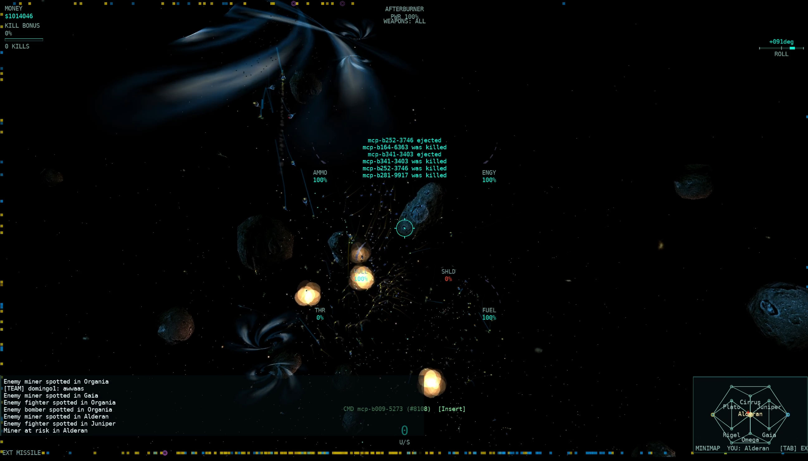

# AllegianceCore



**AllegianceCore** is a from-scratch C#/.NET 10 port of **Microsoft's
_Allegiance_** — the 2001 space-combat RTS/team shooter Microsoft released as
open source (MIT, July 2017). It reproduces the game's simulation, wire
protocol and data formats in modern C#, with no Windows/DirectX/COM machinery
to lean on.

Today it ships a **playable MonoGame client** (Windows, Linux, macOS Apple
silicon and Android), **offline single player** (Skirmish, the native training
missions, spectating), a **dedicated TCP server**, a **lobby**, **autonomous
bots** and an **MCP bot driver**. Everything is cross-checked against the
445k-line native C++ source (`src/`) for byte-exact fidelity.

## What works today

**Playing**

- **Single player, offline**: Skirmish against bot teams (both races, size,
  technology, difficulty, game speed Normal/Fast/Showcase), with an AI
  commander or **you** as commander. **Start as spectator** watches the whole
  battle (free camera, ship/station orbit, "hottest fight" follow) and lets you
  drop in. Pause with Ctrl+P.
- **Training**: the native training set runs offline on an embedded host:
  Basic Flight, Basic Weaponry, Enemy Engagement, Command View, Practice Arena,
  Nanite and the Free Flight dev mission. Mission 1's slideshow isn't ported yet.
- **Multiplayer**: lobby server discovery (sort/find), ready check and
  briefing, scoreboard and pilot info. After game over a scoreboard
  intermission runs, then the next match starts automatically.
- **Multiplayer**: lobby server discovery (sort/find), ready check and
  briefing, scoreboard and pilot info. After game over a scoreboard
  intermission runs, then the next match starts automatically.
- **Showcase**: the intro's Showcase entry launches big AI battles (Small
  5v5 up to Grand 200v200 at Showcase pacing) plus the fixed-seed settings
  tune (seed 729, 5v5, 150 s ×3) that suggests and applies graphics settings.
  Every match ends with a performance panel beside the game-over tables —
  fps/1 % low, frame-ms percentiles, time dilation, ships in view and the
  one-number Showcase score (ranked only for the fixed tune) — with an
  optional settings Apply. Sharing results is opt-in and anonymous.

**Client**

- Flies, fights, docks, mines, warps and ripcords against a real server.
  Cameras: cockpit, chase, turret, missile and external.
- **Native HUD**: the original's radar contacts and icons, brackets, target
  pane with a live 3-D model preview, own-ship gauges, equipment pane, flight
  indicators, console text, chat, warnings and damage flash. Fonts and anchors
  follow the native layout. A **Modern HUD** skin offers scaling (75–150 %) and
  a colour-blind safe palette.
- Command view, minimap and starmap, order/command icons, investment,
  loadout and teleport panes, quick chat, and native UI and simulation sounds.
- **Visuals**: volumetric explosions, bloom and flash lighting, an effects
  quality setting, and an optional HD sky pack. Native asteroid models, aleph exit wobble, the ripcord spark
  ramp.
- Keyboard, mouse, joystick and gamepad, all rebindable (F6). F1 shows every key.
- Crash-safe: a rolling log plus a crash log on every run, and missing
  optional art never takes the game down.

**Server and simulation**

- Boots a real core, runs missions and ticks the full simulation: economy and
  research, mining, construction (constructors build on real rock sizes),
  docking, shields, combat, missiles, chaff, mines, probes, cloak, friendly
  fire, ejection, lifepods and rescue probes. Also aleph warps with the native
  trigger cone, ripcord, and the finale/last-base endgame.
- Scales to **200v200**: the native prioritised ship-update budget, a pooled
  transport, parallel per-player update builds, and EVE-style **time
  dilation** under load. See *Recommended settings* below.
- **Wire protocol**: the FEDMSG framing and game messages are reproduced
  round-trip and byte-exact against the native reference. Port-only messages
  are being retired in favour of native ones.

**Bots**

- Headless bots fly real missions through `tools/allegiance-mcp`, an MCP
  server that spawns scenarios, arenas and full showcase matches.
- A research commander picks tech and issues attack and repair orders. Bots
  run strike waves on the softest enemy station with defend escorts, plus
  cloak, nanite repair support, chaff/probes/mines, ammo trips and
  medevac/rescue-probe drops. Skirmish uses the same bots.

**Verified against native**

- Every ported rule cites the original C++ `file:line`. The corpus-backed
  suite parses 210 real `.igc` maps exactly. The fast test tier alone runs
  ~10,000 tests, and CI builds every tool project and the player bundles.

See **[`docs/GUIDE.md`](docs/GUIDE.md)** for the full guide: prerequisites,
getting the original art, building/running everything, client flags, testing,
architecture, and troubleshooting.

## Download and play

Download the Windows x64 setup `.exe`, Linux x64 AppImage, or a portable bundle from
[GitHub Releases](https://github.com/dominusbelial/AllegianceCore-public/releases).
Windows setup installs per-user by default; Linux users can make the AppImage
executable and run it. Portable `.tar.gz` (Linux) and `.zip` (Windows) downloads
remain available: extract the whole folder and run `allegiance.sh` or `play.bat`.
On macOS Apple silicon (macOS 14+), open the ZIP and drag the `.app` to Applications.
Every format includes .NET, native artwork and sky; no SDK, git or `local.env`
is needed. Start without arguments for the intro screen; Single Player → Skirmish
works offline. See the included `README-PLAYERS.txt` for installation, unsigned
SmartScreen/Gatekeeper steps and multiplayer configuration. F1 shows help; F6
rebinds keys. Verify downloads against the release's `SHA256SUMS.txt`.

The first public release, **v0.1.0**, is out. For local packaging and the release checklist, see
[`packaging/README.md`](packaging/README.md).

## Quick start

Prerequisites: the **.NET SDK 10.0.400** (CI pins this exact version) and a
clone of the **original game art**.

```bash
# 1. Set up the .NET SDK (adjust to your install)
export DOTNET_ROOT="$HOME/.dotnet"
export PATH="$DOTNET_ROOT:$PATH"
dotnet --version        # must print 10.0.400

# 2. Get the original art (not included in this repo), plus the optional sky pack
git clone https://github.com/FreeAllegiance/Artwork ../Artwork
git clone https://github.com/dominusbelial/AllegianceCore-sky ../AllegianceCore-sky   # HD stars, nebulae, galaxies

# 3. Copy the local config template and point it at both (absolute paths;
#    UNCOMMENT the lines — remove the leading '#')
cp local.env.example local.env
#    ALLEGIANCE_ARTWORK_PATH=/absolute/path/to/Artwork
#    ALLEGIANCE_SKY_PACK_PATH=/absolute/path/to/AllegianceCore-sky

# 4. Build
dotnet build AllegianceCore.slnx

# 5. Create a server config and point artPath at your Artwork checkout
cp src/Allegiance.Server/server.example.json src/Allegiance.Server/server.json
#    edit server.json: "artPath" -> your Artwork path (and pick a games[] map)

# 6. Run the server
dotnet run --project src/Allegiance.Server -- --config src/Allegiance.Server/server.json

# 7. Run the client, pointing at the server
dotnet run --project src/Allegiance.ClientCore.MonoGame -- 127.0.0.1 6073 "My Pilot"
```

For **offline single player**, after the whole-solution build and artwork setup,
run the client without host/port arguments and choose **Single Player → Skirmish**.
The client owns the local server and bot driver. Select both races, size,
technology and difficulty; **Ctrl+P** pauses/resumes and **Ctrl+F10** ends the game.
A downloaded player bundle includes everything needed for this mode.

**What you should see:** the client logs on and opens the **READY CHECK** screen. Pick a
team, press **Y** to ready up — a game starts once every team with a player in it is ready,
so alone you start right away — and after a 15 s countdown you launch into space.
After game over, connected players enter the next match automatically: a default
30-second scoreboard intermission, then the normal 15-second briefing. See
[automatic next-match configuration](docs/NEXT_MATCH.md) to change or disable it.
Both timers follow simulation time under dilation.
**F1** shows every key; **F6** rebinds them. If the log says
`HD sky asset '…' unavailable`, the sky pack path isn't set (step 3).

The client and server need the art to render/run; `local.env` keys mirror the
`ALLEGIANCE_ARTWORK_PATH` / `ALLEGIANCE_SKY_PACK_PATH` / `ALLEGIANCE_NATIVE_SRC_PATH`
environment variables (`local.env` is gitignored — never commit machine paths). The sky
pack is optional: without it the client runs with a plainer sky and logs
`HD sky asset '…' unavailable` once per missing layer.

## Recommended settings (what we run for 200v200 tests)

This is the configuration we use for our 195v195 "march" battles (two full fleets
travelling the map and meeting at Alderan, with the economy running). It's tuned for
big battles on a LAN; a small game runs fine on the defaults.

**Server** — add these to your `server.json` (use the `m2xspiderw.igc` map for the
showcase battles below):

```json
"broadcast":    { "parallelBuild": true, "shipUpdateModel": "native" },
"transport":    { "mode": "pool", "maxConnections": 2048, "maxConnectionsPerIp": 1024 },
"liveSettings": { "timeDilation": "auto" }
```

…or set them per run with environment variables (same effect, no file edits):

```bash
ALLEGIANCE_BROADCAST_PARALLEL_BUILD=1 \
ALLEGIANCE_SHIP_UPDATE_MODEL=native \
ALLEGIANCE_TRANSPORT_MODE=pool \
ALLEGIANCE_TRANSPORT_MAX_CONNECTIONS=2048 \
ALLEGIANCE_TRANSPORT_MAX_PER_IP=1024 \
dotnet run -c Release --project src/Allegiance.Server -- --config src/Allegiance.Server/server.json
```

- `parallelBuild` builds each player's updates in parallel (byte-identical output).
- `shipUpdateModel: native` uses the original game's prioritised ship-update budget —
  roughly a fifth of the bandwidth of `port` at 400 players, and what keeps bot hosts
  responsive in big battles.
- `transport: pool` serves all connections from a small worker pool.
- `maxConnectionsPerIp` (default 64) is raised to 1024 for the big battles because
  the ~390 bots all originate from ONE Mac bot host — the default per-IP ceiling is a
  sane limit for a public server but would refuse the rig.
- Server GC is on by default.
- `timeDilation: auto` (the default) is EVE-style slow motion under load: when one crowded
  sector makes ticks run long, the game slows slightly instead of stuttering. In our 200v200
  tests it kept every tick under 150 ms with no disconnects, at about 0.92× speed on
  average (0.73× at the heaviest moment). Set `"off"` to disable.

Inbound decoding can also run on the existing receive workers with
`"receive": { "decouple": true }` or `ALLEGIANCE_RECEIVE_DECOUPLE=1` (default off;
the environment overrides config). Commands still apply at tick boundaries in
peer-id/arrival order, with bounded fair carry-over. For diagnosis, add
`"measure": true` to that section: `[inbound]` reports each tick's message
counts/bytes by fmid and peer, and `[inbound-window]` retains a 100-tick histogram
including drain time. These detailed logs are opt-in. See the
[P673 report](docs/reports/P673_RECEIVE_DECOUPLE.md) for local A/B evidence.

**Client** — always a Release build; join *before* bots spawn so you see the whole battle:

```bash
dotnet run -c Release --project src/Allegiance.ClientCore.MonoGame -- <server-ip> 6073 "My Pilot" --window 2560x1440
```

In game: **F1** shows the live key bindings, **F6** opens Controls to rebind keys.

**Bots (optional)** — `tools/allegiance-mcp` is an MCP server that drives real bot
clients. A 200v200 is one tool call:

```json
{ "tool": "spawn_scenario",
  "args": { "preset": "showcase", "target_sector": "Alderan", "size_scale": 13, "mode": "march" } }
```

`size_scale` 13 ≈ 195 per side; `mode: "march"` launches each side at home and sends
wings through different alephs, `"arena"` spawns both fleets directly in Alderan for an
instant clash. ~390 bots are a heavy load: run the bot tool on its own wired machine,
not on the server or the machine you play on.

## More

- **[Sky pack](https://github.com/dominusbelial/AllegianceCore-sky)** — optional HD sky art (star field,
  nebulae, deep-field galaxies, distant and giant sky objects; NASA/ESA/Hubble/Webb imagery,
  credited). Clone it and set `ALLEGIANCE_SKY_PACK_PATH` (see Quick start).
- **[Full guide](docs/GUIDE.md)** — everything: art paths, Docker, the Android
  head, client flags, testing, architecture, troubleshooting.
- **[Contributing](CONTRIBUTING.md)** — build/test steps, the native-reference
  rule, coding conventions, PR checklist.
- **[Security](SECURITY.md)** — reporting and the server's known non-hardened
  areas (it is a LAN/demo-grade server).
- **[Licence](LICENSE)** — MIT. Original-game logic derived from Microsoft's
  Allegiance (MIT); see **[`NOTICE`](NOTICE)** for the required attribution.
- **[Credits](CREDITS.md)** — third-party imagery and effect art attributions.

Optional art packs (e.g. alternative ship models) are **not** included in this
repository; see the full guide for how to add one.
