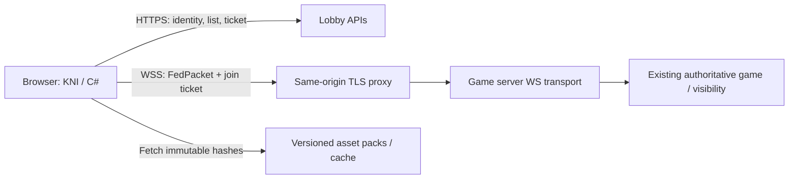

# P1045 — Browser client feasibility study

Date: 2026-11-16. Source baseline: `497e3507`. Completed local investigation. All experiments used loopback; internet access was limited to package registries and documentation. No production service was contacted. No commits or pushes were made.

## Decision

**Yes, a lobby URL can launch a browser version of this C# client, but it needs a separate browser target and platform work.** Recommend KNI/Blazor now, preserving Core/ClientCore and recompiling the shared game sources. The two local spikes prove real MDL rendering in WASM and a real client session through a WebSocket bridge. They do not establish a playable browser Game1 or 200v200 performance.

Ship a clearly labelled browser preview first, then a hardened direct WebSocket server transport and a small playable slice. Keep the desktop build as it is. Do not publish the throwaway gateway: source provenance, privilege handling and bounds need deliberate integration. The biggest concrete traps found were synchronous assets/session threads, KNI API/effect differences, the existing 120-request lobby limiter applying to static files, and the size of the desktop artwork pack.

## Current code and portability boundary

The desktop head references MonoGame DesktopGL 3.8.5.1 and its content builder (`src/Allegiance.ClientCore.MonoGame/Allegiance.ClientCore.MonoGame.csproj:25`); the shared game library compiles against the same package with `PrivateAssets=All`, plus NVorbis 0.10.4 and ClientCore/SinglePlayer/Update (`src/Allegiance.ClientCore.Game/Allegiance.ClientCore.Game.csproj:27`, `:30`, `:34`). Android already supplies a net10.0-android head (`src/Allegiance.ClientCore.Android/Allegiance.ClientCore.Android.csproj:30`), references the shared Game library (`:74`), and supplies packed assets and pause/resume handling (`src/Allegiance.ClientCore.Android/MainActivity.cs:142`, `:149`, `:155`), while retaining MonoGame's framework assembly identity. KNI uses matching namespaces in separate assemblies: the browser needs a **recompiled variant** of shared game sources, not the already-built desktop game DLL.

| Boundary | Existing implementation | Browser action |
|---|---|---|
| Assets | `Assets/IAssetSource.cs:19` exposes synchronous `Exists`, `OpenRead`, `Enumerate`; `DirectoryAssetSource.cs:25` opens physical files; `AssetSources.cs:55` copies to bytes | Async manifest/fetch/cache stage; hand a memory-backed asset source only files already resident. Pause the relevant loading state rather than fetching synchronously during Draw. |
| Parser | `src/Allegiance.Core/Data/MdlFile.cs:138` accepts bytes; `src/Allegiance.Core/Data/MdlTextureDecoder.cs:51` decodes RGB565 without graphics dependencies | Reused unchanged in the running WASM spike. |
| Session | `src/Allegiance.ClientCore/Session/ConnectionSession.cs:64` immediately starts keepalive; `:483` starts a Thread; `ConnectionSession.Ownership.cs:32` uses Task.Run | Async ownership/cancellation, scheduled keepalive and bounded message draining on the browser event loop. |
| Transport | `src/Allegiance.Core/Transport/ITransport.cs:16` / `IServerTransport.cs:6` own bytes, callbacks, queues, lifecycle and accounting | Add browser transport injection and an endpoint URI. The current host/ushort-port signature and hardcoded protocol selection need extension. |
| Discovery | `Game/Discovery/DiscoveryEngine.cs:36` owns UDP, `:110` collects LAN replies; `NetworkLink.cs:7` is adapter classification, with a raw socket at `:44` | Browser game list comes from lobby HTTP. Omit LAN scan and adapter-based TCP/UDP auto-detection. |
| Offline host | `src/Allegiance.SinglePlayer/SkirmishHost.cs:77` starts a sim thread and `:119` starts a bot process | Exclude embedded server/process hosting from initial browser product. |
| Effects | `Game/Rendering/ShaderAssetCache.cs:41` loads MonoGame effect bytes; `VfxPostProcessor.cs:75` names `.ogl.mgfxo`; `HdrOutput.cs:92` selects RGBA16F | Recompile effects through KNI's content pipeline, validate WebGL formats/extensions, initially select LDR. |

Additional OS touchpoints are profile files in `PlayerConfig.cs:11` / `IntroPreferences.cs:119`, saved-password file permissions and Windows DPAPI in `SavedGamePasswords.cs:177` / `:239`, browser launch through Process in `Game1.Identity.cs:63`, raw SDL pointer capture in `Flight/RelativeMouse.cs:107` and native GL symbol loading in `Diagnostics/GlFrameTimer.cs:53`. The browser head needs storage/navigation/input/diagnostic adapters, not emulated desktop paths. `Game1.Career.cs:263` synchronously waits on a remote description save and must become async. Source search found no direct clipboard API usage in Game/ClientCore. NVorbis decoding is managed, while audio-device and browser user-gesture semantics still differ.

Throughout this report, `Game/` and its asset/rendering subpaths refer to `src/Allegiance.ClientCore.Game/`. Unqualified filenames refer to their named subsystem; [the re-grepped source index](BROWSER_CLIENT_P1045_assets/source-citations.txt) resolves every citation to its full repository/native path. These are study findings, not implemented platform changes.

The compile-only compatibility probe first stops at the `OnDeactivated`/`OnExiting` API differences (`Game1.RelativeMouse.cs:31`, `:38`). After adapting only those hooks in a scratch copy, it reports 23 errors: audio initialization, named texture constructor argument, glyph access in both HUD renderers, System.Numerics vector conversion, manual Model/Mesh/Bone construction, window positioning and proof-only text input. This is evidence of bounded source differences, **not** proof that fixing 23 errors makes the game run. Runtime and shader/asset changes remain.

## Engine options

Versions checked on 2026-11-16, separately from the repository's pins. Effort is an engineering estimate for this codebase, not a vendor compatibility promise.

| Option | Current public status / licence | Reuse and breakage here | Recommendation |
|---|---|---|---|
| **A. KNI 4.3.9001** | Released 2026-08-22; NuGet browser backend plus Blazor template. Microsoft Public License, with component exceptions. | Recompile C# game/renderers against KNI assemblies; share Core/ClientCore source. Parser + textured BasicEffect already run in this study. Rebuild `.fx` for KNI/WebGL; desktop `.mgfxo` is not a supported portable input. Probe RT depth/float formats, audio voice/streaming semantics, input/focus, fonts and manual Models. Moderate-to-large platform port. | **Use for the first browser target now.** |
| **B. MonoGame upstream** | Repo pin 3.8.5.1; latest DesktopGL NuGet is **3.8.6.1**. Official 3.8.6 announcement places new WebGL2 target in **3.8.7**, with a published demo already mentioned. Ms-PL plus third-party notices. | Best long-term API alignment. Released desktop backend does not turn our Game1 into a browser build. Async I/O, transport, input and shader work remain even if upstream ships. | Re-evaluate at a supported WebGL2 release; do not make the first slice depend on a promised date. |
| **C. FNA + SDL/Emscripten** | FNA **26.11** released Nov 1. Desktop-focused XNA implementation, Ms-PL with exceptions. Maintainer discussion confirms fnalibs WASM work merged; examples still describe FNA/interop patches and separate WASM builds. | Potential C# API reuse, but native SDL/FNA3D/FAudio need WASM builds, P/Invoke integration and shader tooling. It is not enough to compile SDL with Emscripten; the managed runtime and browser loop also need integration. Same raw socket and asset restrictions. Largest runtime/toolchain ownership risk. | Keep as contingency, not the first lane. |
| **D. TypeScript + Three.js** | Three.js **r187 / npm 0.187.0**, MIT; TypeScript **7.0.2** is current on npm, Apache-2.0. | Excellent browser-native loading/input and small shell. Can preconvert MDL to GLB using existing tooling. Existing C# prediction, wire handlers, HUD modes, shop, training and game rules would need a binding layer or a rewrite, increasing parity risk. Browser audio and HDR still require explicit design. | Suitable viewer/spectator, comparison only for a playable port. |

Primary sources: [KNI package](https://www.nuget.org/packages/nkast.Kni.Platform.Blazor.GL/4.3.9001), [KNI README/licence](https://github.com/kniEngine/kni/blob/main/README.md), [KNI changelog](https://github.com/kniEngine/kni/blob/main/CHANGELOG.md); [MonoGame latest package](https://www.nuget.org/packages/MonoGame.Framework.DesktopGL), [official release announcement](https://monogame.net/blog/2026-10-26-3.8.6-release-2026/); [FNA 26.11 releases](https://github.com/FNA-XNA/FNA/releases), [FNA README](https://github.com/FNA-XNA/FNA), [WASM maintainer discussion](https://github.com/FNA-XNA/FNA/issues/578); [Three.js release link](https://threejs.org/), [Three.js licence](https://github.com/mrdoob/three.js/blob/dev/LICENSE), [TypeScript package metadata](https://www.npmjs.com/package/typescript), [TypeScript licence](https://github.com/microsoft/TypeScript/blob/main/LICENSE.txt).

The KNI template package defaults to net8.0 even though it includes a net10.0 package group. The spike explicitly targets net10.0, KNI 4.3.9001, nkast.Wasm packages 10.0.3 and Microsoft.AspNetCore.Components.WebAssembly 10.0.10. It does not require a framework source fork.

HDR is a separate capability tier. The spike uses WebGL **1.0**, LDR, depth testing and KNI's built-in BasicEffect; it did not validate P984, custom PBR, bloom, linear depth, soft particles, FSR, float target filtering or multiple targets. A browser renderer must probe renderability/filterability, not infer support from a matching SurfaceFormat enum. Ship an LDR baseline and enable each extra effect only after compilation and a real-browser render test. Rebuild fonts/content too; switching framework packages does not certify every existing XNB reader. NVorbis is managed, but device initialization, DynamicSoundEffect streaming, spatial voices and user-gesture audio activation need browser tests.

## Networking and security

Browsers do not expose the raw UDP/TCP transports used here. Ordinary WASM cannot unlock those APIs. `ITransport` is the insertion point, not `NetworkLink`: `TransportFactory.cs:6` currently accepts only tcp/udp, while `ConnectionSession.Ownership.cs:150` already has an internal test factory used by the spike. A future production factory must accept a validated endpoint URI and expose the resolved protocol honestly (`ConnectionSession.cs:31` currently labels any non-UDP transport tcp).

| Path | Fit and changes | Decision |
|---|---|---|
| WSS gateway on lobby host → existing TCP game port | Lowest experimental effort; preserves FedPacket and all server dispatch. One upstream connection per player. Extra hop and two ordered buffers; source-IP collapse and loopback trust must be solved before public use. | Useful local bridge; prefer an isolated gateway process if used, never route arbitrary browser-supplied host/port. |
| WSS endpoint beside game server | Implement `IServerTransport`, combine with existing peer-ID routing, expose via HTTPS reverse proxy. Reuses host ingress validation and server-owned coalescing. Removes TCP conversion and source-provenance ambiguity. | Preferred public playable transport, reached through same-origin lobby proxy routes. |
| WebTransport listener | QUIC datagrams for latest ship poses; reliable streams for lifecycle/orders, with application sequence/epoch rules. Requires HTTP/3, endpoint/server support, JS interop and fallback. | Follow-up latency experiment, not a requirement for Phase 1. |
| WebRTC data channels | Unordered/unreliable state plus reliable control channels possible; requires DTLS/SCTP/ICE, signaling and sometimes TURN. Lobby punch signaling alone does not provide this stack. | Higher operational effort; no advantage for initial dedicated-server join. |

WebSocket has ordered reliable delivery: loss stalls later combat poses behind earlier bytes. Coalescing can replace an **unsent** pose, never bytes already sent into TCP/browser buffers. A priority queue cannot remove wire head-of-line blocking. WebTransport datagrams can avoid retransmitting old poses, but lifecycle dependencies, cookie epochs and disconnect behavior still need application design. MDN now describes WebTransport as Baseline 2026 (with older-client/feature caveats), so do not repeat the outdated blanket claim that Firefox has no support. [WebSocket API](https://developer.mozilla.org/en-US/docs/Web/API/WebSocket), [WebTransport API](https://developer.mozilla.org/en-US/docs/Web/API/WebTransport), [RTCDataChannel API](https://developer.mozilla.org/en-US/docs/Web/API/RTCDataChannel).

Proposed game framing: negotiate `allegiance-fed-v1`; one binary WS message carries one full FedPacket, CRC included. Reassemble fragmented WS frames to a capped message **before** invoking the existing packet decoder; never treat an individual ReceiveAsync fragment as a complete packet. Keep send queues bounded by bytes **and** entries, preserve zero-key order, and implement the two keyed latest-wins APIs in `ITransport.cs:78`/`:93`. The transport callback ordering remains peer-joined before receive (`:105`). Drain decoded input fairly at tick boundaries; neither HTTP receive tasks nor a new callback may mutate simulation directly.

The throwaway bridge includes a type-byte greeting to map to the existing TCP greeting. A direct public WS transport should obtain its name from authenticated session state and feed ordinary LOGONREQ; it does not need to copy that greeting protocol.

### Public admission and the R1/R1b boundary

A raw TCP bridge is **not safe to publish**. `Server.Privileges.cs:11` trusts transport loopback when a privilege secret is absent, and `Server.CredentialLimits.cs:79` currently knows source addresses through concrete TCP/UDP/DualTransport cases. A public gateway would collapse all source addresses into one loopback identity, potentially granting enabled local-only roles and sharing lockout buckets. A directly implemented WS server transport must report the authenticated external source, never treat proxied users as local, and carry source/address accounting through a general interface. If the bridge is retained, add a mutually authenticated, non-public upstream admission/provenance channel; never trust a browser-provided forwarded header or role bit. Keep test harness, debug mode, secrets and bot/admin credentials out of the browser build and public server config.

The server currently publishes as Native AOT (`Allegiance.Server.csproj:12`) into a runtime-deps image (`src/Allegiance.Server/Dockerfile:85`). An embedded Kestrel listener adds hosting dependencies and needs a real AOT publish/trim check; the scratch Web-SDK JIT bridge does not prove that packaging. A separate authenticated gateway is an alternative if embedding fails the shipping constraints, but still requires server provenance changes.

The server seam is useful but needs deliberate integration: `Server.Lifecycle.cs:945` constructs TCP and `:972` constructs the two-way transport; `DualTransport.cs:9` reserves one high bit for UDP. A third listener needs a collision-free peer-ID multiplexer, lifecycle/close routing, per-peer human/loopback/source facts and telemetry. Audit concrete casts in `Server.Egress.cs:57`, `Server.SchedulingMetrics.cs:16` and credential limits. Generalize these seams before adding a third enum string.

Proposed public limits, starting with the existing inbound rules and tuning only with evidence:

- Reject non-allowlisted Origin, non-binary game messages and unknown subprotocol/version; use TLS, same-origin session/admission checks and per-IP/account/global connection and handshake-attempt caps. A finite upgrade request is not a lifetime message rate limiter.
- Cap a reassembled client FedPacket at the existing **64 KiB** server inbound cap (`TcpTransport.cs:171`), with a smaller initial authentication envelope, absolute handshake/auth deadline and fragment-progress deadline. Limit fragments and cumulative bytes even when the peer never sets EndOfMessage. Retain native packet CRC, cbmsg bounds and message-count checks (`Wire/FedPacket.cs:101`). CRC detects framing/corruption; it is not authentication.
- Reuse ingress event/byte reservations and per-tick fairness (`ServerHost.cs:137`, `:162`, `:2322`). Cap outbound queue entries/bytes/oldest guaranteed age; coalesce pending state and disconnect a chronically stalled receiver. Validate legitimate maximum join bursts before reducing the outbound cap. Browser bufferedAmount and our own queue caps are both needed because the browser WS API does not provide receive backpressure.
- Preserve wrong-password/credential throttles, including per-source grouping; absolute greeting deadlines (`TcpTransport.cs:845`), pre-logon retirement, malformed-input isolation and bounded logs. Keep commands tied to the connection's authenticated ship and mission. Do not turn a packet relay into an admin API.
- Retain R1's relay budgets, side-departure transitions, reconnect seat ownership, callsign rules, lobby creation expiry, bounded chat mute/channel state and safe aggregate counters. The HTTP/static work must not weaken the trusted-proxy, 16 KiB API-body, CSRF/Origin or rate policies.
- Retain R1b's squad membership/leadership, seen-only treasure export (`Server.Treasure.cs:29`, `:56`), observer boarding permission (`Server.Docking.cs:127`), recursive crew movement and reset cookies (`:1677`, `:2473`), fire/mount/cooldown/lock enforcement (`Server.ShipCommands.cs:915`), and constructor fog-of-war/anti-oracle behavior (`:2495`). Follow the **current native-aligned command permissions**, not every original audit's suggested gate.

[R1 review](R1_REPORT.md) and [R1b review](R1B_CARBON_REPORT.md) are historical findings, not a claim that the present tree still has every listed flaw. The new entry point must run their relevant regression suites plus new WS fragmentation, close-during-auth, bad ticket/replay, origin, flooding, slow consumer and proxy-provenance tests. The spike verifies the happy path only.

`tools/vizfight/Program.cs:319` is useful prior art for Kestrel upgrades, single-writer per-socket tasks, cancellation and a late-join seeder. **Do not copy its unbounded channel** (`:332`), whole-world JSON snapshots (`:357`) or receiver that discards all browser input (`:414`). A game gateway must have bounded per-peer queues, two-way binary input, authoritative server visibility and no spectator-wide catch-up data. Shared catch-up snapshots can leak unseen enemies between sides.

## Lobby entry and identity

Serve the launch HTML and initial runtime under the lobby's origin, e.g. `/play/`, with versioned files under `/play/builds/<hash>/`. Keep the login/API origin on the lobby. Put bulk immutable artwork behind a CDN later, using a same-origin reverse-proxy URL if possible. A CDN is an optimization for cacheable bytes, not a place for session cookies, identity responses or game state.

### Existing traffic

| Flow | Already HTTP? | Browser consequence |
|---|---|---|
| Server list/detail/core catalog/find player/update metadata | Yes: `LobbyEndpoints.cs:88`, `:95`, `:110`, `:131` | Fetch from same origin, omit UDP probing. Update metadata becomes a browser build/version prompt rather than a native executable installer. |
| Passkey/provider sign-in, device authorization, join ticket | Yes: `Identity/IdentityEndpoints.cs:40`, `:47`, `:64`, `:75` | Reuse browser passkeys/provider redirect. Device-code flow is for a separate native client and need not be shown inside this same-origin page. |
| Directory chat and career, squads, events, game-creation catalog | Yes: `Chat/ChatEndpoints.cs:30`, `:42`; `Career/CareerEndpoints.cs:44`, `:51`; `Squad/SquadEndpoints.cs:26`; `Events/EventEndpoints.cs:26`; `Games/GameEndpoints.cs:45` | Reuse HTTP contracts and auth rules. Game chat and live flight still use FedMessages. Creation requests ask a server to host; they do not give a browser raw listener sockets. |
| Punch introduction | Signaling is HTTP (`PunchSignaling.cs:53`, `:55`, `:66`), actual STUN/probes and game connection are UDP | Do not confuse signaling with a browser-playable transport. Hide NAT traversal, LAN discovery and client-hosted games lacking a configured web route. The desktop `src/Allegiance.Core/Transport/NatTraversalClient.cs:17` also uses a socket-based HTTP handler; reuse the HTTP contracts through browser HttpClient/fetch, not that handler. |
| Game logon, exports, ship/input updates | TCP or UDP, not HTTP today (`Server.Lifecycle.cs:945`, `:972`) | Requires the new WS transport/gateway. A public listing alone is insufficient. |

All lobby paths in this table are under `src/Allegiance.Lobby/`. CORS middleware is absent from `Program.cs`; existing web pages use same-origin fetch. This is a useful default, not a missing wildcard to add.

This is the proposed shipping path. The local network spike used WS → TCP conversion in place of the server WS transport.

### Login → list → join

1. User opens `/play/`; lightweight HTML checks WebAssembly/WebGL before downloading the bundle and offers an explicit **Start** action. After loading, a fresh **Enter flight** gesture activates audio/fullscreen/pointer capture; do not assume a user gesture survives an async download.
2. Fetch `/api/identity/me`; if needed use the lobby's passkey/provider screen. The existing cookie is HttpOnly, Secure for HTTPS and SameSite=Strict (`IdentityEndpoints.cs:14`). WASM need not read it; same-origin browser fetch supplies it. Do not copy a long-lived lobby bearer into localStorage or a URL.
3. Fetch `/api/servers`, display games with an explicitly advertised `webJoin` route/capability. Keep native-only servers visible with a clear compatibility label or filter. Use the native mission cookie from the selected game and verify core/version metadata.
4. Stage the chosen game's minimal art/core pack. Obtain `/api/identity/join-token` **after** loading, so asset downloads do not expire the short ticket. The endpoint already checks login and a verified identity server ID (`IdentityEndpoints.cs:75`).
5. Open same-origin `wss` route to the selected server; send the ticket in the initial authenticated exchange / ordinary LOGONREQ.ZoneTicket, in memory. Browser WebSocket constructors cannot set arbitrary Authorization headers; do not design around the desktop ClientWebSocket header API. A gateway needs a separately scoped short-lived, one-use admission capability or same-origin cookie+strict Origin check before opening upstream. It must not consume the game's join-token JTI and then forward that already-consumed ticket.
6. Game server still validates signature, issuer, audience, time and single use, then binds canonical callsign/squad claims (`Server.Identity.cs:91`, `:114`, `JoinTokens.cs:148`). Select side, ready, launch and prediction use the existing protocol. Retry after a failed join with a fresh ticket; do not silently reuse a consumed token.

Use HTTPS for identity and `wss` for game traffic; HTTP/`ws` is only the loopback development exception. `LobbyIdentityClient.cs:20`, `CareerApiClient.cs:22` and `IdentitySettings.cs:18` already encode that TLS policy. Set `Identity.PublicUrl` to the externally served origin through the trusted proxy configuration so Origin checks, passkey relying-party configuration and Secure cookies agree.

### Hosting details and a rate-limit trap

`Program.cs:102` serves ordinary static files, but it has no browser framework-file mapping, precompressed-content negotiation or browser build fallback. Add these only below `/play/`; serve `.wasm` as `application/wasm`, resolve base paths and `_content` correctly, and never route `/api` failures to index.html. Use prebuilt Brotli/gzip over TLS with correct Content-Encoding, Content-Type and Vary: Accept-Encoding, avoiding double compression. Cache fingerprinted runtime/art files `public,max-age=31536000,immutable`; revalidate launch HTML/manifest, and use `no-store` for identity/admission/ticket responses. Publish build directories atomically and retain an old generation while tabs still use it. [Microsoft deployment guidance](https://learn.microsoft.com/en-us/aspnet/core/blazor/host-and-deploy/webassembly/?view=aspnetcore-10.0).

**Do not just copy the bundle into current wwwroot.** The lobby's global limiter is 120 requests/IP/minute (`RateLimiting.cs:51`) and runs before static files. This tiny spike made 90 HTTP requests on a cold load; two players behind one address can already exhaust that budget before artwork. Serve immutable `/play/builds` and `/play/assets` outside the API limiter or at the reverse proxy/CDN, with separate bandwidth/connection controls. Preserve existing limits for `/api`, and make WS admission limits separate from message limits.

Keep the current CSP/security headers (`Program.cs:88`) for lobby pages. Under `/play/` only, add the narrow `script-src 'self' 'wasm-unsafe-eval'` allowance needed for WASM compilation and self-host external bootstrap scripts instead of the spike's inline script. Specify same-origin `connect-src` (or a short configured WSS allowlist), and only necessary image/media/blob/worker sources. Test KNI's script paths under that policy; do not disable web security. Explicit Origin allowlists protect WS upgrades: HTTP CORS alone does not enforce WebSocket origins. [ASP.NET WebSocket security guidance](https://learn.microsoft.com/en-us/aspnet/core/fundamentals/websockets?view=aspnetcore-10.0). If a separate CDN origin is introduced, allow only that origin for assets, handle MIME/CORP/CORS correctly, and do not send cookies to it.

Do not enable WASM threads for the first target. If a later measured workload warrants them, scope COOP=same-origin and COEP=require-corp to the browser game; require crossOriginIsolated and compatible CORS/CORP on every dependent asset. Test provider login/redirect and popup behavior under opener isolation before changing headers on the entire lobby.

## Artwork and licensing

Measured this read-only corpus at **6,785 files / 2,079,831,261 bytes (1.94 GiB)** excluding `.git`, rather than assuming the brief's approximate 2.5 GB. The existing reviewed desktop manifest contains **3,305 present files / 1,193,491,163 bytes (1.11 GiB)**. It is a conservative all-mode dependency closure, not a browser first-load plan (`packaging/generate-manifest.py:1`, `:59`, `:81`). The old P498 session manifest is narrower but cannot prove all maps/research outcomes. Neither should be blindly precached by a service worker.

[Measured inventory with exact names, sizes and SHA-256](BROWSER_CLIENT_P1045_assets/artwork-inventory.json). MiB below is 1,048,576 bytes; gzip is measured per file at level 9, **not** a GPU texture or format-conversion result.

| Candidate category | Files | Raw MiB | Gzip MiB |
|---|---:|---:|---:|
| PCore001 + XXV_simple | 2 | 0.624 | 0.064 |
| Two-civ starter hull candidates + textures/CVH | 33 | 14.855 | 4.417 |
| Two civ home stations + textures/CVH | 7 | 0.927 | 0.303 |
| Ceto sky (subset of all-map sky) | 3 | 16.003 | 3.701 |
| All XXV_simple sky dependencies | 31 | 168.156 | 31.306 |
| Warp surfaces/icons | 2 | 2.001 | 0.352 |
| Native HUD candidate surfaces | 21 | 0.433 | 0.042 |
| Bundled font source TTFs | 3 | 1.728 | 0.894 |
| Existing desktop font XNB bakes, both densities + HUDs | 17 | 1.821 | 0.189 |
| Existing six VFX PNG atlases | 6 | 3.050 | 3.009 |
| Selected combat/UI Ogg sounds | 19 | 0.585 | 0.569 |
| Five existing rock source surfaces | 5 | 40.001 | 13.675 |

The starter candidates use PCore001 hull IDs **14, 15, 18, 33, 3, 114, 121, 131, 113, 107** (Dreghklar and Ga'Taraan scouts, fighters, stealth fighters, pods and miners), plus both civilizations' InitialStationTypeId. The inventory walks MDL namespace dependencies and texture-script image references. Ceto needs `globe3.mdl`, `environment3bmp.mdl`, `nebplnt45bmp.mdl`; the complete map adds eight other domes and many planet images. Native sky already chooses dome/environment from sector poster data (`Rendering/NativeSkyRenderer.cs:115`, `:293`, `:333`). The render spike instead uses the smaller `fig05` scout (178 KB with texture) and generated stars; it does not claim the whole starter pack was rendered.

These categories are a **measured planning sample**, not a certified minimal first-match closure: the HUD sample omits some style-specific panes/icons, font-source bytes and existing desktop bakes are alternatives rather than a tested KNI font pack, and not every purchased part, asteroid, station upgrade, treasure or rare sound is included. The five rock bitmaps alone are roughly 40 MiB raw, so reusing their full desktop source images would defeat a small bootstrap. The production manifest must record actual opens for login/hangar/launch/combat/warp/death in **Classic and Modern**, then union core-selected hull/part/effect dependencies and test missing assets explicitly.

Recommended delivery layers and budgets (targets, not measured completed bundles):

1. **First visible frame ≤8 MiB compressed:** runtime + one model + lightweight UI/fonts + generated sky. The measured render bundle's whole published payload is 3.85 MiB under per-file Brotli compression, giving some room for UI; actual game code will be larger.
2. **First join ≤20 MiB compressed:** chosen core/version, essential Classic and Modern UI bakes, own pod/scout/loadout, home base and common contact hulls, small shared rock/warp/effect atlas, basic sound cues. Defer high-resolution nebula/planet art, narration, music and researched/rare hulls. Use geometry stand-ins and loading states without altering collision or game rules. Measure this budget before calling the target playable.
3. **Match streaming:** prefetch discovered adjacent-sector scenery and publicly known hull/effect dependencies. An asset request is not authority or visibility information; do not send hidden enemy composition as a preload manifest. Have emergency geometric stand-ins and retry/cancellation when a newly sighted model is still loading.

Add content-hash manifests with compressed/uncompressed sizes, dependency lists, MIME and provenance. Fetch asynchronously into a bounded staging cache; use Cache API for immutable responses and IndexedDB for manifests/settings/residency metadata (or blobs if using one store consistently). Check quota, support cache eviction and partial-download recovery, deduplicate in-flight requests and promote files atomically after hash validation. A missing network asset must never block Draw. Canonicalize case in the manifest and reject ambiguous case-colliding files with different content before publishing. Evict decoded CPU buffers after GPU upload where safe and keep an explicit GPU-memory budget.

Prebake HUD/font atlases at required scales; retain licensed DejaVu rather than relying on Verdana being installed (`Rendering/NativeFonts.cs:15`). Convert large RGB565 sky/rock surfaces to capped resolutions and mip chains; evaluate KTX2/Basis transcoding to formats available on the actual GPU, with PNG/RGBA8 fallback. KNI compressed-texture support must be verified before selecting that path. PNG/WebP on the wire does not by itself reduce resident RGBA GPU bytes. Quantized meshes and prepacked metadata can reduce browser parse/upload cost, but keep MDL parsing as a reference/validation path.

### Rights and provenance

The corpus root has an MIT licence, copyright 2017 FreeAllegiance; the public upstream carries the same notice. That supports redistribution of covered artwork with the notice intact; it does not establish provenance for every later added image, font, third-party sky pack or voice. Include a per-pack attribution/provenance manifest and retain component-specific notices before public hosting. This report ships only reviewed screenshot pixels, the MIT notice and hashes/file lists, not the original model/texture binaries. [Artwork licence](https://github.com/FreeAllegiance/Artwork/blob/master/LICENSE), [included notice](BROWSER_CLIENT_P1045_assets/artwork-LICENSE.txt).

The six repository VFX atlases have CC0 notices in `Content/Vfx/licenses/`; bundled fonts carry `Content/Fonts/LICENSE-DejaVu.txt`. Review converted assets against their originals' licences; conversion is not a new grant. KNI, MonoGame and FNA require their own framework and third-party notices independently of the art licence.

## Runtime and threads

Use **single-threaded net10 WASM** first. The .NET 10 runtime documentation still calls `WasmEnableThreads` experimental and disabled by default; it requires a distinct runtime and COOP/COEP. Its JS interop/thread restrictions mean enabling that property is not a remedy for blocking the browser UI thread. [Version-pinned .NET 10 runtime guidance](https://github.com/dotnet/runtime/blob/release/10.0/src/mono/wasm/features.md).

Required rewrites and exclusions:

- Replace session Thread/ManualResetEvent waits and synchronous Connect/Shutdown wrappers with async operations and time-based keepalive on an event loop. Preserve the existing generation/owner cancellation invariant (`ConnectionSession.Ownership.cs:41`); schedule receive dispatch with a budget, and continue reconnect cleanup before publishing a replacement connection.
- Replace discovery's Task.Run around blocking UDP (`DiscoveryCoordinator.cs:134`) with lobby HTTP. Task.Run is not a promise of parallel execution on single-threaded WASM. Remove LAN probing from the browser UI.
- Stage core/MDL/texture bytes asynchronously, then call pure parsers. `TextCoreAssets.cs:18` currently creates a temp directory: prefer a binary-core browser pack initially and later add a stream-based text-core loader.
- Rewrite training narration decode and capture saves as explicit async tasks; avoid `GetResult` on incomplete work (`Audio/SoundManager.cs:1517`, `Capture/CapturePngSaver.cs:187`). Calls on an already-completed task can be safe; audit callsites instead of mechanically deleting all GetResult calls.
- Isolate skirmish/training hosts, native updater, native library diagnostics and filesystem profiles from the browser variant. Browser options persist through IndexedDB/local storage abstractions; replay import/export and screenshots use browser file selection/download APIs. Keep tokens out of persistent profile storage.

The spike is Release, managed-assembly trimming enabled, interpreted/Jiterpreter runtime (no AOT, no wasm-tools installed). The publish tool explicitly reported no runtime relinking. It proves the parser survives trimming; it does not prove all Game1 reflection/content readers do. Register KNI factories explicitly in a production head and preserve only required reader/JSON metadata. Full AOT can reduce CPU cost while increasing bundle size and build time; measure AOT and stripped IL variants on the same scene before choosing. [Microsoft AOT/IL trimming and relinking guidance](https://learn.microsoft.com/en-us/aspnet/core/blazor/performance/webassembly-runtime-performance?view=aspnetcore-10.0).

Managed GC still exists in WASM. Buffer pooling, bounded world-message queues and reusing draw/particle arrays matter; a GC pause shares the UI frame budget. Enforce an asset-residency budget that includes decoded pixels, GPU textures and temporary upload buffers, not only compressed download bytes. No full-client WASM heap/GC measurement was made here.

## Spike measurements

Both required spikes completed locally. The full Game1 browser port did **not** complete and was not claimed as a spike requirement. Source-only patches and all raw numeric evidence are under [the asset directory](BROWSER_CLIENT_P1045_assets/README.md). No source changes survive outside that report directory.

### Render: actual C# parser + KNI

Release net10, KNI 4.3.9001, managed trimming, no AOT/runtime relink. Browser: headless Chromium **153.0.8010.0**, installed entirely through npm (`@sparticuz/chromium` 153.0.0, Playwright 1.65.1); no OS packages or external browser downloads. WebGL 1.0 via **ANGLE/SwiftShader software rendering**. Cold browser profile/context per viewport, loopback HTTP with uncompressed files, OS file cache unflushed. Firefox is not installed and was not downloaded; no Firefox measurements are claimed.

The head fetches the original `fig05.mdl` (46,742 bytes) and `fig05bmp.mdl` (131,188 bytes), calls the existing `MdlFile.Parse(byte[])` and `MdlTextureDecoder.Decode(byte[])` in WASM, uploads 526 vertices / 453 triangles in two meshes and a 256×256 texture, draws with BasicEffect and a deterministic 280-star background. Both meshes share this texture; model animation/material-group/HUD parity is outside the sample.

| Viewport | CPU Game.Tick median / p95 / p99 | RAF interval median / p95 | Startup to first submitted draw |
|---|---|---|---|
| 1920×1080 | 1.00 / 1.40 / 1.90 ms | 16.70 / 16.70 ms | 402.4 ms |
| 800×480 | 0.80 / 1.50 / 2.20 ms | 16.70 / 16.70 ms | 410.9 ms |

Each sample is 600 frames after 60 warmup frames. CPU timing brackets JS→C# Game.Tick submission; it is **not GPU execution time**. RAF is display-paced and does not prove 1,000 FPS or hardware throughput. Startup is navigation-origin time to completion of the first managed draw submission, not a measured first presented pixel or a complete interactive client. No audio, pointer lock, HUD, live world, shaders or latency impairment is in this render benchmark. [Raw render metrics](BROWSER_CLIENT_P1045_assets/render-metrics.json).

I opened and inspected both final PNGs. The 1920×1080 image shows a large grey/olive, yellow-striped scout with lateral fins and vertical protrusions, centered on a dark blue-black star field. The 800×480 image shows the same textured hull fully inside the viewport at a smaller pixel size, with the same two-line experiment label. Neither shows a real sector HUD, nebula, other ships or gameplay. They are roughly 146 KB combined, below the 2 MB cap.

[1080p capture](BROWSER_CLIENT_P1045_assets/render-1920x1080.png) · [800×480 capture](BROWSER_CLIENT_P1045_assets/render-800x480.png).

### Bundle and startup cost

| Complete published payload, excluding duplicate .br/.gz files | Bytes | MiB |
|---|---:|---:|
| Raw, 93 files | 14,211,929 | 13.553 |
| Per-file gzip-9 | 5,163,105 | 4.924 |
| Per-file Brotli-11 | 4,038,072 | 3.851 |

The whole `_framework` group accounts for 13,887,779 raw bytes / 3,982,770 Brotli bytes. The native art pair is 177,930 raw / 38,316 Brotli bytes. Compression was measured offline; the test server did **not** serve these compressed representations. Chromium requested 90 resources, totaling 12,150,648 CDP encoded bytes at each viewport; that differs from the complete publish folder because not every output file is fetched, and HTTP accounting includes framing/headers. [Bundle measurements](BROWSER_CLIENT_P1045_assets/bundle-metrics.json).

At 10 Mbit/s, 4.04 MB of compressed bytes alone implies about 3.2 seconds of transmission before RTT/parse/startup; the 0.4-second loopback result is not an internet first-load estimate. Whole-client shared assemblies and first-match artwork will add bytes. Measure cold and warm caches, low-end hardware, real HTTPS, interrupted download and a capped connection before promising an install-free instant launch.

### Network: existing client session through WS → TCP

Each of three independent runs starts `scripts/dev-stack.sh up --local --no-build --name p1045` with loopback-only custom configuration, `XXV_simple.igc`, PCore001, 20 Hz, no heartbeat/identity configuration and UDP discovery disabled. The throwaway Kestrel gateway is loopback-only with a fixed loopback upstream; the native .NET harness injects a ClientWebSocket-backed `ITransport` through the existing internal test seam. It uses the **actual ConnectionSession** for LOGONREQ, state decoding, side/ready/launch, ping and input. Reflection is only a throwaway harness technique, not the recommended browser factory API.

| Fresh run | Logon/mission-answer time | Game-ping median | p95 | Maximum | Received packets / decoded bytes |
|---|---:|---:|---:|---:|---|
| 1 | 118.6 ms | 38.50 ms | 39.60 ms | 39.61 ms | 5,817 / 204,619 |
| 2 | 116.7 ms | 47.86 ms | 51.04 ms | 51.06 ms | 5,808 / 204,404 |
| 3 | 123.5 ms | 49.23 ms | 51.31 ms | 51.51 ms | 5,811 / 204,727 |

Each has 30 sequential real FM_CS_PING echoes, spaced 1.1 seconds to retain the existing one-reply/second server limit (`ServerHost.cs:194`). The harness stops its automatic six-second keepalive timer during this manual probing so another ping cannot consume the reply slot. Stopwatch timing includes client send/receive, bridge, TCP, game tick and 1 ms harness polling. Pacing can align with tick phase; this is not pure WS network latency or an unbiased WAN latency distribution. The minimum over all runs is 2.23 ms. The larger values are consistent with tick scheduling, but the spike did not instrument the boundary well enough to separate gateway/socket delay from tick wait; do not assign all measured latency to either one. [Raw network results](BROWSER_CLIENT_P1045_assets/network-metrics.json).

All three validated logon, observed three ship entities, received changing server updates, then used the existing legacy controls-only helper to send an actual forward-thrust FM_C_SHIP_UPDATE. The next authoritative own-ship update moved 0.0750 units. This is a small accepted input proof, not validation of the current pose-prediction/cookie stream, flight quality or packet loss. The harness runs on desktop .NET, as the brief permits; full ConnectionSession has not yet run in browser WASM. The transport also shares a receive helper with the server-side bridge; extract that helper before attempting its browser-head build. Identity/passkey/token handoff, TLS, origin/CORS policy and production gateway hardening were not exercised. No test/unlock/admin secret was used.

The raw bridge uses a small fixed greeting and reassembles binary WS messages with input caps, but it does not implement production coalescing, per-source admission, deadline/rate accounting or identity. Its 128-entry client send queue is bounded by entries; production must account bytes and apply the shared policies. It must not be deployed from this patch. The dev-stack and gateway stop after every run; the render server and Chromium were also stopped.

Initial failed attempts are informative and corrected: the stock KNI indexed-draw overload needs signed short indices; the server rejects excessive ping probes rather than answering 30 ms-spaced pings; reusing a departing sole player's mission interfered with the next ready cycle, so final repetitions use fresh stacks. The compatibility build deliberately remains failing and is retained only as diagnostic evidence; it is not the final solution build.

### 200 versus 200

**Unproven.** This scene has one 453-triangle legacy hull, two hull draw submissions and a star sprite batch. It cannot be linearly extrapolated to 400 independently updated ships, projectiles, particles, PBR/HDR passes and HUD work. High-detail replacements at 20k triangles each would be roughly 8 million hull triangles if all 400 were visible; native LOD and visibility can reduce that considerably, but CPU draw overhead, JS interop, world decode/prediction, GC and texture residency may dominate first.

Use 60 Hz / 16.7 ms as the intended frame budget with a 30 Hz / 33.3 ms fallback target, not a demonstrated result. Before enabling large public matches, replay a real recorded crowded sector into the **ported shared renderer and world**, capture 1080p frame-time p50/p95/p99, main-thread long tasks, GC, GPU time where available, resident memory, draw counts and receive backlog on both hardware-accelerated Chromium and Firefox. Compare LDR, instancing/LOD, reduced resolution and later AOT on the same recording. Separately test real game traffic under delay/loss/slow-consumer conditions. No synthetic CPU load or remote performance host was used in this study.

## Input and UX

Mobile is outside this study's playable target, including touch controls and mobile performance promises. Target desktop Chromium and Firefox first; Safari requires its own later verification.

Mouse flight currently uses an SDL-backed relative mouse with a cursor-warp fallback (`Flight/RelativeMouse.cs:91`, `:107`; policy at `:10`). Neither native-library loading nor cursor warping is a browser backend. Supply Pointer Lock deltas to the same flight controller, with click-to-capture and explicit release feedback. Handle pointerlockchange/error, reacquire only on a new user gesture, discard the first delta after handoff, and preserve menu/chat ownership for both HUD styles. Fullscreen is a user action, not a startup entitlement. [Pointer Lock API](https://developer.mozilla.org/en-US/docs/Web/API/Pointer_Lock_API).

| Input | Current use / browser conflict | Browser policy |
|---|---|---|
| F5 / Shift+F5 | Default flyby; native-layout investment; relocated flyby (`Rendering/InputActionCatalog.cs:350`, `:551`; `InputLayouts.cs:220`) versus reload | Provide browser preset with safe alternatives and visible action buttons; do not depend on overriding reload. |
| F11 | External station camera (`InputActionCatalog.cs:353`) versus browser fullscreen | Remap camera; expose fullscreen button. Screenshot is PrintScreen in the modern catalog, not the stale F11 comments. |
| Esc | Existing UI cancel chain (`Game1.FlightInput.cs:519`) also releases pointer lock/fullscreen | Treat loss of capture as focus transition; do not send a quit command. Require explicit resume. |
| Ctrl+W / Ctrl+R / Ctrl+L / Alt+F4 / browser/OS shortcuts | Tab/window close, reload and address bar may never be delivered to game | Reject these chords in browser rebind UI; offer named alternatives. Do not promise keyboard lock can reclaim them everywhere. |
| Tab, arrows, Space, wheel | Page navigation/scroll versus game commands | Prevent defaults only while the canvas owns play input; restore accessible navigation in menus. |

On blur/visibility loss, clear local held buttons and send one neutral control input if the socket is open; server deadlines must still handle a closed/suspended tab. Stop catch-up simulation from integrating a giant background dt on resume; reconnect/resynchronize as needed. Keep a visible disconnected state and resume/click overlay. Audio starts/resumes on a gesture and suspends appropriately on focus transitions; text entry needs IME/composition-aware DOM handling. No direct clipboard call was found in Game/ClientCore by source search; any future paste/copy feature must use the permission/gesture-aware browser API. Browser pointer lock, fullscreen, IME and audio were **not exercised** by the automated render spike.

## Phased delivery and risks

Sizes are delegation units, not commitments: **S** ≈1–2 engineering days, **M** ≈3–5, **L** ≈1–2 weeks, plus review/integration. These estimates assume a developer familiar with this repository; graphics/runtime surprises can dominate. “Codex” and “Claude” below assign likely strengths for future work, not agents used in this investigation.

| Slice | Size / suggested lane | Deliverable, acceptance and tests |
|---|---|---|
| **1. Shippable browser preview** | M; Codex for build/hosting, Claude for visual review | Separate `Allegiance.ClientCore.Browser` build and browser-only recompiled shared variant, or an initially minimal Core-based viewer if Game1 blockers persist. Default-off lobby flag and explicit `/play/preview` label. One real hull, load/progress/retry, capability fallback and button-driven input; no join promise. Desktop csproj/content stays byte-for-byte unchanged. Chromium + Firefox capture at both resolutions; cold-load bytes/startup/asset hash tests; scoped CSP/MIME/base-path/cache tests; API-rate-limit isolation; flag-off route absent; solution build 0 warnings. This is independently deployable preview value. |
| **2. Asset and platform seams** | L; Codex | Manifest-driven async staging + memory source, bounded persistent cache, browser settings/navigation/capture, disabled native updater/process hosting. Binary core + starter dependency pack with provenance and both HUD font bakes. Missing/corrupt/evicted/aborted download tests, case canonicalization and quota behavior. Capture Classic and Modern at menu/hangar/flight sizes, verify no sync fetch or disk/native calls on browser path. Stage first visible frame ≤8 MiB and join pack ≤20 MiB, or revise scope transparently. |
| **3. Public game WebSocket transport** | L; Codex with independent security review | Implement browser `ITransport` and server `IServerTransport`, endpoint URI factory, ID multiplexer, source facts, bounded queues/coalescing, deadlines and counters. WSS reverse proxy points to a configured server route; server retains ordinary auth/dispatch. Fragmented/malformed/oversize, slow reader, half-close, handshake cancellation, CRC, fairness, queue pressure, origin and forged-loopback tests; two peers/cross-side visibility; auth/password retry limits. AOT publish and compose config validate. No arbitrary-address gateway. |
| **4. Same-origin identity and listing** | M; Codex, Claude for flow review | Lobby login → capability-filtered game list → fresh scoped ticket → one join. No bearer/cookie/token in asset cache, URL or logs. Local passkey test setup, verified-server fixture, bad audience/expiry/replay cases, CORS/Origin/CSRF/proxy tests, failure/retry UX and back-navigation. Actual browser test, not only a native ClientWebSocket harness. |
| **5. First playable flight slice** | L; Codex + Claude for both-style acceptance | Recompiled Game1 can select side, ready, buy starter fit, launch, thrust/turn/fire, dock and return to lobby on the local server. Same C# prediction/world/commands; LDR BasicEffect path initially. Replace thread keepalive with async cadence, preserve owner-generation cleanup. Run one native and one browser client together; prove accepted input, authoritative updates, wrong-cookie reset, disconnect/reconnect, focus-neutral input, pointer lock, fullscreen and audio gesture behavior. Both HUD styles tested and captured, including 800×480. |
| **6. Graphics/content parity** | L; Claude for captures/material review, Codex for adapters | Port custom effects through KNI; capability-specific LDR/float/depth/soft-particle/bloom/PBR/FSR paths. Validate texture wrapping, alpha/color-key/mips, manual Model construction, glyph metrics, scene/post/HUD order and audio voices. Real scene captures for Classic and Modern; unsupported extension/context-loss fallback. Keep advanced visuals individually flag-gated until verified. |
| **7. Large match / delivery qualification** | L; performance-focused lane with local replay first | Actual browser renderer/world on recorded crowded-sector traces, 1080p low-end and representative GPU hardware, cold/warm caches, p95/p99/GC/GPU/memory/backlog. WAN-shaped WS traffic and slow-tab tests with authenticated peers; compare native reference. Establish a documented player/scene cap before expanding it. Any remote-host run needs separate authorization; none was used here. |
| **8. Datagram experiment if WS falls short** | L; transport-focused Codex lane | WebTransport reliable lifecycle + latest-wins datagrams, sequence/cookie-epoch protection, MTU/fragment plan and WSS fallback. Delay/loss/reorder/duplicate tests and real combat comparison justify retaining it. Evaluate WebRTC only if deployment or peer-host requirements change. |

Future shipping projects belong under `src/Allegiance.<Name>/`, with their own Dockerfile and solution/compose registration, and tests under `tests/Allegiance.<Name>.Tests/`. Keep new listener ports, services, stores and env flags in compose/docker documentation and validate `docker compose config`. A source-recompiled shared browser variant can select platform files/packages conditionally without changing the desktop evaluation. Add glossary/parity entries when those systems/rules actually ship; this report-only study does not add one. Test new behavior three times alone, then required solution/tools/fast gates; training work additionally runs the full repeated Live lesson gate with artwork.

The first meaningful playable milestone is Slice 5, not Slice 1. Do not call the preview a web remake or advertise 200v200 until qualification supports that claim.

### Remaining risks and stop conditions

- **Runtime breadth:** compile diagnostics are only the first layer. Stop broad Game1 migration if platform-only server/update/reflection dependencies cannot be cleanly excluded; ship the small preview and address seams before expanding.
- **Graphics correctness:** effect bytecode, manual models, fonts, texture formats and HDR need independent validation. Never silently substitute a gameplay-affecting representation; visual fallback can differ.
- **First-load and residency:** a 1.11 GiB desktop manifest cannot be the default download. Reject a slice that needs the complete corpus before launch; keep loaders cancellable and bounded.
- **Authority/security:** do not enable public join until proxy provenance, local-privilege behavior, limits and historical security regressions are tested. A successful anonymous loopback logon does not certify public identity.
- **Combat responsiveness:** WS head-of-line blocking may remain unacceptable on lossy paths despite excellent loopback results. Set a measured initial cap and retain a later datagram route.
- **Browser lifecycle:** tab suspension, audio activation, pointer-lock loss and browser-reserved keys need real interactive testing; screenshots do not cover them.
- **Upstream movement:** recheck MonoGame 3.8.7 and newer KNI releases before committing to a long-lived fork. Preserve the engine seam and shared game-rule tests.

## Verification and working-tree disposition

Both throwaway sources were archived as applyable patches (render 40,221 bytes; network 14,070 bytes, each below 300 KB), then removed from scratch. Both patches pass `git apply --check` in that reverted state. Screenshots were opened and visually reviewed. No original artwork bytes, private keys, machine paths, personal IPs/hostnames or credentials are in the patches or report assets.

After reverting spikes, `~/.dotnet/dotnet build AllegianceCore.slnx` passed in 37.41 s with **0 warnings / 0 errors**. Standalone network proof passed **3×**, with fresh local stacks and teardown each time. `tools/build-tools.sh --drop-bins` also passed: all **140** standalone tool projects built, with no warnings/errors. `tools/run-tests.sh --tier fast --no-build` completed **14,925 cases in 560.7 s: 14,916 passed / 2 failed / 7 not executed**, plus 9 passing infrastructure checks. The full fast gate is **FAIL**, including five timing-limit exceedances; isolated reruns do not turn it green. [Raw fast summary](BROWSER_CLIENT_P1045_assets/fast-summary.json).

The two assertion failures match existing [flake-ledger](../TEST_FLAKES.md) signatures: `ThreePeerSeededSessionTests.SeedThreePeers_TwoSameSide_OneCrossSide_DeterministicVisibility` saw lobby side -2 instead of 1 (ledger at `docs/TEST_FLAKES.md:987`), and `P660NextMatchLiveTests.Late_game_over_rebuild_ready_countdown_started_has_no_clock_jump(enabled: False, dilation: "off")` measured 14.900000000054206 outside [14.94, 15.06] (`docs/TEST_FLAKES.md:335`). Five passing cases exceeded the actual calibrated **12.959 s** per-case limit: P796 varied loadout/civ 35 (17.326 s), SC2 support/civ 25 (18.250 s), P814 turret carrier (18.401 s), P999 profile/civ 5 (14.603 s), P968 reliable backlog/400 nonindexed/noncoalesced peers (16.969 s). All five also have existing ledger entries (`docs/TEST_FLAKES.md:79`). The runner's generic error text says “10 second limit”; its stored calibrated threshold is 12.959 s.

All seven exact display cases **passed 3/3 in isolation** after the full sweep: 21 separate processes, one case per process, all below the calibrated limit (0.996–3.811 s). [Raw isolated results](BROWSER_CLIENT_P1045_assets/isolated-tests.json). This confirms repeatability of the ledgered signatures without establishing their cause or changing the full-suite failure. No assertion, tier, timing limit, production source or existing flake ledger is changed by this report-only task. The glossary link check also passed (907 paths); report links, media limits, hygiene, patch applicability and final loopback-port cleanup were checked. [Verification receipt](BROWSER_CLIENT_P1045_assets/verification.json).

The intended authored change set is only this report and `BROWSER_CLIENT_P1045_assets/`. The pre-existing untracked `P1045_BRIEF.md` is left untouched. No commits, pushes or stash operations were performed. All started services/browsers are stopped. Scratch retains only ignored package caches and local raw evidence, with no active spike source/project remaining.

## Native intent

Native already separates transport from message intent: `Inc/Messages.h:36` starts with LOGONREQ/ZoneTicket, `:227` carries flight input with the last assigned cookie, and `:280` defines the ping echo. `FedSrv/FedSrv.CPP:4900` stamps server time; `FedSrv/fsship.cpp:767` rotates the cluster cookie, and `:874` checks probe visibility during exports. `_Utility/Messages.cpp:558`/`:559` distinguishes guaranteed/coalesced and nonsequential traffic. These source line numbers were re-grepped in the read-only native corpus.

Preserve those identities, input epochs, authority and per-side knowledge when the carrier becomes WebSocket/WebTransport. Match shared C# behavior for both HUD styles; the rendering can differ. No new native rule was ported in this report-only change, so no parity CSV row is claimed as newly implemented.

## Modern approach

A versioned browser build launched from the lobby, an async cache-backed asset layer, a recompiled KNI renderer and an authenticated bounded web transport can remove installation friction without duplicating the game rules. Start with a visible LDR preview, deliver a small tested playable slice, then expand visual fidelity and player counts using measurements. The desktop client remains the reference and a separate shipping target.
