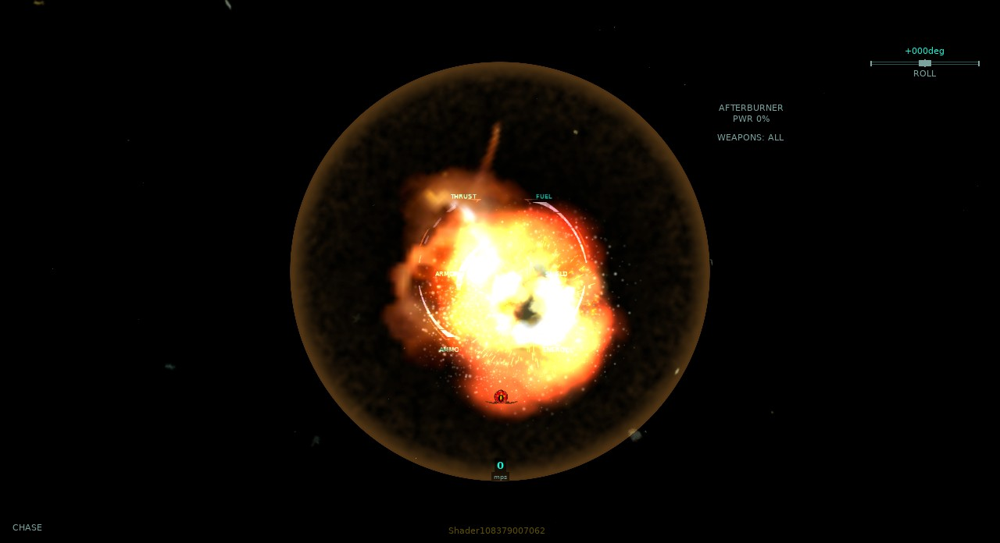
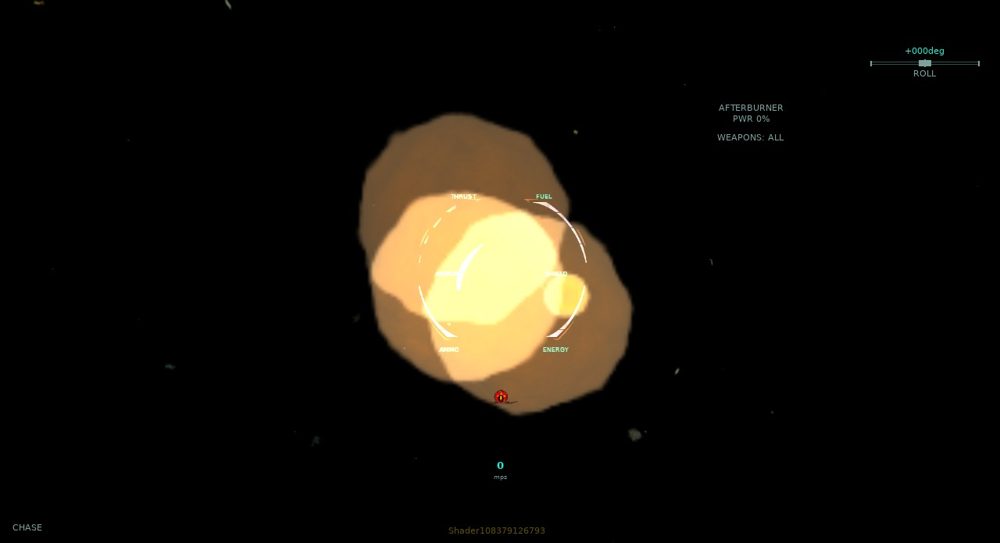
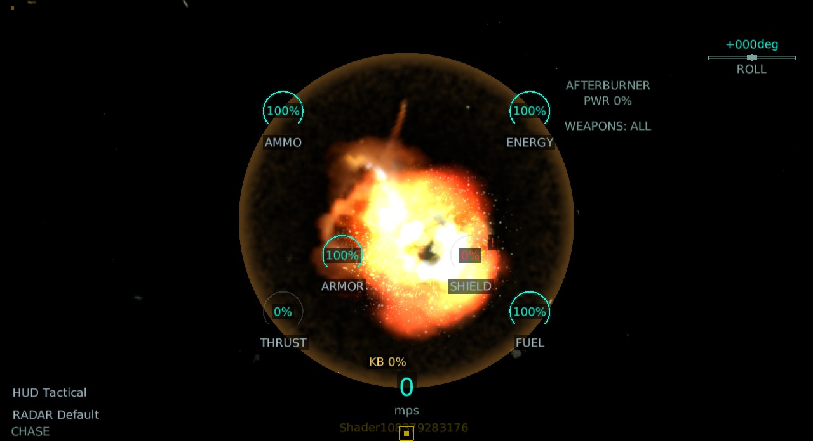
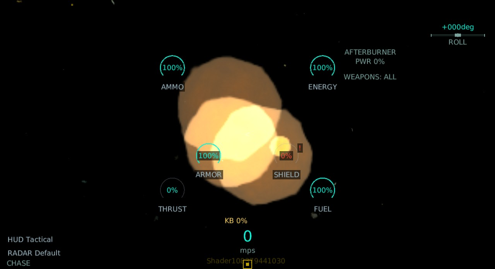

# P1083C — all nine browser effects load under HiDef

Status: **complete**. Every brief item and required run is finished. The full
Fast sweep has classified non-task failures; it is not green. The previous
incomplete attempt is superseded by this report.

## Brief items

| Item | Status | Evidence / remaining work |
|---|---|---|
| 1. KNI runtime profile rule | Done | Tagged 4.3.9001 source, container version check and profile consequences below. |
| 2. Nine loadable effects | Done | Eight SM3 KNIFX12 effects and the unchanged legacy Volumetric bridge; final real-browser proof passes 9/9 on each of three runs. HiDef stays unchanged. |
| 3. Real browser load test | Done | Final published generation **3/3 PASS**, each 9 effects, 16 techniques, 21 passes drawn; no shader fallback or WebGL/page error. |
| 4. Volumetric qualification | Done | **4/4 PASS**, native / Volumetric in Classic + Modern, strict 1280×696 at scale 1; comparison below. No hardware run. |
| 5. Report and gates | Done | Solution 0 warnings/errors; desktop 9/9 byte-identical; Fast sweep complete (classified failures); **156/156 tools built**; all required isolated gates passed 3×; report and sanitized receipts complete. |

## KNI 4.3.9001 runtime rule

The KNIFX12 reader reads each shader's stage followed by the packed major and
minor shader version, then constructs the appropriate shader
([`KNIFXReader12.cs:94-100,135-157`](https://github.com/kniEngine/kni/blob/v4.3.9001/src/Xna.Framework.Graphics/Graphics/Effect/KNIFXReader12.cs#L94-L157)).
The BlazorGL shader constructor compares that version with the maximum for the
active graphics profile and throws the observed exception when it is higher
([`ConcreteShader.cs:22-32`](https://github.com/kniEngine/kni/blob/v4.3.9001/Platforms/Graphics/.BlazorGL/Shader/ConcreteShader.cs#L22-L32)).
The limits are Reach 2.0, HiDef 3.0, FL10_0 4.0, FL10_1 4.1, and FL11_0 /
FL11_1 5.0
([`ShaderStrategy.cs:29-36`](https://github.com/kniEngine/kni/blob/v4.3.9001/src/Xna.Framework.Graphics/Graphics/Shader/ShaderStrategy.cs#L29-L36)).
Legacy MGFX10 instead supplies the default version
([`MGFXReader10.cs:101-107`](https://github.com/kniEngine/kni/blob/v4.3.9001/src/Xna.Framework.Graphics/Graphics/Effect/MGFXReader10.cs#L101-L107));
BlazorGL treats that as the legacy path and translates its GLSL for HiDef
([`ConcreteShader.cs:44-75`](https://github.com/kniEngine/kni/blob/v4.3.9001/Platforms/Graphics/.BlazorGL/Shader/ConcreteShader.cs#L44-L75)).

BlazorGL can select FL10_0, which uses WebGL2 like HiDef, whereas Reach uses
WebGL1 ([`ConcreteGraphicsDevice.cs:154-168`](https://github.com/kniEngine/kni/blob/v4.3.9001/Platforms/Graphics/.BlazorGL/ConcreteGraphicsDevice.cs#L154-L168)).
Its profile check requires WebGL2 and an actual MAX_TEXTURE_SIZE of at least
8192 for FL10_0; HiDef requires WebGL2 without that 8192 check
([`ConcreteGraphicsAdapter.cs:120-148`](https://github.com/kniEngine/kni/blob/v4.3.9001/Platforms/Graphics/.BlazorGL/ConcreteGraphicsAdapter.cs#L120-L148)).
Both therefore exclude WebGL1-only devices, and FL10_0 additionally excludes
some WebGL2 devices accepted by HiDef. The current game explicitly uses HiDef.

Although the shared shader-version table lists FL10_1 and FL11_x, the BlazorGL
adapter explicitly rejects those profiles; FL10_0 is its higher supported option
([`ConcreteGraphicsAdapter.cs:135-149`](https://github.com/kniEngine/kni/blob/v4.3.9001/Platforms/Graphics/.BlazorGL/ConcreteGraphicsAdapter.cs#L135-L149)).

KNI raises its declared maximum 2D texture size from 4096 to 8192 for FL10_0
([`ConcreteGraphicsCapabilities.cs:20-32`](https://github.com/kniEngine/kni/blob/v4.3.9001/Platforms/Graphics/.BlazorGL/ConcreteGraphicsCapabilities.cs#L20-L32),
[`Texture2D.cs:93-110`](https://github.com/kniEngine/kni/blob/v4.3.9001/src/Xna.Framework.Graphics/Graphics/Texture2D.cs#L93-L110)),
and the 3D texture limit from 256 to 2048
([`Texture3D.cs:38-43`](https://github.com/kniEngine/kni/blob/v4.3.9001/src/Xna.Framework.Graphics/Graphics/Texture3D.cs#L38-L43)).
The listed format restrictions apply to Reach, while capabilities such as
arrays, half-float and instancing use `>= HiDef`; float texture support still
checks the extension ([`ConcreteGraphicsCapabilities.cs:34-84`](https://github.com/kniEngine/kni/blob/v4.3.9001/Platforms/Graphics/.BlazorGL/ConcreteGraphicsCapabilities.cs#L34-L84)).
Both HiDef and FL10_0 retain KNI's eight texture slots, disabled vertex textures,
16 vertex-buffer slots and four draw buffers; arrays, half-float and instancing
remain enabled at >= HiDef. Float render textures and compression still depend
on the real extensions
([`ConcreteGraphicsCapabilities.cs:47-84`](https://github.com/kniEngine/kni/blob/v4.3.9001/Platforms/Graphics/.BlazorGL/ConcreteGraphicsCapabilities.cs#L47-L84)).
The existing LDR game does not need the higher texture limits. A profile switch
would exclude some currently accepted WebGL2 devices and is unnecessary here;
HiDef and the existing actual-context capability/fallback path stay unchanged.

KNI's GLES compiler maps `*_3_0` to `*_4_0_level_9_3` for DX11 reflection
before compiling DX9 bytecode for MojoShader translation
([`ShaderProfileGL.cs:84-108`](https://github.com/kniEngine/kni/blob/v4.3.9001/src/Xna.Framework.Content.Pipeline.Graphics.MojoProcessor/EffectCompiler/ShaderProfileGL.cs#L84-L108)).
That reflection stage explains why the browser SM3 sources need a smaller vertex
program even though the desktop SM3 program compiles.

## Per-shader decisions

| Effect | Choice | Shipping XNB | Techniques / passes | Reason |
|---|---|---|---|---|
| Bloom | a (existing SM3) | KNIFX12, 5,384 B | 1 / 3 | No source change needed. |
| DisplacedSphere | a | KNIFX12, 8,299 B | 1 / 1 | GLES-only single normalized noise octave fits level-9.3 reflection. Two octaves require 269 instructions against a 256 limit. Browser displacement is smoother than desktop's four octaves. |
| FsrEasu | a (existing SM3) | KNIFX12, 14,015 B | 1 / 1 | No source change needed. |
| FsrRcas | a (existing SM3) | KNIFX12, 10,874 B | 1 / 3 | No source change needed. |
| LinearDepth | a (existing SM3) | KNIFX12, 1,942 B | 1 / 1 | No source change needed for loading. |
| NativePbr | a (existing SM3) | KNIFX12, 52,767 B | 4 / 4 | No source change needed. |
| SoftParticle | a | KNIFX12, 3,168 B | 1 / 1 | GLES-only homogeneous screen position in TEXCOORD2 replaces VPOS; full view position in TEXCOORD1 preserves WorldView packing. |
| Tonemap | a (existing SM3) | KNIFX12, 4,469 B | 1 / 2 | No source change needed. |
| Volumetric | c | MGFX10 bridge, 106,146 B | 5 / 5 | Direct SM3 compile fails X3511 loop unrolling; SM4 KNIFX12 is rejected by HiDef. Keep the proven source-matched legacy bridge instead of excluding more WebGL2 devices with FL10_0. |

No profile change or new capability fallback is needed. The existing opt-in
Volumetric missing/unusable fallback remains. The restored bridge's old source
receipt was refreshed to the current source hash; regenerating the bridge gave
**byte-identical XNB bytes**. All nine source/output receipts are current. Rejected direct-compile diagnostics:
[rejected-candidates.json](BROWSER_SHADERS_LOAD_P1083C_assets/rejected-candidates.json).

SoftParticle retains every parameter required by SoftParticleRenderer, including
InvViewportSize. Its VS computes homogeneous top-left pixel coordinates and the
PS divides by clip w before converting to depth UVs. Passing only WorldView's
z row exposed KNI's matrix-register compaction: the six-vector vertex buffer
contained the first two matrix rows where the depth row and inverse viewport
were expected. Keeping the full view position live makes the buffer nine vectors
and fixes both uniforms. KNI's remapping / matrix compaction code is
[`ShaderProfileGL.cs:180-205,574-579`](https://github.com/kniEngine/kni/blob/v4.3.9001/src/Xna.Framework.Content.Pipeline.Graphics.MojoProcessor/EffectCompiler/ShaderProfileGL.cs#L180-L205).
The [real-context regression receipt](BROWSER_SHADERS_LOAD_P1083C_assets/soft-particle-regression.json) records a tilted quad (varying clip w) over an
asymmetric depth mask and requires alpha **[255, 0, 0, 0]**, plus a usable cloned
SoftParticleRenderer. This caught the initial all-opaque result; compilation and
pass application alone did not catch it.

## Browser proof and delivery

`tools/p1083-shader-pack.py` now publishes nine exact independent deferred
shader packs. The exact-name allowlist remains bounded; traversal, arbitrary
XNB names and desktop bytecode remain rejected. The join manifest is unchanged,
and default play requests none of these effects. Existing Volumetric opt-in is
the only shader integrated into the browser renderer.

The dev-only `Game1.ShaderProof.cs` uses the game's Content.Load<Effect> and
ResidentContentManager after BattlePackStreamer has verified and promoted all
nine packs. It creates a fresh target, applies a pass, submits a real triangle
and reads the target for every technique/pass. The Chromium script additionally
counts real GL draws, compilation and linking, rejects shader fallbacks and GL /
page errors, and verifies SwiftShader on the actual game WebGL2 context. Some
synthetic draws may be clipped; this is a loading/linking gate, not full visual
or material integration qualification for every effect.

The script is **style-independent**: effects and techniques do not depend on
Classic/Modern. Only the separate Volumetric qualification needs both styles.

```sh
node tools/p1083c-browser-shaders.cjs NPM_DIRECTORY HOST_STATE OUTPUT GENERATION
```

Use a fresh local generation from `scripts/publish-browser-flight.sh` and the
existing P1051 proof host with `--bots 0`. Optional proof-only `--https-port N
--lobby-port N` let the fixture coexist with another host; default ports and
production configuration are unchanged. Harnesses read its origin from the
state file. Restart the host after changing packs: its verified hosting allowlist
is captured at startup. No visible window, install, deployment, commit or push.

## Verification

- Solution build: **0 warnings / 0 errors** after the final implementation.
- Fixed-path desktop rebuild: **9/9 byte-identical** before/after GLES edits;
  current source hash receipts accompany the unchanged shipping binaries.
- Final isolated browser proof: **3/3 PASS**, each **9/9 effects, 16 techniques, 21 passes**, 22 GL draws
  including the perspective depth mask, 30 shader compilations, 21 links;
  no shader fallback, page error or GL error. Receipts: [browser-loads.json](BROWSER_SHADERS_LOAD_P1083C_assets/browser-loads.json).
- Glossary links: **1,167 paths**; parity: **3 rows**, all presentation-only.
- Full Fast run: **16,142 cases in 666.7 s**, **16,131 passed / 6 failed / 5 not executed**; 3 timing overruns at the unchanged 10-second limit. All 9 infrastructure checks and both browser test projects passed. Exact failures are existing ledger families; all nine distinct failed/over-limit methods passed 3× alone (54/54 cases in 27 hosts). Standalone tools: **156/156 built, 0 warnings / 0 errors**.

Required isolated gates each passed three times: **5/5 C# cases per run**,
**4/4 shader pack cases**, **2/2 capability cases**, **1/1 desktop preprocessing
case**, and **9/9 pack-builder entries with unchanged join bytes**. Sanitized
counts, source/output hashes, desktop comparisons and Fast classifications are
in [the evidence directory](BROWSER_SHADERS_LOAD_P1083C_assets/validation.json).
The full Fast result remains red; its six failures and three timing overruns
match existing families in [TEST_FLAKES.md](../TEST_FLAKES.md). All nine methods
passed three isolated fresh-host reruns, including all ten P999 theory rows.
The profile-restoration case used scratch XDG_CONFIG_HOME and never wrote the
real user configuration. These reruns classify failures; they do not repair or
claim fixes to those families.

## Volumetric qualification

**P1083_VOLUMETRIC_PASS 4 runs**: native and Volumetric in both Classic and
Modern. Chromium 153 / actual WebGL2 SwiftShader, scale 1, constant **1280×696**
buffer, type 3 at distance 150 / FOV 50°, three 1.5-second bursts per count,
45-second settle after warm-up. No build or other proof ran in these windows.
These are whole presented RAF intervals, including readback/instrumentation,
with the shared adaptive volume budget still active; they are not GPU timers.

The first sweep correctly stopped because current page chrome left a
1280×699 buffer. The headless fixed-scale harness now adjusts only its window
size to obtain exactly P1083A's **1280×696** game buffer, retaining the strict
buffer assertion and scale 1. No game UI, shader, LOD or player pacing changed.

All values below are **p50 / p95 milliseconds**.

| HUD | Explosions | P1083A native | P1083C native | P1083A Volumetric | P1083C Volumetric |
|---|---:|---:|---:|---:|---:|
| Classic | 0 | 16.7 / 16.8 | 16.7 / 16.8 | 16.7 / 16.7 | 16.7 / 16.8 |
| Classic | 1 | 16.7 / 16.7 | 16.7 / 16.7 | 16.7 / 33.3 | 16.7 / 33.4 |
| Classic | 4 | 16.7 / 16.8 | 16.7 / 16.8 | 33.3 / 50.1 | 33.3 / 50.0 |
| Classic | 10 | 16.7 / 33.3 | 16.7 / 33.4 | 50.1 / 100.0 | 50.0 / 66.7 |
| Modern | 0 | 16.7 / 16.7 | 16.7 / 16.8 | 16.7 / 16.7 | 16.7 / 16.7 |
| Modern | 1 | 16.7 / 16.7 | 16.7 / 16.8 | 16.7 / 33.3 | 16.7 / 33.4 |
| Modern | 4 | 16.7 / 16.7 | 16.7 / 16.8 | 33.3 / 50.1 | 33.3 / 50.0 |
| Modern | 10 | 16.7 / 33.3 | 16.7 / 33.3 | 50.1 / 100.0 | 50.0 / 66.7 |

The four runs sampled **8,280 presented frames**, with **0 discarded purple
frames and 0 page/probe errors**. Volumetric made **43,913 real sub-volume
submissions** (22,085 Classic / 21,828 Modern); both native paths made zero
submissions and zero Volumetric-pack requests. Both opt-in paths loaded the
verified effect and stayed usable without fallback. Detailed counts, buffers,
capabilities and the P1083A comparison are in
[volumetric-fixed.json](BROWSER_SHADERS_LOAD_P1083C_assets/volumetric-fixed.json).

Four-volume medians remain about 33.3 ms; ten-volume medians remain about 50 ms.
The ten-volume p95 is lower in this sweep, but the shader is byte-identical and
the adaptive budget remains active; this does not establish a shader speedup.
The P1083A conclusion stays: keep this explicit opt-in on software rendering.
Hardware qualification is outside this brief and remains Claude/Domingo's run.

Reviewed game-canvas captures (frame 3, eight-frame sequences retained in task
scratch; no private content or Meshy assets):

| HUD | Native | Volumetric |
|---|---|---|
| Classic |  |  |
| Modern |  |  |

All owned proof hosts and browsers were stopped. No visible browser, package /
SDK install, shared Wine-prefix change, commit, push or deployment occurred.
The changes remain in the working tree. No brief item remains unfinished.

## Native intent / Modern approach

Native explosions use authored films and staggered billboards
(`effect/explosion.cpp:104-117,180-202`; `WinTrek/trekigc.cpp:95-177`). These are
port-only visual enhancements behind `visuals.*` and quality tiers, with the
existing browser Volumetric spike additionally requiring explicit developer
opt-in. No simulation, visibility, collision, damage, wire or admission rule
changes. Desktop shader preprocessing and bytecode remain identical; eight
other shaders are delivered and qualified for loading without enabling their
renderer integrations. Hardware qualification remains Claude/Domingo's follow-up.
