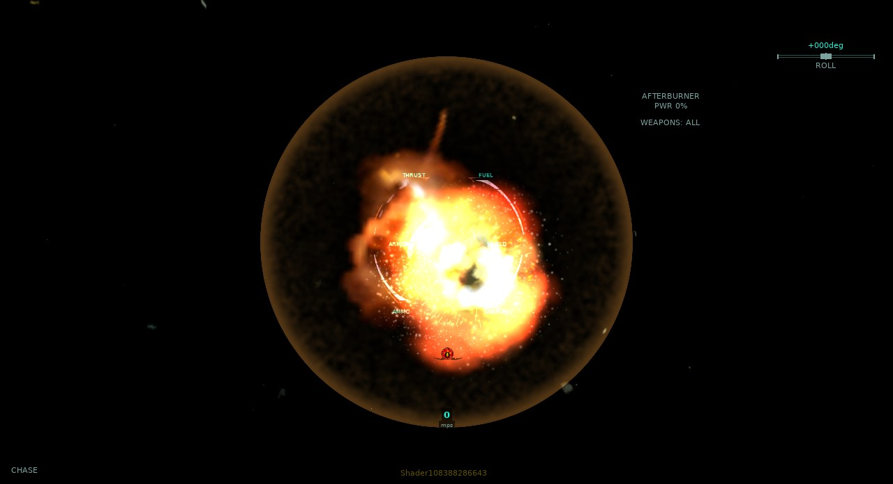
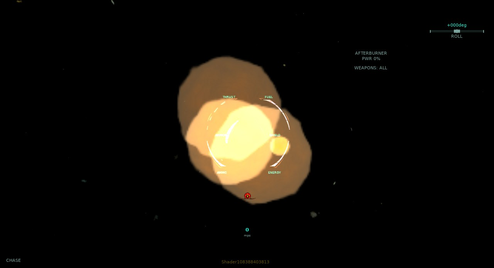
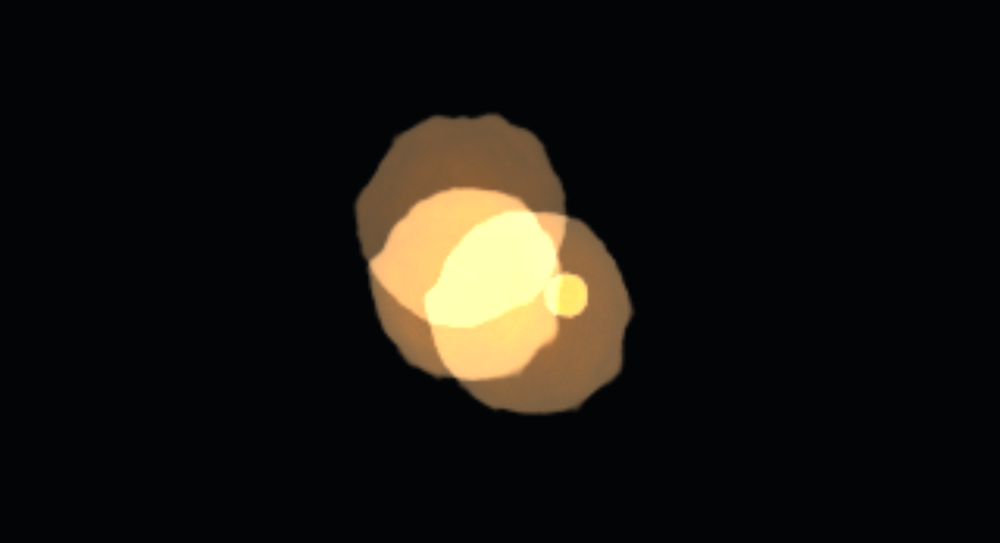
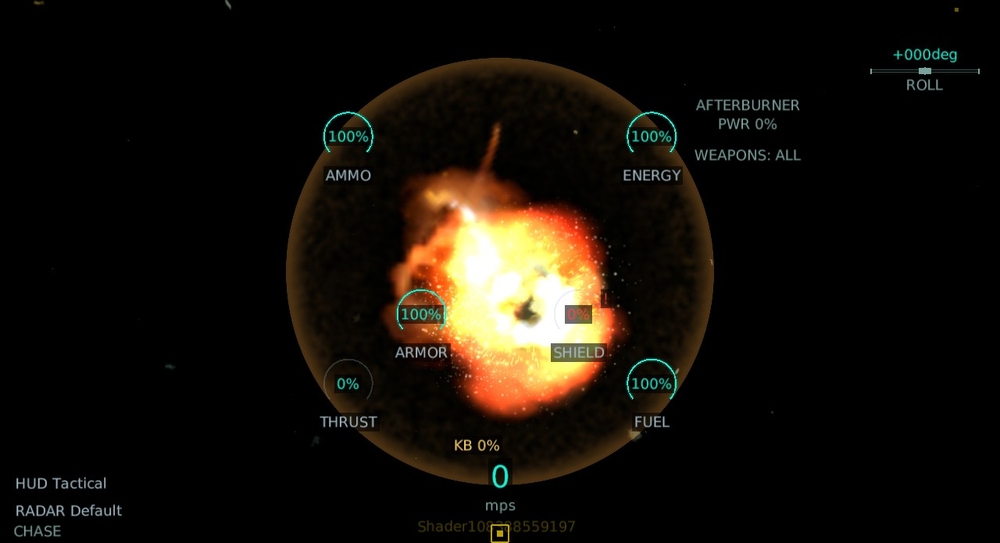
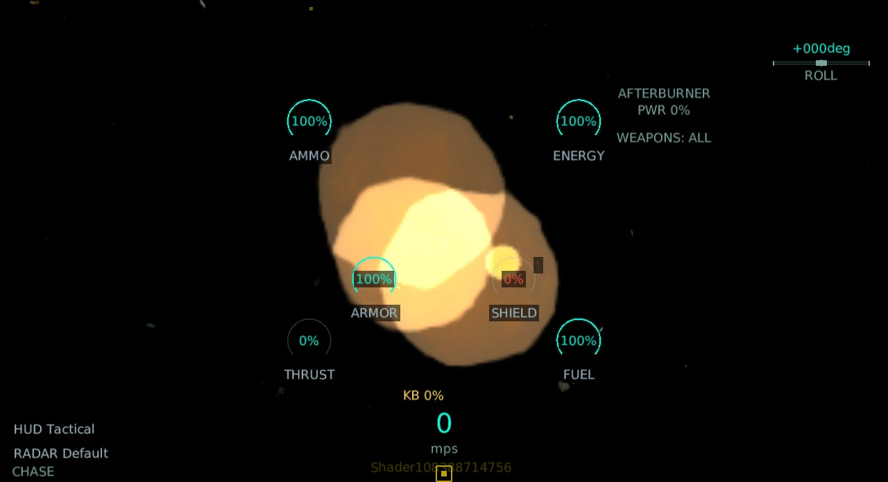

# P1083A — browser shaders spike

Started 2026-11-24 01:45 UTC; completed 02:58 UTC (about 73 minutes, within
the three-hour cap). This report was created before implementation and kept
current. Status: complete; required lane gates and evidence exported.
Base: `a774398d9` (P1078). No commits, pushes or deployments.

## Decision

**Go for an explicit opt-in Volumetric browser proof; no-go for native Linux
HLSL compilation with the pinned KNI packages.** All nine unchanged inputs
reach the Windows `d3dcompiler_47.dll` dependency and produce zero output bytes.
No Wine exists in this lane, so that compiler path was stopped as instructed.
No new system packages, global tools or non-KNI NuGet packages were added.

**One shader works end to end:** `Volumetric.fx`, using its existing,
source-matched desktop artifact through KNI's supported legacy MGFX10 runtime
reader. A narrow build-time adapter removes MGFX11's two debug strings per
shader and recomputes the effect cache key. All GLSL bytes remain identical;
KNI itself performs its legacy GLSL→ES300 translation. KNI's own XNB writer
wraps the effect for `ResidentContentManager`. This is **container adaptation,
not successful recompilation of the nine `.fx` files**.

The final fixed-resolution Chromium proof passed all four Classic/Modern ×
Native/Volumetric runs: 8,072 presented frames, 32,560 actual sub-volume
submissions, zero discarded frames, and no page/probe errors. It uses a clean
generation and matching desktop reference framing. The measured software cost
is too high for default-on at full resolution; hardware GPU qualification
remains a workstation follow-up.

## 1. Toolchain and formats

The new isolated tool is [`tools/p1083-kni-shaders`](../../tools/p1083-kni-shaders/README.md).
It references only these **4.3.9001** packages: `nkast.Xna.Framework.Content.Pipeline`,
`nkast.Xna.Framework.Content.Pipeline.Graphics`, and
`nkast.Xna.Framework.Content.Pipeline.Builder`. The documented standalone
MojoProcessor package is not published on NuGet (`NU1101`); Builder bundles
its DLL and native dependencies. Restore used `NUGET_HTTP_CACHE_PATH` and a
writable scratch package directory. The lane's default package directory is
read-only, so it was not modified. The bundled SharpFont DLL must be present
even for this effect-only writer: KNI scans all graphics pipeline types and
silently skips their writers if a dependency is missing, producing an unusable
ReflectiveReader XNB. The runner checks type loading explicitly; tests verify
that the output really names EffectReader and embeds the expected effect.

Verified upstream version: KNI tag `v4.3.9001`, commit `7944beb`. The supported
compiler route is `EffectImporter → EffectProcessor → MojoEffectProcessor`,
`TargetPlatform.BlazorGL`, HiDef, optimized effects, uncompressed XNB.

- [`MojoEffectProcessor.cs:92-95,221-224`](https://github.com/kniEngine/kni/blob/v4.3.9001/src/Xna.Framework.Content.Pipeline.Graphics.MojoProcessor/Processors/MojoEffectProcessor.cs#L92): WebGL maps to GLES content, not desktop OpenGL content.
- [`ShaderProfileGL.cs:84-109`](https://github.com/kniEngine/kni/blob/v4.3.9001/src/Xna.Framework.Content.Pipeline.Graphics.MojoProcessor/EffectCompiler/ShaderProfileGL.cs#L84): compiles HLSL for DX11 reflection and DX9 MojoShader translation.
- [`ShaderProfile.cs:53-89`](https://github.com/kniEngine/kni/blob/v4.3.9001/src/Xna.Framework.Content.Pipeline.Graphics.MojoProcessor/EffectCompiler/ShaderProfile.cs#L53): directly calls SharpDX's D3D compiler. There is no Wine subprocess bridge.
- [`MojoShader.cs:12-18,2593`](https://github.com/kniEngine/kni/blob/v4.3.9001/src/Xna.Framework.Content.Pipeline.Graphics.MojoProcessor/EffectCompiler/MojoShader.cs#L12): loads the Windows `libmojoshader_64.dll` bundled by Builder. Its file is PE, not a native Linux shared object.

KNI defines `__GL__`/`__GLES__`, while five of these existing sources guard their
shader-model definitions with `OPENGL`. The first unmodified attempt therefore
reported `Invalid profile 'PS_SHADERMODEL'` for DisplacedSphere, LinearDepth,
NativePbr, SoftParticle and Volumetric. Passing **`Defines=OPENGL=1`** fixes that
without editing a source. Every input then reaches the same native-library
failure. There is no evidence yet of an HLSL intrinsic/loop/array rejection.

The Windows/Wine command prepared in this lane was not tested here. The
corrected Linux-build/Wine-execution recipe and later workstation results are
in `tools/p1083-kni-shaders/README.md` and
`docs/reports/BROWSER_SHADERS_KNI_P1083B.md`.

The normal compiler writes KNIFX12, and `Effect.cs:70-178` also recognizes
KNIFX11. The legacy alternative is supported explicitly by KNI:

- [`Effect.cs:180-224`](https://github.com/kniEngine/kni/blob/v4.3.9001/src/Xna.Framework.Graphics/Graphics/Effect/Effect.cs#L180) reads **MGFX10**. The committed desktop files are **MGFX11**, so they cannot be passed directly.
- [`ConcreteGraphicsAdapter.cs:103-116`](https://github.com/kniEngine/kni/blob/v4.3.9001/Platforms/Graphics/.BlazorGL/ConcreteGraphicsAdapter.cs#L103) accepts its OpenGL_Mojo profile on WebGL.
- [`ConcreteShader.cs:43-65`](https://github.com/kniEngine/kni/blob/v4.3.9001/Platforms/Graphics/.BlazorGL/Shader/ConcreteShader.cs#L43) translates legacy GLSL to ES300 for HiDef/WebGL2 and compiles it in the actual browser.
- [MonoGame 3.8.5.1 `Shader.cs:108-123`](https://github.com/MonoGame/MonoGame/blob/v3.8.5.1/MonoGame.Framework/Graphics/Shader/Shader.cs#L108) adds source/entrypoint debug strings in MGFX11. Parameters, techniques, passes, sampler and constant-buffer records otherwise retain the MGFX10 layout used here.

There is no public `Effect(GLSL source)` constructor. KNI emits its built-in legacy-format rebuild notice once on this path. The
browser still consumes a validated effect container with parameter, sampler and technique metadata;
this spike does not implement a new GLSL compiler or replace KNI's translator.

## 2. Unchanged-source compile matrix

Exact common diagnostic **D3D47**:
`InvalidContentException: Unable to load shared library 'd3dcompiler_47.dll' or one of its dependencies.`
The inner exception is `DllNotFoundException`. Full messages, searched-library
names, source SHA-256 and zero-byte results are in
[`compile-linux.json`](BROWSER_SHADERS_SPIKE_P1083A_assets/compile-linux.json);
only machine-specific path prefixes were replaced with placeholders.

| Shader | KNI HLSL compiled | Exact error | Output bytes | Source-change assessment |
|---|---|---|---:|---|
| Volumetric.fx | No | D3D47 | 0 | `OPENGL=1` processor define resolves profile macros; no source edit needed. Browser legacy route works, including all five LOD shaders. |
| DisplacedSphere.fx | No | D3D47 | 0 | Same define; no source change can supply the missing compiler. Intrinsics remain untested by KNI. |
| LinearDepth.fx | No | D3D47 | 0 | Same define; Windows compile still required. |
| SoftParticle.fx | No | D3D47 | 0 | Same define; Windows compile still required. |
| Bloom.fx | No | D3D47 | 0 | No initial macro issue; Windows compile required. |
| Tonemap.fx | No | D3D47 | 0 | No initial macro issue; Windows compile required. |
| NativePbr.fx | No | D3D47 | 0 | Same define; Windows compile still required. |
| FsrEasu.fx | No | D3D47 | 0 | No initial macro issue; Windows compile required. |
| FsrRcas.fx | No | D3D47 | 0 | No initial macro issue; Windows compile required. |

No desktop `.fx`, source-hash record, or `.ogl.mgfxo` was edited or rebuilt.
[`desktop-shaders.json`](BROWSER_SHADERS_SPIKE_P1083A_assets/desktop-shaders.json)
records all nine bytecode hashes. New tests compare every Volumetric GLSL
shader hash before/after adaptation, leave the input array untouched, and
verify that the shipped XNB embeds the exact deterministic adapted bytes.
Rebuilding the XNB reproduced it byte for byte.

## 3. Verified opt-in rendering

The shipped `Content/Shaders/Volumetric.xnb` is **106,146 bytes**, SHA-256
`a7e5d8bf64e977f3be45dc235dcfdb6cad98938c850cc1f3039ca81944bbe30f`.
Its adjacent build receipt binds source and desktop artifact hashes. A future
successful KNI compile also gets a receipt; replace only the browser XNB and
its receipt, publish a fresh generation, and rerun the same harness to qualify
KNIFX12 without changing the runtime delivery path.
`tools/p1083-shader-pack.py` checks that receipt and emits a separate
`shader-volumetric` pack. The normal browser publisher includes its metadata.
The join manifest is unchanged; default play never requests the shader pack.

Only **`content/shaders/volumetric.xnb`** was added to `BattleManifest`'s
allowlist. No wildcard `.xnb` extension, `StagedManifest.Canonical`, SHA-256
verification, cache admission, atomic promotion or CSP rule was weakened.
Delivery reuses `BattlePackStreamer → AssetStager → StagedAssetSource →
ResidentContentManager.Load<Effect>`; no unverified effect fetch exists.

`?dev=1&volumetric=1` is an explicit, default-off proof switch. It is independent
of persisted desktop visual preferences, rejects duplicate/encoded opt-ins,
and uses the same path in both HUD styles. `Game1.Volumetric.cs` resolves
RaymarchA and checks the unchanged shared `VolumetricRenderer.IsUsable`, as
in desktop `Game1.Lifecycle.cs:927-960`. Missing or unusable effects log one
fallback and retain P1079 native explosions. Draw-time compile/link/target
failures restore render state and disable the failed renderer.

Opt-in presentation uses `RenderTargetUsage.PreserveContents`, matching the
desktop requirement for the shared renderer's half/quarter-resolution target
excursions. The browser stays LDR Color; no HDR, depth pass, bloom, soft-particle,
FSR or PBR runtime was enabled. `SoftParticleContext.Off` uses the shared
renderer’s far-depth fallback; depth-dependent scene clipping and soft intersections stay deferred. Volumetric exposes cumulative sub-volume
submissions, current volume count, scale buckets, budget and failure metrics.

## 4. WebGL capability evidence

`webgl-capabilities.js` queries the **actual KNI context after its first draw**,
logs once, and exposes the result at `gameMenu.metrics().webgl` and
`preview.measurements.webgl`. The early startup WebGL admission probe remains
separate. No permission request or unmasking workaround is used.

Measured **Chromium 153.0.8010.0 / SwiftShader** values:

| Capability | Observed |
|---|---|
| WebGL / GLSL | WebGL 2.0 / GLSL ES 3.00 |
| EXT_color_buffer_float | Yes |
| EXT_color_buffer_half_float | Yes |
| OES_texture_float_linear | Yes |
| Fragment / combined texture units | 32 / 64 |
| Fragment highp | Yes; precision 23, exponent range 127/127 |
| Masked renderer | WebKit WebGL |
| Browser-exposed unmasked renderer | ANGLE Vulkan SwiftShader Device (Subzero), SwiftShader driver |

These results establish capability only on the measured software renderer.
A later HDR path must gate float render-target creation and check framebuffer
completeness on each real device. Missing float extensions do not block the
RGBA8 depth, soft-particle or current LDR volumetric paths.

## 5. Proof and cost

`tools/p1083a-browser-volumetric.cjs` uses the P1051/P1079 production logon,
verified packs and real EXPLOSION_EVENT flow, with a bounded local proof-host
burst hook. The fixture supplies exactly 0, 1, 4 or 10 simultaneous type-3
explosions, 150 units ahead of a read-only proof camera above the pilot. It
changes no production server rule or config. Final framing uses world -Z,
50° vertical FOV, and the desktop sampler/preset.

Each style/mode has a fresh browser process. Each cost cell contains three
1,500-ms bursts; only consecutive frames with the requested actual event count
are included. The harness records p50/p95 rAF intervals, sample counts, rendered
sub-volume counts and buffer sizes. An actual explosion warms WASM and driver draw paths first; a further 45-second
settle keeps the scene streamer’s 30-second deferred-art boundary outside the
cost window. The main cost sweep fixes the drawing buffer at **1280×696** and keeps ambient
effect load full on both paths using a harness-only FramePacing wrapper. The
real pacing sampler/slow indicator still runs, and the shared volumetric LOD
budget remains adaptive. `--adaptive` removes this proof override and measures
normal player presentation instead. No production pacing code was changed.
The same presented-frame readback probe runs on both paths. These are whole
rAF intervals, including instrumentation and vsync, **not GPU timer queries**.

Fixed **1280×696**, headless **SwiftShader software rendering**, three bursts per
cell. No build or other browser proof ran during these timing windows.

| HUD | Explosions | Native p50 / p95 ms | Volumetric p50 / p95 ms | Native / volume samples |
|---|---:|---:|---:|---:|
| Classic | 0 | 16.7 / 16.8 | 16.7 / 16.7 | 273 / 273 |
| Classic | 1 | 16.7 / 16.7 | 16.7 / 33.3 | 273 / 244 |
| Classic | 4 | 16.7 / 16.8 | 33.3 / 50.1 | 272 / 131 |
| Classic | 10 | 16.7 / 33.3 | 50.1 / 100.0 | 249 / 71 |
| Modern | 0 | 16.7 / 16.7 | 16.7 / 16.7 | 273 / 273 |
| Modern | 1 | 16.7 / 16.7 | 16.7 / 33.3 | 270 / 242 |
| Modern | 4 | 16.7 / 16.7 | 33.3 / 50.1 | 272 / 129 |
| Modern | 10 | 16.7 / 33.3 | 50.1 / 100.0 | 244 / 71 |

Both styles pass: **8,072 presented frames**, **0 discarded purple frames**,
**0 page/probe errors**, and **32,560 submitted sub-volumes** across the two
volumetric runs (16,263 Classic / 16,297 Modern). Each effect loaded once;
capabilities logged once per page. Both native runs requested **zero shader
packs** and submitted zero volumes. Machine-readable metrics and capture
receipts: [`fixed-cost.json`](BROWSER_SHADERS_SPIKE_P1083A_assets/fixed-cost.json).

The shared adaptive LOD budget remains active, so these are measured effective
end-to-end costs. A single volume usually maintains a 16.7-ms median; four raise
it to 33.3 ms, and ten to 50.1 ms with a 100-ms p95 on this software renderer.
This is a **no-go for default-on at this software/full-resolution target**.
It is not a hardware GPU result.

A separate normal-pacing run passed **8,882 presented frames**, with zero
page/probe errors or discarded frames. At 4/10 volumetric explosions it reduced
the drawing buffer through 960×522 to 640×348. Its improved frame intervals
therefore include a resolution reduction and must not be read as fixed-pixel
shader speed. Both HUD styles retained the same behaviour. Exact adaptive
buffers/timings: [`adaptive.json`](BROWSER_SHADERS_SPIKE_P1083A_assets/adaptive.json).

Eight captures exported from the actual presented canvas at 250-ms RAF cadence show the controlled single explosion in each
style/mode. The existing P834 DesktopGL tool captures the same type, distance,
FOV and 0.8-second age with the unchanged desktop bytecode. Desktop evidence
uses Mesa llvmpipe software rendering; its tiny timer sample is not a hardware
performance claim. All final captures are 1280×696; the selected browser frames
have event ages **776–797 ms**, versus **800 ms** on desktop. The global noise
flow clock is independent between clients. Requested capture cadence is 250 ms;
observed intervals were **233.3–266.7 ms** (one RAF of jitter).

| HUD | Browser native | Browser Volumetric | Desktop Volumetric reference |
|---|---|---|---|
| Classic |  |  |  |
| Modern |  |  | Same single desktop capture above |

The 32 burst frames were reviewed; only the four selected frames are kept in the repository (review trim). The native
artwork retains its existing FreeAllegiance MIT attribution and the sky/font
credits in the verified generation's notices. The comparison captures were visually
reviewed; they contain synthetic proof callsigns and no private content.

Desktop reference command (existing tool, unchanged desktop shader):

```sh
LIBGL_ALWAYS_SOFTWARE=1 SDL_AUDIODRIVER=dummy xvfb-run -a \
  "$HOME/.dotnet/dotnet" tools/p834-vol-perf/bin/Debug/net10.0/p834-vol-perf.dll \
  --res 1280x696 --scenarios p1083:3:150 --frames 3 --warmup 2 --age 0.8 --fov 50 \
  --shader src/Allegiance.ClientCore.MonoGame/Content/Shaders/Volumetric.ogl.mgfxo \
  --png OUTPUT --csv OUTPUT/cost.csv --label p1083
```

Start the existing local proof host with `--bots 0` (the harness reads its
scratch game password and uses ordinary verified lobby identity):

```sh
"$HOME/.dotnet/dotnet" tools/p1051-browser-host/bin/Debug/net10.0/p1051-browser-host.dll \
  ARTWORK GENERATION HOST_STATE --bots 0 --seconds 2400
```

For a real workstation GPU, use the same harness with one extra flag:

```sh
node tools/p1083a-browser-volumetric.cjs NPM_DIRECTORY HOST_STATE OUTPUT GENERATION \
  --hardware-gl /path/to/chromium
```

This selects visible Chromium and supplies no SwiftShader launch flags; verify
the recorded renderer rather than assuming that requesting hardware guarantees
it. The default cost mode fixes presentation scale; `--adaptive` selects normal
player pacing. Use `--fallbacks-only` on the same harness for missing and hash-valid-but-unloadable
effect cases, each in Classic and Modern.

## 6. P1083b plan

“Feasible” below separates API/source evidence from an unrun KNI HLSL compile.
Except Volumetric, no shader is claimed to have been drawn in WebGL here.
Expected costs are qualitative estimates, not measurements of unported paths.

| Shader | Feasibility and work | WebGL requirement / fallback | Expected cost |
|---|---|---|---|
| LinearDepth | Yes, strong source/API evidence. Compile on Windows/Wine; wire shared opaque depth draws and resize/lifecycle. | RGBA8 + Depth24; no float extension. Skip depth target on failure. | Extra opaque geometry pass; measure in dense sectors. |
| SoftParticle | Yes, strong source/API evidence. Pair with LinearDepth; preserve pass ordering and texture unbinding. | WebGL2/highp and 2 samplers. Native/near-fade particles if unavailable. | One depth lookup and decode/fade per particle pixel plus depth-pass cost. |
| Volumetric | **Yes, measured here.** Replace or qualify the legacy bridge with a reproducible pinned Windows/Wine compile; retain shared five-LOD budget, preservation and fallbacks. Add hardware/near-camera matrix before broader use. | WebGL2, fragment highp; RGBA8 half/quarter targets. P1079 native fallback. No float RT required. | Highest ALU/fill pressure; measured 0/1/4/10 software curve below. |
| DisplacedSphere | Likely yes; compile and measure the shared mesh renderer. Keep desktop sources untouched unless a guarded change can prove identical desktop output. | WebGL2/highp; native fallback. | More vertex/mesh work, less per-pixel raymarch ALU; unmeasured. |
| Bloom | Conditional yes; compile and wire LDR first, with resize/context failure handling. | RGBA8 LDR can work without float RT. Optional HDR needs float color-buffer capability and completeness checks; bloom off fallback. | Fullscreen bright-pass, blur pair and composite; bandwidth/fill. |
| Tonemap | Conditional yes; compile separately, then pair with a deliberately linear HDR scene path. Do not apply to today's already encoded LDR scene. | HDR HalfVector4 needs WebGL2 float color-buffer support; linear filtering capability or manual sampling. Existing LDR output fallback. | One fullscreen transform; HDR bandwidth and preceding passes dominate. |
| NativePbr | **No for P1083b**; technically plausible but out of scope. Shader compile, material/texture delivery, lighting and color-space work need their own evidence. | WebGL2/highp and sufficient texture units; existing native lighting fallback. | Material sampling, lights and texture residency; unmeasured. |
| FsrEasu | **No for P1083b**; technically plausible but out of scope. Needs an upscaling pipeline and device measurements before it competes with existing browser scaling. | WebGL2/highp, bounded color target; existing browser scale fallback. | Expensive reconstruction taps/ALU; no measured browser benefit. |
| FsrRcas | **No for P1083b**; technically plausible but out of scope. Pair only with a justified upscaling path. | WebGL2/highp; sharpening off fallback. | Additional fullscreen sharpen and bandwidth; unmeasured. |

Recommended order remains **depth + soft particles → qualify Volumetric →
displaced sphere → LDR bloom → capability-gated HDR/tonemap**. Volumetric's
runtime feasibility is now demonstrated, but that does not remove its hardware
cost qualification. Keep FSR and NativePbr out. First establish a repeatable
Windows/Wine compiler matrix; a Linux-only content build is not supported by
the pinned package's native dependencies. Do not generalize this narrow
container adapter into a nine-shader port in this spike.

## Validation and outstanding work

- Solution build: **0 warnings / 0 errors**, including the current implementation.
- `tools/build-tools.sh`: **155/155 standalone tool projects built**, 0 warnings/errors; build-server disabling and scratch NuGet paths supplied through the command wrapper. The final changed shader tool was rechecked separately with 0/0.
- Browser tests: **52/52**; Game.Browser tests: **325/325**, no skips; both rechecked on the current implementation.
- Every new test three times alone: **15/15 C# cases**, **9/9 Python cases**,
  **6/6 JavaScript capability cases**. New pack tests run once more after the
  final loader-format guard, and all required repeat cases passed again.
- Rebuilt XNB: byte-identical to the shipped artifact, including a final check with the portable receipt-path logic.
- Glossary links: passed, **1,154** distinct paths. New parity CSV: **2 rows**
  validated; both describe presentation/reachability, not a new native rule.
- Chromium opt-in/cost: **4/4 fixed-resolution runs pass**, 8,072 presented frames; **4/4 normal-pacing runs pass**, 8,882 frames. Both styles load the effect, submit real volumes and retain the main scene; zero page/probe errors or discarded frames.
- Chromium missing/unusable fallback: **4/4 cases pass**, both styles, one fallback log each, real native-event draws, no page/probe errors or discarded frames. Summary: [`fallbacks.json`](BROWSER_SHADERS_SPIKE_P1083A_assets/fallbacks.json).
- Default-off P1074 keyboard: **Classic + Modern pass**, including zero-mouse keyboard phase, real pointer lock, targeting and docking. Summary: [`keyboard-regression.json`](BROWSER_SHADERS_SPIKE_P1083A_assets/keyboard-regression.json). P1079 live combat: **Classic + Modern pass**, 120 seconds per style in the true 5v5 fixture, shader opt-in false and zero volumetric submissions throughout. The correlation window contained 0 Classic / 9 Modern server explosions; every observed event passed its correlation assertions, and both styles passed all controlled combat captures and the frame probe. Summary: [`p1079-regression.json`](BROWSER_SHADERS_SPIKE_P1083A_assets/p1079-regression.json).
- Desktop reference: **one final matching-axis/size capture**, inspected alongside Classic and Modern browser frames.
- Desktop `.fx`/`.mgfxo` diff: empty. No shared desktop source was touched, so
  the brief's light gate applies; no full Fast sweep or training gate is needed.

Unfinished by design: Windows/Wine HLSL compilation and hardware Chromium
numbers require the workstation. Neither is presented as a passing lane check.
All required lane work is complete. All owned proof hosts/browsers were stopped;
raw logs remain under `.scratch/p1083/`. No new test flakes occurred. The
commit-range publish guard cannot inspect uncommitted work; equivalent scans
of the changed/new files found no secrets or absolute home paths. The supplied
brief remains untracked and untouched. Changes and evidence remain in the working
tree; HEAD remains `a774398d9`.

## Native intent

Native explosions stagger per-decal births, choose authored films, and draw
animated billboards at 20 fps (`effect/explosion.cpp:104-117,180-202`;
`WinTrek/trekigc.cpp:95-177`). This change reuses those existing event/preset
inputs and leaves the P1079 native route as default and fallback. No native
simulation, visibility, collision, damage, wire or admission rule was added.
Tracking: `docs/parity/p1083-browser-shaders.csv`.

## Modern approach

Volumetric is a port-only visual enhancement, as on desktop. The spike keeps
it explicitly opt-in, verifies and promotes exact content before loading,
preserves the main scene around shared reduced-resolution passes, and measures
both HUD styles. Shader feasibility and software measurements are reported
separately from the Windows toolchain and real-GPU follow-up.
