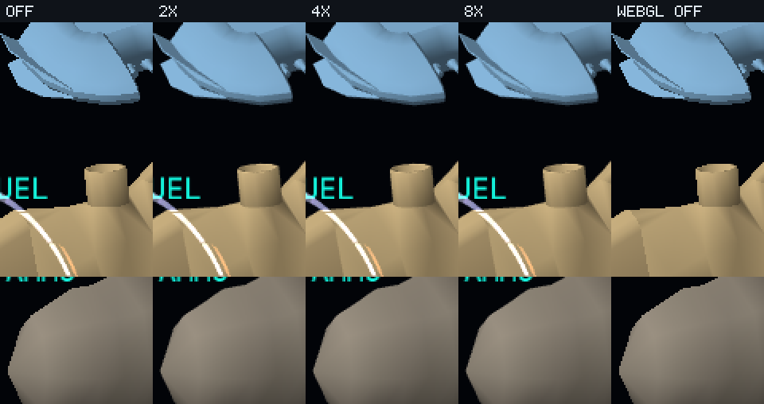
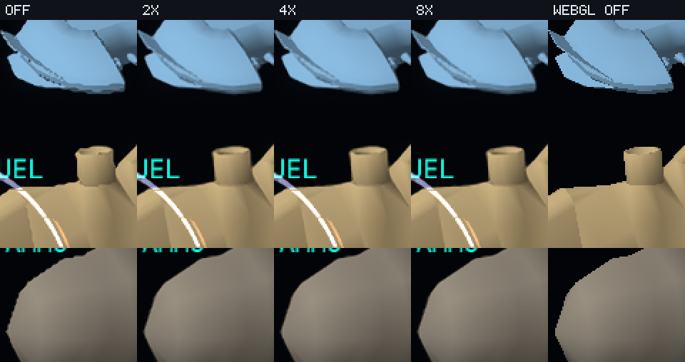

# Desktop antialiasing — P1057

Started 2026-11-19 06:42; completed 2026-11-19 11:33 (lane local time, UTC−05:00).
No commits or pushes. Software rendering measurements are evidence of image
quality and capability only, never workstation GPU performance.

## Cause confirmation

**The proposed browser-MSAA explanation is false for this checkout.** Actual
production KNI context creation was observed through Chromium CDP after staging
the recorded desktop menu asset closure and waiting for the first game frame:

```text
requestedType=webgl2
requestedAttributes={depth:true, stencil:false, antialias:false,
                     preserveDrawingBuffer:false, PowerPreference:high-performance}
getContextAttributes().antialias=false
SAMPLES=0 SAMPLE_BUFFERS=0 drawingBuffer=1920×1032 DPR=1
```

The 48-pixel height difference is the browser toolbar/viewport reservation.
`Game1.Browser.cs:69-88` constructs one device used for menu and online flight;
`Menu.razor.cs:66` owns that game instance. No browser render code was changed.
The production P1051 flight harness now records its existing context too.
Readback is preserved in
`DESKTOP_ANTIALIAS_P1057_assets/webgl-context.json`.

The initial default-WebGL hypothesis confused the capability probe with the
actual KNI context. `getContext("webgl")` without attributes really does report
`antialias:true`, `SAMPLES=4` in this Chromium 153 build. The controlled
`antialias:false` and measured-KNI-policy WebGL2 fixtures both report 0. The
production result supersedes that initial probe.

Desktop startup/flight and the pre-change 1920×1080 fixture report backbuffer
0 and scene target 0. Thus both production clients were single-sampled.
The browser does omit custom bloom/HDR/tonemap/soft particles/volumetrics/PBR/
FSR (`Game1.Browser.cs:88`) and sizes its canvas from DPR with adaptive scale
(`frame-pacing.js`). Desktop FSR Quality lowers scene dimensions before
upscaling. In the matched fixture, post+FSR with AA Off visibly roughens the
fighter rim and rock limb; turning MSAA on reduces that roughness. Those are
measured possible contributors; this lane cannot identify the player's exact
settings or claim one proven cause of the original subjective comparison.

Important capability finding: llvmpipe exposes requested 2× and 4× through
MonoGame, but the bound framebuffer physically has **4 samples for both**.
An 8× request clamps to 4×. All non-Off capture columns are pixel-identical
within each post/style combination, so these captures cannot establish true
2× versus 4× versus 8× quality on workstation hardware.

Matched native meshes, camera and drawing buffer isolate geometry coverage.
Browser and desktop fixtures use identical precomputed vertex colours;
textures are deliberately absent. The comparison browser fixture reproduces
the **measured KNI WebGL2/AA-Off policy**, while actual production context
readback is separate. This is not a claim of full KNI/desktop pixel parity:
the WebGL-Off/desktop-Off control differs at 3,035 RGB pixels because of
interpolation/rasterization. The controlled default-WebGL 4× image is retained
only in scratch as a check of the original hypothesis.

## Implementation and render paths

Implemented Off/2×/4×/8×, default Off, saved in graphics.json. Unknown values
request the maximum supported level without discarding other preferences.
Device format/depth/sample queries and allocation fallback choose supported
samples, with configuration and physical bound-framebuffer readback logs.

`SceneAntialiasing` allocates only when On. It substitutes a preserved
colour/depth scene attachment for flight and inspector geometry, matching the
existing scene dimensions and format. Unbinding triggers MonoGame's resolve.
Plain rendering copies once to the output; bloom/HDR/FSR sample the resolved
texture before their normal passes. FSR Quality resolves at 1280×720 before
upscaling. Volumetric half/quarter-res excursions retain P582b preservation.
The HUD remains on the single-sample output, after resolve/post, avoiding
coverage changes to text, native sprite art and gauges. Off keeps existing
bindings and does not allocate an AA target.

The shared desktop Visuals page cycles the choice with the native
`Antialiasing (...)` label form. Browser menus omit this desktop setting.
The first actual options capture exposed a pre-existing em-dash font crash in
the Jet-description row. Desktop display replaces that unsupported separator
with ASCII `-`, leaving labels in the model and all commands unchanged. This
small prerequisite makes the existing page and the new setting reachable.

### Changed files and native references

| Change | Source |
|---|---|
| Choices, unknown-value handling, supported-level clamp, memory model | `src/Allegiance.ClientCore.Game/Rendering/Antialiasing.cs:9` |
| Persist with existing graphics preferences; tolerant converter before generic enum converter | `src/Allegiance.ClientCore.Game/Rendering/UpscalingSettings.cs:12`, `:43`, `:53` |
| Preserved scene target, capability/allocation fallback, unbind/resolve, plain copy | `src/Allegiance.ClientCore.Game/Rendering/SceneAntialiasing.cs:19`, `:70` |
| Actual physical GL count instead of relying only on requested counts | `src/Allegiance.ClientCore.Game/Diagnostics/GlSampleCount.cs:11` |
| Flight scene substitution and pre-post resolve | `src/Allegiance.ClientCore.Game/Game1.Rendering.cs:606`, `:1887` |
| Inspector/showcase scene substitution and resolve | `src/Allegiance.ClientCore.Game/Game1.Inspector.cs:934`, `:994` |
| Lifetime / startup readback | `src/Allegiance.ClientCore.Game/Game1.GpuBudget.cs:215`, `Game1.Lifecycle.cs:909`, `Game1.cs:2182` |
| Shared Visuals row, keyboard command and persistence | `src/Allegiance.ClientCore.Game/OptionsMenuModel.cs:289`, `Game1.OptionsMenu.cs:143` |
| Existing page's unsupported em-dash display fallback, desktop only | `src/Allegiance.ClientCore.Game/Game1.OptionsMenu.cs:345` |
| Native-mesh captures, real-device resolve/depth proof, timer mode | `tools/p979-visual-proof/AntialiasProof.cs` |
| Real options keyboard/save proof | `tools/p979-visual-proof/Program.cs` (`ui --aa-ui`) |
| Actual production-context observation and matched browser control | `tools/p1057-browser-aa.cjs`; existing-flight readback in `tools/p1051-browser-flight.cjs` |
| Deterministic nearest-neighbour sheets / lossless PNG packing | `tools/p1057-aa-images.py` |
| Settings, clamp, menu, memory and real-device tests | `tests/Allegiance.ClientCore.MonoGame.Tests/P1057AntialiasingTests.cs` |

Native default `UseAntialiasing=0`: `WinTrek/WinTrek.cpp:2997`;
persisted cycle: `:4623-4631`; parenthesized label: `:5964-5967`;
AA capability checks: `engine/engine.cpp:878-952`; radar deliberately bypasses
MSAA around art: `WinTrek/radarimage.cpp:272-277,1408-1457`.
P1057 intentionally offers 0/2/4/8 rather than native's additional 6/16 levels,
and clamps unsupported requests down instead of native's fallback to Off.
These are visual choices, with no simulation/wire rule or new parity credit.
Tracking: `docs/parity/p1057-desktop-antialiasing.csv` (3 validated rows).

### Each render path

| Path | MSAA On | Resolve and 2-D output |
|---|---|---|
| Plain/backbuffer | Preserved RGBA8 + Depth24 scene at output size | Unbind/resolve, opaque point-sampled 1:1 copy to original output, then HUD |
| Bloom only | Preserved scene in current scene format | Unbind before bright pass; existing bloom buffers/composite stay single-sampled |
| HDR (with/without bloom) | Preserved RGBA16F + Depth24 | Resolve before float bloom/output transform; HUD follows the single output transform |
| FSR Quality (with/without HDR/bloom) | Scene at FSR dimensions, matching RGBA8/RGBA16F | Resolve at low resolution before existing bloom/EASU/RCAS/output transform; HUD stays at output resolution |
| Volumetric half/quarter-res excursion | Same preserved MSAA scene restored after low-res work | Intermediate unbind may resolve early; the retained colour **and opaque depth** survive restoration, with final resolve before post |
| Capture / inspector | Same policy; original capture/output target retained | Plain copy or normal post stack ends at the caller's single-sample target |
| Off, every path | No AA target allocated; original scene selection and bindings | Resolve method returns without binding, copying or changing render state |

## Visual evidence

All 16 full-resolution captures and their exact 2× nearest-neighbour edge
strips are generated, plus browser capture/strip and two comparison sheets.
Current PNG total: **2,419,910 bytes**. All 38 PNGs (16 full frames, 16 edge strips, browser frame/strip, two sheets, two options screens)
have been opened and inspected individually. Off scene PNG SHA-256 before/after:
`f0953ebc8e65a9ba295ae5d712143cba16271c818071383bb6f4160179246777`. The byte comparison uses the raw
`scene-before/scene.png` and `captures/classic-off-0/scene.png` under the lane
scratch evidence directory. Repository PNGs are losslessly repacked to meet
the size budget, so their PNG-file hashes differ from those raw captures;
`images.json` records their unchanged decoded RGB hashes. Opaque scene alpha
is implicitly 255; the options captures retain their original alpha/filter
bytes while only IDAT compression changes.





Columns: Off, requested 2×, 4×, 8×, browser measured KNI policy (Off). Rows: fighter lower
silhouette, station structure, asteroid limb. The browser column has no HUD
or post effects and is single-sampled. The desktop's bright HUD arc and text remain unfiltered.

Visual inspection of every full frame and strip:

| Requested level | What the captures show |
|---|---|
| Off | Distinct steps along the fighter's lower rim and rock limb. With the post stack on, FSR's lower-resolution sampling makes the rim rougher and the rock edge more uneven. |
| 2× | Grey coverage pixels soften the fighter rim and rock edge. The station's narrow cylinder/structural edge is less stepped. This is physically 4× on this driver. |
| 4× | Same pixels as requested 2× here; the broad polygon facets remain visible because AA does not add geometry. |
| 8× | Same pixels again, because the device clamp selects 4×. No true 8× image-quality claim is possible from this lane. |
| Browser KNI policy | Unfiltered geometry edges resemble desktop Off. It lacks the desktop HUD arc/text in the crop and has no post stack. |

Classic and Modern change only the HUD composition: the former has native
sprite gauges/arc and monospaced text, the latter round numeric gauges and
smoother font art. Both retain the same scene and AA differences. MSAA does
not blur either HUD's text. The station crop shows its narrow cylindrical
support and slanted body edge, not a dense lattice or a subpixel strut stress
scene; the screenshots support only those visible shapes.

The optional FXAA/SMAA comparison was not added.

Options evidence: [Classic](DESKTOP_ANTIALIAS_P1057_assets/options-classic.png)
and [Modern](DESKTOP_ANTIALIAS_P1057_assets/options-modern.png), actual
960×540 Game1 windows on fresh, proof-owned profiles (player/HUD/graphics/keymap
under the output directory; the proof never modifies a player's graphics file). Both show `Antialiasing (4x MSAA)` after real keyboard
activation and persistence (`P1057_OPTIONS_PASS ... Off -> 2x -> 4x`).
The existing proof/window clipping of the top title and long right-side
Visuals descriptions is visible; this task changes neither that layout nor
other screens. The complete AA row and navigation hint are visible.


## Memory and workstation measurement

The scene allocation below includes multisample colour, 32-bit storage for
Depth24, and one single-sample colour resolve texture. Values are MiB
(1,048,576 bytes), before driver padding, swapchain buffering or compression.
Each cell is **RGBA8 / RGBA16F**. Off is a conventional single-sample
colour+depth scene (the plain Off path uses the existing backbuffer instead).

| Resolution | Off | 2× | 4× | 8× |
|---|---:|---:|---:|---:|
| 1080p | 15.82 / 23.73 | 39.55 / 63.28 | 71.19 / 110.74 | 134.47 / 205.66 |
| 1440p | 28.12 / 42.19 | 70.31 / 112.50 | 126.56 / 196.88 | 239.06 / 365.62 |
| 4K | 63.28 / 94.92 | 158.20 / 253.12 | 284.77 / 442.97 | 537.89 / 822.66 |

**Formula:** pixels × [colourBytes × (samples + 1 resolve) + 4 × samples]
for MSAA; pixels × (colourBytes + 4) at Off. `AntialiasingOptions.TargetBytes`
encodes this model and is tested. The resolve texture has no extra depth copy. Use the **physical** sample count:
the lane's requested 2× allocation belongs in the 4× memory column.

For strict Off parity, the existing VFX/FSR single-sample scene targets remain
allocated while MSAA is On. Thus the On cells are the **additional AA target**
cost over the existing post stack; Off adds **zero** AA bytes. The existing
scene target is not a second render of the world. At FSR Quality, the AA
attachment is 1280×720 at 1080p output: multiply the full-resolution cells by
4/9. Bloom intermediates, FSR upscale/composite targets, linear depth and
volumetric half/quarter-res buffers are unchanged and remain single-sampled.

Workstation commands (local artwork configured, tools built; run on the
workstation display with its GPU, without `LIBGL_ALWAYS_SOFTWARE`):

```bash
export NUGET_HTTP_CACHE_PATH="$PWD/.scratch/p1057/nuget-http"
tools/p1057-aa-measure.sh .scratch/p1057/gpu-plain --style classic
tools/p1057-aa-measure.sh .scratch/p1057/gpu-post --post --style modern
```

Each command appends four JSON rows to `measurements.jsonl`, one per requested
level. Each level warms up for 2 seconds, then records **60 seconds** of the
same fixed native-mesh flight composition and real HUD/post passes. Vsync and
fixed timestep are disabled. Frame intervals include update/draw/presentation;
GPU query time covers scene+resolve+post+HUD, excludes final presentation,
and is nullable when asynchronous GL timer queries are unavailable. Rows
include requested/selected/physical samples, resolution, style, post mode,
frame count, frame p50/p95, GPU p50/p95/sample count, renderer/driver and a
software-renderer marker. This is a fixed AA comparison workload, not a
prediction of a crowded multiplayer battle. No lane frame/GPU numbers are
presented as workstation measurements. A one-second-per-level software smoke run produced four valid JSON rows, with
all timing values intentionally omitted from this report.

## Validation

Solution build passed with 0 warnings/0 errors. New tests **31/31 ×3**
including the real-device colour/depth preservation, fractional geometry coverage,
HUD proof and all eight bloom/HDR/FSR combinations compared at Off/MSAA (16
real shader/resolve executions per proof). Off scene is
byte-identical. Final screen compare **420/420, zero differing**, including the P1055 screen state.
The 148-tool build passed (0 warnings/errors). Final HUD comparison **PASS: 1,848 combinations, zero pixel and zero semantic
differences, 82 animation-only differences within the established badge masks,
zero corrupt goldens**. The first attempt was terminated externally at
1,700/1,848 (exit 143); the complete rerun finished successfully.
A first tool-build attempt was likewise terminated at tool 110; its full
incremental rerun completed all 148. Training gate **PASS**, 06:56–11:18 local, exit 0:

| Repeat | ClientCore passed / failed / skipped | MonoGame passed / failed / skipped |
|---|---:|---:|
| 1 | 131 / 0 / 0 | 298 / 0 / 3 |
| 2 | 131 / 0 / 0 | 256 / 0 / 1 |
| 3 | 131 / 0 / 0 | 256 / 0 / 1 |

All **42 P912 window children** completed by 10:45 local. The six P918
window children (two per repeat) passed too. Total training results:
**1,203 passed, 0 failed, 5 skipped**. The skips are two existing opt-in
miner-hunt cases before any child spawns, plus the standalone voice-loader
case on each repeat because the parent lacked an audio device. That voice
case then passed **1/1 ×3, zero skips**, alone in fresh processes with
`ALSOFT_DRIVERS=null`, matching the window children's backend.
Fast tier ran last, **11:19–11:28 local**: **15,588 executions, 15,582 passed,
0 failed assertions, 6 not executed; 9 infrastructure checks passed**. The
sweep took 554.4 seconds. It remains **FAIL** solely because five existing
non-AA passing executions exceeded the calibrated **11.528-second** limit.
Each affected method subsequently passed three fresh-process isolated runs,
including all theory rows: **15 processes, 78 passed cases, zero failures or
skips**, all below that same limit. The original red gate is retained.

| Offending sweep case | Sweep seconds | Isolated results per run | Slowest case in runs 1 / 2 / 3 (seconds) |
|---|---:|---:|---|
| `SC2NaniteSupportTests.Support_selection_obeys_research_dock_budget_and_mounts(civ: 25)` | 12.257 | 2 passed ×3 | 3.917 / 3.936 / 3.935 |
| `P796VariedLoadoutTests.Varied_equips_every_legal_hull_and_part_of_the_role_over_many_purchases(civ: 35)` | 12.042 | 3 passed ×3 | 5.202 / 5.206 / 5.211 |
| `P814GunnerTests.P814b_TurretCarrier_pref_keeps_or_beats_the_Best_hulls_turret_seats` | 13.223 | 1 passed ×3 | 3.042 / 3.071 / 3.035 |
| `P999CivStrategyTests.Every_profile_is_reachable_in_catalog_and_actual_side_buy_gates(civ: 5)` | 11.939 | 10 passed ×3 | 4.273 / 4.315 / 4.204 |
| `P1000CivProfileTests.Every_loaded_civ_has_immutable_specs_and_legal_routes(civ: 3)` | 13.535 | 10 passed ×3 | 1.900 / 1.548 / 1.645 |

The catalogue/loadout/gunner source and tests are untouched by P1057. These
results are recorded in [the current flake ledger](../TEST_FLAKES.md).
No timing limit, calibration rule, assertion, tier or quarantine was changed.

<!-- P1057_TRAINING_CHILDREN_START -->
### Repeat-1 P912 real-window children

All 42 started P912 children completed successfully; none was stopped early.

| Child / policy | Completion line |
|---|---|
| `m2-Classic-missing-audio` | `P912_WINDOW_PASS M2 Classic lessons=1,2,3,4,5,6,7,8,9` |
| `m2-Modern-missing-audio` | `P912_WINDOW_PASS M2 Modern lessons=1,2,3,4,5,6,7,8,9` |
| `m2-Classic-reminders` | `P912_WINDOW_PASS M2 Classic lessons=1,2,3,4,5,6,7,8,9` |
| `m2-Modern-muted` | `P912_WINDOW_PASS M2 Modern lessons=1,2,3,4,5,6,7,8,9` |
| `m2-Modern-reminders` | `P912_WINDOW_PASS M2 Modern lessons=1,2,3,4,5,6,7,8,9` |
| `m2-Classic-muted` | `P912_WINDOW_PASS M2 Classic lessons=1,2,3,4,5,6,7,8,9` |
| `m3-Classic-default` | `P912_WINDOW_PASS M3 Classic lessons=1,2,3,4,5,6,7,8,9,10,11,12,13` |
| `m8-Modern-loss` | `P912_WINDOW_PASS M8 Modern lessons=1,2,3` |
| `m2-Modern-default` | `P912_WINDOW_PASS M2 Modern lessons=1,2,3,4,5,6,7,8,9` |
| `m4-Modern-default` | `P912_WINDOW_PASS M4 Modern lessons=1,2,3,4,5,6,7,8,9,10` |
| `m4-Classic-default` | `P912_WINDOW_PASS M4 Classic lessons=1,2,3,4,5,6,7,8,9,10` |
| `m5-Classic-default` | `P912_WINDOW_PASS M5 Classic lessons=1,2,3,4,5` |
| `m8-Classic-default` | `P912_WINDOW_PASS M8 Classic lessons=1,2,3` |
| `m5-Modern-default` | `P912_WINDOW_PASS M5 Modern lessons=1,2,3,4,5` |
| `m3-Modern-default` | `P912_WINDOW_PASS M3 Modern lessons=1,2,3,4,5,6,7,8,9,10,11,12,13` |
| `m4-Modern-departure` | `P912_WINDOW_PASS M4 Modern lessons=1,2,3,4,5,6,7,8,9,10` |
| `m8-Modern-default` | `P912_WINDOW_PASS M8 Modern lessons=1,2,3` |
| `m2-Classic-default` | `P912_WINDOW_PASS M2 Classic lessons=1,2,3,4,5,6,7,8,9` |
| `m4-Modern-lesson=8` | `P912_LESSON_PASS M4 Modern lesson=8` |
| `m4-Modern-lesson=2` | `P912_LESSON_PASS M4 Modern lesson=2` |
| `m3-Modern-lesson=10` | `P912_LESSON_PASS M3 Modern lesson=10` |
| `m8-Modern-lesson=3` | `P912_LESSON_PASS M8 Modern lesson=3` |
| `m8-Modern-lesson=2` | `P912_LESSON_PASS M8 Modern lesson=2` |
| `m5-Modern-lesson=5` | `P912_LESSON_PASS M5 Modern lesson=5` |
| `m5-Modern-lesson=3` | `P912_LESSON_PASS M5 Modern lesson=3` |
| `m4-Modern-lesson=9` | `P912_LESSON_PASS M4 Modern lesson=9` |
| `m4-Modern-lesson=1` | `P912_LESSON_PASS M4 Modern lesson=1` |
| `m5-Modern-lesson=4` | `P912_LESSON_PASS M5 Modern lesson=4` |
| `m4-Modern-lesson=5` | `P912_LESSON_PASS M4 Modern lesson=5` |
| `m8-Modern-lesson=1` | `P912_LESSON_PASS M8 Modern lesson=1` |
| `m5-Modern-lesson=2` | `P912_LESSON_PASS M5 Modern lesson=2` |
| `m4-Modern-lesson=10` | `P912_LESSON_PASS M4 Modern lesson=10` |
| `m4-Modern-lesson=7` | `P912_LESSON_PASS M4 Modern lesson=7` |
| `m3-Modern-lesson=11` | `P912_LESSON_PASS M3 Modern lesson=11` |
| `m5-Modern-lesson=1` | `P912_LESSON_PASS M5 Modern lesson=1` |
| `m4-Modern-lesson=3` | `P912_LESSON_PASS M4 Modern lesson=3` |
| `m4-Modern-lesson=4` | `P912_LESSON_PASS M4 Modern lesson=4` |
| `m3-Modern-lesson=9` | `P912_LESSON_PASS M3 Modern lesson=9` |
| `m8-Classic-sacrifice` | `P912_WINDOW_PASS M8 Classic lessons=1,2,3` |
| `m8-Modern-sacrifice` | `P912_WINDOW_PASS M8 Modern lessons=1,2,3` |
| `m8-Classic-early` | `P912_WINDOW_PASS M8 Classic lessons=1,2,3` |
| `m8-Modern-early` | `P912_WINDOW_PASS M8 Modern lessons=1,2,3` |
<!-- P1057_TRAINING_CHILDREN_END -->

### Other real-window children

P918 runs on all three repeats (only P912 is excluded after repeat 1).
All six children completed successfully:

| Repeat / child | Completion line |
|---|---|
| 1 / Classic buoy visibility and retirement | `P918_WINDOW_PASS Classic` |
| 1 / Modern buoy visibility and retirement | `P918_WINDOW_PASS Modern` |
| 2 / Classic buoy visibility and retirement | `P918_WINDOW_PASS Classic` |
| 2 / Modern buoy visibility and retirement | `P918_WINDOW_PASS Modern` |
| 3 / Classic buoy visibility and retirement | `P918_WINDOW_PASS Classic` |
| 3 / Modern buoy visibility and retirement | `P918_WINDOW_PASS Modern` |

Thus repeat 1 has **44 successful window children**, including the 42 P912
children above. No started window child was stopped early.

### Additional MSAA-On flight checks

Additional actual Game1 checks at 4× MSAA + HDR + FSR Quality both completed:

```text
P912_WINDOW_PASS M8 Classic lessons=1,2,3
P912_WINDOW_PASS M8 Modern lessons=1,2,3
```

The real flight readback selected 4 samples, `physicalGL=4`, a low-resolution
RGBA16F scene, and a 0-sample backbuffer. These are additional On checks; the
required three-repeat training gate uses the default Off profile.

## Completion and limits

Required implementation items 0–4 are complete. The Fast timing gate remains
red as recorded above; all assertion and isolated checks passed. True 2×/8×
quality and workstation GPU timing still require the documented workstation
run; software-driver captures cannot establish those results. Optional FXAA/SMAA
was omitted.

The brief is absent from the change set. Glossary links (1,007 paths), the three
parity rows, JavaScript/bash/Python syntax and whitespace checks pass. All new
media was reviewed; 38 PNGs total 2,419,910 bytes. New public text was checked
for secrets, personal emails, home paths and host identifiers. All long-running
proof/browser/server/build/test jobs ended. Changes remain in the working tree;
no commit, push or stash was made.

Native intent: preserve game rules and default pixels.

Modern approach: optional desktop scene MSAA, default Off, resolved before 2-D.
