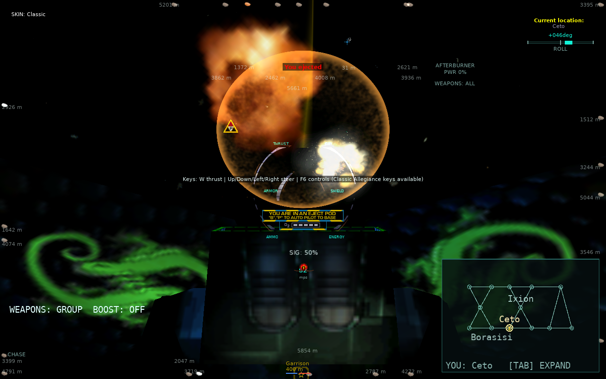
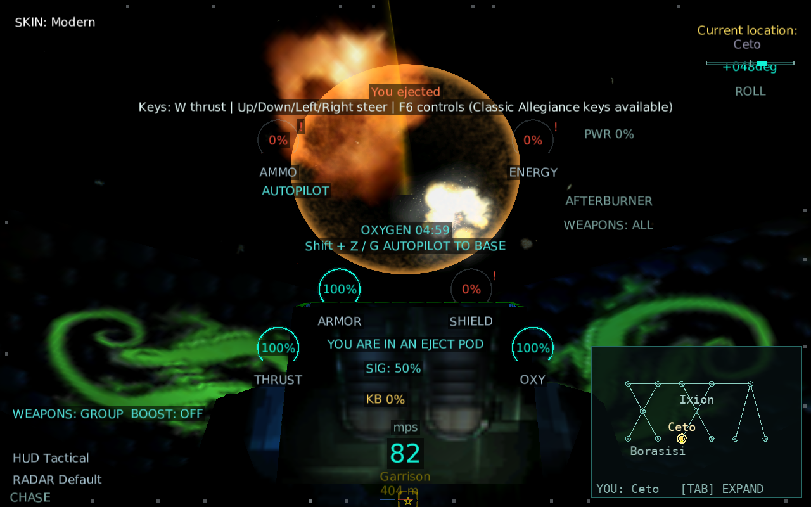

# P1084 — Desktop ejection blast

Implementation, focused qualification and desktop proof complete on base `b76d6c0d6`. The complete Fast sweep remains red from classified non-task failures and timing overruns. Changes remain uncommitted. This report was created before implementation and updated throughout the lane.

## Brief items

| Item | Done or not done | Evidence |
|---|---|---|
| 1. Shared render-free cue; unchanged browser behavior | Done | [`EjectBlastCues.cs`](../../src/Allegiance.ClientCore.Game/Rendering/EjectBlastCues.cs); all 25 original P1079 combat cases pass untouched |
| 2. Desktop draw, light, sound and director integration; both styles | Done | [`Game1.EjectBlasts.cs`](../../src/Allegiance.ClientCore.Game/Game1.EjectBlasts.cs), `Game1.Rendering.cs`, `Game1.Director.cs`; four real desktop runs pass |
| 3. Headless coverage; new and affected tests three times alone | Done | 25 new + 25 affected cases, each three times: **150 passed / 0 failed**, 60 fresh test hosts; [per-method receipts](P1084_assets/isolated-tests.json) |
| 4. Real loopback eject; Classic and Modern captures; cue/sound counts | Done | Native and Enhanced × both styles, real Game1 + TCP + server damage/eject path; [receipts](P1084_assets/desktop-receipts.txt), screenshots below |
| 5. Report and light gate | Done | Solution and all 156 tools build cleanly; complete Fast tier + nine infrastructure checks; every non-task failure/over-limit method isolated three times; broad Fast remains red as detailed below |

## Implementation

`EjectBlastCues` now owns the browser's previous-frame hull pose/velocity/fighter snapshot, KILL_SHIP sequence, preset expiry, mission/sector-view/sector resets and exact-overlap authoritative replacement. `BrowserCombatEffects` delegates cue handling to it; its remaining pose cache serves shield-hit alignment. No existing P1079 test was edited.

Desktop begins the cue frame before camera selection, snapshots only hulls admitted to the actual ship draw pass, and merges local cues with authoritative explosions once. The explosion quality branches, effect lights, nearest-blast camera and recency-scored spectator subjects all consume that snapshot. Docked, non-flight and skipped scene frames clear the local history. Classic and Modern use the same model.

Sound requests drain once, independently of rendering repetitions, through the existing `ExplosionSoundRouter` and `SoundManager.PlayWorldExplosion`. The saved old hull diameter determines the sound tier, independently of visual category: a fighter's small visual blast can use the medium sound. An authoritative overlapping blast suppresses the inferred draw and any pending inferred sound. Server/wire code, art and shockwave geometry are unchanged.

## Tests and builds

The seven new headless test methods cover 25 cases: fighter/last pose and velocity in both styles, nonfighter, credited death, not drawn/stale/hidden/other-sector/unknown ship and hull, mission/view/sector/reset, exact expiry boundary for both presets, native sound thresholds and one-shot draining, listener/sector gates and authoritative overlap boundaries. All 13 original P1079 combat methods (25 cases) also ran unchanged. Every method ran three times by itself in a fresh process: **75 new + 75 affected passes**, no skips or failures.

Commands use the installed .NET SDK; NuGet HTTP cache is under `.scratch/nuget-http`. Local raw build logs, TRX and full-run logs are under `.scratch/p1084/` (ignored). Durable aggregate receipts are in `P1084_assets/`.

- Solution build: **0 warnings / 0 errors** (final clean pass).
- `tools/build-tools.sh`: **all 156 projects built, 0 warnings / 0 errors**. The first pass hit a read-only default-cache restore for the unchanged KNI shader tool; the passing run used its already-existing cached packages as a fallback, with restore restricted to local files. No package was installed. The new proof project also builds cleanly.
- One complete Fast-tier sweep, the light gate specified in `AGENTS.md`: **16,142 cases: 16,131 passed / 4 failed / 7 skipped**, 662.7 s, plus **15** passing executions above the calibrated 12.554 s limit. All **nine infrastructure checks** passed (0.002 s unittest time). Every failing/over-limit method ran three times alone; results below. [Qualification summary](P1084_assets/qualification-summary.json).
- Glossary links and both task parity CSVs validate; `git diff --check` passes.
- No showcase run is needed: no server or wire behavior changed. Training is unchanged.

## Real desktop proof

[`tools/p1084-eject-proof/Program.cs`](../../tools/p1084-eject-proof/Program.cs) reuses the `p998-ui-proof` loopback fixture: a real purchase/launch of Adv Fighter hull 15, ordinary lethal simulation damage, server `KILL_SHIP` with `BDeathCredit=false`, then surviving Lifepod hull 33. It introduces no server cheat or injected client explosion. The proof runs the production Game1 window through DesktopGL/Mesa on Xvfb, with native artwork and the existing Content tree linked beside the proof executable. OpenAL's null output permits real sound requests without a physical audio device.

The fixed camera records the old hull, then its blast, then the surviving pod after expiry. Each run asserts **one cue / one sound request / zero authoritative explosions**, type 3 (small fighter), one director explosion subject and a valid nearest-explosion override target. Enhanced additionally asserts a live effect light; Native retains its existing disabled effect-light setting. Each run checks the sound count remains one after the blast expires. Logs confirm **tier Medium**.

| HUD | Old hull | Native blast at old hull position | Surviving pod after expiry | Enhanced blast/light |
|---|---|---|---|---|
| Classic | [Before](P1084_assets/native-eject-classic-before.png) | [Blast](P1084_assets/native-eject-classic-blast.png) | [Pod](P1084_assets/native-eject-classic-pod.png) | [Enhanced](P1084_assets/enhanced-eject-classic-blast.png) |
| Modern | [Before](P1084_assets/native-eject-modern-before.png) | [Blast](P1084_assets/native-eject-modern-blast.png) | [Pod](P1084_assets/native-eject-modern-pod.png) | [Enhanced](P1084_assets/enhanced-eject-modern-blast.png) |





All retained screenshots were visually reviewed: real game frames, native art, no private content or newly generated media assets.

Reproduce after building the solution and the proof project, with artwork configured through the repository's existing local configuration:

```sh
for quality in native enhanced; do
  for style in classic modern; do
    LIBGL_ALWAYS_SOFTWARE=1 ALSOFT_DRIVERS=null \
      XDG_CONFIG_HOME="$PWD/.scratch/p1084/config-$style" \
      xvfb-run -a -s '-screen 0 1600x1000x24' \
      ~/.dotnet/dotnet tools/p1084-eject-proof/bin/Debug/net10.0/p1084-eject-proof.dll \
      ".scratch/p1084/desktop-$quality" "$style" "$quality"
  done
done
```

## Qualification observations

The first broad sweep failure is outside this task: `BroadcastTelemetryUnitTests.Record_path_allocates_nothing_after_warmup` observed 6,128 B instead of zero. The unchanged method passed three isolated processes (10 / 11 / 8 ms (TRX case time)). It belongs to the allocation-counter symptom family already discussed in `docs/TEST_FLAKES.md`; the exact cause is unproven. The ledger records this exact-method observation. Two further unchanged Core failures also passed 3/3 exact-method processes: console rate-reduction capture (1.271 / 1.335 / 1.414 s) and the already-ledgered warp status receipt (0.380 / 0.336 / 0.372 s). The console failure observed before 351 lines/s versus after 44 lines/s; the warp collection contained only old-sector status. These observations are ledgered without changing assertions or quarantine. A fourth failure, `KillBonusLiveTests.Real_end_to_end_projectile_kill_increases_kill_bonus`, missed the Bot kill receipt. Its three isolated outcomes were **fail / pass / pass** (3.228 / 0.627 / 0.562 s), matching the existing combat-receipt signature; it is not claimed as a threefold isolated pass. Isolated passes do not make the failed broad Fast sweep green.

All 12 timing-limit methods were already recorded by exact method in the pre-P1084 flake ledger. Each then ran three times alone, including all theory rows: **105/105 cases passed in 36 hosts**, all below the original 12.554 s limit. Thresholds, filters and scheduling policy are unchanged. [Isolation receipts](P1084_assets/failure-isolation.json).

| Timing-limit method | Isolated cases passed (three hosts) | Maximum case seconds |
|---|---:|---:|
| `P800HullProofGpuTests.Every_hull_of_the_real_core_renders_in_hangar_flight_and_target_pane` | 3/3 | 2.916 |
| `P704TechLoadoutTests.Dock_local_masks_are_never_combined_and_finale_uses_the_same_bomber_selection` | 3/3 | 4.937 |
| `P796VariedLoadoutTests.Varied_equips_every_legal_hull_and_part_of_the_role_over_many_purchases` | 9/9 | 9.334 |
| `P814GunnerTests.P814b_TurretCarrier_pref_keeps_or_beats_the_Best_hulls_turret_seats` | 3/3 | 3.536 |
| `P832bProsperityTests.No_goal_decision_trace_matches_dispatch_base` | 3/3 | 1.333 |
| `P942ResearchCommanderTests.Generated_commander_funds_buyable_research_before_optional_production` | 9/9 | 1.813 |
| `SC2NaniteSupportTests.Support_selection_obeys_research_dock_budget_and_mounts` | 6/6 | 5.100 |
| `SC3CloakPolicyTests.Research_loadouts_offer_real_legal_cloaks_without_unlock_bypass` | 3/3 | 1.526 |
| `P1000CivProfileTests.Every_loaded_civ_has_immutable_specs_and_legal_routes` | 30/30 | 2.073 |
| `P750NativeAsteroidTypesTests.Research_showcase_rocks_carry_native_models_and_no_rock_names` | 3/3 | 1.920 |
| `P999CivStrategyTests.Every_profile_is_reachable_in_catalog_and_actual_side_buy_gates` | 30/30 | 5.141 |
| `TechTreeDevelopmentLiveTests.Side_attribute_change_broadcasts_whole_mission_but_not_across_missions` | 3/3 | 6.638 |

## Validation limits and unfinished extras

The invocation was initially `tools/run-tests.sh --tier all --no-build`, which completed the entire required Fast tier before continuing into Live. That was broader than this task's light gate (`AGENTS.md` specifies Fast; training code is unchanged). I stopped my extra continuation cleanly, exit 130, after **41 reported Live passes / 0 reported failures / 3 reported skips**. These are partial results, not a completed Live verdict; Perf did not run. The extra checks included the ten-minute flight soak, two-warp pod rescue and several real training windows. They are not presented as a substitute for any required check. No P1084 implementation or desktop-proof item remains unfinished.

## Native intent

`clintlib/appmsg.cpp:2846-2857` creates a hull explosion on KILL_SHIP regardless of death credit, choosing small for fighter-capable hulls and big otherwise. `WinTrek/trekigc.cpp:105-177` supplies category-specific explosion geometry. Its lines 90-101 gate positional sound to the current cluster and select large above scale 100, medium above 10, otherwise small; lines 180-192 supply the old model position, velocity and diameter. Native sprite timing comes from `effect/explosion.cpp:104-202` through the existing shared presets.

## Modern approach

Both platforms infer the missing presentation cue locally from the previous drawn hull and the existing ordered kill sequence. They retain the authoritative 207 death path and prefer overlapping server blasts. Desktop rendering, lighting, audio and cinematic interest reuse existing presentation paths; no world mutation, new packet, server rule, art or shockwave change is required.
