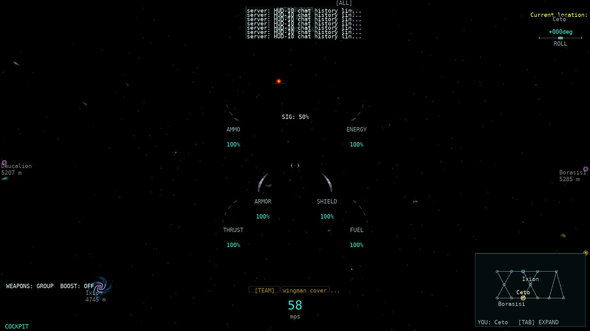
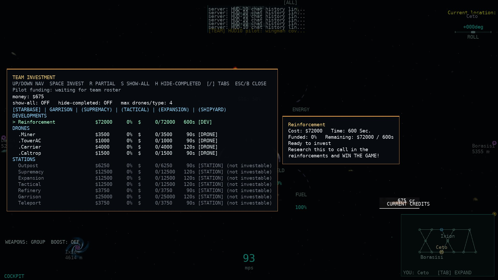
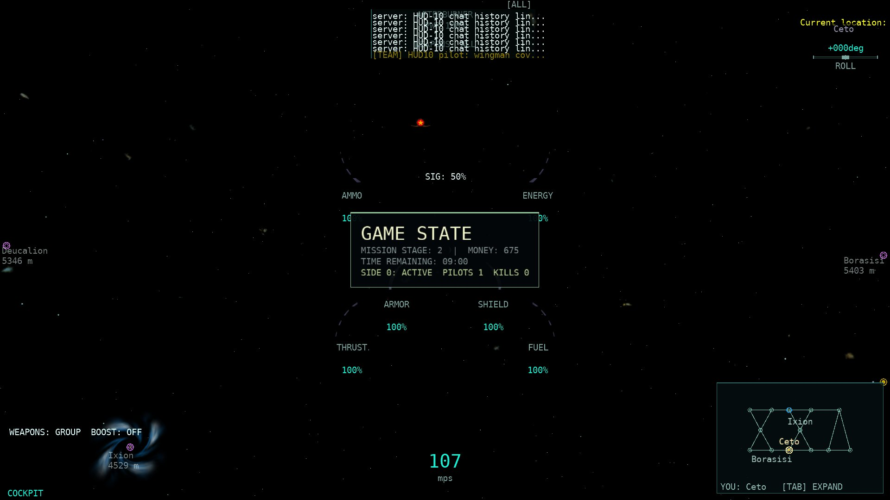
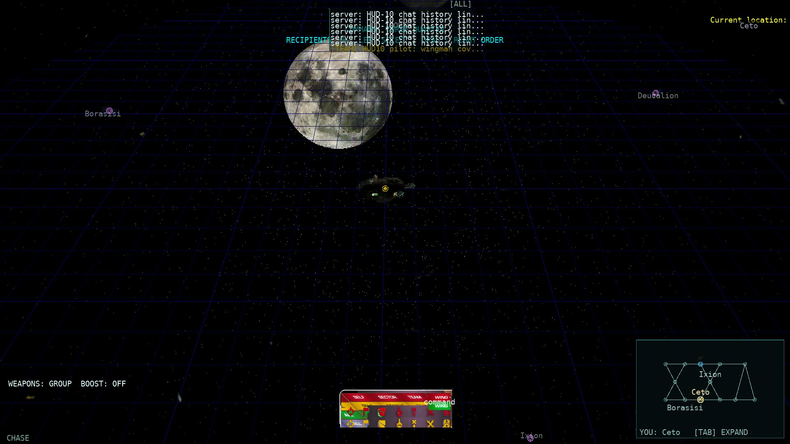
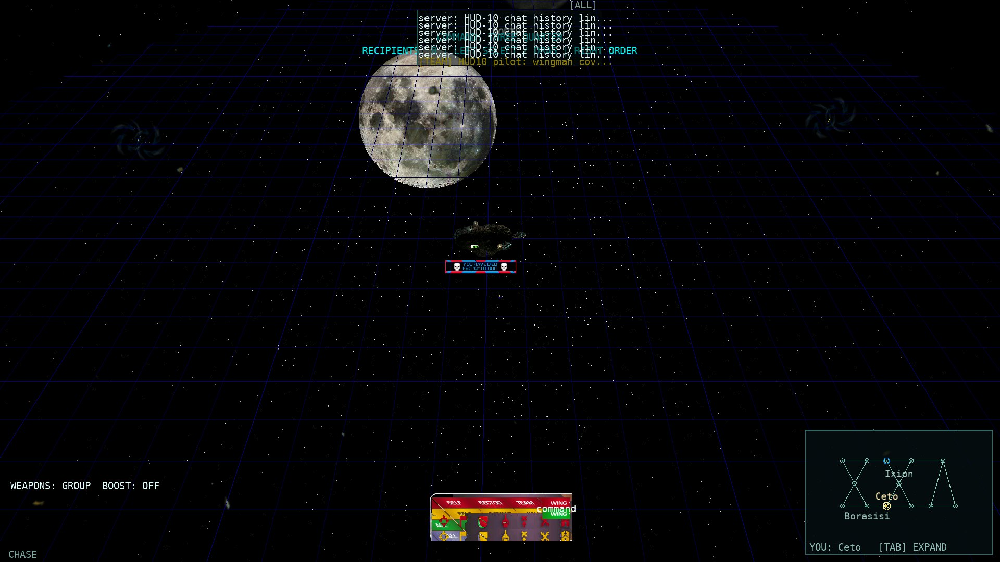
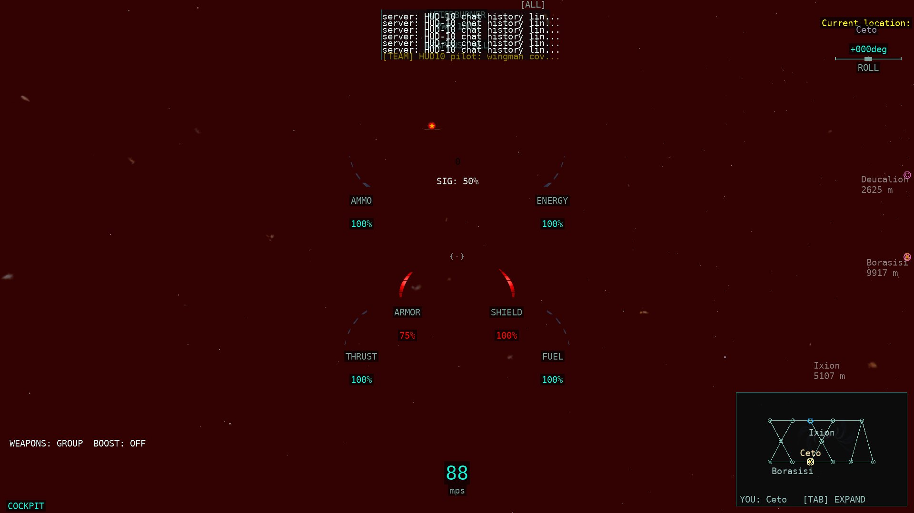
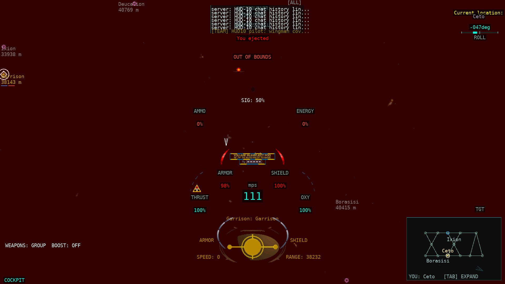

# HUD-10 — chat, compose, command bar, money, clock, pod/death, warnings, damage flash, pane slides

Base: master at dispatch (`50830ab5`, e1c528b2 or later). Branch/worktree:
`pi/hud10`. Changes are left in the working tree; no commits or pushes were made.

Native coordinates in this report use `Artwork/dialog.mdl`'s own convention:
lower-left origin, +Y up (`dialog.mdl:5259-5268`). The port converts each point
to top-left screen space in the layout classes; the conversions are pinned by
tests.

## Rows

### 1. Chat history — partial

- **Native:** `WinTrek/console.cpp:3508`; `Artwork/dialog.mdl:180` —
  `ChatListPane(355, 8 + ChatFontSize*NumChatLines, ChatFontSize, false)`
  (hidden scrollbar); `WinTrek/chatpane.cpp:374-380` (`m_pnumLines *
  itemHeight + 8`); default `ChatLines` 7 (`WinTrek.cpp:3317`), default
  `ChatFontSize` 2 (`WinTrek.cpp:2912`); `CommPane` at `SideTop(-160,-126)`
  (`dialog.mdl:5394`); per-line sender side colour ×0.85
  (`WinTrek/trekigc.cpp:4736-4741`, `chatpane.cpp:93-101`).
- **Port:** `Rendering/Hud10Layouts.cs:13` (`ChatPaneLayout`: width 355,
  height 8+14·lines, 7 lines, anchor, hidden scrollbar);
  `Rendering/ChatRenderer.cs:14` draws the 355-wide pane at the native
  top-left anchor with 14 px native line slots;
  `Game1.Session.cs:888-950` carries the sender side colour per line;
  `ModernHudRenderer.cs` uses the same native geometry.
- **Test:** `Hud10PanelsTests.Chat_pane_uses_native_width_height_lines_and_anchor`,
  `Chat_pane_height_scales_with_the_native_line_count`.
- **Status:** partial — geometry/line count/position/colour rule match; the
  port HUD spritefont substitutes native `largeFont`, and the OLDER scrolled
  marker remains a port extension.
- **Screenshot:** [`1920x1080-chat-compose.jpg`](HUD10_assets/1920x1080-chat-compose.jpg)
  — seven history rows occupy the 355×106 pane just below the top edge; the
  team line is drawn in the sender’s side colour.

### 2. Chat composition and recipient — partial

- **Native:** `WinTrek/console.cpp:704-708` for `ComposeState`/`CommandVerb`/
  `ChatRecipient`/`ChatText`; `Artwork/dialog.mdl:89-170`:
  `ComposingMouse` 73×23 `chatmousebmp`, `ComposingText` 266×22 `chattextbmp`
  (recipient box 100×17 at (3,3), text box 154×17 at (112,3)),
  `ComposingCommand` 236×22 `chatcommandbmp` (verb icon at (78,2), text at
  (104,3)), `ComposingShell` 236×22 `chatshellbmp`, `ComposingQuick`
  `chatmousebmp`; panel anchor `SideBottom(-150,148)`, slide 0.5 s
  (`dialog.mdl:5355`). Compose states 1-5 (`console.cpp:524-529`).
- **Port:** `Rendering/Hud10Layouts.cs:105` models all five variants
  (art stem, sizes and every inner offset); `Rendering/ChatRenderer.cs:14`
  draws the selected variant from the real art;
  `Rendering/HudNativeTextures.cs:1` loads the `.mdl` panels; production maps
  typed chat → state 2 and the quick-chat menu → state 5
  (`Game1.Rendering.cs:2754-2775`).
- **Test:** `Hud10PanelsTests.Compose_variants_match_the_native_panel_art_and_inner_offsets`,
  `Compose_panel_slides_from_off_to_native_on_anchor`,
  `Compose_command_verb_icon_maps_the_native_verb_initials`.
- **Status:** partial — all five native presentation variants are implemented
  and drawn from the art, but the port has no mouse-command/command/shell
  compose input paths yet, so only states 2 and 5 are reachable in play.
- **Screenshot:** [`1920x1080-chat-compose.jpg`](HUD10_assets/1920x1080-chat-compose.jpg)
  — the 266×22 `chattextbmp` panel at the native bottom anchor showing
  `[TEAM]` and `wingman cover …|`.

### 3. Command recipient verb and wing controls — partial

- **Native:** `WinTrek/console.cpp:742-760` (`RecipientsBB`, `VerbsBB`,
  `WingCombo` with `c_pszWingName`), `OnVerbButton` `console.cpp:1264-1278`;
  `Artwork/dialog.mdl:38-42` (recipient columns `[53,106,159,212]`, verb columns
  `[32,62,92,122,152,182,212,242,268]`) and `dialog.mdl:73-87` (children at
  (4,8), (216,8), (2,38)); display entry `SideBottom(-135,-190)→(-135,40)`,
  0.5 s (`dialog.mdl:5416`).
- **Port:** `Game1.Commanding.cs:300` draws the native command background,
  recipient bar, verb bar and wing combo at the native anchor/slide;
  `Game1.Commanding.cs:340` hit-tests/clicks the native columns and arms a
  verb (which overrides the resolver default in `Game1.Targeting.cs:1096`);
  `Rendering/Hud10Layouts.cs:156` owns the native layout/columns/wing names.
- **Test:** `Hud10PanelsTests.Command_bar_native_columns_hit_test_and_verb_ids`.
- **Status:** partial — the bars and wing combo are present and clickable and a
  verb applies to the next order; the native per-recipient/per-wing order
  fan-out and full command-compose flow are not ported.
- **Screenshot:** [`1920x1080-command-bar.jpg`](HUD10_assets/1920x1080-command-bar.jpg)
  — the 274×92 bar at the bottom centre with recipient labels, verb icons and
  the `command` wing name.

### 4. Money credits — partial

- **Native:** `WinTrek/console.cpp:713` (`Money`); `Artwork/dialog.mdl:1885-1908`
  (`moneyPane` = `creditboxbmp`, value box 90×13 at (58,0) with
  `NumberString(Money)+" cr"`, white, centred; `CURRENT CREDITS` box;
  `MoneyPaneImage` at `dialog.mdl:5182`), embedded in
  `MergedInvestmentsPaneImage` at (33,0) (`dialog.mdl:5199-5203`) and shown only
  under `ofInvestment` at `SideRight(-490,-265)` (`dialog.mdl:5368`).
- **Port:** the always-visible flight `$n` readout was removed from
  `Rendering/HudRenderer.cs`; `Rendering/DockedScreenRenderer.cs:76,170-190`
  draws the real `creditboxbmp` + native `"n cr"` and `CURRENT CREDITS`
  anchors only in the F5 investment pane;
  `Rendering/Hud10Layouts.cs:235` owns the art/text/anchor and
  `Rendering/HudNativeTextures.cs:1` loads the PNG-backend `creditboxbmp.mdl`.
- **Test:** `Hud10PanelsTests.Money_creditbox_uses_native_art_text_and_anchor`.
- **Status:** partial — flight no longer invents a credits line and the native
  art/text/when-rule is used; the port investment pane itself is not the native
  purchases pane, so its surrounding layout/typography differ.
- **Screenshot:** [`1920x1080-investment-money.jpg`](HUD10_assets/1920x1080-investment-money.jpg)
  — `675 cr` over `CURRENT CREDITS` in the creditbox at the lower right; no
  flight `$n` line.

### 5. Mission countdown — partial

- **Native:** `WinTrek/WinTrek.cpp:8128-8143` — countdown games:
  `int(GetCountDownTime() - (time - timeStart))`; otherwise
  `int(time - timeStart)`. `MissionParams::IsCountdownGame()` is
  `dtGameLength != 0.0f` (`Igc/igc.h:1526-1529,1557-1560`). The
  `CountdownOn`/`timebmp` badge is never fed (`dialog.mdl:5091-5106`).
- **Port:** `Rendering/Hud10Layouts.cs:276` (`MissionClock`) pins the
  remaining/elapsed/format rule; `ClientWorld.cs:1690`
  (`MissionElapsedSeconds`) evaluates native `dt` on the live server clock;
  `Game1.ConsoleModes.cs:250-261` feeds the port GAME STATE container;
  `Server.Lobby.cs:3114,3187` now fill `MissionDef.GameLengthSeconds` from the
  configured game length (`MissionDef.cs:98,144` already carried it).
- **Test:** `Hud10PanelsTests.Mission_clock_is_remaining_for_countdown_games_and_elapsed_otherwise`,
  `Hud10ServerClockLiveTests.Mission_def_carries_the_configured_countdown_length_to_the_client`.
- **Status:** partial — the native rule and data path are implemented; the
  native game-state screen art is not ported (the port shows its text GAME STATE
  pane), and the unused native countdown badge is deliberately not invented.
- **Screenshot:** [`1920x1080-gamestate-clock.jpg`](HUD10_assets/1920x1080-gamestate-clock.jpg)
  — `TIME REMAINING: 08:59` in the game-state container.

### 6. Eject pod identity panel — partial

- **Native:** `WinTrek/consoledata.cpp:578-590` (`IsEjectPod`: own hull has
  `c_habmLifepod` **and** is in a cluster); `Artwork/dialog.mdl:1985-1996`
  (`EjectPodImage` switches to `DefaultEjectPodDisplayOn` / `GHEjectPodDisplayOn`
  by HUD style); classic group `dialog.mdl:1922-1935`: 172×44
  `conejectpoddisplaybmp`, endurance bar at (66,10); placement
  `SideCenter(-86,-87)` (`dialog.mdl:5436`).
- **Port:** `Game1.Rendering.cs:3567` draws the real 172×44 panel unscaled at
  `LifepodPanelLayout` (`Rendering/Hud10Layouts.cs:313`), gated by
  `LifepodHud.IsAdriftLifepod` (own hull capability + in space).
- **Test:** `Hud10PanelsTests.Lifepod_panel_and_gauge_use_native_unscaled_geometry`.
- **Status:** partial — native art/position/scale and own-pod gate match; the
  GlassHUD `GHEjectPodDisplayOn` variant is not drawn (classic panel in both port
  skins).
- **Screenshot:** [`1920x1080-lifepod.jpg`](HUD10_assets/1920x1080-lifepod.jpg)
  — the 172×44 `YOU HAVE EJECTED / YOU CAN WAIT TO BE RESCUED` panel at centre
  with the yellow endurance bar, `OXY 98%`.

### 7. Lifepod oxygen endurance — partial

- **Native:** `WinTrek/consoledata.cpp:534-545` (`GetEndurance` only for the own
  ship; fraction = remaining/endurance clamped 0..1);
  `Artwork/dialog.mdl:1927-1935`
  `GaugeImage(JustifyLeft, softgaugebmp, GetEndurance)` at (66,10).
- **Port:** `Game1.Rendering.cs:3567` draws the real 52×4 `softgaugebmp` with an
  integer left-to-right fill of `FuelFraction` (the wire OXY fraction) at
  `LifepodPanelLayout.GaugeTopLeft` (`Rendering/Hud10Layouts.cs:313`).
- **Test:** `Hud10PanelsTests.Lifepod_panel_and_gauge_use_native_unscaled_geometry`.
- **Status:** partial — the classic horizontal endurance bar matches; the
  GlassHUD endurance bar at (60,52) is not drawn separately.
- **Screenshot:** [`1920x1080-lifepod.jpg`](HUD10_assets/1920x1080-lifepod.jpg)
  — the yellow bar under the eject text, with `OXY 98%`.

### 8. Death banner — partial

- **Native:** `WinTrek/WinTrek.cpp:3653` feeds `IsGhost`; `IsGhost` is
  `m_nDeaths > mission iLives` (`Igc/shipIGC.h:2465-2469`);
  `Artwork/dialog.mdl:1998-2003` `DeathBannerPane = deathbannerbmp`,
  `SideCenter(-105,15)` (`dialog.mdl:5439`), natural 136×25 size.
- **Port:** `Game1.Rendering.cs:3567` draws the unscaled 136×25
  `deathbannerbmp` at `DeathBannerLayout` (`Rendering/Hud10Layouts.cs:347`).
- **Test:** `Hud10PanelsTests.Death_banner_is_unscaled_at_the_native_centre_anchor`.
- **Status:** partial — art/size/position match; the gate uses the port `Dead`
  flag because native lives/deaths (`IsGhost`) are not on the client wire.
- **Screenshot:** [`1920x1080-death-banner.jpg`](HUD10_assets/1920x1080-death-banner.jpg)
  — the small `YOU WERE KILLED` banner at the native centre anchor.

### 9. Boundary and crowd warnings — partial

- **Native:** `WinTrek/WinTrek.cpp:8654-8670` — play
  `salBoundryExceededSound` / `salSectorCrowdedSound` on the rising edge of
  `c_wmOutOfBounds` / `c_wmCrowdedSector` only; native has no warning text.
- **Port:** already implemented in `ClientCore/State/ShipWarningState.cs:7`
  (rising-edge accumulator), `Game1.FlightInput.cs:269` (feed) and
  `Audio/SoundManager.cs:2027` (VO + shared bounds loop); the textual
  `OUT OF BOUNDS` / `SECTOR CROWDED` badges remain in `Rendering/HudModel.cs:260`
  as an explicit port extension. No production change this wave.
- **Test:** existing `P629ShipWarningTests` (wire round-trip/rising edges are
  idempotent, both bits share the loop/reset discards pending audio) and
  `P629PenaltyLiveTests`.
- **Status:** partial — edge semantics are native and pinned; the text badges
  are a port extension.
- **Screenshot:** [`1920x1080-lifepod.jpg`](HUD10_assets/1920x1080-lifepod.jpg)
  — `OUT OF BOUNDS` visible under the eject banner. (The dedicated
  `1920x1080-boundary-warning.jpg` capture did not retain the badge: the server
  envelope-corrected the moved pose before the warning tick; the lifepod capture
  shows the same live warning path.)

### 10. Incoming missile warning — done

- **Native:** `WinTrek/trekigc.cpp:5030-5070` — warn when any missile in the
  cluster targets the own **source ship** (`GetSourceShip()`, carrier when
  boarded; `Igc/shipIGC.h:1481-1484`), pitch `0.75 + bestLock/2`, stop when none.
- **Port:** `Server.Broadcast.cs:3003-3045` now compares the missile target with
  `ship.ParentShip ?? ship` (the source ship) and reads the source sector;
  `Audio/MissileWarningController.cs:47` has the arm/pitch/disarm edges and
  `Game1.Audio.cs:189` drives the loop. The wire is the owner-only
  `MISSILE_TRACK_WARNING(208)` extension.
- **Test:** `MissileTrackWarningLiveTests.Warning_routes_by_the_source_ship_for_pilot_and_gunner`
  (pilot and gunner, 3/3 isolated) plus the existing arm/clear live test and
  controller unit tests.
- **Status:** done — matches the cited native rule; the wire is a documented
  this-port-only extension because the missile stream carries no target.
- **Screenshot:** not visually distinct from the audio loop; the live test
  observes arm/disarm over the real transport.

### 11. Damage flash timer — done

- **Native:** `WinTrek/WinTrek.cpp:35-37` (0.25 s on, 0.25 s off, 2.0 s
  duration); `SetTimeDamaged` `:8921-8935` snaps a re-hit to the last on/off
  boundary; `GetFlash` `:8937-8958`. Arms on `DamageShipEvent`
  (`trekigc.cpp:4270-4283`).
- **Port:** `Flight/DamageFlashTracker.cs:45` already pins the exact timings and
  boundary snap; `Game1.Rendering.cs:2560-2566` now arms from the real per-hit
  `VICTIM_DAMAGED(217)` revision (`ClientWorld.cs:432`), with the sampled
  hull/shield decrease retained only for damage sources that have no per-hit
  wire event (collisions/mines). `HudSettings.cs:22` makes the extra full-view
  wash optional (`DamageWash`, default on).
- **Test:** `DamageFlashTrackerTests` (timings/boundary/edges) and
  `Hud10PanelsTests.Victim_damaged_increments_the_real_hit_revision_used_by_the_flash`.
- **Status:** done — timing/arming rule matches; the wash is optional and
  non-native gauge flash remains the default art behaviour.
- **Screenshot:** [`1920x1080-damage-flash.jpg`](HUD10_assets/1920x1080-damage-flash.jpg)
  — red wash, `ARMOR 75%`, red hull/shield gauge segments after a real server
  `ReceiveDamage` hit.

### 12. Console pane visibility and slide animation — partial

- **Native:** `WinTrek/console.cpp:3052-3075` slide time
  (`AnimatedTranslateTransform2`), `:3268-3290` `SetOverlayFlags`, `:3384-3392`
  `Show`, pane slide entries `:3400-3415`; all ported panes are 0.5 s in
  `dialog.mdl:5355-5387`.
- **Port:** `Rendering/Hud10Layouts.cs:401` (`PaneSlideTracker`, 0.5 s);
  `Game1.ConsoleModes.cs:60-112` computes the native overlay mask and advances
  the slides, plays `paneSlideSound` on a mask change and keeps the compose
  visual state while it slides out; the inventory pane and command bar use the
  slide offset, and the chat composer uses its native state-driven slide.
- **Test:** `Hud10PanelsTests.Overlay_mask_change_starts_a_native_half_second_slide`,
  `Compose_panel_slide_is_state_driven_not_overlay_driven`,
  `Sliding_pane_mask_bits_match_the_native_overlay_flags`.
- **Status:** partial — the panes the port actually draws animate with native
  durations; the full native console-overlay set and every pane slide are not
  ported.
- **Screenshot:** [`1920x1080-command-bar.jpg`](HUD10_assets/1920x1080-command-bar.jpg)
  shows the settled native command pane; the slide timing is pinned by tests and
  the `paneSlideSound` trigger is live.

### 13. SIM-0320 `paneSlideSound` — implemented

- **Native:** `WinTrek/console.cpp:3272-3274` — on
  `GetOverlayFlags() != om`; `sounddef.mdl:323` wave `windowslides`.
- **Port:** `Game1.ConsoleModes.cs:95` detects the mask change and calls
  `SoundManager.PlayPaneSlide` (`Audio/SoundManager.cs:1048`);
  `Content/Sounds/windowslides.ogg` + `Content.mgcb` entry are bundled.
- **Test:** `Hud10PanelsTests.Overlay_mask_change_starts_a_native_half_second_slide`
  and `SoundAssetManifestTests.Every_literal_LoadSound_asset_is_bundled`.
- **Status:** implemented; the sound is audible, not visible in a screenshot.
- **Screenshot:** trigger state shown by the command-bar/investment captures.

### 14. SIM-0317 / SIM-0318 / SIM-0319 `chatKeySound` — implemented

- **Native:** `WinTrek/console.cpp:1264-1268` (verb button while not in the
  compose shell), `:2335-2339` (each typed char while composing past
  mouse-command), `:2422-2424` (`StartChat`); `sounddef.mdl:324` wave `text`.
- **Port:** `Game1.Commanding.cs:340` (verb button), `Game1.Session.cs:874`
  (`OnTextInput` append), `Game1.FlightInput.cs:925` (Enter/StartChat seam);
  `SoundManager.cs:1040`; `Content/Sounds/text.ogg` + `Content.mgcb` entry.
- **Test:** `SoundAssetManifestTests.Every_literal_LoadSound_asset_is_bundled`;
  `Hud10PanelsTests` pins the command-bar verb mapping used by the cue.
- **Status:** implemented; the sound is audible, not visible in a screenshot.
- **Screenshot:** [`1920x1080-chat-compose.jpg`](HUD10_assets/1920x1080-chat-compose.jpg)
  is the live composer state whose Enter/typing path plays the cue.

## Real-client screenshots

All captures are real `Allegiance.ClientCore.MonoGame` windows (1920×1080)
against a real local `Allegiance.Server` on `XXV_simple.igc`, driven by
`tools/hud10-proof/Program.cs` through the production seams (real chat input,
real investment pane, real server warning/hit/eject state, real command view).
Raw PNGs/logs are outside the repo in `~/allegiance-evidence/HUD10/`; the
small JPEGs under `HUD10_assets` total **1.17 MB** (≤ 2 MB).
[Provenance and source SHA-256](HUD10_assets/screenshots.json).

| Scenario | 1920×1080 |
| --- | --- |
| Chat history + compose |  |
| Investment money creditbox |  |
| Game-state clock |  |
| Command bar |  |
| Death banner |  |
| Damage flash |  |
| Eject pod + endurance + warning |  |

The death-banner capture drives the port’s `Dead` flag locally (native `IsGhost`
needs lives/deaths, which are not on the wire); every other shot uses live
server state. The dedicated boundary-warning shot is retained in
`HUD10_assets` but did not keep the badge (the server envelope-corrected the
moved pose before the warning tick); the lifepod capture shows `OUT OF BOUNDS`
from the live warning stream.

## Verification

- **Whole-solution Release build:** 0 warnings / 0 errors
  (`dotnet build AllegianceCore.slnx -c Release`).
- **New/affected tests 3× alone:**
  - `Hud10PanelsTests` + `DamageFlashTrackerTests` + `P757ChatPaneTests` +
    `HudModelTests` + `HudConsoleTextTests` + `SoundAssetManifestTests`:
    **130 passed, 3/3 runs**.
  - `MissileTrackWarningLiveTests` + `Hud10ServerClockLiveTests` +
    `P629ShipWarningTests`: **11 passed, 3/3 runs**.
  - `P674ParityScorecardTests`: **8 passed, 3/3 runs**.
- **Fast tier:** `tools/run-tests.sh --tier fast` — **9,274 tests, PASS**
  (268 s). Log: `~/allegiance-evidence/HUD10/fast.log`.
- **Server AOT publish** (`-r linux-x64 --self-contained -p:PublishAot=true`):
  **succeeded**, no IL2026/IL3050. Log:
  `~/allegiance-evidence/HUD10/aot.log`.
- Rig/221/200v200 runs were not launched (Claude runs those).

## Scorecard (before → after)

`python3 scripts/parity-scorecard.py`:

| matrix | area | weighted before | weighted after | unweighted before | unweighted after |
| --- | --- | --- | --- | --- | --- |
| parity-matrix | hud | 5.56% (18/324) | **7.41% (24/324)** | 5.56% (6/108) | **7.41% (8/108)** |
| parity-matrix | TOTAL | 78.70% (1429.905/1817) | **79.03% (1435.905/1817)** | 75.91% (479/631) | **76.23% (481/631)** |
| sim-rules | sounds | 87.64% (482/550) | **89.09% (490/550)** | 84.43% (179/212) | **86.32% (183/212)** |
| sim-rules | TOTAL | 87.07% (1118/1284) | **87.69% (1126/1284)** | 84.73% (355/419) | **85.68% (359/419)** |

The two new `done` HUD rows are **Incoming missile warning** and **Damage flash
timer**; the four sound rows (SIM-0317/0318/0319/0320) moved to `implemented`.
Everything else is recorded with a more precise `partial` difference rather
than over-claimed.

## Unfinished / remaining gaps

- Port HUD spritefonts substitute the native font set; text-bearing chat rows
  therefore stay partial.
- Mouse-command / command / shell compose input is not ported; only chat and
  quick-chat compose states are reachable.
- The native per-recipient/per-wing command fan-out and `hoverPane` verb
  tooltips are not ported; the command bar’s recipient/wing selections are
  displayed and stored, while the verb affects the next order.
- Money is native only in the F5 investment pane; the surrounding port
  purchases pane is not the native `MergedInvestmentsPaneImage` layout.
- The native game-state screen art is not ported (the port shows its text GAME
  STATE pane); the unused `CountdownOn`/`timebmp` badge was deliberately not
  invented.
- GlassHUD `GHEjectPodDisplayOn` and the GlassHUD endurance bar differ from the
  classic panel drawn in both port skins; native death banner uses `IsGhost`
  (lives/deaths not on the client wire).
- Native console-overlay slide coverage is broader than the panes the port
  draws; only the chat composer, command bar and inventory offsets are animated.
- Boundary/crowd warning text remains a port extension (native is audio-only).
