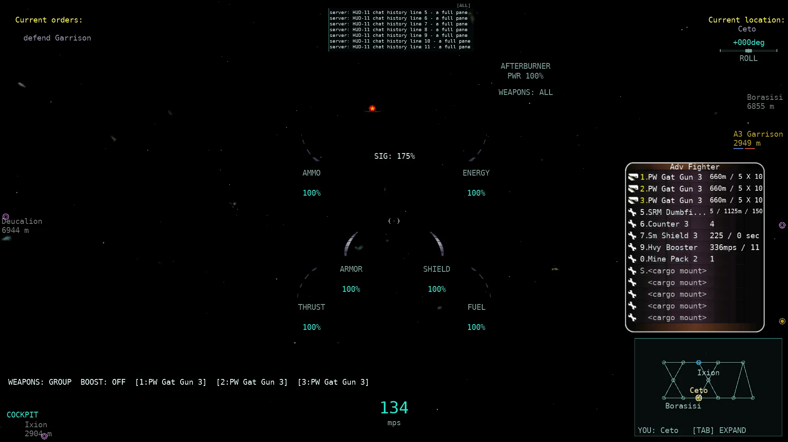
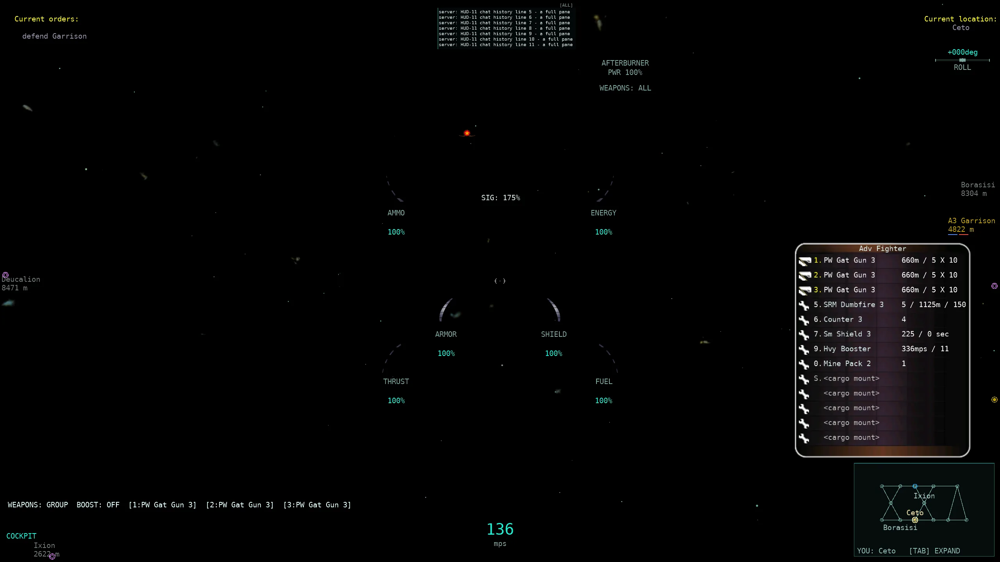
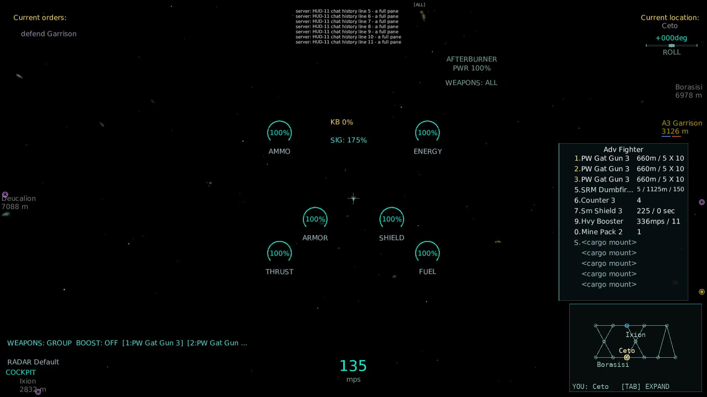
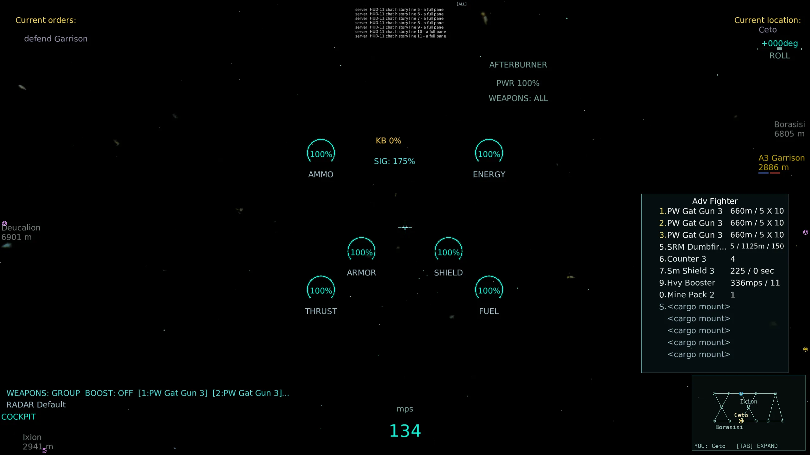
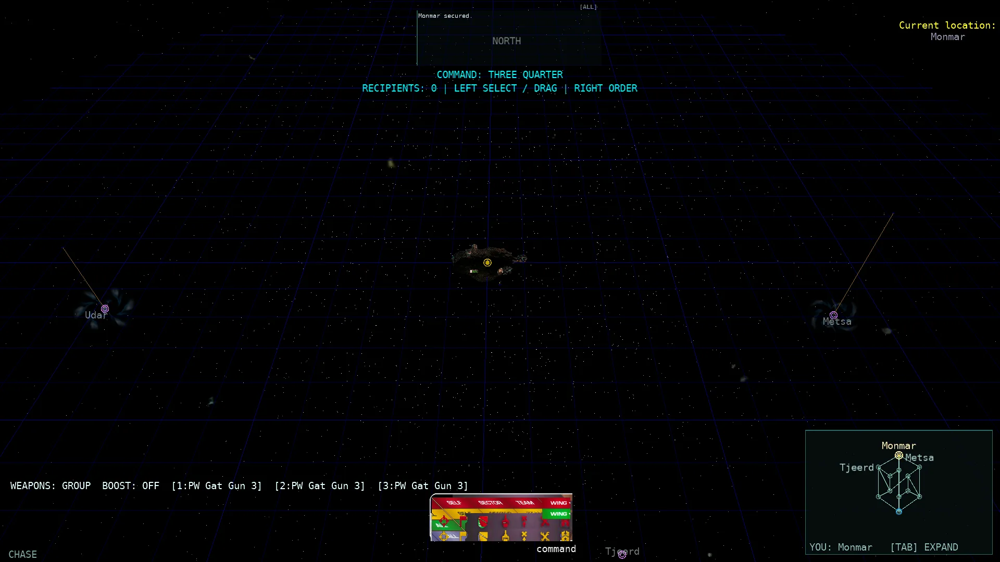
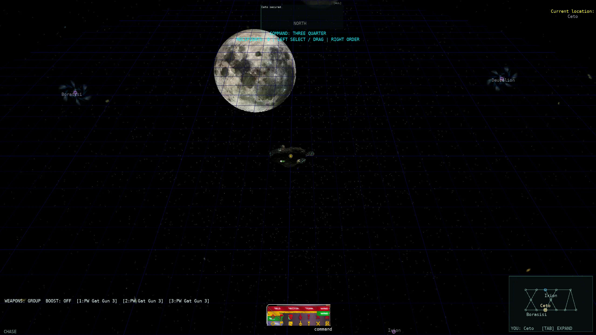
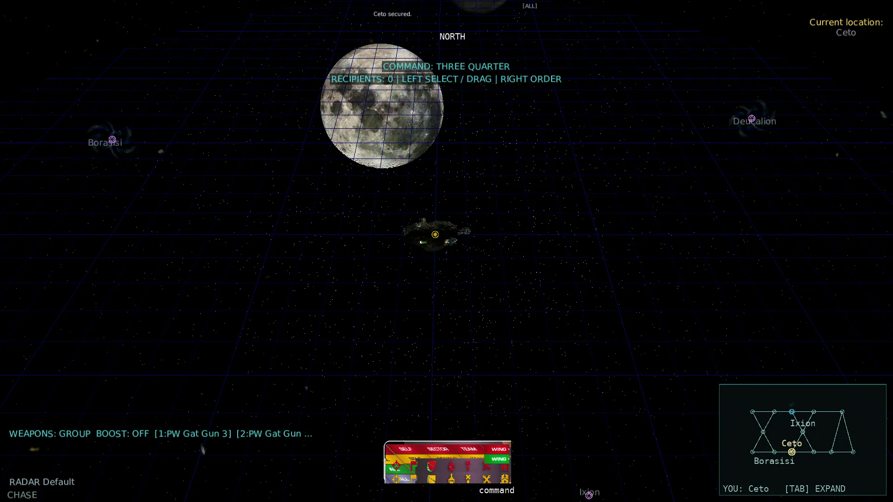
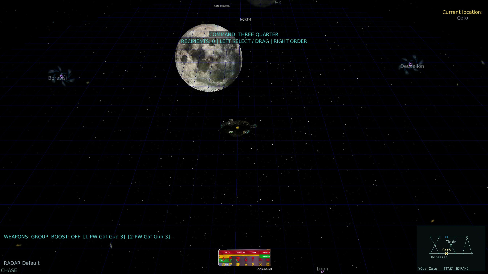
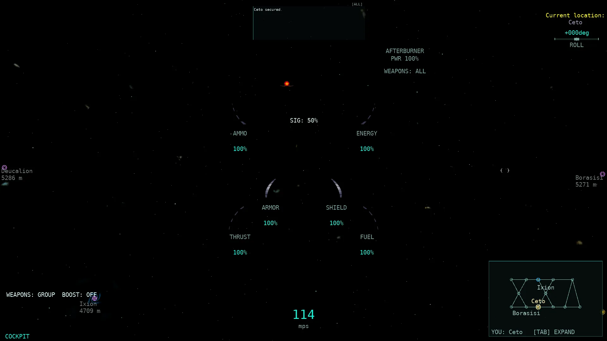
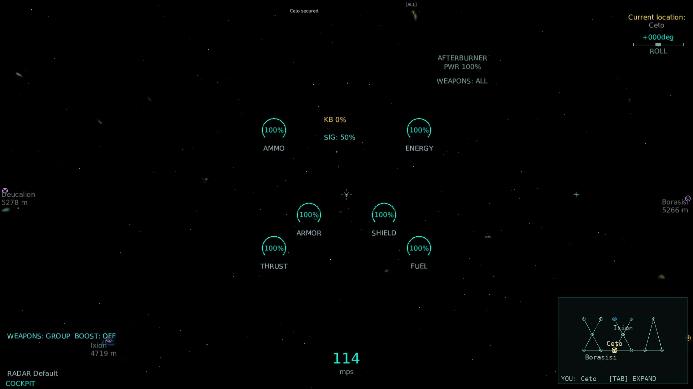

# HUD-11 — layout and per-frame cost cleanup from the HUD-3…HUD-10 reviews

Base: master at dispatch (`73296846`, carrying HUD-3…HUD-10). Worktree:
`/home/domingo/allegiance-pi-hud11` (branch lane `pi/hud11`), model DeepSeek V4.1
Flash. Changes are left in the working tree; **no commits or pushes** were made.
All native rules below cite `~/Development/Allegiance/src/` (and
`~/Development/Artwork/` for the `.mdl` dialogs).

## Result summary

| # | Item | Status | Rule / test |
| --- | --- | --- | --- |
| 1 | `HudModel.Create` per-frame contact/inventory `ToArray` copies | **fixed** | caller-owned `HudSnapshotBuffers`/`SnapshotList` reuse (`HudSnapshotBuffers.cs:14,56`; `HudModel.cs:243,260`), wired from `Game1`; `Hud11LayoutPerfTests` |
| 2 | 9 `Count(...)` passes + uncached label resolve in `HudElements` | **fixed** | one contact pass + `RadarLabelCache` (`HudElements.cs:149`); `Hud11LayoutPerfTests.HudElements_counts_contacts_in_one_pass_through_the_shared_label_cache` |
| 3 | Edge-clamped labels over the top-left block; block shuffled | **fixed** | the old MONEY/KILLS/KILL BONUS block is **gone**; the only top-left block is the native `LastOrderImage` (dialog.mdl:5451) and its anchors are now reserved before labels (`HudRenderer.cs:461-500`); test `Edge_clamped_labels_yield_to_the_reserved_console_block` |
| 4 | “Current location:” → sector name raw 14 px gap | **fixed** | gap is one rendered font line (`HudConsoleText.cs:114`; classic line height 22 px at 1080p, not 14), both skins (`HudRenderer.cs:701`, `ModernHudRenderer.cs:541`); dialog.mdl:1473-1485 |
| 5 | “Current orders:” over the port kill/money block | **resolved (nothing to collide)** | HUD-6 removed the port `N KILLS/KILL BONUS` block; HUD-10 removed the flight credits line (moneyPane is investment-only, dialog.mdl:5199-5203,5368). Top-left keeps only the native orders block, in native order. Pinned by `Flight_hud_draws_no_money_or_kill_block_at_the_top_left` |
| 6 | Tip/vote offset from shown chat lines, not configured height | **fixed** | `HudSettings.ChatLines` (default 7, clamp 1-10; WinTrek.cpp:3317,5262-5280) → `HudChat.PaneLines` → `HudConsoleFormat.BannerChatLines` (`HudConsoleText.cs:106`); loadout cap 6 (`Hud10Layouts.cs:61`, WinTrek.cpp:6694-6700). Tests `Banner_offsets_use_the_configured…`, `Configured_chat_lines_are_clamped…` |
| 7 | Inventory stats clipped (rate/missile damage/`<cargo mount>`) | **fixed** | native `StatsBar`/`Point(130,5)` lives in an 81-native-px slot (`invsweapon.mdl:5-27,105`); stats glyphs scale into that slot instead of ellipsizing (`InventoryPaneLayout.FitFontScale:62`, `HudRenderer.cs:2149`, `ModernHudRenderer.cs:431`), and rows without right columns use the full line for the name. Test `Native_inventory_stats_string_fits_its_stats_slot_at_1080p` |
| 8 | Chat history over AFTERBURNER/WEAPONS, overlapping rows; `command` over `WING` | **fixed** | chat glyphs are scaled into the native 14 px item slot (`ChatPaneLayout.TextScale:71`, chatpane.cpp:374-380) and the port top-centre cluster moved into the free slot right of the 355 px CommPane (dialog.mdl:180,5394); command-view lines start below the pane's fixed 126 px bottom. Native `ImageComboFacePane::SetString` is a no-op (effect/combopane.cpp:98-100), so the wing name is a caption below the art, not drawn on “WING” (`Hud10Layouts.cs:208,226`, `Game1.Commanding.cs:340`). Tests `Chat_rows_are_scaled_into_the_native_line_slot`, `Wing_caption_is_below_the_native_combo_art` |
| 9 | Plain target pick sends `c_cmdNone`, native resolves `c_cidDefault` | **fixed** | `CurrentCommandSetFor` resolves `GetDefaultOrder(own ship, target)` (`Game1.Orders.cs:149-162`) and `SendCurrentCommandToServer` sends that concrete id (`Game1.Orders.cs:195`); WinTrek.cpp:8827-8854, shipIGC.h:2071-2161. Tests `Plain_enemy_target_pick…`, `Plain_friendly_station_pick…`, `Explicit_command_selection…` |
| 10 | Velocity marker never shown in a real-client shot | **verified, no production change** | native `directionbmp` projection/cockpit/non-zero-speed/inside-view rules (`indicator.cpp:130-148`) were already implemented; a real cockpit frame now shows it off the reticle (staged 29° side-slip, see below). The stock launch attitude/velocity points straight down the reticle, which is why earlier shots could not show it. |

No parity row moved: every touched row still differs from native in font/art
(port spritefonts, undecoded command icons), and HUD-11 is a layout/cost
cleanup, not new native artwork. `scripts/parity-scorecard.py` after the change:
`hud 7.41% (24/324)`, `7.41% (8/108)` — identical to the HUD-10 scorecard.

## Perf evidence

- **Contact snapshot (item 1).** `HudModel.Create(frame, context, buffers)` now
  copies `context.Contacts` into a reused `SnapshotList<HudContact>` and the
  inventory rows into a reused `SnapshotList<HudInventoryRow>` instead of
  `ToArray()` per frame. The test measures `GC.GetAllocatedBytesForCurrentThread`
  over 200 frames after warm-up:
  **872 B/frame with 4 contacts and 872 B/frame with 4000 contacts** — flat, no
  per-contact array. The old `context.Contacts.ToArray()` allocated a new array
  proportional to the contact count every frame (the 107v107 path is ~214
  contacts). The buffer and its view are the same object across frames
  (`Contact_snapshot_reuses_one_buffer_across_frames`,
  `Inventory_row_snapshot_reuses_one_buffer_across_frames`).
- **Row counting (item 2).** `HudElements.Build` now walks the contacts once,
  accumulating the overlay masks, per-kind counts and label-row counts in the
  same loop, and resolves each label through the caller's long-lived
  `RadarLabelCache`. The test asserts exactly one `Resolve` call per contact per
  build (60 contacts → 60 calls) on two consecutive builds, so the former nine
  `Count(...)` walks and the separate uncached resolve pass are gone.
- The snapshot is frame-scoped by contract (the buffers are reused), matching the
  HUD-4 `_drawRadarContactsBuffer` intent; a model must not be retained across a
  later snapshot.
- **HUD-10 regression found while verifying item 7:** `HudModelAdapter` accepted
  `inventorySlide` but never assigned it to `HudContext`, so the inventory pane
  was always drawn 190 px low (at slide 0) and overlapped the minimap. Fixed at
  `HudModelAdapter.cs:50`; the before/after shots show the pane moving above the
  minimap.

## Layout detail

### Console blocks (items 3/4/5)

`ReserveConsoleAnchors` now reserves, before any radar label is placed:

- the native 355×`8+14·NumChatLines` CommPane rect (dialog.mdl:180,5394);
- the port top-centre status cluster's new slot (right of the chat pane);
- the measured top-right `Current location:` label + sector name;
- the measured `Current orders:` label and its queued/accepted lines at
  `OrderLabelX`/`OrderTextX` (dialog.mdl:1641-1649,5451).

The console text itself is still drawn with fixed anchors (`fixedAnchor: true`),
so the overlap pass cannot reorder the block. The label/value gap and the
label/queued/accepted gaps are now one rendered font line each
(`NameBelowLabel`, `OrderQueuedTop`, `OrderAcceptedTop`) instead of native raw
14/20/40 px, because the port substitute font is 22 px high at 1080p. Native
14 px is correct for native promptFont (dialog.mdl:1473-1485).

There is no flight money/kills block to preserve any more: HUD-6 removed the port
kill-bonus block and HUD-10 removed the always-visible `$n` line (native
moneyPane is inside the F5 investment pane only, dialog.mdl:5199-5203,5368).
`HudElements` still exposes the money value but keeps it invisible in flight, and
the test pins that “Money credits”, “Lives remaining” and “Mission kills” are not
drawn.

### Chat and command bar (item 8)

- Native `SetChatLines`/`UpdateSize` make each row exactly
  `GetFont(ChatFontSize,true)->GetHeight()` high and the pane
  `NumChatLines*itemHeight + 8` (chatpane.cpp:360-380). The port's spritefont is
  taller than native largeFont, so each history line is drawn at
  `min(1, 14/LineSpacing)` and advances by the native 14 px slot; rows no longer
  overlap and the pane cannot bleed over the top-centre readouts. This is used by
  Classic (`ChatRenderer`) and Modern (`ModernHudRenderer`).
- The port's AFTERBURNER/PWR/WEAPONS/MINING/TiDi cluster is a port extension
  (native has no text at top centre). It moved into the free slot immediately
  right of the CommPane; the reserved chat rect also keeps clamped radar labels
  out. Command-view summary lines moved to `ChatPaneLayout.BottomFromTop+6`
  (the native pane's bottom is always 126 px from the top).
- Native `WingCombo` is `ImageComboPane(btnchangewing3.png, smallFont)`; its
  `ImageComboFacePane::SetString` is empty (effect/combopane.cpp:98-100), so the
  native button shows only the baked “WING ▾” art. HUD-10 drew the selected wing
  name centered on that art and overprinted “WING”. HUD-11 keeps a small
  selected-wing caption **below** the panel (port extension) instead.

### Inventory pane (item 7)

`invsweapon.mdl` puts the name at `Point(35,5)` and `StatsBar` at `Point(130,5)`
in the 214 px line; the stats slot is 81 native px. The port font is wider than
native medVerdana, so `FitText` truncated the reading at 1080p (`660m / 5…`).
The renderer now computes `FitFontScale(stats, slot, measure)` and draws the full
native stats string at that smaller scale. Rows with no ammo/progress/stats
(notably `<cargo mount>`) use the full line width for the name. At 1080p Classic
and Modern the weapon rows show `660m / 5 X 10`, the launcher `5 / 1125m / 150`,
the shield `225 / 0 sec`, the booster `336mps / 11`, and every `<cargo mount>`
fully.

## Behaviour detail (item 9)

Native `SetTarget(pmodel, cid)` maps `c_cidDefault` through
`GetDefaultOrder(pmodel)` and sends that concrete `commandID`
(WinTrek.cpp:8827-8854). The port's plain target pick carried `CommandId=c_cidNone`
in `AutopilotTarget` and sent it verbatim. `CurrentCommandSetFor` now:

- keeps the explicit id for command-selected targets;
- otherwise resolves the native default order for the **own** ship's hull role,
  layer flag and parent flag against the same `CommandTargetProfile` used by the
  issue-order key (`Friendly`/hull/station/probe capabilities);
- returns no op for `TargetKind.Cluster` (not a model target).

`SendCurrentCommandToServer` sends the resolved id/type/id, falling back to
`c_cidNone` + invalid object only when there is no orderable target. Tests cover
an enemy ship → `c_cidAttack`, a friendly landable station → `c_cidGoto`, a
rescue pod → the explicit `c_cidPickup`, and a cluster/null → no send.

## Real-client screenshots

All after frames are real windowed `Allegiance.ClientCore.MonoGame` clients
against a real local `Allegiance.Server` (`XXV_simple.igc`, full-tech sides for
the inventory rows), driven through production seams by
`tools/hud11-proof/Program.cs`: real chat history lines, real console
orders/sector, real F4 inventory pane, real command view, and the production
velocity-marker projection. Raw PNGs, logs and the proof source are in
`~/allegiance-evidence/HUD11/{after,before,logs,proof}`. The ten WebP assets
total **821,922 bytes** (≤ 2 MB); [provenance and SHA-256](HUD11_assets/screenshots.json).

### Before

| Frame | What the pre-HUD-11 port showed |
| --- | --- |
| [1920×1080 Classic console text (HUD-9)](HUD9_assets/console-text-1920x1080-Classic.jpg) | “Current location:” and the sector name sit 14 raw px apart and crowd; the top-centre chat histories are not yet native; the old `3 KILLS / KILL BONUS / MONEY` block is still top-left (before HUD-6/HUD-10). |
| [1920×1080 Classic command bar (HUD-10)](HUD10_assets/1920x1080-command-bar.jpg) | Chat history rows overprint each other and the AFTERBURNER/WEAPONS block; `command` is drawn centered on the baked `WING` art; the command summary line `RECIPIENTS…` runs across the chat pane. |
| [1920×1080 Classic inventory (HUD-7)](HUD7_assets/1920x1080-inventory-Classic.webp) | Weapon stats are ellipsized (`660m / 5…`, `5 / 1125…`); the pane is above the minimap in that shot but the new harness reproduced a HUD-10 slide bug that put it over the minimap. |
| [1920×1080 Classic combat (HUD-5)](HUD5_assets/1920x1080-combat-Classic.webp) | Edge-clamped radar labels near the top-left collide with the old port money/kill block, which the measured-text pass then moves out of native order. |
| `~/allegiance-evidence/HUD11/before/layout-1920x1080-Classic.png` | Fresh pre-change frame of the same layout scenario: chat rows overlap each other and the centered AFTERBURNER block; sector label/name crowd; inventory pane is drawn 190 px low over the minimap. |

### After — layout (console text + chat + inventory)

| Scenario | 1920×1080 | 2560×1440 |
| --- | --- | --- |
| Classic |  |  |
| Modern |  |  |

What is visible (all four opened and checked):

- **Top-left:** `Current orders:` at the native (37,37), followed by
  `defend Garrison` one rendered line below; no MONEY/KILLS/KILL BONUS row.
- **Top-right:** `Current location:` at 37 and `Ceto` one full line below — no
  glyph collision in either skin or resolution.
- **Top-centre:** seven chat history rows inside the native 355×106 pane; the
  rows no longer overlap and do not cover the `AFTERBURNER`/`PWR 100%`/
  `WEAPONS: ALL` block, which now sits to the right of the pane.
- **Bottom-right:** the Adv Fighter inventory pane is above the minimap and shows
  the complete native stats: `660m / 5 X 10` on the three Gatling guns,
  `5 / 1125m / 150` on the SRM launcher, `225 / 0 sec` shield, `336mps / 11`
  booster, and `<cargo mount>` fully in all five cargo rows. At 2560 Classic the
  longer `SRM Dumbfire 3` name also fits.
- **Radar labels** (e.g. `Deucalion`, `Borasisi`, `A3 Garrison`) stay at the left
  and right edges, clear of the reserved console blocks.

### After — command bar

| Scenario | 1920×1080 | 2560×1440 |
| --- | --- | --- |
| Classic |  |  |
| Modern |  |  |

The four command frames show one chat line at the top of the pane, the
`COMMAND: THREE QUARTER` / `RECIPIENTS: 0 | LEFT SELECT / DRAG | RIGHT ORDER`
summary below the pane's 126 px bottom, and the command bar with its intact
`WING ▾` art; the selected wing `command` is a caption below the panel, not
printed over “WING”. No chat row/command line/bar overprint is visible in either
skin or resolution.

### After — velocity direction marker (item 10)

| Scenario | 1920×1080 |
| --- | --- |
| Classic |  |
| Modern |  |

Both frames are cockpit captures at 114 m/s. The reticle is at
(960,540); the velocity marker is the small `directionbmp` cross at
**(1559,540) Classic** and the geometric cross at **(1596,540) Modern**, visibly
off the reticle to the right. The proof stages a 29° side-slip in the local
simulation (`velocity = forward·100 + right·55`, logged as
`staged_slip=(-55,-100,0)`) because the stock launch attitude/velocity points
straight down the reticle; the marker computation and drawing are the production
`ComputeVelocityMarker` + `DrawVelocityMarker` path. This required no production
change: the native inside-view/cockpit/non-zero-speed gates were already correct.

## Verification

- **Whole-solution Release build:** 0 warnings / 0 errors
  (`dotnet build AllegianceCore.slnx -c Release`).
- **New tests 3× alone:** `Hud11LayoutPerfTests` — **15 passed, 3/3 runs**
  (`~/allegiance-evidence/HUD11/logs/hud11-tests-{1,2,3}.log`).
- **Affected existing tests 3× alone:** `HudModelTests`, `HudConsoleTextTests`,
  `Hud10PanelsTests`, `HudInventoryPaneTests`, `Hud8bCurrentCommandTests`,
  `CommandOrderResolverTests`, `Hud4RadarTests`, `Hud5bReviewFixTests`,
  `Hud6bOwnStatusTests` — **163 passed, 3/3 runs**
  (`hud11-affected-{1,2,3}.log`).
- **Renderer/overlap proof + settings tests 3× alone:** `ModernHudTests`
  (including the live offscreen HUD-2 render sweep, 16 scenarios × 3 resolutions
  × 3 sizes × 2 skins) — **4 passed, 3/3 runs**
  (`hud11-modern-{1,2,3}.log`). `tools/hud2-proof` expectations were updated for
  the new full-line gaps, configured-chat banner offsets and the full-stats fit.
- **ONE fast tier:** `tools/run-tests.sh --tier fast` — **9,354 tests, PASS**
  (271.7 s) (`hud11-fast.log`; summary `TestResults/tiers-…/summary.json`).
- **AOT publish:** not required — no `src/Allegiance.Server` or
  `src/Allegiance.Core` production source changed.
- Rig / 221 / 200v200 runs were not launched (Claude runs those).
- No new Live-tier test was added; the existing `ModernHudTests` live renderer
  test was run 3× alone as above.

## Track coordination

HUD-12 runs after this lane and owns `Game1.Rendering.cs`/`HudRenderer.cs`/radar
contacts. HUD-11 changes there are limited to the items above: the snapshot-buffer
wiring at the `HudModelAdapter.Create` call, console-anchor reservation/chrome
placement, the top-status cluster offset, the chat/inventory/command-bar layout,
and the inventory-slide assignment. No HUD-12 data-source rows or new HUD rows
were added, and no unmerged `pi/*` branch rows were touched.

## Unfinished / remaining gaps

- Port HUD spritefonts still substitute the native promptFont/medVerdana/largeFont
  set, so all text-bearing rows remain `partial` in the parity matrix. HUD-11
  fixes placement, not the fonts.
- The native accepted/queued command icon (`comacceptbmp`/`comqueuedbmp`) and
  the native `WingCombo` dropdown menu are not ported; the selected wing is a
  port caption below the bar because the native face pane ignores its string.
- The velocity-marker capture stages the side-slip in the proof harness; the
  stock launch trajectory otherwise puts the marker exactly under the reticle,
  so a natural-flight frame cannot demonstrate it without flying a turn.
- `HudElements` allocation still includes the model/context records and the
  small telemetry/tip snapshots; only the hot contact/inventory arrays and the
  label cache were targeted here.

## Merge review (Claude, 2026-10-20)

- **Fixed: own pilot type.** `SendCurrentCommandToServer` fed the human's hull roles into the default-order resolver,
  so a hull with Miner/Builder bits (or a layer hull id) would turn a pick into Mine/Build. Native switches on
  `m_pilotType` (`shipIGC.h:2078-2100`) and a human is `c_ptPlayer`. Now `PlayerPilotRoles` strips those bits and
  `ownIsLayer` is false (test `Human_on_a_miner_capable_hull_picks_an_asteroid_with_goto_not_mine`).
- **Corrections to this report:** the velocity marker in the shot is the "( · )" bracket glyph, not a cross.
  `HudSnapshotBuffers.RadarLabels` is a second label cache, not the renderer's, and `HudModel.Elements` is not on a
  per-frame production path. The 1080p shot still clips "5.SRM Dumbfi…".
- **Deferred to HUD-12b:** self-target and the TK_TargetCommand path should send `c_cidNone` as native does
  (`WinTrek.cpp:10442`, `10410`); per-row lambda allocations in `FitFontScale` (`HudRenderer.cs:2149`,
  `ModernHudRenderer.cs:431`); the per-character truncate loop (`ModernHudRenderer.cs:470-475`); a wiring test for
  `SendCurrentCommandToServer`.
