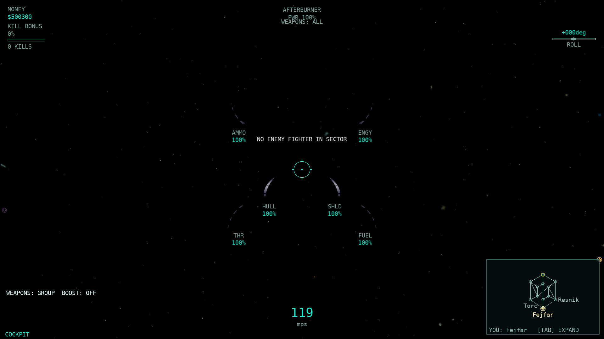
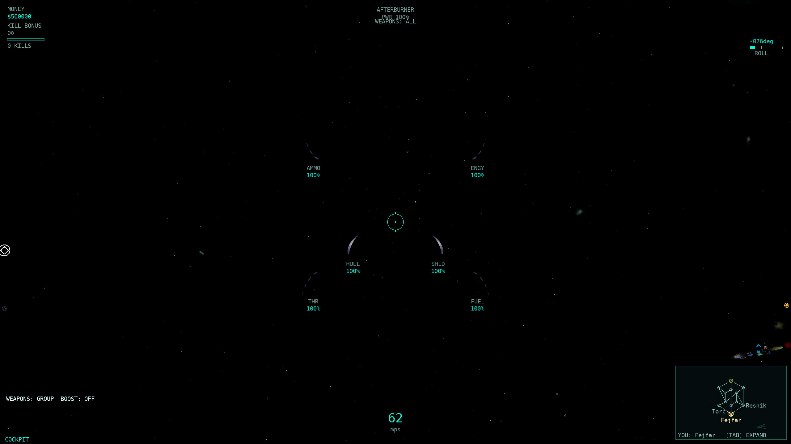
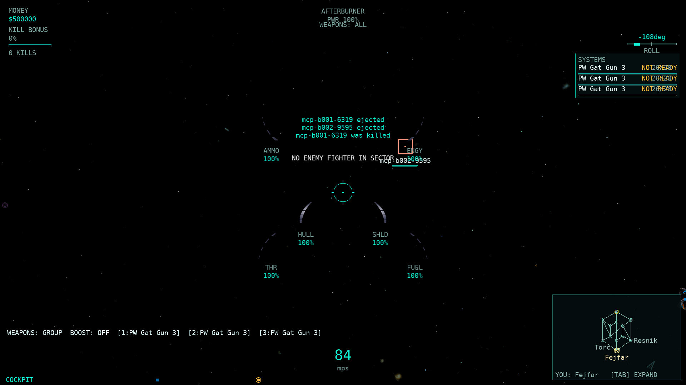
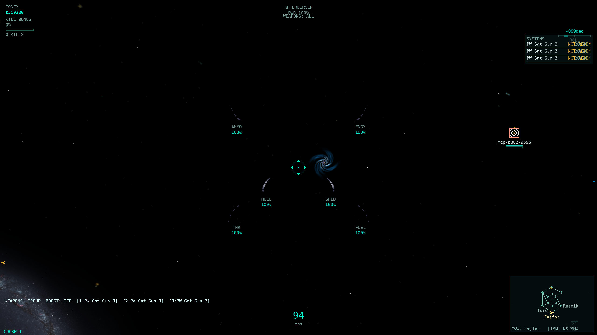
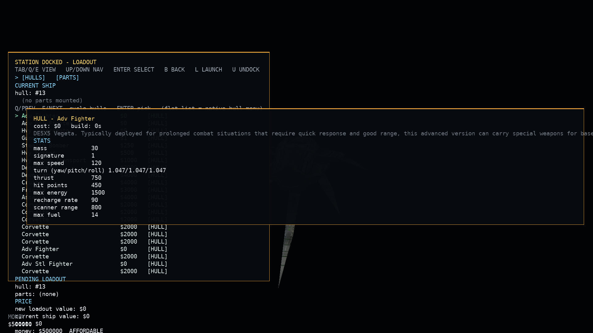
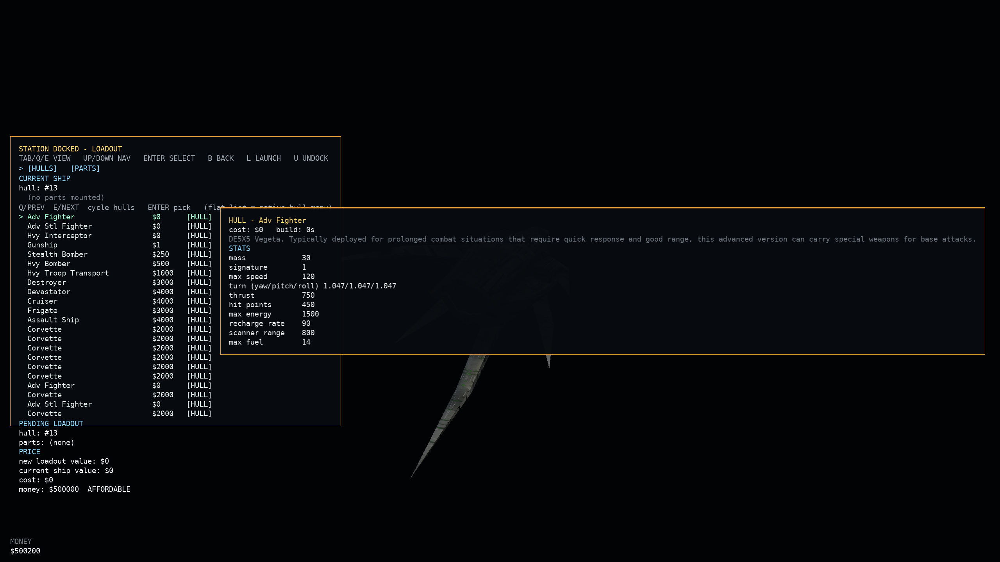
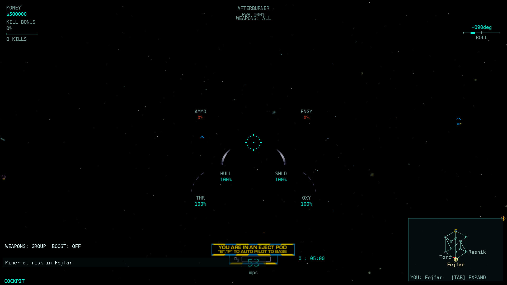
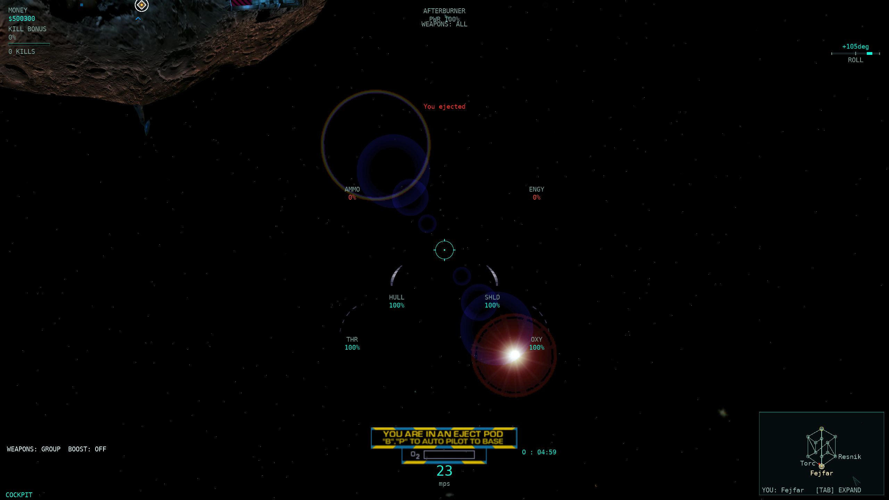

# HUD-1 — native HUD inventory and shared frame model

Base `a8a9eb24`, branch `codex/hud1`. Changes are left in the working tree; no commits or pushes were made. Modern HUD visuals, P715 minimap changes, and menu redesign are excluded.

The former `Main game screen / HUD = done` row is replaced by **110 `hud` rows**. Full visual parity is **not** claimed: 108 rows are partial and two are scope/declaration sentinels. Each partial row names the remaining difference. The detailed, machine-readable inventory is [inventory.json](HUD1_assets/inventory.json); it includes input and sound fields even where their value is `none`.

## Native source and coordinate conventions

Native citations below resolve against `/home/domingo/Development/Allegiance/src/`. Artwork citations resolve against `/home/domingo/Development/Artwork/`. The source was read directly, including `WinTrek/console.cpp`, `consoledata.cpp`, `indicator.cpp`, `radarimage.cpp`, `hudimage.h`, `gamescreen.cpp`, and the current `dialog.mdl`/`cortui_huds.mdl` layout.

`gamescreen.cpp:46` is the **multiplayer game-list screen**, not the in-flight HUD. Its old coarse citation was misleading. The flight HUD assembly is `WinTrek/WinTrek.cpp:3170-3175`; console panes are loaded from the `dialogs` list at `WinTrek/console.cpp:3385-3425`. `hudimage.h:10-30` declares a camera/view-rectangle wrapper and update methods, not an additional set of hidden widgets.

Two coordinate conventions must remain distinct:

- `Artwork/dialog.mdl:5259-5280` documents pane anchors with a **lower-left origin and +Y upward**. Pane positions in the inventory use these native terms. `CenterHudDisplayImage` is anchored at centre `(-320,-240)`; target display at bottom `(-320,25)` (`dialog.mdl:5399-5405`). The smaller positions listed inside those panes are local offsets, not viewport pixels.
- Gauge tutorial landmarks are offsets from view centre in `WinTrek/indicator.cpp:514-566`. The current classic renderer retains its established screen-space placement of these landmarks and its viewport spread. `HudPoint` gauge offsets use +Y downward; `HudPlacement.YUp` identifies native pane coordinates separately. Tutorial arrows are reference landmarks, not a claim that the port matches native bitmap rectangles.

The binary `*Gaugebmp.mdl` files do not have meaningful source line numbers. Their **layout rules are cited to textual `dialog.mdl` lines**, and [artwork-manifest.json](HUD1_assets/artwork-manifest.json) records exact filenames, sizes, and SHA-256 hashes. No binary content was added to the repository.

Shared native rules apply to the element table:

- HUD text colour is actual side RGB times HUD brightness with alpha `.75`; shadows use alpha `.55` (`WinTrek/WinTrek.cpp:8679-8694`). Neutral radar objects are white; side-bearing radar contacts use their side colour, with a red threat-flash override (`WinTrek/radarimage.cpp:676-685`, `:1471`). The port's universal friendly-blue/enemy-red selection bracket is an explicit difference.
- Console elements use the tuple's overlay mask and slide positions/time (`WinTrek/console.cpp:3084-3126`, `:3398-3423`; `Artwork/dialog.mdl:5255-5458`). Most slide in `.5s`; the large GlassHUD target pane uses `.75s`. The centre instruments are cockpit/chase panes; command mode has separate summaries. Docked/dead state is not equivalent to ordinary cockpit flight.
- Native indicator drawing is allowed for internal cameras, external chase, and external missile (`WinTrek/indicator.cpp:763-800`). The fixed `directioninbmp` is cockpit-only (`:133-150`). Lead requires a visible same-cluster target and weapon, with healing/friendship and relay/capability gates (`:179-328`). An ordinary centre reticle must not substitute for chase's projected weapon-range aim marker (`:367-405`).
- Native damage flashing is `.25s on / .25s off` for `2s`, with phase-preserving extension on repeated hits (`WinTrek/WinTrek.cpp:35-37`, `:8922-8955`). It selects normal/red hull and shield artwork (`Artwork/dialog.mdl:2429-2436`, `:2499-2506`). It is **not** a 50% resource threshold.
- Native low-resource sounds have separate thresholds: crossing below **15% hull/ammo/fuel**, or **5% energy**, on the own source ship; empty-fire/empty-afterburner attempt sounds fire on their rising edges (`WinTrek/trekigc.cpp:1231-1275`). These thresholds do not imply a matching native red percentage label. The port retains its pre-existing 50% warning-colour percentage extension and records that visual difference.
- Radar is a viewport-projected peripheral marker system, distinct from the P715 minimap (`WinTrek/radarimage.cpp:286-427`, `:515-590`). Range labels use centre distance before subtracting source/object radii; LOD distance predicates use the adjusted surface separation (`radarimage.cpp:626-636`). The native 100/1000 distance-alpha block at `:689-700` is **commented out**. The port's active 300..4000 fade is a divergence. The optional round border at `:1134-1177` is not a set of concentric range rings. No such distance rings were found in this native renderer.

## Changes implemented

1. `HudModel` now owns one frame's telemetry, visibility context, semantic gauge values/colours/landmarks, projected lock/lead/selection data, target bearing, radar contacts, warning strings, chat history/composition, tip lines, pod/death state, cargo/part and command readouts, and existing activity/weapon/readout data. `HudElements` exposes every native inventory ID, native anchor placement (or null when no single static placement applies), projected screen position, availability, visibility and available scalar/text values. Unported readings remain unavailable/null rather than becoming fabricated zeroes.
2. `Game1` gathers the snapshot; the current classic `HudRenderer`, radar renderer, chat renderer, cargo/parts/command readouts, and eject/death overlay consume it. Collections are copied into read-only snapshots so later world/loadout changes cannot mutate an already-built frame. `HudModelAdapter` contains the MonoGame-vector/colour boundary conversion. `HudModel`, `HudContext`, `HudElements`, `HudPoint`, `HudPlacement`, and the moved semantic `GaugeKind` contain no textures, fonts, graphics devices, bitmap dimensions, or classic-art selection.
3. Hull and shield now use the real **native red bitmap variants** during the existing damage timer's lit phase. Their percentage colours follow the same state. The extra port damage wash now supplies premultiplied alpha correctly, so it remains translucent instead of saturating the whole view red.
4. Thrust now follows native `playerThrottle`: ordinary cruise setting, full on any manual-thrust/afterburner input, and zero for a turret gunner (`WinTrek/WinTrek.cpp:8461-8467`). The same normalized value feeds both art and fallback paths.
5. Boundary/crowding warnings are drawn independently of whether gauge textures loaded. Previously they appeared only inside the procedural fallback status panel. The mask and sound routing remain existing client data.
6. The speed unit now reads **mps**, as the native layout specifies (`Artwork/dialog.mdl:2553`). Instrument, cockpit-reticle, indicator, pod, death, radar and chat visibility use the shared context. Dead/docked ships do not retain ordinary flight instruments; command view suppresses the centre instrument cluster. F1/director/hidden-HUD state applies consistently to the snapshot's consumers.

`HudFrame` remains the telemetry input type for existing callers. The old `HudRenderer.Draw(HudFrame, ...)` overload is a compatibility adapter to the model; the real client calls `Draw(HudModel, ...)`. Rich weapon rows, mouse-stick state, mining/cloak/activity flags, kill bonus, roll, wallet, warp opacity, time dilation, command prompts and diagnostics remain plain model data rather than being coupled to a new skin.

A future HUD-2 renderer can consume the same model and choose different geometry, fonts, gauge shapes and spacing. `HudElements` availability is a data contract, **not a second parity status**: an available scalar/contact analogue can still have a partial native row because its geometry, units, disclosure policy or animation differs. Detailed target/contact collections remain typed in the model. Native-only fields with no port data deliberately remain unavailable. Native skin loading, composite bitmap bounds, glyph measurement and final viewport scaling remain drawing responsibilities.

7. Native eject-panel instructions are no longer overprinted by the large white fallback title. The title is retained when native artwork is absent. A real-backbuffer pixel regression check rejects the old overprint and verifies three post-eject frames at each requested resolution.

## Native → port element table

Every row below corresponds to a `hud` row in `docs/parity/parity-matrix.csv` (LF line endings). `partial` includes both approximate implementations and missing subfeatures; the final column states which. Repeated data in alternate native skins is inventoried once with its variant rules, rather than counted as an extra gameplay element.

| Element | Native source and binding | Native position / visibility | Colour / animation | Port evidence and remaining gap |
|---|---|---|---|---|
| Hull integrity | WinTrek/consoledata.cpp:202; Artwork/dialog.mdl:2404; WinTrek/indicator.cpp:514 — visible damageable model hull / max hull; fraction 0..1; classic native label ARMOR | centre (-65.5,+35.5); cockpit/chase centre console; hidden when docked; command mode has its own summary | bottom reveal Rect(40,23,88,105); normal/red art; side HUD colour = side RGB × brightness; alpha .75; shadows alpha .55 (WinTrek.cpp:8679-8694); damage: hull/shield alternate red at Flash; other gauges no autonomous flashing or low-resource threshold | partial: src/Allegiance.ClientCore.Game/Rendering/HudModel.cs:10; src/Allegiance.ClientCore.Game/Rendering/GaugeTextures.cs:15; src/Allegiance.ClientCore.Game/Rendering/HudRenderer.cs:392 — Bindings retained; thrust override and hull/shield red variants fixed in HUD1. Whole-bitmap clipping/size/spacing differs from native rect layers. Energy/ammo zero in pods; oxygen deliberately reuses fuel slot. Native text ARMOR vs current port HULL. |
| Shield charge | WinTrek/consoledata.cpp:252; Artwork/dialog.mdl:2474; WinTrek/indicator.cpp:514 — mounted shield fraction; 0 if absent; station shield fraction; classic native label SHIELD | centre (+65.5,+35.5); cockpit/chase centre console; hidden when docked; command mode has its own summary | bottom reveal Rect(40,23,88,105); normal/red art; side HUD colour = side RGB × brightness; alpha .75; shadows alpha .55 (WinTrek.cpp:8679-8694); damage: hull/shield alternate red at Flash; other gauges no autonomous flashing or low-resource threshold | partial: src/Allegiance.ClientCore.Game/Rendering/HudModel.cs:10; src/Allegiance.ClientCore.Game/Rendering/GaugeTextures.cs:15; src/Allegiance.ClientCore.Game/Rendering/HudRenderer.cs:392 — Bindings retained; thrust override and hull/shield red variants fixed in HUD1. Whole-bitmap clipping/size/spacing differs from native rect layers. Energy/ammo zero in pods; oxygen deliberately reuses fuel slot. Native text SHIELD vs current port SHLD. |
| Energy reserve | WinTrek/consoledata.cpp:328; Artwork/dialog.mdl:2331; WinTrek/indicator.cpp:514 — energy / hull max energy; own/source ship only; classic native label ENERGY | centre (+126.5,-112.5); cockpit/chase centre console; hidden when docked; command mode has its own summary | bottom reveal Rect(30,18,99,110); side HUD colour = side RGB × brightness; alpha .75; shadows alpha .55 (WinTrek.cpp:8679-8694); damage: hull/shield alternate red at Flash; other gauges no autonomous flashing or low-resource threshold | partial: src/Allegiance.ClientCore.Game/Rendering/HudModel.cs:10; src/Allegiance.ClientCore.Game/Rendering/GaugeTextures.cs:15; src/Allegiance.ClientCore.Game/Rendering/HudRenderer.cs:392 — Bindings retained; thrust override and hull/shield red variants fixed in HUD1. Whole-bitmap clipping/size/spacing differs from native rect layers. Energy/ammo zero in pods; oxygen deliberately reuses fuel slot. Native text ENERGY vs current port ENGY. |
| Fuel reserve | WinTrek/consoledata.cpp:406; Artwork/dialog.mdl:2226; WinTrek/indicator.cpp:514 — fuel / hull max fuel; own/source ship only; classic native label FUEL | centre (+126.5,+93.5); cockpit/chase centre console; hidden when docked; command mode has its own summary | top reveal Rect(17,10,113,118); side HUD colour = side RGB × brightness; alpha .75; shadows alpha .55 (WinTrek.cpp:8679-8694); damage: hull/shield alternate red at Flash; other gauges no autonomous flashing or low-resource threshold | partial: src/Allegiance.ClientCore.Game/Rendering/HudModel.cs:10; src/Allegiance.ClientCore.Game/Rendering/GaugeTextures.cs:15; src/Allegiance.ClientCore.Game/Rendering/HudRenderer.cs:392 — Bindings retained; thrust override and hull/shield red variants fixed in HUD1. Whole-bitmap clipping/size/spacing differs from native rect layers. Energy/ammo zero in pods; oxygen deliberately reuses fuel slot. Native text FUEL vs current port FUEL / OXY in port pods. |
| Ammunition reserve | WinTrek/consoledata.cpp:367; Artwork/dialog.mdl:2278; WinTrek/indicator.cpp:514 — ammo / hull max ammo; own/source ship only; classic native label AMMO | centre (-126.5,-112.5); cockpit/chase centre console; hidden when docked; command mode has its own summary | bottom reveal Rect(29,18,98,110); side HUD colour = side RGB × brightness; alpha .75; shadows alpha .55 (WinTrek.cpp:8679-8694); damage: hull/shield alternate red at Flash; other gauges no autonomous flashing or low-resource threshold | partial: src/Allegiance.ClientCore.Game/Rendering/HudModel.cs:10; src/Allegiance.ClientCore.Game/Rendering/GaugeTextures.cs:15; src/Allegiance.ClientCore.Game/Rendering/HudRenderer.cs:392 — Bindings retained; thrust override and hull/shield red variants fixed in HUD1. Whole-bitmap clipping/size/spacing differs from native rect layers. Energy/ammo zero in pods; oxygen deliberately reuses fuel slot. |
| Thrust setting | WinTrek/WinTrek.cpp:8461; Artwork/dialog.mdl:2173; WinTrek/indicator.cpp:514 — 0.5*(1+throttle); manual thrust/afterburner ->1; parented gunner ->0; classic native label THRUST | centre (-126.5,+93.5); cockpit/chase centre console; hidden when docked; command mode has its own summary | top reveal Rect(15,10,110,118); side HUD colour = side RGB × brightness; alpha .75; shadows alpha .55 (WinTrek.cpp:8679-8694); damage: hull/shield alternate red at Flash; other gauges no autonomous flashing or low-resource threshold | partial: src/Allegiance.ClientCore.Game/Rendering/HudModel.cs:10; src/Allegiance.ClientCore.Game/Rendering/GaugeTextures.cs:15; src/Allegiance.ClientCore.Game/Rendering/HudRenderer.cs:392 — Bindings retained; thrust override and hull/shield red variants fixed in HUD1. Whole-bitmap clipping/size/spacing differs from native rect layers. Energy/ammo zero in pods; oxygen deliberately reuses fuel slot. Native text THRUST vs current port THR. |
| Speed | WinTrek/consoledata.cpp:136; Artwork/dialog.mdl:2546 — velocity magnitude; rounded NumberString + mps; unseen dynamic target returns -1 | centre HUD Point(281,152); cockpit/chase centre console; hidden when docked; command mode has its own summary | side HUD colour = side RGB × brightness; alpha .75; shadows alpha .55 (WinTrek.cpp:8679-8694); no autonomous flashing or low-resource threshold | partial: src/Allegiance.ClientCore.Game/Rendering/HudRenderer.cs:473 — mps unit fixed; uses same-frame predicted own velocity in prediction mode; typography/position differ |
| Kill bonus | WinTrek/console.cpp:824; Artwork/dialog.mdl:2556 — 100*(experience multiplier-1); number, not raw kill count | centre HUD Point(281,102); cockpit/chase centre console; hidden when docked; command mode has its own summary | black number over killcounterbmp; side colour in other skins; no autonomous flashing or low-resource threshold | partial: src/Allegiance.ClientCore.Game/Rendering/HudRenderer.cs:664 — owner stream exists; gold bar and streak text are port additions; native layout differs |
| Roll tutorial cue | WinTrek/indicator.cpp:634 — tutorial instruction to roll; no native continuous numeric roll gauge | centre (-110,-170); only selected RollTrainingOverlay | red tutorial annotation; none | partial: src/Allegiance.ClientCore.Game/Rendering/HudRenderer.cs:702 — port numeric roll gauge is an extension; native tutorial annotation remains absent |
| Signature percentage | WinTrek/console.cpp:865; Artwork/dialog.mdl:2595 — 100*signature / side signature attribute; SIG: n% | centre HUD Point(281,133); cockpit/chase centre console; hidden when docked; command mode has its own summary | side HUD colour = side RGB × brightness; alpha .75; shadows alpha .55 (WinTrek.cpp:8679-8694); no autonomous flashing or low-resource threshold | partial: src/Allegiance.ClientCore.Game/Rendering/HudFrame.cs:85 — no signature telemetry/readout in current flight model; add an owner value |
| Detection eye | WinTrek/console.cpp:809; Artwork/dialog.mdl:2529 — Detected binding is inverted in console: eye shown for binding 0 | centre HUD Point(390,55); cockpit/chase centre console; hidden when docked; command mode has its own summary | radonbmp; side-tinted in GlassHUD; switch on detection, no timer | partial: src/Allegiance.ClientCore.Game/Rendering/HudFrame.cs:85 — ship status has detection information; native inverted binding/icon not presented |
| Cloak active | WinTrek/consoledata.cpp:565; Artwork/dialog.mdl:2537 — source ship GetCloaking()<1 | centre HUD Point(120,80); cockpit/chase centre console; hidden when docked; command mode has its own summary | concloakbmp; HUD tint; no autonomous flashing or low-resource threshold | partial: src/Allegiance.ClientCore.Game/Rendering/HudRenderer.cs:560 — CLOAKED text follows active bit rather than native continuous cloaking factor; fading transition differs |
| Cloak strength and drained state | WinTrek/consoledata.cpp:480; Artwork/dialog.mdl:570 — C=100*(1-cloaking) from ModelData; current GlassHUD reveal is 1-(C-.1)/.9, with (1-C)*(100*energy) > .1 gate; drained icon when energy<=.2 | GlassHUD gear cluster; GlassHUD, IsCloaked and the literal energy/cloak switches at dialog.mdl:599-610; no extra capability check in this layout | side HUD colour = side RGB × brightness; alpha .75; shadows alpha .55 (WinTrek.cpp:8679-8694); no autonomous flashing or low-resource threshold | partial: src/Allegiance.ClientCore.Game/Rendering/HudFrame.cs:85 — continuous cloak value/drained icon absent; native source and MDL scales differ, so preserve the literal formulas for an explicit follow-up decision |
| Autopilot status | WinTrek/console.cpp:793; Artwork/dialog.mdl:2153 — autopilot enabled boolean | centre HUD Point(177,342); command summary; cockpit/chase centre console; hidden when docked; command mode has its own summary | conautopilot.png; side HUD tint; no autonomous flashing or low-resource threshold | partial: src/Allegiance.ClientCore.Game/Game1.FlightInput.cs:32; src/Allegiance.ClientCore.Game/Rendering/TargetSelectionView.cs:35 — engaged bracket exists; independent persistent native autopilot lamp absent |
| Vector lock status | WinTrek/consoledata.cpp:465; Artwork/dialog.mdl:2142 — own/source ship vector lock boolean | centre HUD Point(442,337); command summary; cockpit/chase centre console; hidden when docked; command mode has its own summary | convectorlock.png; side HUD tint; no autonomous flashing or low-resource threshold | partial: src/Allegiance.ClientCore.Game/Game1.FlightInput.cs:32 — coast action exists; no independent HUD lamp |
| Carried flag | WinTrek/console.cpp:846; Artwork/dialog.mdl:2586 — GotFlag own carried-object boolean | centre HUD Point(427,350); cockpit/chase centre console; hidden when docked; command mode has its own summary | captureflag bitmap colours; no autonomous flashing or low-resource threshold | partial: src/Allegiance.ClientCore.Game/Rendering/HudFrame.cs:85 — carried objective markers missing from flight HUD |
| Carried artifact | WinTrek/console.cpp:846; Artwork/dialog.mdl:2572 — GotArtifact own carried-object boolean | centre HUD Point(159,350); cockpit/chase centre console; hidden when docked; command mode has its own summary | captureflag bitmap colours; no autonomous flashing or low-resource threshold | partial: src/Allegiance.ClientCore.Game/Rendering/HudFrame.cs:85 — carried objective markers missing from flight HUD |
| Target name | WinTrek/consoledata.cpp:65; Artwork/dialog.mdl:4211 — GetModelName; empty for null | target pane Point(240,125); target non-null; visibility/last-seen gates from ModelData | target side colour; target damage bars/bitmap colours; no autonomous flashing or low-resource threshold | partial: src/Allegiance.ClientCore.Game/Rendering/TargetSelectionView.cs:35 — projected bracket name exists; native bottom target pane absent |
| Target type description | WinTrek/consoledata.cpp:40; Artwork/dialog.mdl:4211 — visible type or last-seen hull; unknown fallback | target pane oval words; target non-null; visibility/last-seen gates from ModelData | target side colour; target damage bars/bitmap colours; no autonomous flashing or low-resource threshold | partial: src/Allegiance.ClientCore.Game/Rendering/HudFrame.cs:85 — last-seen type description absent |
| Target side identity | WinTrek/consoledata.cpp:89; Artwork/dialog.mdl:4211 — side name and actual side RGB; neutral white | target pane oval colour; target non-null; visibility/last-seen gates from ModelData | target side colour; target damage bars/bitmap colours; no autonomous flashing or low-resource threshold | partial: src/Allegiance.ClientCore.Game/Rendering/TargetSelectionStyle.cs:25 — port uses universal enemy red/friendly blue/neutral aqua; native uses actual side colour |
| Target hull | WinTrek/consoledata.cpp:202; Artwork/dialog.mdl:4211 — damageable visible local target hull fraction; otherwise 0 | target pane Point(235,33); target non-null; visibility/last-seen gates from ModelData | target side colour; target damage bars/bitmap colours; no autonomous flashing or low-resource threshold | partial: src/Allegiance.ClientCore.Game/Rendering/TargetSelectionView.cs:35 — projected bars exist; dedicated TargetHullGaugebmp pane and unseen-state rules differ |
| Target shield | WinTrek/consoledata.cpp:252; Artwork/dialog.mdl:4211 — visible ship mounted shield or station fraction; otherwise 0 | target pane Point(367,33); target non-null; visibility/last-seen gates from ModelData | target side colour; target damage bars/bitmap colours; no autonomous flashing or low-resource threshold | partial: src/Allegiance.ClientCore.Game/Rendering/TargetSelectionView.cs:35 — ship/projected shield bar exists; dedicated TargetShieldGaugebmp and complete station handling differ |
| Target range or sector | WinTrek/consoledata.cpp:182; Artwork/dialog.mdl:4211 — distance metres when visible in same cluster; -1 -> LOCATION: sector | target pane Point(400,33); target non-null; visibility/last-seen gates from ModelData | target side colour; target damage bars/bitmap colours; no autonomous flashing or low-resource threshold | partial: src/Allegiance.ClientCore.Game/Rendering/HudFrame.cs:85 — native range/last-seen sector field absent from target pane |
| Target speed | WinTrek/consoledata.cpp:136; Artwork/dialog.mdl:4211 — velocity magnitude + mps; unseen dynamic -1; static 0 | target pane Point(92,33); target non-null; visibility/last-seen gates from ModelData | target side colour; target damage bars/bitmap colours; no autonomous flashing or low-resource threshold | partial: src/Allegiance.ClientCore.Game/Rendering/HudFrame.cs:85 — target speed field absent |
| Target ore | WinTrek/consoledata.cpp:449; Artwork/dialog.mdl:4211 — ore amount; radar normalizes to two miner loads | target projected bar; target non-null; visibility/last-seen gates from ModelData | target side colour; target damage bars/bitmap colours; no autonomous flashing or low-resource threshold | partial: src/Allegiance.ClientCore.Game/Rendering/TargetSelectionView.cs:35 — port displays fraction of remaining ore; native radar fill units differ |
| Target kill bonus | WinTrek/console.cpp:830; Artwork/dialog.mdl:4191 — 100*(target experience multiplier-1), only ship target | target pane Point(280,110); non-null ship target | target side colour; no autonomous flashing or low-resource threshold | partial: src/Allegiance.ClientCore.Game/Rendering/HudFrame.cs:85 — target experience readout absent |
| Target in weapon range | WinTrek/indicator.cpp:405; Artwork/dialog.mdl:4077 — SetInRange from predictor intercept and lifespan; boolean | target pane Point(200,90); current target with computed in-range intercept | native inrange bitmap; switch; no free-running pulse | partial: src/Allegiance.ClientCore.Game/Rendering/LeadIndicatorView.cs:25 — lead InRange exists; native target-pane range icon absent |
| Target model preview | WinTrek/console.cpp:672; Artwork/dialog.mdl:4218 — targetGeo with targetCamera; 96x96 viewport | bottom target pane Point(270,9); non-null target | lit model / side oval; target camera animation | partial: src/Allegiance.ClientCore.Game/Rendering/HudRenderer.cs:31 — flight target model preview absent |
| Target time to intercept | WinTrek/consoledata.cpp:182; Artwork/dialog.mdl:1280 — range / (own speed-target speed); signed m:ss; closing speed zero hides | GlassHUD top-right large target; GlassHUD non-null target; nonzero closing speed | grey text, skin typography; no autonomous flashing or low-resource threshold | partial: src/Allegiance.ClientCore.Game/Rendering/HudFrame.cs:85 — GlassHUD TTI absent; scalar speed difference is native formula, not ballistic lead |
| Cockpit centre reticle | WinTrek/indicator.cpp:128 — directioninbmp at exact view centre | viewport centre; cockpit only | (.4,.4,.4,.4) additive; static | partial: src/Allegiance.ClientCore.Game/Rendering/HudModel.cs:10; src/Allegiance.ClientCore.Game/Rendering/HudRenderer.cs:813 — native camera gate fixed; port procedural circle/firing colour differs from native art |
| Velocity direction marker | WinTrek/indicator.cpp:130 — source velocity projected into view; rounded speed !=0 | projected velocity direction; cockpit; projected point inside view | directionbmp bitmap; tracks velocity | partial: src/Allegiance.ClientCore.Game/Rendering/HudFrame.cs:85 — velocity direction marker absent; speed numeral is separate |
| Joystick turning indicator | WinTrek/indicator.cpp:154; WinTrek/indicator.cpp:778 — clamp(length(controlYaw,controlPitch),0,1); angle atan(pitch/yaw)+pi/2 with yaw-sign correction; scale .5+.5*magnitude | view centre -100*(controlYaw,controlPitch); allowed indicator cameras and ShowJoystickIndicator setting | white; alpha = clamped control-vector magnitude; tracks the control vector | partial: src/Allegiance.ClientCore.Game/Rendering/HudRenderer.cs:1193 — mouse-stick/deadzone input snapshot exists; native pointer geometry/position/scale and control-vector presentation differ |
| Ballistic lead marker | WinTrek/indicator.cpp:179; WinTrek/indicator.cpp:282 — weapon intercept lead; lifespan in-range; source hull or friendly relay capability grants display | projected lead point; visible current target in same cluster; turret uses mounted turret weapon; native indicator camera gate; healing-on-friendly/allied vs damage-on-enemy gate, except chase/missile (indicator.cpp:217) | lead in/out-range surfaces; tracks intercept; native has no ornamental pulse | partial: src/Allegiance.ClientCore.Game/Rendering/LeadIndicatorView.cs:25; src/Allegiance.ClientCore/State/LeadIndicatorState.cs:33 — server-granted lead exists; art and port pulse differ; renderer-independent lead data captured |
| Aim hit-probability predictor | WinTrek/indicator.cpp:245; WinTrek/indicator.cpp:334 — angular miss squared / projected target radius squared; green ramp, grey out-of-range | projected weapon aim point; native lead/weapon gates | (1-g,g,0); grey (.33,.33,.33,.5) out-of-range; tracks probability; no native sinusoid | partial: src/Allegiance.ClientCore.Game/Rendering/LeadIndicatorView.cs:25; src/Allegiance.ClientCore.Game/Rendering/HudRenderer.cs:31 — port combines predictor and lead into procedural indicator; native distinction remains |
| Chase weapon aim without target | WinTrek/indicator.cpp:367 — project weapon forward*speed*lifespan from actual camera | projected weapon-range aim point; chase/missile, no target, no parent, mounted weapon | grey (.33,.33,.33,.5); tracks camera and aim | partial: src/Allegiance.ClientCore.Game/Rendering/HudModel.cs:10 — native projection marker absent; hiding static cockpit reticle in chase now faithful |
| Accepted and current order turn arrows | WinTrek/indicator.cpp:411; WinTrek/indicator.cpp:783 — off-axis directions to accepted/current targets; same target yellow, else accepted green/current red | view centre +108*normalized target screen offset; allowed indicator cameras; non-self/source target, visible same cluster; screen offset squared >108 squared | yellow (1,1,0); accepted green; current red; bearing-responsive 3D geometry, continuously rotates around Z by native GetTime value | partial: src/Allegiance.ClientCore.Game/Rendering/HudRenderer.cs:1048 — one bottom-right selected-target bearing chevron exists; two native order pointers absent |
| Selected target bracket | WinTrek/radarimage.cpp:28; WinTrek/radarimage.cpp:352 — current-command mask selects bracket; bracket size follows projected object radius | projected target with edge clamp; visible/pickable/can-see target and radar LOD | actual side RGB, neutral white; port engagement brightens; native masks choose shapes | partial: src/Allegiance.ClientCore.Game/Rendering/TargetSelectionView.cs:35; src/Allegiance.ClientCore.Game/Rendering/HudRenderer.cs:974 — fixed-size closed box and relationship colours differ; data snapshot includes name/hull/shield/ore |
| Missile lock flower | WinTrek/radarimage.cpp:325 — lock fraction 0..1; partial radius +=40*(1-lock), full uses lockedbmp | projected target bracket; nonzero missile lock and valid radar target | native plockbmp/lockedbmp colours; white tint; shrinks with lock progress; native no sinusoid | partial: src/Allegiance.ClientCore.Game/Rendering/LockBracketStyle.cs:22; src/Allegiance.ClientCore.Game/Rendering/HudRenderer.cs:908 — real art loaded; port semantic state/pulsing fixed size loses continuous lock progress |
| Training HUD callouts | WinTrek/indicator.cpp:461 — one selected overlay; 24 switch cases (gauges, sectors, chat, targets, booster, roll) | per-callout centre offsets in indicator.cpp:483-707; training selection and allowed indicator camera | red (.9 alpha) text/line + training surface; no free-running flash | partial: src/Allegiance.ClientCore.Game/Rendering/HudRenderer.cs:31 — training annotations absent; port roll/afterburner text is not a replacement |
| Radar viewport and round border | WinTrek/radarimage.cpp:1134; WinTrek/radarimage.cpp:1149 — peripheral viewport radar; optional circular edge | view rect / round border; cluster exists and LOD != c_rlNone; round border setting | border (.5,.5,.5,.25), side contact colours; static border | partial: src/Allegiance.ClientCore.Game/Rendering/RadarBracketRenderer.cs:33 — square edge clamp exists; native round border mode absent; no concentric distance rings implemented in this native file |
| Radar ship contacts | WinTrek/radarimage.cpp:738; WinTrek/radarimage.cpp:590 — ship icons plus own/source marker and pilot/capital variants | object screen projection or viewport edge; visible + source.CanSee + native per-kind LOD | actual side colour; no side = white; asteroid ore path forces white; tracks real projection | partial: src/Allegiance.ClientCore.Game/Rendering/RadarBracketRenderer.cs:33 — ship contacts exist; native icon set/self marker and label tiers differ |
| Radar station contacts | WinTrek/radarimage.cpp:782; WinTrek/radarimage.cpp:590 — station/pedestal icons and side colour; pedestal clips at 1000 m | object screen projection or viewport edge; visible + source.CanSee + native per-kind LOD | actual side colour; no side = white; asteroid ore path forces white; tracks real projection | partial: src/Allegiance.ClientCore.Game/Rendering/RadarBracketRenderer.cs:33 — station shapes exist; type palette fallback/pedestal rules differ |
| Radar warp contacts | WinTrek/radarimage.cpp:952; WinTrek/radarimage.cpp:590 — warp icon and labels; All/Default label; Target clips range at 1000 m | object screen projection or viewport edge; visible + source.CanSee + native per-kind LOD | actual side colour; no side = white; asteroid ore path forces white; tracks real projection | partial: src/Allegiance.ClientCore.Game/Rendering/RadarBracketRenderer.cs:33 — warp shapes exist; native labels/range tiers absent |
| Radar asteroid contacts | WinTrek/radarimage.cpp:903; WinTrek/radarimage.cpp:590 — rock icons; named special rocks; 1000 m rules; side-seen ore | object screen projection or viewport edge; visible + source.CanSee + native per-kind LOD | actual side colour; no side = white; asteroid ore path forces white; tracks real projection | partial: src/Allegiance.ClientCore.Game/Rendering/RadarInvestAsteroidSelection.cs:17 — only hovered station build spots shown; ordinary/special-rock LOD missing |
| Radar missile contacts | WinTrek/radarimage.cpp:819; WinTrek/radarimage.cpp:590 — missile icon; outside All only missiles aimed at own side | object screen projection or viewport edge; visible + source.CanSee + native per-kind LOD | actual side colour; no side = white; asteroid ore path forces white; tracks real projection | partial: src/Allegiance.ClientCore.Game/Rendering/RadarBracketRenderer.cs:33 — missile radar contacts absent |
| Radar probe and mine contacts | WinTrek/radarimage.cpp:834; WinTrek/radarimage.cpp:590 — probe/mine type icons; allied/enemy and 1000 m LOD rules | object screen projection or viewport edge; visible + source.CanSee + native per-kind LOD | actual side colour; no side = white; asteroid ore path forces white; tracks real projection | partial: src/Allegiance.ClientCore.Game/Rendering/RadarBracketRenderer.cs:33 — probe/mine radar contacts absent |
| Radar treasure and tech contacts | WinTrek/radarimage.cpp:877; WinTrek/radarimage.cpp:590 — useful part/tech discrimination; tech icon; All/Target range rules | object screen projection or viewport edge; visible + source.CanSee + native per-kind LOD | actual side colour; no side = white; asteroid ore path forces white; tracks real projection | partial: src/Allegiance.ClientCore.Game/Rendering/RadarBracketRenderer.cs:33 — treasure radar contacts absent |
| Radar accepted order brackets | WinTrek/radarimage.cpp:352 — accepted-command bracket mask | object bracket or edge clamp; corresponding mask and radar visibility | side colour; threat flashing red override; mask-driven; threat follows native damage-bucket timer | partial: src/Allegiance.ClientCore.Game/Rendering/RadarBracketRenderer.cs:33 — accepted-order bracket absent |
| Radar queued order brackets | WinTrek/radarimage.cpp:352 — queued-command bracket mask | object bracket or edge clamp; corresponding mask and radar visibility | side colour; threat flashing red override; mask-driven; threat follows native damage-bucket timer | partial: src/Allegiance.ClientCore.Game/Rendering/RadarBracketRenderer.cs:33 — queued-order bracket absent |
| Radar nearest enemy bracket | WinTrek/radarimage.cpp:334 — nearest enemy marker c_maskEnemy | object bracket or edge clamp; corresponding mask and radar visibility | side colour; threat flashing red override; mask-driven; threat follows native damage-bucket timer | partial: src/Allegiance.ClientCore.Game/Rendering/RadarBracketRenderer.cs:33 — dedicated nearest-enemy bracket absent |
| Radar threat damage flash | WinTrek/radarimage.cpp:645 — damage bucket threat mask; db.flash(now) switches red | object bracket or edge clamp; corresponding mask and radar visibility | side colour; threat flashing red override; mask-driven; threat follows native damage-bucket timer | partial: src/Allegiance.ClientCore.Game/Rendering/RadarBracketRenderer.cs:33 — per-contact threat flash absent |
| Radar command subjects | WinTrek/radarimage.cpp:340 — selected command subjects c_maskSubject | object bracket or edge clamp; corresponding mask and radar visibility | side colour; threat flashing red override; mask-driven; threat follows native damage-bucket timer | partial: src/Allegiance.ClientCore.Game/Rendering/RadarBracketRenderer.cs:33 — group subject bracket absent |
| Radar carried flag marker | WinTrek/radarimage.cpp:343 — c_maskFlag carried objective | object bracket or edge clamp; corresponding mask and radar visibility | side colour; threat flashing red override; mask-driven; threat follows native damage-bucket timer | partial: src/Allegiance.ClientCore.Game/Rendering/RadarBracketRenderer.cs:33 — flag radar overlay absent |
| Radar carried artifact marker | WinTrek/radarimage.cpp:346 — c_maskArtifact carried objective | object bracket or edge clamp; corresponding mask and radar visibility | side colour; threat flashing red override; mask-driven; threat follows native damage-bucket timer | partial: src/Allegiance.ClientCore.Game/Rendering/RadarBracketRenderer.cs:33 — artifact radar overlay absent |
| Radar ripcord marker | WinTrek/radarimage.cpp:999 — same-side NPC droneRipMask and c_maskRip | object bracket or edge clamp; corresponding mask and radar visibility | side colour; threat flashing red override; mask-driven; threat follows native damage-bucket timer | partial: src/Allegiance.ClientCore.Game/Rendering/RadarBracketRenderer.cs:33 — ripcord radar overlay absent |
| Radar construction highlight | WinTrek/radarimage.cpp:701 — c_maskHighlight; investment/command asteroid selection | object bracket or edge clamp; corresponding mask and radar visibility | side colour; threat flashing red override; mask-driven; threat follows native damage-bucket timer | partial: src/Allegiance.ClientCore.Game/Rendering/RadarBracketRenderer.cs:33 — build-spot pulse exists; native bracket shape/tiers differ |
| Radar name labels | WinTrek/radarimage.cpp:1199 — one name text line; prioritized labels before ordinary labels | text stacked adjacent to projected/edge contact; bLabel/bStats and per-kind LOD, range, friendship gates | side-coloured text; hull/shield danger red; no autonomous flashing or low-resource threshold | partial: src/Allegiance.ClientCore.Game/Rendering/RadarBracketRenderer.cs:33 — no native name-label layout; ship side-colour tags alone are not names |
| Radar range labels | WinTrek/radarimage.cpp:1209 — int(centre separation+.5), plain metres, computed before subtracting source/object radii; no range in command camera | text stacked adjacent to projected/edge contact; bLabel/bStats and per-kind LOD, range, friendship gates | side-coloured text; hull/shield danger red; no autonomous flashing or low-resource threshold | partial: src/Allegiance.ClientCore.Game/Rendering/RadarBracketRenderer.cs:33 — range text absent |
| Radar hull and shield bars | WinTrek/radarimage.cpp:1408 — visible damageable hull/shield fraction; >1 sentinel suppresses bar | text stacked adjacent to projected/edge contact; bLabel/bStats and per-kind LOD, range, friendship gates | side-coloured text; hull/shield danger red; no autonomous flashing or low-resource threshold | partial: src/Allegiance.ClientCore.Game/Rendering/RadarBracketRenderer.cs:33 — only selected target has bars; all-contact native bars absent |
| Radar ore and miner fill bars | WinTrek/radarimage.cpp:989 — own miner ore/capacity; asteroid oreSeen/(2*capacity), capped1 | text stacked adjacent to projected/edge contact; bLabel/bStats and per-kind LOD, range, friendship gates | side-coloured text; hull/shield danger red; no autonomous flashing or low-resource threshold | partial: src/Allegiance.ClientCore.Game/Rendering/RadarBracketRenderer.cs:33 — ore readout on target uses a different normalization; native radar fills absent |
| Radar friendly detection eyes | WinTrek/radarimage.cpp:1008 — same-side non-self player ShipStatus.GetDetected | text stacked adjacent to projected/edge contact; bLabel/bStats and per-kind LOD, range, friendship gates | side-coloured text; hull/shield danger red; no autonomous flashing or low-resource threshold | partial: src/Allegiance.ClientCore.Game/Rendering/RadarBracketRenderer.cs:33 — friendly eye label absent |
| Radar friendly ripcord seconds | WinTrek/radarimage.cpp:1021 — same-side non-self active ripcord; int(time)+1 capped99999 | text stacked adjacent to projected/edge contact; bLabel/bStats and per-kind LOD, range, friendship gates | side-coloured text; hull/shield danger red; no autonomous flashing or low-resource threshold | partial: src/Allegiance.ClientCore.Game/Rendering/RadarBracketRenderer.cs:33 — friendly ripcord text absent |
| Radar command verb labels | WinTrek/radarimage.cpp:1234 — command verb/command target label decorations | text stacked adjacent to projected/edge contact; bLabel/bStats and per-kind LOD, range, friendship gates | side-coloured text; hull/shield danger red; no autonomous flashing or low-resource threshold | partial: src/Allegiance.ClientCore.Game/Rendering/RadarBracketRenderer.cs:33 — command labels absent |
| Radar LOD modes | WinTrek/radarimage.h:42; WinTrek/radarimage.cpp:724; WinTrek/WinTrek.cpp:9955 — All -> Default -> Target -> Minimal; c_rlNone=-1 suppresses entire radar | contacts + post-text mode notice; separate cockpit/command preferences; command defaults All | contact side colours; native fourth label says None although enum is Minimal; discrete cycle and persisted RadarLOD | partial: src/Allegiance.ClientCore.Game/Rendering/RadarLod.cs:23 — four-state cycle exists; port Minimal retains enemies and has no native label/stat tiers; native Minimal retains important-mask contacts plus own ship |
| Radar range fade | WinTrek/radarimage.cpp:689 — 100/1000 m alpha block is commented out; NOT an active native rule | all contacts; same radar gate | active native side colour has no distance-alpha modification; no autonomous flashing or low-resource threshold | partial: src/Allegiance.ClientCore.Game/Rendering/RadarBracketLayout.cs:32 — port actively fades 300..4000 m to zero; explicit divergence rather than claiming parity |
| Sector location | WinTrek/console.cpp:870; Artwork/dialog.mdl:1430; Artwork/dialog.mdl:5419 — view sector vs own sector vs station sector, context dependent | top-right (-180,-37); flight; alternate hangar/command label | side tint in flight; red current-view label; no autonomous flashing or low-resource threshold | partial: src/Allegiance.ClientCore.Game/Game1.Rendering.cs:33; src/Allegiance.ClientCore.Game/Rendering/StarmapRenderer.cs:26 — minimap names current sector; native independent top-right context label absent |
| Turret carrier identity | WinTrek/console.cpp:797; Artwork/dialog.mdl:1508; Artwork/dialog.mdl:5425 — parent pilot name; BoardState controls turret/observer wording | top-right (-180,-75); parented player in cockpit/chase/command/hangar | HUD tint / red warning wording; state switches | partial: src/Allegiance.ClientCore.Game/Game1.Rendering.cs:33 — turret reticle/view available; native carrier-name header absent |
| Observer and turret board state | WinTrek/console.cpp:797; WinTrek/consoledata.cpp:493; Artwork/dialog.mdl:2086 — board state 0/1/2 and child observer count | loadout centre and carrier header; board state / observer predicates | side-coloured text; no autonomous flashing or low-resource threshold | partial: src/Allegiance.ClientCore.Game/Rendering/HudFrame.cs:85 — native board-state text/observer count absent from HUD model |
| Accepted order text | WinTrek/console.cpp:875; Artwork/dialog.mdl:1623 — accepted command verb + target name | top-left (50,-37); ShowLastOrders option, ofAlways | green native accepted order; own-side label; no autonomous flashing or low-resource threshold | partial: src/Allegiance.ClientCore.Game/Game1.Commanding.cs:7 — commandee text exists; dedicated last accepted order HUD line missing |
| Queued order text | WinTrek/console.cpp:893; Artwork/dialog.mdl:1605 — queued command verb + target name | top-left (50,-37), second order line; ShowLastOrders option, ofAlways | red queued order; no autonomous flashing or low-resource threshold | partial: src/Allegiance.ClientCore.Game/Game1.Commanding.cs:7 — queued order HUD line missing |
| Chat history | WinTrek/console.cpp:3508; Artwork/dialog.mdl:173 — ChatListPane, configurable number of lines and chat font size | top (-160,-126); console overlay masks; flight/command/hangar | chat recipient/side colours; scroll history | partial: src/Allegiance.ClientCore.Game/Rendering/ChatRenderer.cs:14; src/Allegiance.ClientCore.Game/Rendering/HudModel.cs — history and scroll included in shared snapshot; native line-count/font/colour/pane positioning still differ |
| Chat composition and recipient | WinTrek/console.cpp:705; Artwork/dialog.mdl:89 — ComposeState mouse/text/command/shell/quick; recipient, verb, typed text | bottom (-150,148); composing state and overlay masks | own side colour; state switches | partial: src/Allegiance.ClientCore.Game/Rendering/ChatRenderer.cs:14; src/Allegiance.ClientCore.Game/Rendering/HudModel.cs — composition text/recipient and timestamp included in shared snapshot; five native presentation variants remain partial |
| Command recipient verb and wing controls | WinTrek/console.cpp:746; Artwork/dialog.mdl:38 — recipient buttons, nine command verbs and wing combo | bottom (-135,40); flight/station command view | own-side UI colours; yellow hover tooltip; pane slides .5s | partial: src/Allegiance.ClientCore.Game/Game1.Commanding.cs:7 — command actions exist; native recipient/verb bar and wing controls absent from flight model |
| Tip text lines | WinTrek/console.cpp:723; WinTrek/console.cpp:913; Artwork/dialog.mdl:2006 — three noncritical lines with newest-first shift; ordinary tip timestamps are stored but are not cleared by the current native Update expiry code | bottom (-300,14/25/34); ofAlways, all console views | tips own side; critical pure red; retained until overwritten; no ordinary-tip timeout clearing found in this native branch | partial: src/Allegiance.ClientCore.Game/Game1.Feedback.cs:21; src/Allegiance.ClientCore.Game/Rendering/HudModel.cs:10; src/Allegiance.ClientCore.Game/Game1.Rendering.cs:33 — port expires ordinary tips after7.5s with .8s fade and uses a six-entry shared ring; native retains three ordinary slots |
| Critical tip text lines | WinTrek/console.cpp:726; WinTrek/console.cpp:913; Artwork/dialog.mdl:2006 — four critical lines with timestamp shift; expire after7.5s normally or30s during native training | top (-310,chat-dependent Y offset); ofAlways, all console views | tips own side; critical pure red; expiry at7.5s / training30s; no native .8s dissolve | partial: src/Allegiance.ClientCore.Game/Game1.Feedback.cs:21; src/Allegiance.ClientCore.Game/Rendering/HudModel.cs:10; src/Allegiance.ClientCore.Game/Game1.Rendering.cs:33 — port shared ring mixes critical/ordinary capacity and always uses7.5s; native four critical slots and30s training lifetime differ |
| Vote banner | WinTrek/console.cpp:935; Artwork/dialog.mdl:2114 — current ballot text; HasVote controls presence | top (-310,chat-dependent Y offset); active ballot; ofAlways | white text; no autonomous flashing or low-resource threshold | partial: src/Allegiance.ClientCore.Game/Game1.InFlightUtility.cs:18 — vote workflow exists separately; native banner not in shared model |
| Money credits | WinTrek/console.cpp:792; Artwork/dialog.mdl:1885 — NumberString(Money) + cr; CURRENT CREDITS label | investment pane creditbox; money/investment console pane | white text; updates with wallet | partial: src/Allegiance.ClientCore.Game/Rendering/HudRenderer.cs:640 — wallet data correct; port always-visible $n label differs from this native artwork cr/pane rule |
| Lives remaining | WinTrek/console.cpp:812; Artwork/dialog.mdl:5056 — mission iLives - MissionDeaths; LivesOn when finite lives | top-left (40,-97); ofInFlight and LivesOn | hudlives bitmap + number; updates on death | partial: src/Allegiance.ClientCore.Game/Game1.InFlightUtility.cs:18 — game state overlay exists; native persistent finite-lives flight badge absent |
| Mission kills | WinTrek/console.cpp:813; Artwork/dialog.mdl:5107 — MissionKills + kills; KillsOn when mission kill goal enabled | top-left (40,-177); ofInFlight and KillsOn | hudkills bitmap + number; no autonomous flashing or low-resource threshold | partial: src/Allegiance.ClientCore.Game/Rendering/HudRenderer.cs:664 — kill-streak text is a different quantity; native mission-kills badge absent |
| Mission countdown | WinTrek/WinTrek.cpp:8134; Artwork/dialog.mdl:5091 — CountdownOn is a local MDL number initialized0; standalone image is timebmp only. Active numeric clock is GameStateContainer remaining/elapsed seconds. | top-left (40,-137); standalone badge requires CountdownOn=1; no binding setting it was found in inspected native files; game-state clock follows timed-mission mode | native countdown bitmap + text; clock tick | partial: src/Allegiance.ClientCore.Game/Game1.InFlightUtility.cs:18 — game-state clock exists; avoid inventing an active native standalone numeric HUD timer from the unused MDL badge |
| Ripcord countdown | WinTrek/consoledata.cpp:521; Artwork/dialog.mdl:5139 — 0.5+source ripcord seconds; Ripcord in: n | centre (-75,15); active ripcord; flight/command | HUD text; counts down | partial: src/Allegiance.ClientCore.Game/Game1.Rendering.cs:33; src/Allegiance.ClientCore.Game/Rendering/HudRenderer.cs:575 — status label includes sector/countdown; placement/rounding and native wording differ |
| Eject pod identity panel | WinTrek/consoledata.cpp:578; Artwork/dialog.mdl:1984 — lifepod hull AND in cluster; own pod panel | centre (-86,-87); ofInFlight and IsEjectPod | conejectpoddisplaybmp bitmap; GlassHUD alternate wording; pane transition .5s | partial: src/Allegiance.ClientCore.Game/Game1.Rendering.cs:33; src/Allegiance.ClientCore.Game/Rendering/HudModel.cs:10; src/Allegiance.ClientCore.Game/Rendering/LifepodHud.cs:13 — real native art and own adrift/rescued/dead gates available; HUD1 removes the white fallback-title overprint. Native viewport position/scale and panel endurance fill remain partial. |
| Lifepod oxygen endurance | WinTrek/consoledata.cpp:536; Artwork/dialog.mdl:1926 — GetEndurance fraction left -> horizontal softgauge | eject panel Point(66,10); own adrift lifepod only | softgaugebmp native colours; fraction drains | partial: src/Allegiance.ClientCore.Game/Game1.Rendering.cs:33; src/Allegiance.ClientCore.Game/Rendering/LifepodHud.cs:13 — fuel-slot oxygen mm:ss and fraction exist; native panel horizontal endurance bar absent |
| Death banner | WinTrek/WinTrek.cpp:3653; Artwork/dialog.mdl:1998 — IsGhost boolean | centre (-105,15); ofAlways and IsGhost | deathbannerbmp native colours; pane transition .5s | partial: src/Allegiance.ClientCore.Game/Game1.Rendering.cs:33; src/Allegiance.ClientCore.Game/Rendering/HudModel.cs:10 — native bitmap and dead/docked gate present; scaled top-of-view banner differs |
| Boundary and crowd warnings | WinTrek/WinTrek.cpp:8654 — OutOfBounds and CrowdedSector warning bits | existing port warning text now upper-centre; local ship warning mask | native audio edges; port red text; sound only on rising edge; port text while bit stays set | partial: src/Allegiance.ClientCore.Game/Rendering/HudModel.cs:10; src/Allegiance.ClientCore.Game/Rendering/HudRenderer.cs:289; src/Allegiance.ClientCore/State/ShipWarningState.cs:7 — HUD1 fixes disappearing warning text on native-art path; textual badges are a port extension |
| Incoming missile warning | WinTrek/trekigc.cpp:5061 — tracked boolean is separate from best incoming lock; pitch .75+bestLock/2 | audio; no distinct widget in these native HUD files; any missile targets own source ship and player is in a cluster; warning can remain active even when bestLock=0 | not applicable; loop pitch .75+bestLock/2 | partial: src/Allegiance.ClientCore.Game/Game1.Audio.cs:174 — ordinary own-ship tracked/pitch loop exists. Native uses GetSourceShip for parented players; Server.Broadcast.cs:3012 compares against the peer ship directly, so carrier/gunner/observer warning routing needs a follow-up. Audio stays independent of drawing. |
| Damage flash timer | WinTrek/WinTrek.cpp:35; WinTrek/WinTrek.cpp:8937; Artwork/dialog.mdl:2429 — Flash active for2s after local damage; .25s on/.25s off | hull and shield gauge variants; local own damage; native timer endpoint is inclusive | green/red native bitmap alternation; 2Hz flash; HUD1 red-art switching follows same Flashing value | partial: src/Allegiance.ClientCore.Game/Flight/DamageFlashTracker.cs:45; src/Allegiance.ClientCore.Game/Rendering/HudModel.cs:10; src/Allegiance.ClientCore.Game/Rendering/GaugeTextures.cs:15 — native gauge colour switch closed; port retains extra translucent full-view wash (alpha corrected for premultiplication); damage arming still infers sampled hull/shield decreases rather than native per-positive-hit callbacks |
| HUD style and software layouts | WinTrek/WinTrek.cpp:5104; Artwork/cortui_huds.mdl:1; Artwork/dialog.mdl:5398 — classic/Raveen/less/Glass/Parci/Jello slots; software presentation substitutions | centre/top/bottom-left depending skin; StyleHUD and overlay masks | per-skin bitmaps and side tint; skin switch; .5s panes | partial: src/Allegiance.ClientCore.Game/Game1.ConsoleModes.cs:6; src/Allegiance.ClientCore.Game/Rendering/HudRenderer.cs:31 — current classic approximation + art-missing fallback; native skin selector/software layouts unported; HUD2 visuals remain out of scope; independent centre/target/chat visibility switches remain unported beyond the port global F1 hide |
| Console pane visibility and slide animation | WinTrek/console.cpp:3084; WinTrek/console.cpp:3385; Artwork/dialog.mdl:5255 — dialog tuple image/side/off/on/time/overlayMask/undetectable | Side* anchor; on/off local points; mask OR intersections; cockpit/chase vs flight/command/hangar/loadout | inherits each pane palette; mostly .5s; large target .75s; anchored panes0s | partial: src/Allegiance.ClientCore.Game/Game1.ConsoleModes.cs:6; src/Allegiance.ClientCore.Game/Rendering/HudModel.cs:10 — lifecycle/command visibility centralized for instruments; full native pane animation and all console overlays remain separate |
| HUD base class contract | WinTrek/hudimage.h:10 — WrapImage camera + view rect; Update, SetClusterName, SetWindowSize | camera/view rectangle; abstract declaration only | no actual element palette; no rendering defined here | na: src/Allegiance.ClientCore.Game/Rendering/HudModel.cs:10; src/Allegiance.ClientCore.Game/Rendering/HudModelAdapter.cs:9 — contract recorded; this header does not supply another hidden HUD implementation |
| Game list screen boundary | WinTrek/gamescreen.cpp:46 — GameScreen is the multiplayer GAME LIST, not the in-flight HUD | outside flight; outside requested scope | not applicable; not applicable | na: docs/reports/HUD1_HUD_PARITY.md:1 — coarse HUD row cited the wrong native screen; flight assembly is WinTrek.cpp:3170-3175 and console.cpp:3385 |
| Flight equipment inventory pane | WinTrek/inventoryimage.cpp:299; Artwork/dialog.mdl:5388 — fixed weapons, turrets/observers, missile/chaff/shield/cloak/afterburner/dispenser then cargo | bottom-right (-36,40); ofInventory mask; source ship and mountable slots | white labels; native row/icon backgrounds; rebuild/cache on part/occupant changes | partial: src/Allegiance.ClientCore.Game/Game1.FlightParts.cs:11 — part controls and persistent system list exist; native inventory pane, icon vocabulary and disclosure differ |
| Equipment part identity and key | WinTrek/consoledata.cpp:684; WinTrek/inventoryimage.cpp:65; Artwork/invdefault.mdl:53 — part type name, equipment icon, configured/native hotkey label and mount | inventory row Point(35,5); native part row exists | white selected name; dim grey unselected weapon; weapon/equipment icon; none | partial: src/Allegiance.ClientCore.Game/Rendering/HudFrame.cs:85 — weapon rows and part-summary names are snapshot data; native icons/row formatting and gunner semantics differ |
| Equipment selected and active state | WinTrek/consoledata.cpp:1080; WinTrek/consoledata.cpp:1122; Artwork/invsweapon.mdl:80 — selected = group fire or selected fixed mount; gunner uses assigned weapon; active = fActive | inventory row Point(23,5); mounted weapon row; parent/gunner special case | active key yellow; inactive key white; selected name white vs .75 grey; state-driven, no independent flash | partial: src/Allegiance.ClientCore.Game/Rendering/HudFrame.cs:85 — group/single and mount data available; native active/key treatment absent |
| Equipment quantity and empty warning | WinTrek/consoledata.cpp:768; WinTrek/consoledata.cpp:1132; Artwork/invsweapon.mdl:90 — mounted part amount; cargo same-type amounts aggregated; ammo/fuel packs normalized by max capacity; empty weapon ammo or afterburner fuel warning | inventory row Point(110,5); corresponding part row; cargo aggregation/pack rules | red A for out-of-ammo; white count; switch on empty state | partial: src/Allegiance.ClientCore.Game/Flight/WeaponReloadTracker.cs:14 — weapon ammo/capacity rows and cargo summary exist; native aggregation/pack-equivalent units differ |
| Equipment mounting progress | WinTrek/consoledata.cpp:1157; WinTrek/consoledata.cpp:1177; Artwork/invdefault.mdl:6 — ReadyState1 selects mounted fraction0..1; missing/cargo state0; ready3 stats | inventory row Point(130,5); mounted fraction<1, valid mounted part | skin-specific mountingbar with black background; continuous mounting fraction | partial: src/Allegiance.ClientCore.Game/Flight/WeaponReloadTracker.cs:14 — READY/NOT READY/RELOAD status available; exact native mounted fraction/bar absent |
| Launcher arming progress | WinTrek/consoledata.cpp:1157; WinTrek/consoledata.cpp:1189; Artwork/invsmissile.mdl:69 — ReadyState2 selects armed fraction0..1 for launcher | inventory row Point(130,5); mounted launcher, armed fraction<1 | skin-specific armed/mounting progress art; continuous armed fraction | partial: src/Allegiance.ClientCore.Game/Flight/WeaponReloadTracker.cs:14 — native launcher arming fraction and bar absent; ammo reload is not the same state |
| Equipment weapon range | WinTrek/consoledata.cpp:690; Artwork/invsweapon.mdl:9; Artwork/invsmissile.mdl:12 — gun speed*lifespan with ammo/energy side modifiers; missile lifespan*(initialSpeed+.5*lifespan*acceleration); metres | inventory row Point(130,5); weapon/missile ready stats row | white stats text; none | partial: src/Allegiance.ClientCore.Game/Rendering/HudFrame.cs:85 — native range stats absent from HUD snapshot; catalog/side modifiers needed |
| Equipment shot damage | WinTrek/consoledata.cpp:722; Artwork/invsweapon.mdl:14; Artwork/invsmissile.mdl:16 — projectile or missile power+blast power times side gun/missile damage modifier | inventory row Point(130,5); weapon/missile ready stats row | white stats text; none | partial: src/Allegiance.ClientCore.Game/Rendering/HudFrame.cs:85 — native per-shot damage stat absent |
| Equipment burst rate | WinTrek/consoledata.cpp:748; Artwork/invsweapon.mdl:17 — 1/dtimeBurst; displayed as damage X rate | inventory row Point(130,5); weapon ready stats row | white stats text; none | partial: src/Allegiance.ClientCore.Game/Rendering/HudFrame.cs:85 — native burst-rate stat absent |
| Equipment shield strength | WinTrek/consoledata.cpp:911; Artwork/invshield.mdl:9 — shield fraction*max strength; hit-point units | inventory row Point(130,5); shield ready stats row | white stats text; updates with shield | partial: src/Allegiance.ClientCore.Game/Rendering/HudFrame.cs:85 — fraction available; native absolute strength stat absent |
| Equipment shield recharge seconds | WinTrek/consoledata.cpp:945; Artwork/invshield.mdl:12 — (maxStrength-currentStrength)/regeneration; seconds | inventory row Point(130,5); shield ready stats row | white stats text plus sec; counts toward0 as shield restores | partial: src/Allegiance.ClientCore.Game/Rendering/HudFrame.cs:85 — native recharge-time stat absent |
| Equipment afterburner top speed | WinTrek/consoledata.cpp:848; Artwork/invafterburn.mdl:14 — hull maxSpeed*(1+afterburner max thrust with GA/hull thrust); mps | inventory row Point(130,5); afterburner ready stats row | white stats text; none | partial: src/Allegiance.ClientCore.Game/Rendering/HudFrame.cs:85 — port shows active/power; native theoretical top-speed stat absent |
| Equipment afterburner endurance | WinTrek/consoledata.cpp:869; Artwork/invafterburn.mdl:4 — fuel/(fuelConsumption*maxThrust); -1 -> Inf. | inventory row Point(130,5); afterburner ready stats row | white stats text; updates with fuel | partial: src/Allegiance.ClientCore.Game/Rendering/HudFrame.cs:85 — fuel fraction present; native afterburner seconds stat absent |
| Equipment cloak endurance | WinTrek/consoledata.cpp:967; Artwork/invcloak.mdl:4 — energy/(cloakConsumption-hullRecharge); consumption<=recharge -> -1 -> Inf.; cloak percentage alongside | inventory row Point(130,5); cloak ready stats row | white stats text and percent/sec units; updates with energy | partial: src/Allegiance.ClientCore.Game/Rendering/HudFrame.cs:85 — native cloak seconds stat absent |
| Inventory turret gunner identity | WinTrek/inventoryimage.cpp:65; Artwork/invturret.mdl:3 — gunner model name and turret key per mounted turret | inventory row Point(35,5); turret inventory slot / occupant | white text and turret icon; updates on boarding | partial: src/Allegiance.ClientCore.Game/Rendering/HudFrame.cs:85 — native per-turret occupant rows absent; carrier camera label is separate |
| Inventory cargo slots | WinTrek/inventoryimage.cpp:169; WinTrek/inventoryimage.cpp:341 — selected cargo mount first (S.), other mounts wrap; duplicate pack/magazine/dispenser instances collapse; no cargo in lifepod | bottom-right inventory cargo rows; non-lifepod hull; slot deduplication | white native labels and cargo icons; updates with cargo and selection | partial: src/Allegiance.ClientCore.Game/Game1.InFlightUtility.cs:18 — cargo/selection summary captured in model; native row/icon/deduplication presentation differs |
| Inventory own ship name | WinTrek/consoledata.cpp:65; Artwork/dialog.mdl:1803 — GetName(Me), source-ship resolution | inventory header; inventory pane | white text; none | partial: src/Allegiance.ClientCore.Game/Rendering/HudFrame.cs:85 — native inventory own/source name header absent |
| Equipment empty slot affordances | WinTrek/inventoryimage.cpp:94; Artwork/invemptyweapon.mdl:3 — empty mountable slots with relevant equipment in hold; per-equipment empty icon/key | inventory equipment rows; hull slot part mask and ShipHasPartForMount; cargo deduplication | native empty icons and white key text; updates with loadout | partial: src/Allegiance.ClientCore.Game/Game1.FlightParts.cs:11 — part actions exist; native eligible-empty-slot affordances absent |
| Command view ship summary | WinTrek/console.cpp:783; Artwork/dialog.mdl:4998 — own hull/type/shield/hull/fuel/ammo/thrust/speed/signature/bonus and target summary; pod substitutions | left (36,120); ofInFlightCommand; separate station-command summary outside flight | side/status icons plus grey labels and native soft gauges; updates each frame; pane slide .5s | partial: src/Allegiance.ClientCore.Game/Game1.Commanding.cs:7 — command lines now share snapshot; native compact resource summary still absent |

## Inputs and associated sounds

Elements omitted from this table have no independent input toggle or sound in the inspected HUD drawing/binding code. Their state can still change through ordinary gameplay. Inputs are action names; user key remapping is authoritative, so artwork tutorial text is not assumed to be the current port keyboard map. Input/sound details are also present on every JSON inventory row.

| Element | Input/toggle | Associated sound |
|---|---|---|
| Hull integrity | throttle: configured axis/wheel; afterburner/manual-thrust actions | trekigc.cpp:1263 hullLowSound on crossing below15%; own source ship only |
| Shield charge | throttle: configured axis/wheel; afterburner/manual-thrust actions | none |
| Energy reserve | throttle: configured axis/wheel; afterburner/manual-thrust actions | trekigc.cpp:1269 energyLowSound crossing below5%; own source ship only |
| Fuel reserve | throttle: configured axis/wheel; afterburner/manual-thrust actions | trekigc.cpp:1267 fuelLowSound crossing below15%; salNoFuelSound on empty-afterburner attempt rising edge :1274 |
| Ammunition reserve | throttle: configured axis/wheel; afterburner/manual-thrust actions | trekigc.cpp:1265 ammoLowSound crossing below15%; salNoAmmoSound on empty-fire attempt rising edge :1272 |
| Thrust setting | throttle: configured axis/wheel; afterburner/manual-thrust actions | none |
| Roll tutorial cue | native tutorial Q/E roll; V mouse control | none |
| Autopilot status | configured autopilot action | none |
| Vector lock status | configured vector lock action | WinTrek/WinTrek.cpp:9463 vectorLockSound |
| Joystick turning indicator | native ShowJoystickIndicator setting; port mouse-flight toggle | none |
| Missile lock flower | none | WinTrek/trekigc.cpp:5061 lock warning loop; pitch .75+bestLock/2 at :5065 |
| Radar ship contacts | TK_CycleRadar | none |
| Radar station contacts | TK_CycleRadar | none |
| Radar warp contacts | TK_CycleRadar | none |
| Radar asteroid contacts | TK_CycleRadar | none |
| Radar missile contacts | TK_CycleRadar | none |
| Radar probe and mine contacts | TK_CycleRadar | none |
| Radar treasure and tech contacts | TK_CycleRadar | none |
| Radar name labels | TK_CycleRadar | none |
| Radar range labels | TK_CycleRadar | none |
| Radar hull and shield bars | TK_CycleRadar | none |
| Radar ore and miner fill bars | TK_CycleRadar | none |
| Radar friendly detection eyes | TK_CycleRadar | none |
| Radar friendly ripcord seconds | TK_CycleRadar | none |
| Radar command verb labels | TK_CycleRadar | none |
| Radar LOD modes | TK_CycleRadar (configured CycleRadar action) | none |
| Chat history | next/previous communication message; chat composition actions | chat action cue in WinTrek/console.cpp:2339 |
| Chat composition and recipient | configured chat/quick-command actions | chatKeySound WinTrek/console.cpp:1268 |
| Command recipient verb and wing controls | configured command actions | none |
| Mission countdown | none | WinTrek.cpp:11133 CheckCountdownSound mission countdown voice cues |
| Boundary and crowd warnings | none | salBoundryExceededSound at WinTrek.cpp:8661; salSectorCrowdedSound at :8666 |
| Incoming missile warning | none | missileLockSound; pitch update trekigc.cpp:5065 |
| HUD style and software layouts | native StyleHUD menu action :6337; centre-HUD toggle :5082; chat-history toggle :5073; port F1 HUD toggle and configured console/camera actions; independent target-HUD toggle WinTrek.cpp:5091; all three flags initialized :2897-2899 and applied by dialog.mdl:5195-5198 | none |
| Flight equipment inventory pane | configured inventory and part actions | none |
| Equipment part identity and key | weapon1..4; native part keys5..0 | none |
| Equipment selected and active state | configured group-fire/weapon actions | none |
| Equipment mounting progress | configured mount/replace action | none |
| Equipment afterburner top speed | configured booster action | none |
| Equipment cloak endurance | configured cloak action | none |
| Inventory turret gunner identity | native pilot turret keys Y/U/I/O | none |
| Inventory cargo slots | configured cargo select/drop actions | none |
| Equipment empty slot affordances | configured mount/replace actions | none |
| Command view ship summary | configured command-view action | none |

## Larger gaps for follow-up

- **Native classic composition:** use the actual active/background/spine bitmap layers, native cropped gauge rectangles and top/bottom reveal rules, target HUD panel and preview, original fonts/side palette, and native pane anchoring/slide transitions. Current spacing, whole-texture clipping, universal selection colours, gold bonus bar, roll gauge, firing/mining/afterburner tags and percentages are not exact native visuals. The missing horizontal lifepod endurance fill and the equipment-list text-column overlap remain visible layout gaps.
- **Owner/target readings:** signature, detection eye, continuous cloak/drained state, autopilot/vector-lock lamps, carried flag/artifact, target type/side/range/sector/speed/experience, target-pane in-range lamp, GlassHUD TTI, independent mission kills/lives badges, turret/observer identity and command-mode resource summaries. Preserve native visibility/last-seen rules when adding telemetry; do not replace unavailable values with zeroes.
- **Indicators:** native velocity marker, independent aim predictor vs lead glyphs, chase weapon-range projection without a target, paired accepted/current order direction pointers, and native tutorial callouts. Preserve healing/friendship/relay weapon gates. Continuous lock progress and object-radius sizing must replace the port's ornamental pulse before claiming exact lock parity.
- **Radar:** native icon vocabulary, missile/probe/mine/treasure/ordinary asteroid contacts, important-mask override tiers, names/metre labels, per-contact health/ore/ripcord/eye/command labels, accepted/queued/enemy/threat/subject/objective overlays, round-border mode, and exact All/Default/Target/Minimal behaviour. Native Minimal keeps important-mask contacts before suppressing ordinary non-self icons; the port currently keeps enemies. Resolve the non-native distance fade deliberately. Incoming warning audio also needs native carrier/source-ship routing for gunners and observers; the ordinary pilot loop is already present.
- **Console feedback:** native separate three-tip/four-critical capacities, retained ordinary tips vs critical 7.5s/30s-training expiry, exact text placement, accepted/queued order lines, command recipient/verb/wing controls, vote banner and native HUD/software-style toggles. The inventory explicitly distinguishes the unused standalone `CountdownOn=0` bitmap badge from the actively bound game-state clock.

These are partial rows, not hidden completion claims. Existing command/game-state/cargo/quick-chat overlays retain their own interaction controllers; command/cargo/part display data is included in the shared snapshot; their native presentation gaps and unavailable fields are represented in the inventory/model. No HUD-2 skin was added.

## Validation

Release whole-solution build: **0 warnings / 0 errors** (`NUGET_HTTP_CACHE_PATH=/tmp/HUD1/nuget-cache dotnet build AllegianceCore.slnx -c Release -m:8 -v:minimal`). The cache override addresses the sandbox's read-only home NuGet HTTP-cache location; vulnerability auditing was not disabled.

`HudModelTests`: **11 methods / 24 cases**, each method run alone three times: **33 invocations, 72 case executions, 0 failed invocations**. The affected repository parity-matrix validation test also passed three isolated runs. Both real-art gauge/polish harnesses passed three runs each. The polish harness checks native hull/shield red pixels, the translucent damage wash, and warning pixels with art both present and absent. Its exit code now reflects assertion failures.

The eject-panel regression check in `tools/hud-polish-proof/verify-pod-captures.py` rejects an old 1080p frame with **1,565 white overprint pixels** and accepts **three original post-eject PNGs at each resolution** (0–2 white pixels; native yellow instructions remain). [Pixel counts and source paths](HUD1_assets/pod-pixel-proof.json) are retained. It also rejects a missing panel, so a blank frame cannot pass.

One complete, unfiltered run of each required suite was performed, including live/loopback tests. No second full sweep was run.

| Suite | Passed | Failed | Skipped results | Total |
|---|---:|---:|---:|---:|
| Allegiance.Core.Tests | 4867 | 12 | 0 | 4879 |
| Allegiance.ClientCore.Tests | 1378 | 2 | 1 | 1381 |
| Allegiance.ClientCore.MonoGame.Tests | 2458 | 0 | 3 | 2461 |

| Full-sweep failure | Initial isolated triplet | Final disposition |
|---|---|---|
| `Allegiance.Core.Tests.AsteroidMinedLiveTests.No_broadcast_fires_once_miner_hits_capacity` | pass, pass, pass | load flake (3/3 final exact-method pass) |
| `Allegiance.Core.Tests.LiveCountdownStartPingTests.Multi_mission_countdown_scopes_per_mission` | pass, pass, pass | load flake (3/3 final exact-method pass) |
| `Allegiance.Core.Tests.BroadcastSnapshotLoopbackTests.Crowded_real_TCP_session_measures_sim_projection_and_publish_pool` | pass, pass, pass | load flake (3/3 final exact-method pass) |
| `Allegiance.Core.Tests.Transport.ConsoleVerbosityLiveTests.Plain_WriteLine_on_the_sim_path_does_not_block_a_stalled_stdout` | pass, pass, pass | load flake (3/3 final exact-method pass) |
| `Allegiance.Core.Tests.LiveTeamLobbyTests.Unready_broadcasts_team_ready_false` | pass, pass, pass | load flake (3/3 final exact-method pass) |
| `Allegiance.Core.Tests.ShipUpdateBudgetLiveTests.Heavy_updates_are_bounded_to_the_budget_not_proportional_to_ship_count` | pass, pass, pass | load flake (3/3 final exact-method pass) |
| `Allegiance.Core.Tests.P493EnemySpottingLiveTests.Probe_spot_of_cross_side_ship_delivers_status_and_hidden_to_side0_peer` | pass, pass, pass | load flake (3/3 final exact-method pass) |
| `Allegiance.Core.Tests.LiveRipcordTests.First_activation_broadcasts_to_everyone_flying_in_sector` | pass, pass, pass | load flake (3/3 final exact-method pass) |
| `Allegiance.Core.Tests.LiveInSpaceEjectTests.Already_a_lifepod_is_truly_killed_not_re_ejected` | pass, pass, pass | load flake (3/3 final exact-method pass) |
| `Allegiance.Core.Tests.Transport.TcpTransportCoalesceAndReasonThreadPerPeerTests.Guaranteed_coalesced_frames_are_never_shed_but_still_bounded` | pass, pass, pass | load flake (3/3 final exact-method pass) |
| `Allegiance.Core.Tests.Transport.TcpTransportPriorityLaneThreadPerPeerTests.Ordered_world_data_is_next_drained_even_after_a_stream_backlog` | pass, pass, pass | load flake (3/3 final exact-method pass) |
| `Allegiance.Core.Tests.Transport.TcpTransportCoalesceAndReasonPoolTests.Coalesce_distinct_keys_remain_independent` | pass, fail, pass | load flake (3/3 final exact-method pass); final triplet: pass, pass, pass |
| `Allegiance.ClientCore.Tests.ClientWarpApproachSlowHullLiveTests.Legacy_200_450_arrival_parks_slow_board_hull_26_outside_the_transit_volume` | fail, fail, fail | fixed test receipt barrier (3/3 isolated pass); final triplet: pass, pass, pass |
| `Allegiance.ClientCore.Tests.P522UndockReseedLiveTests.Three_dock_undock_cycles_zero_rejects_and_zero_SHIP_RESETs_with_reseed` | pass, pass, pass | load flake (3/3 final exact-method pass) |

Thirteen full-sweep failures passed **3/3 exact-method isolated invocations** without changes and are recorded in `docs/TEST_FLAKES.md` under the brief’s load-flake rule. Coalescing initially passed 2/3, then 3/3 in fresh quiet retries. The legacy warp negative control initially failed 3/3 and remained intermittent in two more triplets (1/3 and 2/3 passes), while an untouched `git archive HEAD` base copy passed 3/3. It was therefore not waived as a qualified load flake. Its helper advanced simulation ticks without waiting for TCP pose receipt. A bounded receipt barrier now requires the client’s position, direction and sector to catch up before the next steering sample. Both the legacy negative control and positive transit test passed **3/3 individually** after this test-only fix. Arrival laws, simulated tick limits and outcome assertions are unchanged. The helper change is in `tests/Allegiance.ClientCore.Tests/ClientWarpApproachSlowHullLiveTests.cs:203`; its two-second receipt bound adds a failing assertion rather than relaxing either arrival outcome. The suite table above preserves the original failures; the fixture fix was verified with targeted runs after that one allowed sweep, without another full sweep.

The ClientCore sweep’s opt-in local showcase skip was closed with `ALLEGIANCE_LIVE_P660_SHOWCASE=1`: **1/1 passed** (30 bots plus two rotating human peers). MonoGame’s three skips require the unavailable private Meshy pack; all native artwork/source tests ran. No live/loopback category was excluded.

No `Allegiance.Core`, `Allegiance.Server`, bot, or simulation production code changed, so the conditional server AOT publish and five additional showcase never-parks runs are not triggered. The test-only receipt barrier does not affect runtime flight. The local opt-in showcase was run separately as described above. Rig/221/200v200 exercises were not requested or launched separately.

The 110 model inventory IDs, JSON inventory IDs and matrix rows agree; native cited files/line bounds exist; the CSV has LF endings; `git diff --check` passes. [Machine-readable validation results](HUD1_assets/validation-summary.json) include raw evidence paths.

Raw logs/TRX/original PNGs are in `/tmp/HUD1/raw/`. The brief's suggested `~/allegiance-evidence/HUD1/` is outside this session's writable roots; `/tmp` is the permitted external evidence location. Raw evidence is not placed in the repository.

Evidence assets total approximately **1.24 MB**, below the 2 MB cap. No commits or pushes were made.

## Real-client screenshots

All eight images below came from the normal windowed MonoGame client against a local server on `m2scatter.igc` / `PCore001.igc`. The scenarios selected a side, readied, launched or stayed docked, selected real enemy bots, and sent the normal suicide command for lifepod captures. They use the real backbuffer autoshot path, not the offscreen gauge/polish harness and not fabricated telemetry. The later capture run used `--fx native --soft off`; the HUD remains the current classic renderer.

[Source paths, original-PNG SHA-256 hashes and exact resolutions](HUD1_assets/screenshots.json) identify every selected frame. Each source directory also retains `argv.json` and the client log under `/tmp/HUD1/raw/`. Report images are JPEG quality 82, 4:4:4, **without cropping or resizing**, to keep repository evidence below the 2 MB cap. Original PNGs remain outside the repository. Capture retries, including processes terminated with signal 9, are recorded in the raw capture logs; no explanation for those terminations is inferred here.

| State | 1920×1080 | 2560×1440 |
|---|---|---|
| Flight — classic gauges and mps readout |  |  |
| Bot combat / selected enemy — projected name, hull/shield bars and systems; the 1080p frame follows enemy ejection |  |  |
| Docked — existing loadout view, ordinary flight instruments absent |  |  |
| Lifepod — native panel instructions readable, ammo/energy zero, oxygen slot/countdown |  |  |

The target images establish live selection feedback, not full parity of every missile-lock/lead style. The pod's extra mm:ss readout is a port extension derived from the local catalog endurance; server debug-endurance overrides are not conveyed by that fraction alone. The native panel's horizontal endurance fill remains a partial row.
