# HUD-2 — Classic / Modern flight HUD

Changes remain in the working tree on `codex/hud2`; no commits or pushes were made.

## Implementation and controls

Open **Settings** from the flight menu or press **Ctrl+F6**. The HUD rows select **Classic / Modern**, adjust **HUD size (75–150%)** with arrows or the mouse slider, and enable the **colour-blind safe palette**. Changes apply immediately and persist in `AllegianceCore/hud.json` beside the player profile. `ALLEGIANCE_HUD_SETTINGS` overrides that path for captures. Fresh profiles default to Modern. Existing player, graphics or keymap files without a HUD preference select Classic; startup saves the migration decision.

`ModernHudRenderer` is a second skin of HUD-1's `HudModel`. It shares widget composition and visibility with `HudRenderer`, replacing bitmap gauges with geometric arcs and supplying a centre dot, predictor ring, corner brackets, target readouts and hit confirmation. Only gauge geometry eases between samples; numbers and critical state use the current sample immediately. Hit confirmation uses existing projectile-hit source identity, including with audio disabled. Range and closing speed derive from existing positions/velocities. No packet, simulation, weapon or control rule changes.

Modern text uses a high-resolution DejaVu Sans source and a padded signed-distance atlas. Coverage is rasterized at the current physical size and cached; resizing regenerates it. This avoids the sandbox's unavailable Wine shader-compilation runtime and adds no runtime font or shader dependency. Classic retains native gauge artwork and its existing fonts.

`HudTextLayout` measures strings, reserves instrument/minimap regions, and moves projected labels and notices into free boxes. Both skins share it. Systems gives identity and magazine/status separate measured lines, including `NOT READY`. The top-centre activity stack, target/gauge labels, and target/no-match banner use the same pass. Classic's pod speed readout is raised clear of the native panel; Modern preserves the return-to-base instruction with the current key bindings and displays oxygen separately.

Radar retains HUD-1's already-filtered positions, types, alpha and selected/build-spot markers. The accessible palette maps native side colours consistently for radar, target brackets and ship chevrons. Critical resources also have an exclamation mark and pulse. Long chat, cargo and parts text fits the free left column. The minimap and docked menus keep their existing presentation.

The requested same-sector target range now has a model inventory value and is displayed by both skins. Sector-name and other unavailable native readings remain unavailable. This task does not claim to close its 110-row native parity inventory; see [HUD-1](HUD1_HUD_PARITY.md). Modern coverage is checked against every element **the current model marks visible**, including empty radar categories, lifecycle states, chat, inventory/cargo and command summaries.

## Native rules retained

Source citations resolve under `/home/domingo/Development/Allegiance/src/`; artwork layout citations resolve under `/home/domingo/Development/Artwork/`.

| Rule | Native evidence | HUD-2 treatment |
| --- | --- | --- |
| Six gauge landmarks | `WinTrek/indicator.cpp:515-566` | Same HUD-1 centre offsets and viewport spread; geometry changes around those anchors. |
| Reticle/camera and lead visibility | `WinTrek/indicator.cpp:133-150`, `:179-328`, `:763-800` | Model gates remain authoritative; chase does not gain a cockpit reticle. |
| Side-colour semantics | `WinTrek/radarimage.cpp:676-685`; `WinTrek/WinTrek.cpp:8679-8688` | Actual side colour for side-bearing contacts/targets, with an optional accessible mapping. Own gauges keep HUD-1's semantic colours. |
| Damage phase and resource sounds | `WinTrek/WinTrek.cpp:8922-8955`; `WinTrek/trekigc.cpp:1263-1275` | Existing damage timer and audio routing retained. Visual pulses do not retrigger sounds. HUD-1's 50% warning-colour extension remains. |
| Target range | `WinTrek/consoledata.cpp:182-199` | Centre separation; unknown values remain absent. Closing speed is a presentation derivation from existing velocities, not a new native telemetry claim. |
| Radar projection and LOD | `WinTrek/radarimage.cpp:286-427`, `:700-980`; `WinTrek/WinTrek.cpp:9955-9975` | Existing projection, filters and keys retained. All/Default and Target/Minimal keep HUD-1's existing condensed grouping. |
| Pod visibility and return instruction | `WinTrek/consoledata.cpp:578`; `WinTrek/console.cpp:3398-3423`; `Artwork/dialog.mdl:1926-1993`, `:5435-5436` | Same lifecycle, oxygen and return-to-base usage; Modern displays actual port bindings. |

## Validation

The final whole-solution Release build completed with **0 warnings / 0 errors**. The final render harness passed **234 combinations**: 13 scenarios × 3 resolutions (1280×720, 1920×1080, 2560×1440) × 3 sizes (75%, 100%, 150%) × 2 skins. It checks actual font-measured boxes for overlap and viewport bounds, Modern coverage of every model-visible element, and the pod's return-to-base instruction. The accessible palette runs at maximum size. The additional scenario fills chat history/input with long messages. A separate run without artwork also passed all 234 combinations through Classic's procedural fallback.

[Validation ledger](HUD2_assets/validation.json), [all invocations](HUD2_assets/test-invocations.json), and [render combinations](HUD2_assets/render-checks.json) retain the evidence.

| Check | Result |
| --- | --- |
| New HUD/settings tests, final render test, affected range-model test and disposal guard | Each final method **3/3** alone; 21 final invocations. Earlier affected HUD/model/radar/flight-input methods also ran 3× individually. |
| Core — one broad run | Quota interrupted usable TRX export; complete counts are unavailable. Five visible failures across four methods are recorded. After correction/recovery, every affected method passed **3/3** alone. |
| ClientCore — one broad run, local P660 opt-in enabled | **1,063 passes / 0 assertion failures recorded**, then the test host crashed. This is an **incomplete sweep**, not a clean pass; the cause was not established. |
| MonoGame — one broad run | **2,499 pass / 1 fail / 3 existing private Meshy-pack skips**. The failure was the new renderer missing from the disposal guard's registration set; the actual unload disposal call was already present. Registration was corrected and the guard passed **3/3** alone. |
| Local showcase never-parks | **5/5** additional runs passed. The bot/flight/simulation implementation is unchanged. Historical load-sensitive base results are documented in `docs/TEST_FLAKES.md` (including pre-change `060fc834`: 2/3); these historical loads are not a controlled comparison with this run. |

The Core sweep exposed pre-existing unquoted commas in two training rows of `docs/parity/parity-matrix.csv`. Only quoting was corrected; claims and weights are unchanged. The HUD range row also documents its new existing-state derivation. `scripts/parity-scorecard.py` validates both matrices. The visible profiling/config failures explicitly reported disk-quota errors; the four affected methods passed 12/12 recovered invocations using working temporary storage. These environment failures and deterministic corrections are not classified as timing flakes.

Some early builds/captures overlapped the broad test processes. Their aborted results remain inconclusive. Final feature evidence uses the final build and separate exact-method invocations. No second full sweep was run, following the lane's explicit limit; Claude's runner still needs to establish clean broad Core/ClientCore results.

No `src/Allegiance.Core` or `src/Allegiance.Server` production source changed, so the conditional server AOT publish is not triggered. Rig/221/200v200 runs were not launched. Raw evidence is under `/tmp/HUD2/raw/`; the preferred home evidence directory is outside the sandbox's writable roots. Completed TRX/logs are gzip compressed. Initial quota-interrupted captures and the rejected initial spawn argument are excluded from measurements; later spawn results explicitly verify 30 bots per side.

## Local 1440p performance

Real windowed clients, local server, `m2scatter.igc` / `PCore001.igc`, 30 bots per side in arena mode, enhanced effects and soft rendering. ABBA order: Classic, Modern, Modern, Classic. Each client ran 32 seconds; the first third of frame samples is discarded. Measurements include the scene and HUD, with the optional HD material pack absent. A separate live PBR compatibility capture uses the HD-2 synthetic test maps on the native hull’s two hash-verified atlases (3.33 MiB resident); those captures replace the flight review row below. [Exact numbers and raw CSV paths](HUD2_assets/performance.json).

| Presentation | Classic runs (FPS) | Modern runs (FPS) |
| --- | --- | --- |
| Normal frame limit | 58.89, 58.89 | 58.94, 59.03 |
| Uncapped (`ALLEGIANCE_NOVSYNC=1`) | 82.28, 90.79 | 97.09, 89.86 |

**No FPS regression was observed.** These are sequential samples of a changing live battle on a shared machine, not a controlled claim that Modern improves performance or a substitute for Claude's rig measurements. Frame/draw-time medians remain in the JSON.

Reproduce after a Release build, with `ALLEGIANCE_ARTWORK_PATH` set:

```sh
python3 tools/hud2-proof/capture-loopback.py --out /tmp/HUD2/reproduce
SDL_VIDEODRIVER=offscreen ALSOFT_DRIVERS=null dotnet tools/hud2-proof/bin/Release/net10.0/hud2-proof.dll /tmp/HUD2/render
```

The capture script checks successful spawning before benchmarking and keeps raw output outside the repository.

## Review pairs

Each image is **Classic left, Modern right**, at the stated per-panel resolution. WebP previews retain the original dimensions. [Provenance and hashes](HUD2_assets/screenshots.json) identify every pair. The original backbuffers are preserved as lossless WebP outside the repository, verified against decoded RGBA hashes; original PNG hashes are also recorded.

Flight, docked and lifepod rows are real loopback backbuffers. Flight uses the synthetic PBR material described above; it is a compatibility fixture, not proposed replacement ship artwork. Combat target, critical and radar rows are deterministic HUD-1 model fixtures rendered by the production skins. The combat fixture deliberately places a target against a gauge and simultaneously injects the no-match banner to reproduce the collision. Critical uses a bright backdrop to exercise contrast. Radar fixtures apply existing LOD filters. Additional real 30v30 battle captures and all measurement metadata remain with the raw evidence. Fixture values are not presented as real combat telemetry.

| Scenario | 1920×1080 per skin | 2560×1440 per skin |
| --- | --- | --- |
| Flight / HD-2 synthetic PBR | 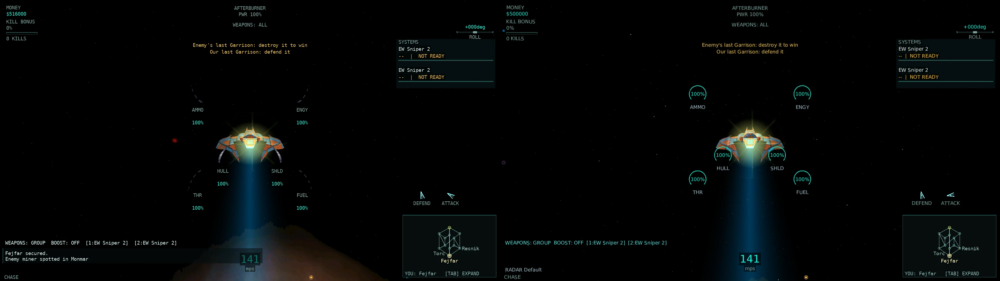 | 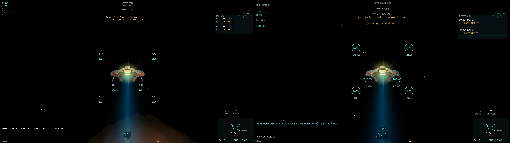 |
| Combat target / overlap regression |  |  |
| Critical, bright backdrop | 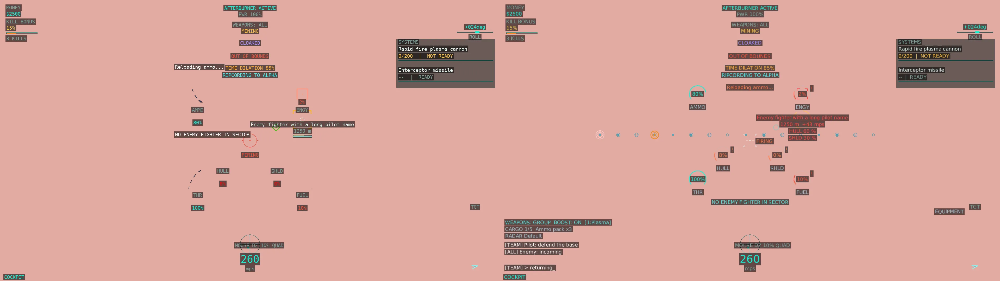 | 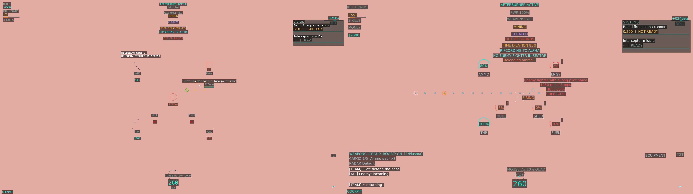 |
| Docked | 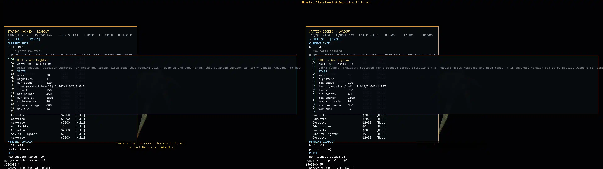 | 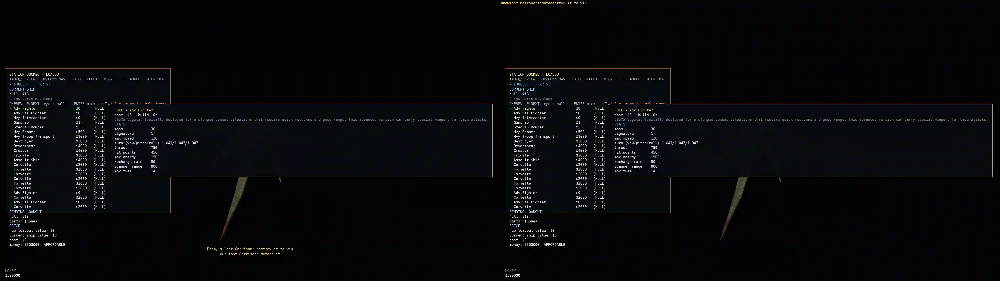 |
| Lifepod / current return bindings | 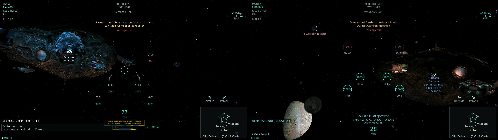 | 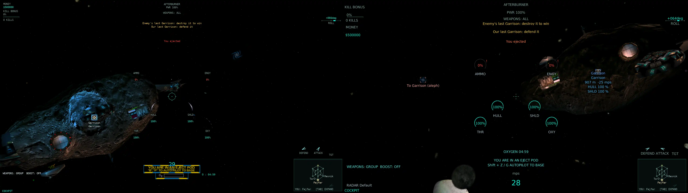 |
| Radar All | 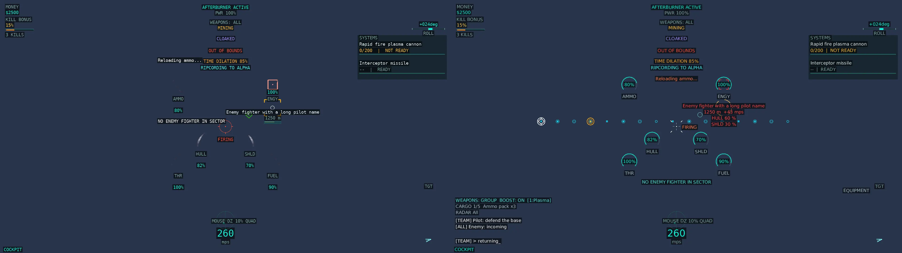 | 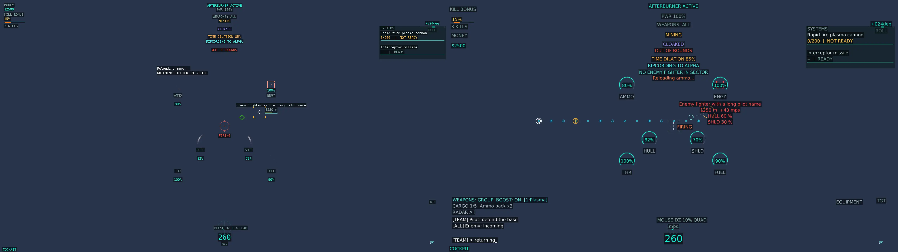 |
| Radar Default |  |  |
| Radar Target |  |  |
| Radar Minimal | 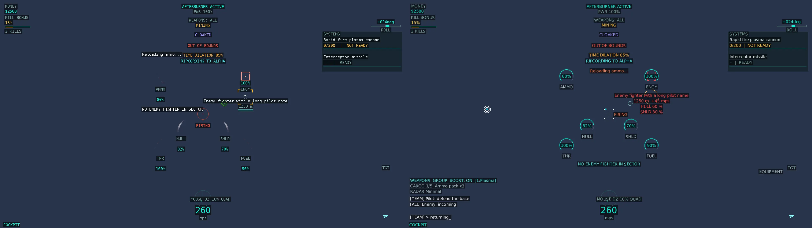 | 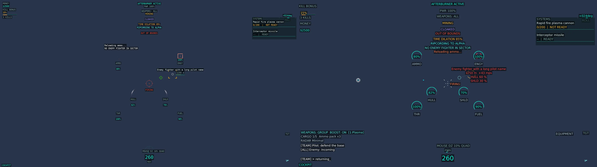 |

The final assets total **1,804,550 bytes**, below the 2 MB cap. Raw TRX/logs, lossless originals and the synthetic test pack remain outside the repository. Claude and Domingo's visual judgement remains external to this implementation.
