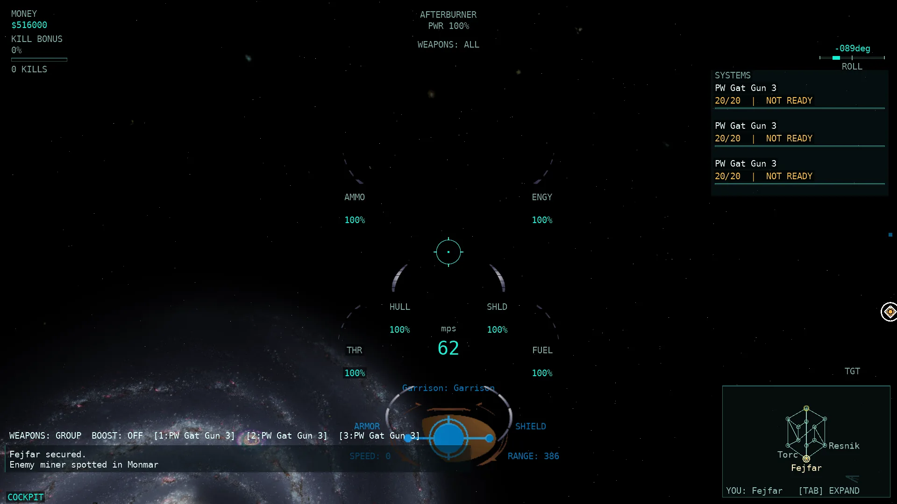
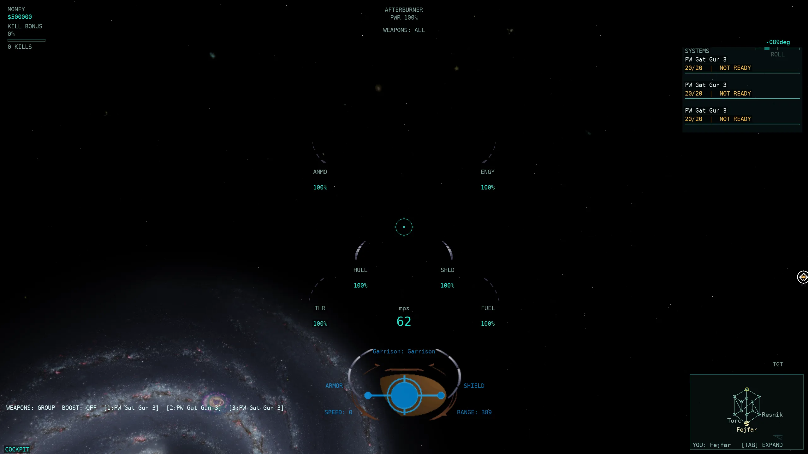
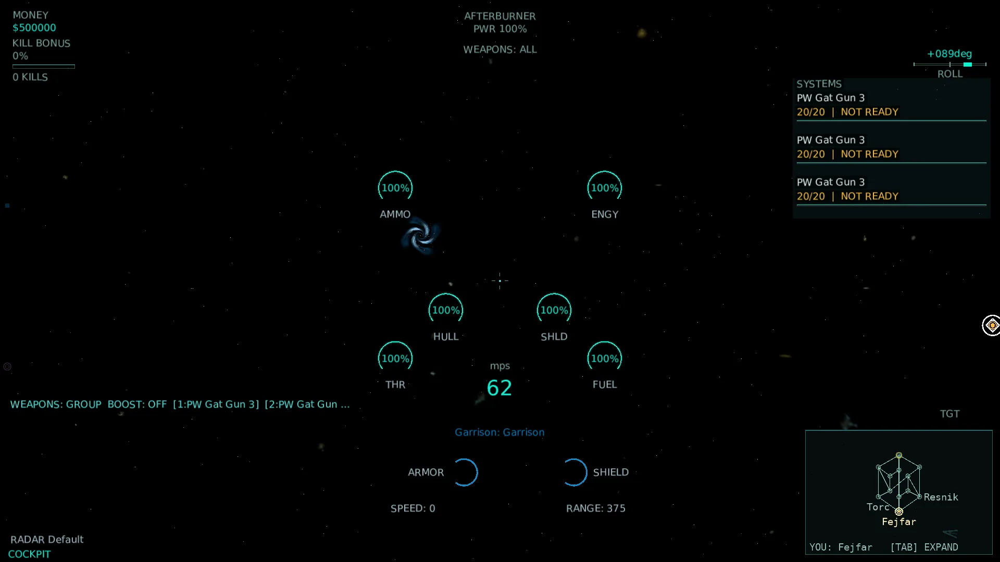
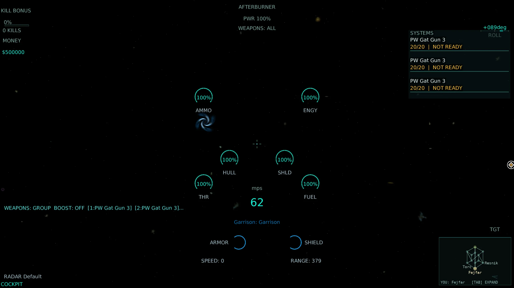

# HUD-3 — first HUD parity wave: the native target pane

Base: master at dispatch (HUD-1's `HudModel` + HUD-2's Classic/Modern skins). Branch: `pi/hud3`. Changes are left in the working tree; no commits or pushes were made. Reviewed and fixed in place on `pi/hud3b` (see the **Review fixes** section at the end).

The native bottom target pane is now a real, model-driven pane rendered by both skins, with native bitmap art in Classic and a HUD-2 geometric pane in Modern. After review the single row at full parity is *Target side identity*; *Target in weapon range* was corrected back to `partial` (the lead predictor is gated by `c_habmLeadIndicator` and does not reproduce native's healing/friendly, turret-weapon, or any-model target handling), and the other ten target-pane rows remain `partial` with the precise remaining difference recorded in `docs/parity/parity-matrix.csv`.

## Rows covered (12)

All `hud` rows of the native target pane, from `docs/parity/parity-matrix.csv`:

| Row | Native rule | Final status and remaining difference |
| --- | --- | --- |
| Target name | `WinTrek/consoledata.cpp:65`; `Artwork/dialog.mdl:4043-4050,4237` — `GetName(Target): GetModelTypeDesc(Target)`, target side colour, shown for a non-null target | partial — pane renders name:type in actual side colour; unseen-target last-seen hull type absent; port HUD font substitutes `medVerdana` |
| Target type description | `WinTrek/consoledata.cpp:40-56`; `Igc/common.cpp:1053-1105` — visible type or last-seen hull; "unknown" fallback | partial — visible type resolved for ship/station/asteroid/warp; native last-seen hull fallback absent (no wire field) |
| Target side identity | `WinTrek/consoledata.cpp:89-104`; `WinTrek/WinTrek.cpp:8784-8818`; `Artwork/dialog.mdl:4161-4176` — side name and actual side RGB × `g_hudBright` at alpha 0.5; neutral grey (0.5,0.5,0.5,0.5) | **done** — pane text/oval now use the native `SetTargetGeo` colour: actual side RGB × 0.85 at alpha 0.5, neutral grey |
| Target hull | `WinTrek/consoledata.cpp:202-220`; `Artwork/dialog.mdl:4123-4130,4222` — damageable visible local fraction, else 0; same-cluster or docked-station gate | partial — dedicated `TargetHullGaugebmp` bottom reveal drawn at native position; native cluster/docked-station gate applied; unseen rule still approximated by dead/gone (no per-target scanner `CanSee` gate) |
| Target shield | `WinTrek/consoledata.cpp:252-277`; `Artwork/dialog.mdl:4131-4135,4221` — mounted ship shield or station fraction, else 0; station same-cluster or docked-station gate | partial — dedicated `TargetShieldGaugebmp` bottom reveal drawn; native station cluster/docked-station gate applied; `CanSee` still approximated |
| Target range or sector | `WinTrek/consoledata.cpp:182-199`; `Artwork/dialog.mdl:4053-4070,4238` — same-cluster metres; −1 → `LOCATION: sector` | partial — same-cluster `RANGE:n` drawn; `LOCATION: sector` fallback absent (no last-seen sector on the wire) |
| Target speed | `WinTrek/consoledata.cpp:136-150`; `engine/modeler.cpp:2008`; `Artwork/dialog.mdl:4095-4103,4239` — velocity magnitude mps; unseen dynamic −1; static 0; rendered via native `NumberString` `(int)(v+0.5)` | partial — value rule matches and renders as `SPEED:n` (the −1 sentinel reads `0`); port HUD font substitutes `smVerdana` |
| Target ore | `WinTrek/consoledata.cpp:449-460` — asteroid ore amount | partial (unchanged) — port shows remaining-ore fraction; native radar fill units differ |
| Target kill bonus | `WinTrek/console.cpp:824-830`; `Artwork/dialog.mdl:4181-4196` — `100·(target experience multiplier−1)`, ship only | partial — `HudTargetPane.KillBonusPercent` stays null; per-target experience is not on the client wire |
| Target in weapon range | `WinTrek/indicator.cpp:405`; `Artwork/dialog.mdl:4073-4081,4242` — `SetInRange` from the lead predictor | partial — native `turretrangebmp` drawn at the pane position from the lead predictor's in-range flag; gaps: ship targets only (native any `c_cmdCurrent` model), gated by `c_habmLeadIndicator`, healing/friendly test missing (`indicator.cpp:213-217`), turret weapon ignored (`indicator.cpp:196-203`) |
| Target model preview | `WinTrek/console.cpp:672`; `Artwork/dialog.mdl:4218-4224` — `targetGeo` 96×96 viewport | partial — native oval/word art now drawn; 3D `targetGeo` preview remains absent |
| Target time to intercept | `WinTrek/consoledata.cpp:182`; `Artwork/dialog.mdl:1280` — GlassHUD `range/(own−target speed)`, signed m:ss | partial (unchanged) — GlassHUD TTI absent; closing speed already in the model |

## Implementation

### Model (`src/Allegiance.ClientCore.Game/Rendering/HudModel.cs`)

New `HudTargetPane` record carries the pane's resolved frame: name, type description, side name, side colour, hull/shield fractions, same-cluster distance, target speed, ore fraction, kill-bonus (null — not on the wire), the lead predictor's in-range flag, and an `IsShip` discriminator. `HudContext.TargetPane` holds it; `HudModel.TargetPaneVisible` gates it to the native pane mask (`ofInCockpit | ofInChase | ofGloatCam`, `Artwork/dialog.mdl:5402`; `ofGloatCam` is `cmExternalOverride` per `WinTrek/WinTrek.cpp:6844`, so `CameraMode.ExternalOverride` is included). `HudElements` now exposes the pane rows from this structure instead of the projected selection bracket; the projected bracket continues to feed `Selected target bracket` and `Target ore`.

### Pure model (`src/Allegiance.ClientCore.Game/Rendering/TargetPaneModel.cs`)

`TargetPaneModel.Build(...)` is the single, unit-testable resolution of the pane, sitting next to `SelectionPaneModel` and reusing its name/hull/shield/ore shape. It applies the native value rules directly: static targets speed 0, unseen dynamic speed −1; hull cluster-gated (`consoledata.cpp:202-212`) with the docked-station exception, station shields the same (`consoledata.cpp:252-276`); same-cluster range only; neutral side colour grey (0.5,0.5,0.5,0.5) and sided colour × 0.85 at alpha 0.5 (`WinTrek/WinTrek.cpp:8784-8818`); and it sanitises every string once so the draw path never re-sanitises per frame.

### Snapshot (`src/Allegiance.ClientCore.Game/Game1.Camera.cs`)

`ComputeTargetPane` maps the player's own `T/G` selection to `IgcObjectType` and delegates to `TargetPaneModel.Build(...)`, independent of whether the target projects into the current view (native `IsNotNull(Target)` keeps the pane for an off-screen target). It follows the native rules above: ship hull type name / station type name / `NativeAsteroidTypes` row / `"aleph"` for type; `SideRoster` colour + neutral grey for side; dead/gone → hull/shield 0 and speed −1; static targets → speed 0; same-cluster centre separation for range; `ClientWorld.LeadIndicator` for in-range.

### Renderers

- **Classic** (`HudRenderer.DrawTargetPane`) draws the native pane at the `SideBottom (-320, 25)` anchor (`dialog.mdl:5402`) using the real decoded bitmaps (`TargetHullGaugebmp`, `TargetShieldGaugebmp`, `turretrangebmp`, `TargetOvalbmp`, `targetovalcolorbmp`, `targetovalword1/2bmp` — `TargetPaneTextures.cs`). Gauges use the native source rectangles (`dialog.mdl:4123-4135`) with a bottom-up reveal; text uses the actual side colour at the native pane-local anchors.
- **Modern** (`ModernHudRenderer.DrawTargetPane`) draws the same pane position in the HUD-2 style: measured SDF text, compact hull/shield arcs, and a geometric in-range marker, honouring the HUD size and colour-blind palette.
- `TargetPaneLayout.cs` owns the pane-local extents, viewport scale, and the width clamp that keeps the pane clear of the bottom-right minimap (the HUD-2 overlap rule). `PrepareLayout` reserves the pane so measured text (radar labels, notices, the raised speed/leader/commandee/mouse-stick readouts) is placed around it.

## Validation

- **Whole-solution Release build**: **0 warnings / 0 errors**.
- **`TargetPaneModelTests`** (new, 5 pure value-rule cases): **3/3** isolated runs, 5 cases each — static/unseen speed, same-cluster range vs the absent sector-name fallback, unseen → 0 hull/shield, neutral/sided side colour, and the cluster/docked-station gate.
- **`HudFormatTests`** (native `NumberString` formatter added): **3/3** isolated runs, 41 cases each.
- **`HudModelTests`** (target-pane value/visibility cases; `ExternalOverride` = `ofGloatCam` added to the mask): **3/3** isolated runs, 30 cases each.
- **Renderer smoke test** (`ModernHudTests.Both_skins_render_Hud1_scenarios…`, now exercises the pane in the combat/critical/radar fixtures): **3/3** isolated runs; the proof harness passed **234 combinations** (13 scenarios × 3 resolutions × 3 sizes × 2 skins) with real font-measured bounds, no overlap, and full Modern coverage.
- **`RendererDisposalGuardTests`**: **3/3** isolated runs (new `_targetPaneTextures` disposed in `UnloadContent`).
- **`P674ParityScorecardTests`**: **3/3** isolated runs (both matrices validate after the row updates).
- **Fast tier** (`tools/run-tests.sh --tier fast`): **8894 tests, PASS** (272.0 s).
- No `Allegiance.Core`/`Allegiance.Server` production source changed, so the conditional server AOT publish is not triggered. Rig/221/200v200 runs were not launched.

## Real-client screenshots

Four real windowed clients against a local server on `m2scatter.igc` / `PCore001.igc`, one per skin per resolution, using the real backbuffer autoshot path (`--auto-launch "Adv Fighter" --auto-target station --autoshots 9 --exit-after 18`). Each selected the same in-sector target (`Garrison (Station#1053)`) so the pane is populated in every frame. The HUD-3b recapture runs without combat bots (the pane is target-driven, not combat-driven), which removes the defeat/ready-check frame that the original HUD-3 Classic 1920×1080 capture had. [Provenance and original-PNG SHA-256 hashes](HUD3_assets/screenshots.json); raw logs/original PNGs remain under `~/allegiance-evidence/HUD3b/`.

| Scenario | 1920×1080 | 2560×1440 |
| --- | --- | --- |
| Combat target — Classic |  |  |
| Combat target — Modern |  |  |

Assets total **274,516 bytes** (under the 2 MB cap). The original HUD-3 enemy-fighter capture remains under `~/allegiance-evidence/HUD3/raw/1920x1080-combat-Classic/`.

## Review fixes (HUD-3b)

Applied on `pi/hud3b`, in place, per the review brief:

1. **Model extracted** — `ComputeTargetPane` moved into pure `TargetPaneModel.Build(...)` next to `SelectionPaneModel`; `Game1.Camera.cs` is now a thin `TargetKind`→`IgcObjectType` mapping wrapper. Unit-tested: speed static/unseen, same-cluster range vs the absent sector-name fallback, unseen → 0, neutral/side colour, and the cluster/docked-station gate.
2. **Pod speed regression** — restored master's `h − 238f` pod speed position (`HudRenderer.cs`).
3. **Speed formatting** — both pane renderers now use native `NumberString` `(int)(v+0.5)` (`HudFormat.FormatNativeNumber`), so the −1 sentinel reads `0` and exact halves round up.
4. **Side colour** — neutral is now grey (0.5,0.5,0.5,0.5) and sided is side RGB × `g_hudBright` (0.85) at alpha 0.5 (`WinTrek/WinTrek.cpp:8784-8818`), not white.
5. **Cluster gating** — hull uses the player's cluster or the docked station (`consoledata.cpp:202-212`); station shields use the same gate (`consoledata.cpp:252-276`); the range code's same-cluster test is the single shared computation.
6. **Modern overlap** — ARMOR/SHIELD labels now flank their arcs instead of sitting on the stroke, and the arc radius follows the pane scale `s` (not the Modern UI `_scale`).
7. **Allocations** — strings are sanitised once in `TargetPaneModel`; the per-frame `Ascii()` LINQ was removed from the pane draw path.
8. **CSV** — restored the quote-wrapping on the two unrelated lobby training rows.
9. **Gloat cam** — `CameraMode.ExternalOverride` added to the pane mask (native `ofGloatCam` = `cmExternalOverride`, `WinTrek/WinTrek.cpp:6844`).
10. **Rows** — *Target side identity* stays `done` (now the native grey/bright/alpha rule); *Target in weapon range* corrected to `partial` (ship targets only, gated by `c_habmLeadIndicator`, healing/friendly test missing, turret weapon ignored); *Target speed* note fixed; cluster gate added to the *Target hull/shield* notes.
11. **Evidence** — all four screenshots recaptured with a populated pane (no combat bots, so no defeat/ready-check frame); see `HUD3_assets/screenshots.json`.

## Remaining gaps (unfinished)

- Unseen-target fallbacks: native last-seen hull type (`PlayerInfo.LastSeenShipType`) and last-seen sector (`PlayerInfo.LastSeenSector`) have no port wire equivalent, so the pane shows "unknown" and omits `LOCATION: sector` for a target that left view.
- Per-target experience (target kill bonus) is not streamed, so `targetexperiencebmp` stays absent.
- The 3D `targetGeo` model preview is not rendered; only the oval/word decoration is drawn.
- Classic text uses the port HUD font instead of native `medVerdana`/`smVerdana` (no native shadow), so text-bearing target rows remain `partial`.
- Target hull/shield unseen-state still approximates native `CanSee` with the port's dead/gone flag; a hidden (`Unknown`) but not-yet-deleted ship can show its last live fraction where native would show 0. The cluster/docked-station gate is now exact.
- Target in weapon range still does not reproduce native's healing/friendly weapon test (`indicator.cpp:213-217`), turret-weapon selection (`indicator.cpp:196-203`), or non-ship `c_cmdCurrent` targets; the lead indicator is also gated by the `c_habmLeadIndicator` hull capability.
- Target ore normalization and the GlassHUD time-to-intercept remain out of scope for this pane wave.
