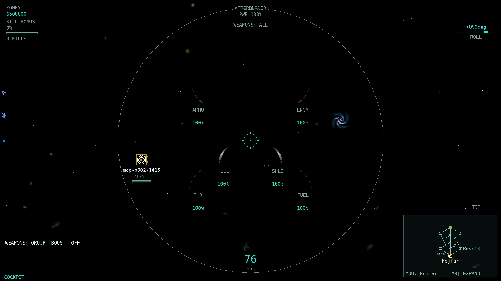
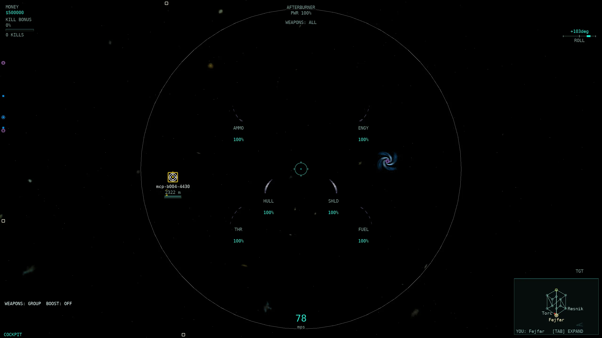
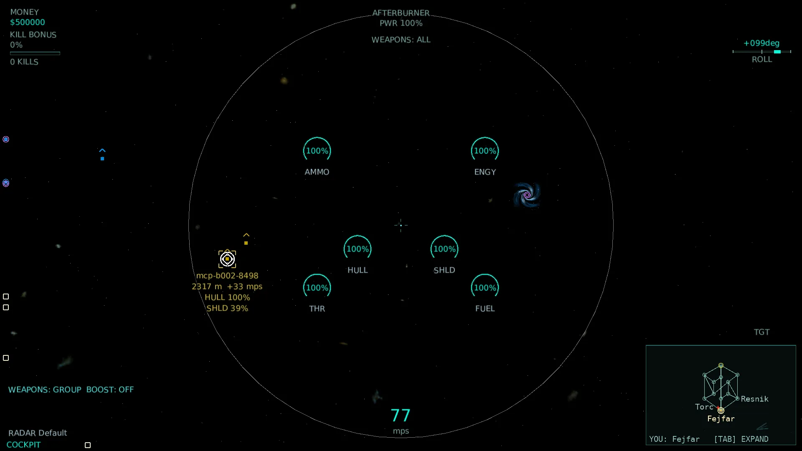
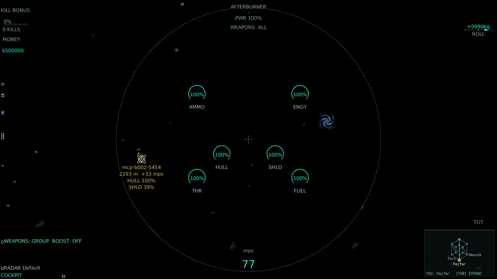
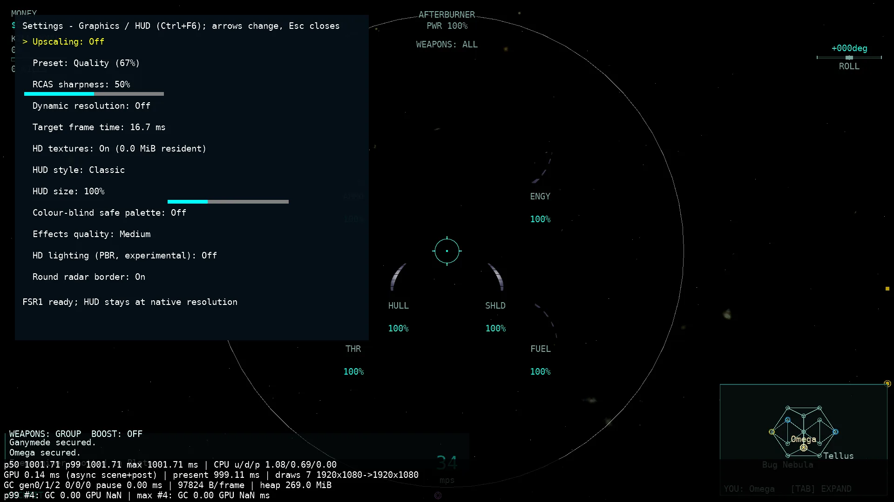

# HUD-4 — HUD wave: radar contacts

Base: master at dispatch (HUD-1's `HudModel` + HUD-2's Classic/Modern skins; HUD-3's target pane is still on `pi/hud3`, unmerged). Branch: `pi/hud4`. Changes are left in the working tree; no commits or pushes were made.

## Track coordination

Unmerged Pi branches and their `docs/parity/parity-matrix.csv` ownership were checked before picking rows:

| Branch | Touches `hud` rows? | Action |
| --- | --- | --- |
| `pi/hud3`, `pi/hud3b` | 12 target-pane rows | Skipped — those are HUD-3's rows. |
| `pi/p751`, `pi/p752`, `pi/p753`, `pi/ux1` | none (their diffs are empty on `parity-matrix.csv`) | Not in conflict. |

HUD-4 owns the radar rows only. CSV edits are limited to the 12 rows listed below.

## Rows covered (12)

All radar `hud` rows named in the brief, from `docs/parity/parity-matrix.csv`:

| Row | Native rule | Final status and remaining difference |
| --- | --- | --- |
| Selected target bracket | `radarimage.cpp:28,296-319,352` — projected-radius bracket, actual side colour | partial — bracket now scales to the projected object radius and uses actual side colour; native `m_psurfaceTargeted` art and exact thickness remain absent |
| Missile lock flower | `radarimage.cpp:325-332` — `lock==0` nothing, partial `radius + 40×(1−lock)`, full `lockedbmp` | partial — continuous lock sizing and projected base radius now match; real `plockbmp`/`lockedbmp` art retained; no sinusoid remains |
| Radar viewport and round border | `radarimage.cpp:1130-1177`; `WinTrek.cpp:2715,3832` — optional round border, square default | partial — optional round border added at native radius/colour; eye-space edge clamp (`WinTrek.cpp:7882-7944`) still approximated by NDC clamp |
| Radar ship contacts | `radarimage.cpp:738,733-735,590` — ship icons + own-ship `c_maskMe` | partial — own-ship marker and real side colours added; native ship icon surfaces and label tiers remain absent |
| Radar station contacts | `radarimage.cpp:782-810,590` — pedestal 1000 m clip, side colour | partial — real side colour and pedestal clip added; native station icon art/label tiers absent |
| Radar warp contacts | `radarimage.cpp:952-963,590` — always shown (range clips in Target) | partial — warp shape/radius exist; native labels and Target range clip absent |
| Radar asteroid contacts | `radarimage.cpp:903-930,590` — generic rocks within 1000 m, named special rocks | partial — ordinary rocks now follow native All/Default/Target LOD; native rock icon art and ore fills absent |
| Radar missile contacts | `radarimage.cpp:819-832,590` — outside All only missiles aimed at own side | partial — contacts now drawn with the own-side aim gate; native missile icon art absent |
| Radar probe and mine contacts | `radarimage.cpp:834-873,590` — Target keeps enemy within 1000 m | partial — contacts now drawn with native LOD; native icon art/stat tiers absent |
| Radar treasure and tech contacts | `radarimage.cpp:877-900,437-511` — useful part vs tech vs not-useful | partial — contacts now drawn with usefulness LOD; native treasure/tech icon art absent and the live dev-tech split is deferred |
| Radar LOD modes | `radarimage.h:42`; `radarimage.cpp:724-980`; `WinTrek.cpp:9955` — per-kind presence, Minimal = self + important | partial — per-kind icon presence now matches native (Minimal keeps self + important only, not enemies); label/stat tiers remain absent (separate rows); fourth label now "None" per `c_szRadarLODs` |
| Radar range fade | `radarimage.cpp:689-700` — native alpha block is **commented out** | **done** — the port's former 300..4000 m fade is removed; contacts are full opacity, matching native's no-fade behaviour |

## Implementation

### Model (`HudModel.cs`, `HudModelAdapter.cs`, `HudElements.cs`)
- `HudContactKind` now carries `Missile`, `Probe`, `Mine`, `Treasure`, `Tech`; `HudContact` adds `IsSelf` and `IsTech` (the unused per-contact `ScreenRadius`/`Range`/`IsEnemy` fields were dropped in HUD-4b, see Review fixes).
- `HudLock` adds the continuous `Fraction` (0..1) and the projected `ScreenRadius`; `HudTarget` adds the projected `ScreenRadius`.
- `HudContext.RoundRadar` carries the optional round-border mode.
- `HudElements` exposes the new contact rows and the round-border value.

### Snapshot (`Game1.Rendering.cs` `DrawRadar`)
- Own ship is now a `c_maskMe` contact; ships carry real side colour and projected radius.
- Missiles, probes, mines and treasures are gathered from the existing `ClientWorld` collections (no new wire data). Missiles use the native own-side aim gate; probes/mines use the native side/1000 m LOD; treasures use `RadarTreasure.Usefulness` (radarimage.cpp:437-511).
- Asteroids now follow native ordinary-rock LOD (generic rocks within 1000 m, named special rocks kept in All/Default), while the P495 build-spot highlight is retained.
- Native has no distance fade (`radarimage.cpp:689-700` is commented out), so contacts are full opacity; `RadarBracketLayout.NativeContactOpacity = 1` is the renderer constant and the parity test pins it.
- `RadarLod` (`RadarLod.cs`) is rewritten as per-kind native icon-presence rules, including Minimal = own ship + selected target only.

### Renderers
- **Classic** (`RadarBracketRenderer`) draws the native round border circle (radius `0.48×(h−20)`, colour `(0.5,0.5,0.5,0.25)`, 60 segments) before the contacts, plus distinct procedural silhouettes for missile/probe/mine/treasure/tech and a hollow-square self marker. `HudRenderer.DrawTargetSelectionBracket` and `DrawLockBracket` now use the projected radius and the continuous lock rule; the selection bracket uses actual side colour.
- **Modern** (`ModernHudRenderer`) uses the same `RadarBracketRenderer` for contacts/border and applies the same projected-radius selection bracket and continuous lock-flower sizing in the HUD-2 style.
- `HudSettings.RoundRadar` (persisted) and a graphics-settings row (`Game1.GpuBudget.cs`) toggle the round border; square radar remains the default (`WinTrek.cpp:2715`).

### Fixtures
`tools/hud2-proof/Program.cs` now exercises all nine contact kinds, the round border, and the new LOD signatures in its 234-combination smoke sweep.

## Validation

- **Whole-solution Release build**: **0 warnings / 0 errors**.
- **Unit tests**, each method/family run **3× alone**: `HudModelTests` (24 cases), `Hud4RadarTests` (10 cases, new), `P624FlightKeysPackTests` (48 cases), radar bracket/selection bundle (27 cases) — all **3/3**.
- **Renderer smoke test** (`ModernHudTests.Both_skins_render…`, Live): **3/3** alone; the proof harness passed **234 combinations** (13 scenarios × 3 resolutions × 3 sizes × 2 skins) with real font-measured bounds, no overlap, and full Modern coverage of every visible element. [render-checks.json](HUD4_assets/render-checks.json).
- **Fast tier** (`tools/run-tests.sh --tier fast`): **8912 tests, PASS** (268.7 s).
- No `Allegiance.Core`/`Allegiance.Server` production source changed, so the conditional server AOT publish is not triggered. Rig/221/200v200 runs were not launched.

### Scorecard before → after

| | hud area |
| --- | --- |
| Before | **0/324 (0/108)** complete |
| After | **3/324 (1/108)** complete — *Radar range fade* |

The only row moved to `complete` is *Radar range fade*, because native's fade block is commented out and the port now matches that no-fade behaviour. Every other row remains `partial` with the precise remaining difference recorded above and in the CSV.

## Real-client screenshots

Re-shot for HUD-4b: four real windowed clients against a local server on `m2scatter.igc` (2 bots per side arena so the 107v107-era PBR/combat path stays responsive; `--auto-launch --auto-target enemy`, round radar really enabled via `ALLEGIANCE_HUD_SETTINGS`), one per style per resolution, using the real backbuffer autoshot path. The selected target is a real enemy fighter (`--auto-target enemy`), so the selection bracket is present; a missile-lock flower was not reachable with the available automation (no auto-fire flag). [Provenance and original-PNG SHA-256 hashes](HUD4_assets/screenshots.json); raw logs/original PNGs remain under `~/allegiance-evidence/HUD4b/raw`.

| Scenario | 1920×1080 | 2560×1440 |
| --- | --- | --- |
| Combat — Classic |  |  |
| Combat — Modern |  |  |
| Graphics/HUD settings panel |  | — |

Deterministic renderer-smoke fixtures (all nine contact kinds + round border) are also retained: [fixture-screenshots.json](HUD4_assets/fixture-screenshots.json).

Assets total **521,205 bytes**, below the 2 MB cap.

## Review fixes (HUD-4b)

Claude's review items, addressed end to end on branch `pi/hud4b` (after `git merge master` and resolving the HD-5 row-10/round-radar-row-11 conflict in `Game1.GpuBudget.cs`):

1. **Own-ship marker** — `Game1.Rendering.cs` now emits the `c_maskMe` contact only when the camera is an external/chase flight camera AND the own ship projects on-screen; the cockpit bottom-centre edge-clamp marker is gone (native `radarimage.cpp:733-735`).
2. **Settings layout** — `Game1.GpuBudget.cs` moved the footer below the 12th row (`78 + rows.Length*46 + 8`) and grows the panel (`Math.Min(700, viewportH−40)`); captured as `HUD4_assets/settings-panel.webp`.
3. **Range fade pinned** — `RadarBracketLayout.NativeContactOpacity = 1f` (native fade commented out, `radarimage.cpp:689-700`) is the constant `Game1.Rendering.cs` uses for `op`; dead `Opacity`/`CloseRange`/`FarRange` removed, and `RadarBracketLayoutTests.NativeContactOpacity_IsFullOpacity_NoDistanceFade` pins it.
4. **Treasure rule** — `RadarTreasure.Usefulness` now takes `launcherMountable` and applies native `IsLauncherType(et) && CanMount(ppt,0)` (`radarimage.cpp:503-508`, `igc.h:3879-3885`); a researched non-launcher part is `NotUseful`. `Hud4RadarTests` updated + a new pinning test added.
5. **Treasure live data** — `Game1.Rendering.cs` resolves the own loadout/hull once per frame and computes pack usefulness (afterburner / ammo weapon) and launcher mountability live; `ResolveFlightPart` caches Parts+Launchers once per catalogue instead of scanning per treasure. CSV wording updated accordingly.
6. **LOD distance** — probes, mines and treasure now use `LodSeparation(centre, objectRadius)` like stations/asteroids (native `radarimage.cpp:636` subtracts `radiusSource + pmodel->GetRadius()`); probe/mine radii come from the static core.
7. **Lock flower radius** — `LockBracketStyle.HalfSizeForFraction` now applies native's `1.05×radius` base and clips it to `distanceToEdge + c_flBorderSide` (`radarimage.cpp:308-319`); both renderers pass the viewport edge distance.
8. **Perf** — the unused per-contact `ScreenRadius`/`Range`/`IsEnemy` computation is dropped from `DrawRadar`; `HudModelAdapter` fills a caller-reused `HudContact[]` buffer and `RadarBracketRenderer` draws straight from the model without a LINQ `Select…ToArray`; asteroids are only projected after they pass the LOD/build-spot gate.
9. **Test rename** — `RadarLod_ShowTargetable_KeepsSelectedInSparseModes` → `RadarLod_ShowWarp_KeepsSelectedInSparseModes`.
10. **Evidence** — re-shot the four combat shots with round radar actually on (`ALLEGIANCE_HUD_SETTINGS` pointing at a `RoundRadar:true` file) and a real enemy selected; `screenshots.json` now has one unique source name + hash per entry and the settings-panel proof.

## Remaining gaps (unfinished)

- Native radar contact **icon art** (ship/station/warp/asteroid/missile/probe/mine/treasure/tech surfaces) is not decoded; the port keeps its procedural silhouettes, so all contact rows stay `partial`.
- **Label/stat tiers** (name, range, hull/shield bars, ore fills, detection eyes, ripcord seconds, command verbs) remain absent; they are separate parity rows and were out of scope for this wave.
- The **selected-target bracket** still uses the port's closed box rather than native `m_psurfaceTargeted`, and the exact thickness differs.
- **Eye-space edge clamp** (`WinTrek.cpp:7882-7944`) is still approximated by the NDC edge clamp; the round border is exact but the off-screen contact placement is not pixel-for-pixel native.
- Treasure **tech-vs-part** discrimination is deferred: the live side development-tech mask can be a default struct on the wire, so resolved parts render as useful treasure rather than the tech icon. `RadarTreasure.Usefulness` keeps the full rule for fixtures/follow-up.
- Overlay brackets (accepted/queued/nearest-enemy/threat/subject/flag/artifact/ripcord/construction) are out of scope for this wave.
