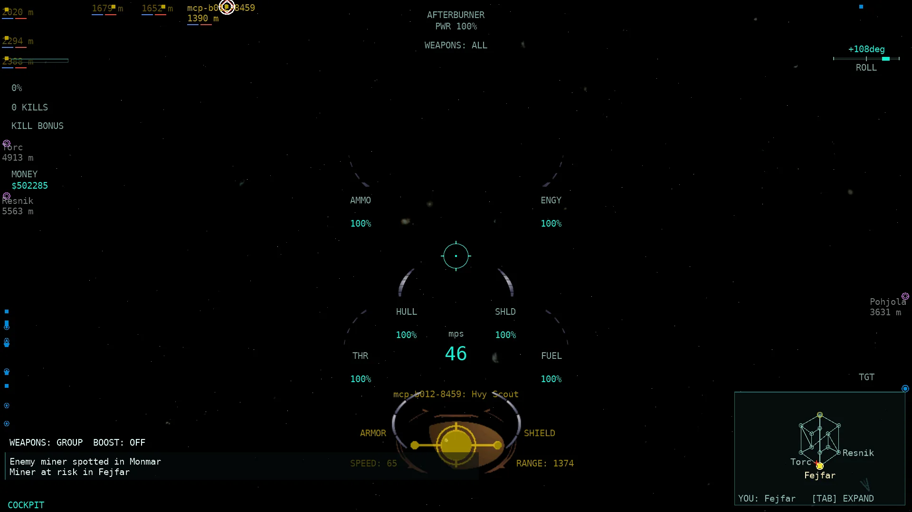
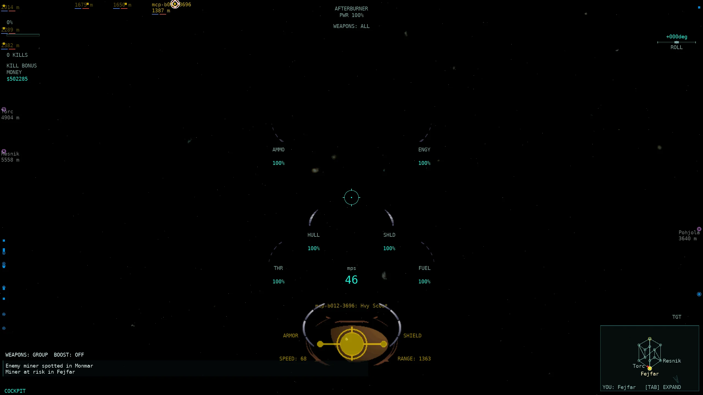
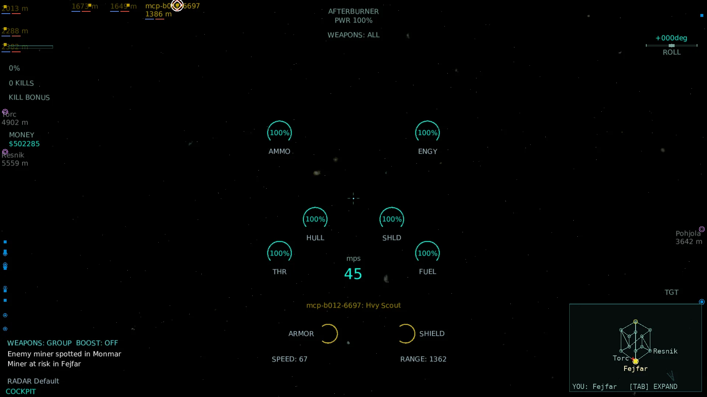
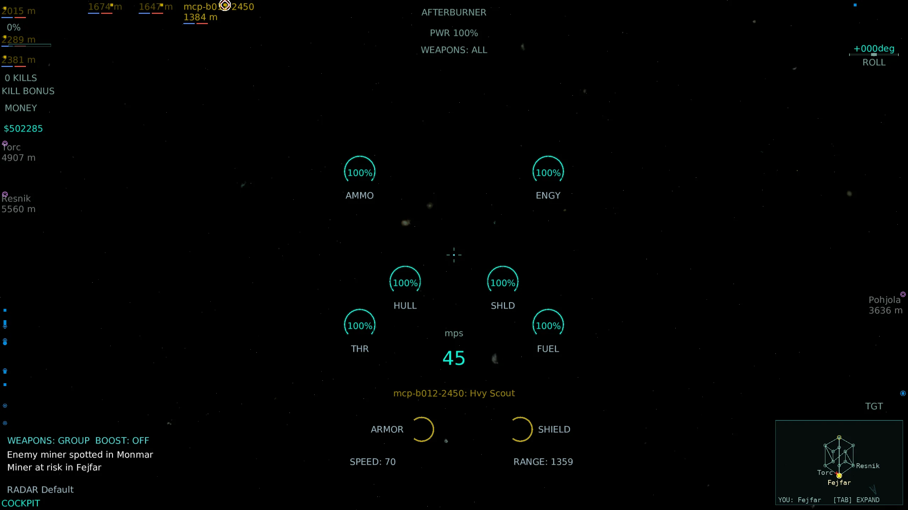
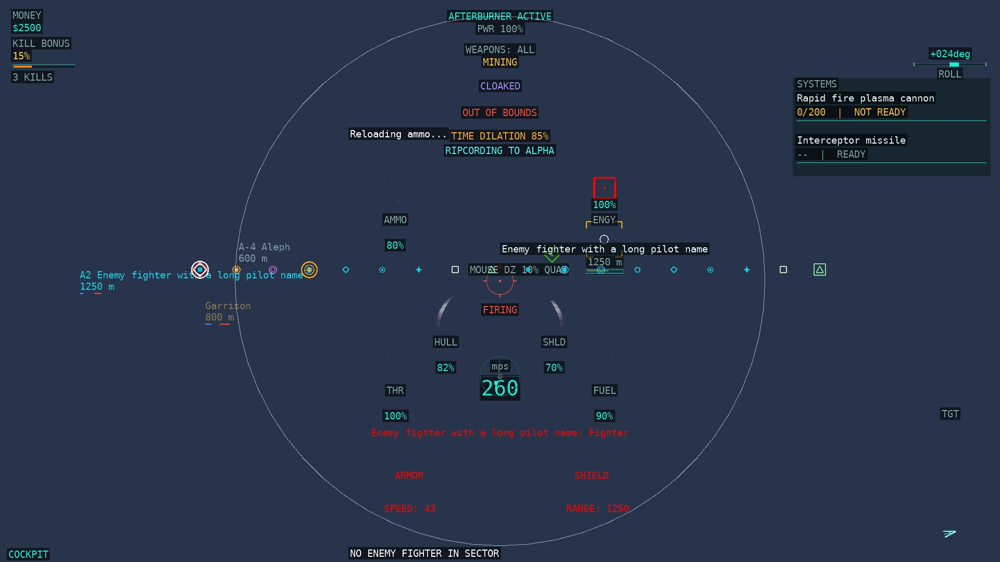
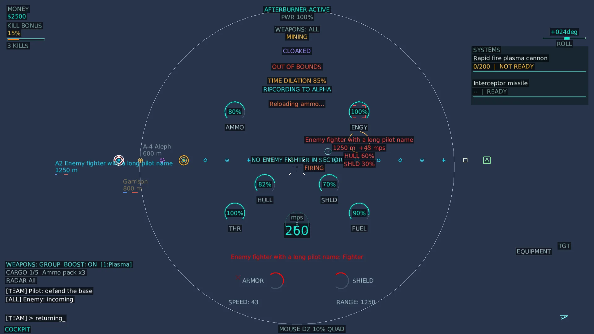

# HUD-5 — HUD wave: radar overlays and labels

Base: branch `pi/hud5` (from `c2f0a3b3`), now **`pi/hud5b` after merging `master`** (HUD-3 target pane `dfdb48ca` and HUD-4 radar
contacts `beda2413`; merge commit on top of master `e1c528b2`, committed as allowed by the HUD-5b brief). This round fixes the
five defects Claude's review found in the HUD-5 overlay/label work (see **Review fixes**) and re-shoots the evidence.
Changes are left in the working tree; no commits or pushes beyond that merge.

## Track coordination

Unmerged Pi branches were checked before picking rows (`git branch --list "pi/*" --no-merged master` plus
`git diff master <branch> -- docs/parity/parity-matrix.csv`):

| Branch | Touches `hud` rows? | Action |
| --- | --- | --- |
| `pi/hud3`, `pi/hud3b` | 12 target-pane rows | Skipped (now merged from master; HUD-3's rows kept as master has them). |
| `pi/hud4`, `pi/hud4b` | 12 radar rows: selected target, lock flower, viewport/border, ship/station/warp/asteroid/missile/probe/treasure contacts, LOD modes, range fade | Skipped (now merged from master; HUD-4's icon-presence rows kept as master has them). HUD-4's `RadarLod.ShowShip(mode, ownOrAllied, isSelf, isSelected)` signature is the one HUD-5b's snapshot calls. |
| `pi/p751`…`pi/p753`, `pi/ux1` | none in `parity-matrix.csv` | Not in conflict. |

HUD-4 ports **which contacts show**; HUD-5/HUD-5b port **what each contact says and which overlay brackets native draws**. They
share one `HudContact` record: HUD-4's `HudContactKind` (ship/station/warp/asteroid/missile/probe/mine/treasure/tech) and
`IsSelf`/`IsTech`, HUD-5b's radar overlay/label payload. CSV edits are limited to the 16 overlay/label rows listed below.

## Rows covered (16)

All are `hud` rows from `docs/parity/parity-matrix.csv`. None reaches `complete`; each stays `partial` with the precise remaining
difference recorded in the CSV and below.

| Row | Native rule | Final status and remaining difference |
| --- | --- | --- |
| Radar accepted order brackets | `WinTrek/radarimage.cpp:352-357,1094-1096` — brackets exist only for target/enemy/me/subject/flag/artifact/rip/last-fired; an accepted order keeps `colorOther` at full brightness and forces a label | partial — label line + `A<id>` text prefix, full brightness; **no bracket** (the HUD-5 green corner frame is gone); native `m_psurfaceAccepted` command-icon art absent |
| Radar queued order brackets | `radarimage.cpp:352-357,1094-1096` — queued dims `colorOther` to ×0.75 and forces a label | partial — label line + `Q<id>` prefix, label/bracket colour ×0.75; **no bracket** (amber corner frame gone); native `m_psurfaceQueued` art absent |
| Radar nearest enemy bracket | `radarimage.cpp:334,523-524,582-583` — `FindTarget(ship|enemy|nearest)` only while `bRangeLabels` (`!CommandCamera`); `Igc/common.cpp:470-630` | partial — resolved only when range labels are on, using the native nearest-squared-distance / first-wins-tie / enemies-only rule; red diamond stands in for `m_psurfaceEnemy` art |
| Radar threat damage flash | `radarimage.cpp:35-36,356-357,660-684` — per-model damage bucket; `db.flash(now)` adds `c_maskFlash` and turns the colour red | partial — `HudContact.Threat/ThreatFlash` + red-flash override exist; the renderer-only client has no per-model damage-bucket stream, so production leaves them unset (no data source) |
| Radar command subjects | `radarimage.cpp:340-342,574,652` — command-camera subjects draw a subject bracket | partial — the single `_commandee` is marked in command camera and draws white corners; native multi-subject list and subject icon art absent |
| Radar carried flag marker | `radarimage.cpp:343-345,643-645` — `GetFlag() != NA` and not the artifact sentinel | partial — `ship.CarriedFlagSideId != -1/-2` draws a gold pennant; native flag icon art absent |
| Radar carried artifact marker | `radarimage.cpp:346-347,643-645` — `GetFlag() == SIDE_TEAMLOBBY (-2)` | partial — `ship.CarriedFlagSideId == -2` draws a violet pennant; native artifact icon art absent |
| Radar ripcord marker | `radarimage.cpp:37,349-350,999-1005` — same-side NPC with `droneRipMaskIGC` | partial — `HudContact.Ripcord` + cyan ring exist; no per-ship drone-ripcord wire state for remote NPCs, so production leaves it unset |
| Radar construction highlight | `radarimage.cpp:42,639,704-710` — `c_maskHighlight` (flag treasure objective) forces a full-colour label | partial — `HudContact.Highlight` + white ring exist; native `c_maskHighlight` is the flag-treasure highlight (`radarimage.cpp:639`), not an asteroid construction bracket — the port's P495 build-spot pulse is a separate feature, and treasure contacts are out of this wave |
| Radar name labels | `radarimage.cpp:1199-1208` — one name line, prioritised labels first | partial — `RadarLabelModel.Resolve` + `HudRenderer.DrawRadarLabels` draw the name; port HUD font and block placement approximate the native stacked layout |
| Radar range labels | `radarimage.cpp:523,626-636,1209-1219` — `int(centre separation + 0.5)` metres before radius subtraction; no range in command camera | partial — same metre rule; port font/placement approximate; strings are now cached by metre value |
| Radar hull and shield bars | `radarimage.cpp:1408-1441` — 16px bars from damageable hull/shield fraction; `>1` sentinel suppresses | partial — bars from `ship.Latest` / `StationLive`; sentinel rule matched; native bar art/width differ |
| Radar ore and miner fill bars | `radarimage.cpp:989-997` — own-side miner `GetOre()/capacity`; asteroid `oreSeen/(2*capacity)`, capped 1 | partial — same-side miner fill from `ship.Latest.OreFraction` (native `GetOre/capacity`) without the miner-pilot-type gate; asteroid uses remaining-ore fraction because native side-known `oreSeen/(2*capacity)` is not on the client wire |
| Radar friendly detection eyes | `radarimage.cpp:1006-1019` — a **different same-side player-piloted** ship with `ShipStatus.GetDetected()` | partial — the native gate is implemented (`RadarLabelModel.ShowDetectionEye`), but the port has no scanner simulation and the server hard-codes `Detected = true` for teammates, so the eye stays **off** instead of lighting up for the whole team; native eye artwork absent |
| Radar friendly ripcord seconds | `radarimage.cpp:1021-1034` — same-side non-self active ripcord `int(time)+1`, capped 99999 | partial — `HudContact.RipcordSeconds` + `Ns` label exist; per-ship ripcord time is only tracked for the own ship (`ClientWorld.Apply(RipcordActivate)`), so remote friendly seconds stay unavailable |
| Radar command verb labels | `radarimage.cpp:1234-1310` — accepted/queued command icon beside the label | partial — `A<id>`/`Q<id>` prefix from `world.MyAcceptedCommand`/`MyQueuedCommand`; native accepted/queued command-icon art absent |

## Review fixes

Claude's review of HUD-5 raised five code defects plus the evidence and the size/location rule. Each is fixed in production code
and pinned by a test in `tests/Allegiance.ClientCore.MonoGame.Tests/Hud5bReviewFixTests.cs` (12 cases; each was run 3× alone).

1. **The eye marker was fake.** HUD-5 set `DetectionEye: ship.Detected` for every ship (`Game1.Rendering.cs`), and the server sends
   `Detected = true` for every teammate (`Server.Broadcast.cs:1654,1667,1700`), so every teammate label carried a permanent `*`.
   Native shows the eye only for a *different same-side **player-piloted*** ship whose `ShipStatus.GetDetected()` is set
   (`radarimage.cpp:1006-1019`, incl. the `ppi != null` guard). The snapshot now calls
   `RadarLabelModel.ShowDetectionEye(isSelf, sameSide, playerPiloted, detected)` with the pilot-type gate
   (`ship.Player.PilotType >= PlayerInfo.PilotTypePlayer`) and `detected: null`, because detection is not simulated: **the eye does
   not show from the constant**. The report's old claim "`Detected` is false for remote ships (no eye appears in production)" was
   wrong — the value is a hard-coded `true` — and is corrected here and in the CSV.
   Tests: `Detection_eye_needs_a_different_same_side_player_ship`, `Detection_eye_stays_off_while_detection_is_not_simulated`.

2. **Order brackets were invented.** HUD-5 drew green/amber corner frames for accepted/queued orders. Native draws a bracket only
   for target/enemy/me/subject/flag/artifact/rip/last-fired (`radarimage.cpp:352-357`); an order instead brightens the label and
   bracket colour (`colorOther`: ×1.0 for the important masks, ×0.75 queued, ×0.5 otherwise, `radarimage.cpp:1094-1096`) and shows
   the command icon in the label row. The corner frames are gone; `RadarLabelModel.BracketBrightness(contact)` implements the native
   step and both the label text and the surviving overlay brackets use it (icons keep the full side colour, as native does).
   `RadarBracketRenderer.HasOverlayBracket`/`RadarLabelModel.HasOverlayBracket` now enumerate only the native bracket masks, so the
   HUD coverage report can no longer claim a bracket that is not drawn. The accepted/queued rows are conveyed by the `A<id>`/`Q<id>`
   label prefix plus that brightness.
   Tests: `Accepted_and_queued_orders_draw_no_overlay_bracket`, `Order_state_changes_bracket_and_label_brightness_like_native`.

3. **Nearest-enemy lookup ran every frame in every mode.** Native resolves it only while `bRangeLabels` is on
   (`radarimage.cpp:523-524`) and passes `NULL` for `pmodelEnemy` otherwise (`radarimage.cpp:582-583`). The snapshot now gates the
   scan on `RadarLabelModel.RangeLabelsEnabled(commandCamera)` and uses the native `FindTarget(c_ttShip | c_ttEnemy | c_ttNearest)`
   rule — enemies only, smallest squared centre distance, first candidate wins a tie (`Igc/common.cpp:470-630`, replace test at
   `:608,621`) — through the pure `RadarLabelModel.NearestEnemy` over a reused candidate buffer (no per-frame list allocation).
   Tests: `Nearest_enemy_is_the_closest_visible_enemy_and_ignores_friends`,
   `Nearest_enemy_keeps_the_first_candidate_on_a_tie`, `Nearest_enemy_lookup_is_gated_by_bRangeLabels`.

4. **Per-frame allocations at 107v107 (~214 contacts).**
   - `RadarBracketRenderer.Draw(HudContact list)` maps each contact on the stack — the former
     `Contacts.Select(...).ToArray()` copy is gone (the HUD-4 `contactsBuffer` path is unnecessary now that `HudContact` is the
     snapshot type and was removed from `HudModelAdapter`).
   - Range strings are cached by metre value (`RadarLabelModel.RangeText` / `RangeLineText`), and
     `RadarLabelCache` keeps the resolved `RadarLabel`, the formatted name line and the drawn-element array per contact slot,
     rebuilding only when a label input (not position/opacity) changes; a moving ship refreshes just the range line.
   - `HudFormat.Printable` replaces the `new string(text.Select(...))` sanitising in `DrawMeasuredText` (and in the radar label
     block) and returns the *same instance* when the text is already printable.
   - The label block no longer builds `List<string>`/`List<(float,Color)>`/`List<string?>` per contact per frame.
   Tests: `Range_strings_are_cached_by_rounded_value`, `Label_cache_reuses_the_block_and_only_refreshes_a_moved_range`,
   `Label_cache_rebuilds_when_a_different_contact_reuses_the_slot`, `Printable_returns_the_same_instance_for_clean_text`.

5. **Screenshots.** The previous "combat" 1080p Classic shot was the game-over scoreboard and the others showed
   "NO ENEMY FIGHTER IN SECTOR". All four real-client frames were re-shot with `--auto-target-class enemy:fighter` against a live
   local arena: they show in-sector enemy contacts with range labels and the nearest-enemy bracket (numbers below). See
   *Real-client screenshots*.

6. **Evidence moved out of the repo.** The raw logs/PNGs now live in `~/allegiance-evidence/HUD5/` (outside the repo, per the
   evidence-size rule); only the six small WebP assets stay in `docs/reports/HUD5_assets/`, and the links below point there.

## Implementation

### Model (`HudModel.cs`, `RadarLabelModel.cs`, `RadarLabelCache.cs`)
`HudContact` carries the raw per-contact readings native `radarimage.cpp:590-1120` uses: `Name`, `Range`, `Shield`, `Hull`, `Fill`,
`IsEnemy`, `IsSelf`, `IsSameSide`, `IsTech`, and the overlay masks `AcceptedOrder`, `QueuedOrder`, `Threat`, `ThreatFlash`,
`Subject`, `CarriedFlag`, `CarriedArtifact`, `Ripcord`, `Highlight`, `NearestEnemy`, `CommandId`, `CommandAccepted`,
`RipcordSeconds`, `DetectionEye`. Unknown readings stay null/absent rather than becoming invented zeroes.

`RadarLabelModel` is a pure port of the native per-kind `bLabel`/`bStats` tiers (`radarimage.cpp:704-980`), the important-mask
forcing (`:704-710`), the `colorOther` brightness step (`:1094-1096`), the detection-eye gate (`:1006-1019`), the
`bRangeLabels` gate (`:523-524`) and the nearest-enemy search (`:582-583` + `Igc/common.cpp:470-630`). `RadarLabelCache` caches
the resolved block per contact slot.

### Snapshot (`Game1.Rendering.cs DrawRadar`)
`_drawRadarContacts` is a `List<HudContact>` filled under the session gate with HUD-4's contact set and LOD rules (own ship, ships,
stations, warps, missiles, probes, mines, treasures/tech, asteroids) plus HUD-5b's overlay/label payload: nearest non-allied
in-sector ship (range-labels gated), the own ship's accepted/queued command targets, the command-camera `_commandee`, carried
flag/artifact state, hull/shield/ore fractions and per-contact name/range. Command camera suppresses range
(`radarimage.cpp:523`). An opt-in diagnostic (`ALLEGIANCE_RADAR_PROOF=1`) logs the radar snapshot for each autoshot, which is how
the evidence frames below are tied to real radar state.

### Renderers
- **Classic** (`RadarBracketRenderer` + `HudRenderer.DrawRadarLabels`): contact icons (HUD-4 shapes/colours, own-ship marker),
  then the native overlay brackets only — nearest enemy (red diamond), command subjects (white corners), carried flag/artifact
  (pennants), ripcord ring, threat ticks, flag-treasure highlight ring. No accepted/queued frames. Label blocks (name, range,
  hull/shield/ore bars, eye, ripcord seconds, command prefix) are drawn in `HudRenderer.DrawRadarLabels` with measured bounds
  recorded in the shared `HudTextLayout`; their colour is the side colour × the native `colorOther` brightness.
- **Modern** (`ModernHudRenderer` inherits `DrawRadarLabels`): same contacts and overlay brackets, same label positions, SDF text
  through the existing `RenderText` override.
- `HudTextLayout.PlaceBlock` places the multi-line radar label block and records it for the HUD-2 overlap check.

## Validation

- **Whole-solution Release build**: **0 warnings / 0 errors** (`dotnet build AllegianceCore.slnx -c Release`).
- **Tests, each new/affected family run 3× alone** (`TMPDIR` inside the worktree): `Hud5bReviewFixTests` (12 cases, new),
  `RadarLabelModelTests` (9), `HudModelTests` (31), `Hud4RadarTests` (10), `RadarBracketLayoutTests` (8),
  `RadarBracketSideColorTests` (6), `RadarTargetSelectionTests` (5), `RadarInvestAsteroidSelectionTests` (4),
  `P527RadarTagRenderPoseAnchorTests` (3), `P624FlightKeysPackTests` (48) — **136/136 passed on each of the 3 runs**. The Live
  renderer/overlay family (`ModernHudTests`, `RadarTargetHighlightLiveTests`) — **5/5 on each of the 3 runs**;
  `P674ParityScorecardTests` (Allegiance.Core.Tests, 8 cases — validates the CSV the review rows changed) — **8/8 × 3 runs**.
- **Renderer smoke test** (`ModernHudTests.Both_skins_render_Hud1_scenarios…`, Live): the proof harness passed **234 combinations**
  (13 scenarios × 3 resolutions × 3 sizes × 2 skins) with real font-measured bounds, no overlap, and full Modern coverage of every
  model-visible element (`HUD2_RENDER_PASS 234`).
- **Fast tier** (`tools/run-tests.sh --tier fast`, final code state): **9036 tests, 267.7 s, 5 failures — all
  `Allegiance.Core.Tests.PlayerBundlePathsTests`** (5 of its 9 cases). Those tests read the workstation's gitignored `local.env`
  (this machine sets `ALLEGIANCE_ARTWORK_PATH`/`ALLEGIANCE_NATIVE_SRC_PATH`) and assert the *unconfigured* result; they fail
  identically **on master's own worktree** with the same binary (base rate: 5/9 fail there too, run 3× here and once on master),
  and are unrelated to the radar work. No other test failed.
- No `Allegiance.Core`/`Allegiance.Server` source differs from master (`git diff master -- src/Allegiance.Core src/Allegiance.Server`
  is empty), so the conditional server AOT publish is not triggered. Rig / 221 / 200v200 runs were not launched.

### Scorecard before → after

| | hud area |
| --- | --- |
| Before (HUD-5 alone) | **0/324 (0/108)** complete |
| After HUD-5b | **6/324 (2/108)** complete |

HUD-5b itself moves **no** row to `complete`: every overlay/label row still differs from native in artwork (command/enemy/
flag/artifact/ripcord/subject icon surfaces are not decoded), font, or because the renderer-only client has no per-object
damage-bucket / remote-ripcord / scanner-detection wire data. The two complete `hud` rows come from the merge: *Radar range fade*
(HUD-4: native's fade block is commented out, `radarimage.cpp:689-700`) and *Target side identity* (HUD-3). The scorecard and CSV
both validate (`python3 scripts/parity-scorecard.py`).

## Real-client screenshots

Four real windowed clients against a local `Allegiance.Server` on `m2scatter.igc` / `PCore001.igc` with a 6-per-side arena in
Fejfar, using the real backbuffer autoshot path and `--auto-target-class enemy:fighter`, one per skin per resolution. Each frame
was captured ~1 s after launch, while the pilot was airborne in the arena; the client log for that exact frame records the radar
snapshot it drew. [Provenance and SHA-256 hashes](HUD5_assets/screenshots.json); raw logs/original PNGs live in
`~/allegiance-evidence/HUD5/` (see `commands.txt` and `verify_frames.py` there).

| Scenario | 1920×1080 | 2560×1440 |
| --- | --- | --- |
| Combat — Classic |  |  |
| Combat — Modern |  |  |

What each frame shows, from the client log line written for that frame
(`[autoproof] radar on that frame: …`), and from the pixel checks in `~/allegiance-evidence/HUD5/verify_frames.py`:

| Frame | Radar snapshot on that frame (client log) | Pixel checks |
| --- | --- | --- |
| 1920×1080 Classic | 23 contacts, 13 ships, **6 enemies**; nearest enemy `mcp-b012-8459` at (478,14), label `mcp-b012-8459` / `1390 m`; five more enemy contacts with range labels `2020/1679/2294/1652/2388 m` | 2310 HUD-accent px; 3160 enemy-side (gold) label px; **96 px of the exact nearest-enemy bracket colour** clustered at the logged contact |
| 1920×1080 Modern | 23 contacts, 13 ships, **6 enemies**; nearest `mcp-b012-6697` at (481,14), label `mcp-b012-6697` / `1386 m`; others `2013/1673/2288/1649/2382 m` | 1960 teal px; 1283 gold label px; **88 px** of bracket red at the logged contact |
| 2560×1440 Classic | 23 contacts, 13 ships, **6 enemies**; nearest `mcp-b012-3696` at (637,14), label `mcp-b012-3696` / `1387 m`; others `2014/1675/2289/1650/2382 m` | 2196 teal px; 4089 gold label px; **96 px** of bracket red at the logged contact |
| 2560×1440 Modern | 23 contacts, 13 ships, **6 enemies**; nearest `mcp-b012-2450` at (634,14), label `mcp-b012-2450` / `1384 m`; others `2015/1674/2289/1647/2381 m` | 4305 teal px; 2563 gold label px; **81 px** of bracket red at the logged contact |

The nearest enemy sits outside the cockpit frustum in these frames, so it is edge-clamped by the native bracket technique and its
label/`range` text and red diamond are drawn at the clamp position (top edge); the remaining five enemies are likewise
edge-clamped with their own range labels. As a control, HUD-5's old "combat" frame has **0** HUD-accent px, **0** enemy-label px
and **0** bracket-red px — consistent with the scoreboard the review identified. *Limitation: the agent cannot view images; the
frames were verified with these objective pixel checks plus the client logs, not by eye.*

Deterministic renderer-smoke fixtures (radar All, 1920×1080, both skins) from the re-run proof harness show the full overlay/label
set with real font metrics:

| Fixture | 1920×1080 |
| --- | --- |
| Radar All — Classic |  |
| Radar All — Modern |  |

Assets total **369,012 bytes**, below the 2 MB cap. Raw logs/PNGs and the 234-combination fixture renders are in
`~/allegiance-evidence/HUD5/{hud5b-raw,hud5b-fixtures}`; HUD-5's original evidence is preserved in
`~/allegiance-evidence/HUD5/hud5-raw`.

## Remaining gaps (unfinished)

- **Native icon art**: accepted/queued command icons, enemy/me/subject/flag/artifact/ripcord/last-fired surfaces are not decoded;
  the port uses procedural frames (or, for orders, label text + brightness) in the same positions.
- **Detection eye**: gated correctly but permanently off — the port has no scanner simulation, so `GetDetected()` has no honest
  source (the server constant is not one). A scanner/`SENSOR` system would be needed to light it.
- **Threat flash**: the renderer-only client has no per-model damage-bucket stream (`radarimage.cpp:660-671`), so
  `Threat`/`ThreatFlash` have no production caller and the row stays `partial`.
- **Ripcord**: remote-ship drone-ripcord state and friendly ripcord seconds are not on the wire; only the own ship's ripcord is
  tracked.
- **Asteroid ore fill**: native `GetOreSeenBySide(side)/(2*capacity)` is not on the client wire; the port uses the streamed
  remaining-ore fraction.
- **`c_maskHighlight`**: native's "construction highlight" mask is actually the flag-treasure objective highlight
  (`radarimage.cpp:639`); the port has no flag-treasure radar contact this wave.
- Radar label block placement and fonts are an approximation of the native stacked `SmallFont` layout; the native per-line
  command/eye/ripcord icon centering is not pixel-exact.
