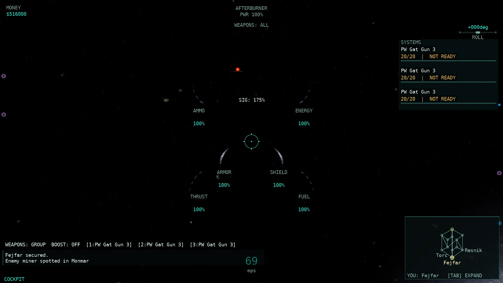
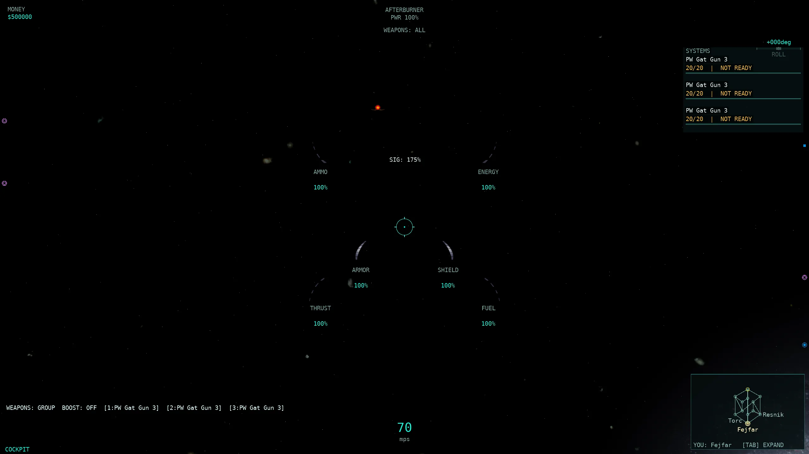
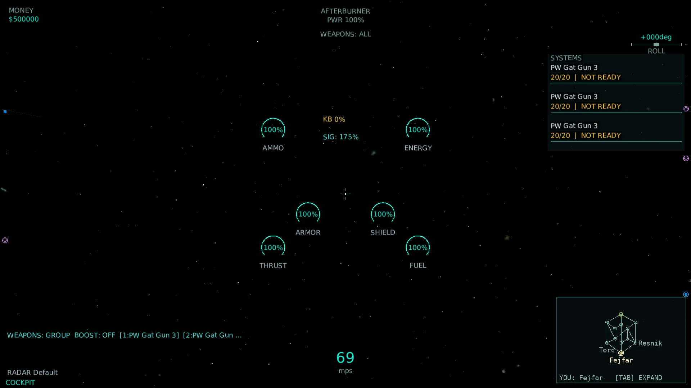
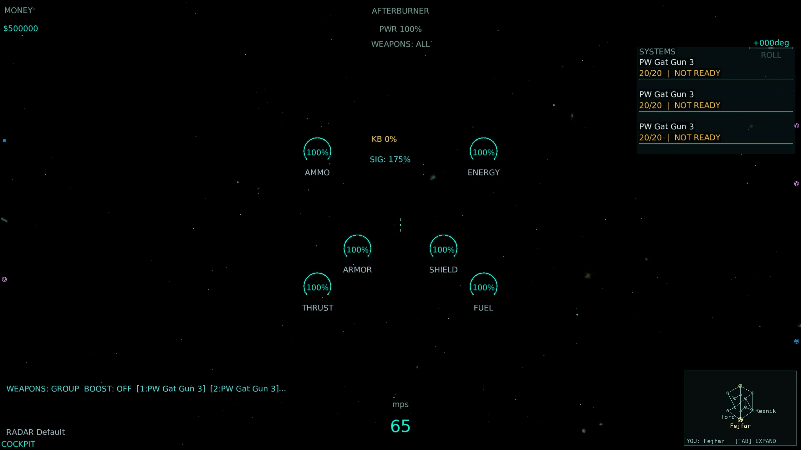
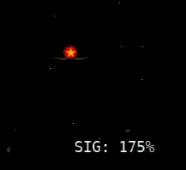

# HUD-6 — own-ship gauges and status (HUD-6b review-fix round)

Base: master at dispatch (HUD-1 `HudModel` + HUD-2 Classic/Modern skins + HUD-3 target pane + HUD-4 radar contacts). Branch: `pi/hud6b`, merged from `pi/hud6` (`11d3cd43`) with `master` first. Changes are left in the working tree; no commits or pushes were made.

The `hud` area is **18/324 (6/108)** on the merged matrix (5.56% both). Four of those done rows are HUD-6's own-ship icons: *Autopilot status*, *Vector lock status*, *Carried flag* and *Carried artifact*. The other two (`Target side identity`, `Radar range fade`) come from HUD-3/HUD-4. The eleven remaining HUD-6 in-scope rows are `partial` with the precise difference recorded in `docs/parity/parity-matrix.csv`; *Detection eye* is one of them after this review (see fix 1).

## Review fixes (HUD-6b)

1. **Detection eye → `partial`.** The visibility gate still matches native (`WinTrek/console.cpp:811`: the eye pane is bound to `!GetDetected()`, shown for binding 0 at `dialog.mdl:2527-2533`), and `radonbmp` is drawn at its native corner. But the port's own-ship `SHIP_STATUS(90)` sets `Detected = true` unconditionally (`src/Allegiance.Server/Server.Broadcast.cs:1667`, no scanning system yet), so the own ship is never unseen in real play and the eye cannot appear. The gate is retained for wire parity and pinned by `HudModelTests`; the matrix row is `partial`.
2. **Carried flag/artifact use the source ship.** Native reads `pship = trekClient.GetShip()->GetSourceShip(); switch (pship->GetFlag())` (`WinTrek/console.cpp:845-861`), so a gunner in a turret sees the carrier's flag/artifact. `OwnStatusData.SourceShip`/`FromClientState` now resolve the parent when `ParentId >= 0`; `Game1` uses exactly that source. The data source — not only the model switch — is pinned by a test that puts the artifact on the gunner and a flag on the carrier and asserts the HUD shows the carrier's flag.
3. **Signature readout.** Implemented in `OwnStatusData.SignaturePercent` on the **source ship** (`WinTrek/console.cpp:845,865-866`):
   - weapons add their signature only while firing (`Igc/weaponIGC.h:103-122`, Activate/Deactivate);
   - afterburner and cloak add theirs only while active (`Igc/afterburnerIGC.h:78,89`; `Igc/cloakigc.h:76,89`);
   - shields and launchers count whenever mounted (`Igc/shieldIGC.h:72`, `Igc/magazineigc.h:74`);
   - the accumulated signature is multiplied by the cloak factor (`Igc/shipIGC.h:268-270`).
   Group fire activates all mounted weapons; single fire activates the selected fixed mount. The own-ship wire carries no continuous `GetCloaking()` ramp, so the cloak factor uses the engaged end state (0), and the row stays `partial`. Tests cover inactive/active parts, cargo exclusion, group vs single mount, side-attribute zero, and the cloak factor.
4. **Kill-counter bitmap: evidence-harness bug, not an asset bug.** `killcounterbmp.mdl` exists in `Artwork/`, loads at **128×128** (`[monogame] status art 'killcounterbmp': 128x128 'killcounterbmp.mdl'` in the real-client logs), and the Classic screenshot now shows the red bitmap. The old “Classic shows KB 0% text” shot was **not** a Classic capture: HUD-6's `capture.py` wrote `ALLEGIANCE_HUD_SETTINGS` into a copied env (`ce`) but launched the client with the original `env`, so every “Classic” shot actually ran the Modern skin (and Modern draws measured `KB n%` text by design). The harness now passes `ce`; the re-shot 1920×1080 Classic screenshot has the bitmap's red glyph pixels at the native anchor (`x 889-925, y 256-272`) and no fallback text.
5. **Anchors are native corners.** Native `TranslateImage` offsets the child image's own bounds origin, so the `dialog.mdl` point is the image's **top-left corner** (`engine/image.cpp:834-845`); the centre-HUD pane itself is placed with its top-left at centre−`(320,240)` and pane Y increases downward (`dialog.mdl:5397`). `OwnStatusLayout` now stores the native points minus `(320,240)` in screen terms and `ScreenPos` returns that top-left. Both skins draw from the corner, and `NudgeClear` is gone. This also corrects the previous vertical mirroring: autopilot/vector lock/flag/artifact are in the lower half of the native pane, kill bonus/signature in the upper half. Tests pin every anchor at 1920×1080 and 2560×1440, plus the `ExperienceImage` inner offsets.
6. **Data-source tests.** `Hud6bOwnStatusTests` builds real `ClientWorld` entities from wire messages and pins:
   - autopilot from the client-local `autoPilot()` analogue (`console.cpp:793`);
   - vector lock from `StateM & CoastButton` (`consoledata.cpp:465`);
   - flag/artifact from the source ship (parent in a turret), not the own entity.
7. **Own hull lookup cached.** `OwnSignaturePercent` uses the existing `_hullById` catalogue dictionary (built once in `Game1.Lifecycle`) instead of `catalog.Hulls.Where(...).Cast<>().FirstOrDefault()` every frame.
8. **Real-client evidence re-shot and inspected.** Four real windowed clients against a local server with the fixed per-run HUD settings (true Classic and Modern, 1920×1080 and 2560×1440). The Classic shots show the real gauge bitmaps and the kill-counter bitmap; the Modern shots show the HUD-2 arcs/text. A status crop from the Classic shot is included.

## Rows covered (16)

| Row | Native rule | Final status and remaining difference |
| --- | --- | --- |
| Hull integrity | `WinTrek/consoledata.cpp:202`; `Artwork/dialog.mdl:2404`; `WinTrek/indicator.cpp:514` | partial — native **ARMOR** label, bottom reveal and red damage art retained; whole-bitmap clipping/size/spacing still differs from the native `dialog.mdl` rect layers; port adds a % numeral |
| Shield charge | `WinTrek/consoledata.cpp:252`; `Artwork/dialog.mdl:2474` | partial — native **SHIELD** label + bottom reveal retained; same rect-layer/% differences |
| Energy reserve | `WinTrek/consoledata.cpp:328`; `Artwork/dialog.mdl:2331` | partial — native **ENERGY** label + bottom reveal retained; same rect-layer/% differences |
| Fuel reserve | `WinTrek/consoledata.cpp:406`; `Artwork/dialog.mdl:2226` | partial — native **FUEL** label + **JustifyTop** reveal; rect-layer/% differences; pod OXY override stays a port extension |
| Ammunition reserve | `WinTrek/consoledata.cpp:367`; `Artwork/dialog.mdl:2278` | partial — native **AMMO** label + bottom reveal retained; rect-layer/% differences |
| Thrust setting | `WinTrek/WinTrek.cpp:8461`; `Artwork/dialog.mdl:2173` | partial — native **THRUST** label + **JustifyTop** reveal; rect-layer/% differences |
| Speed | `WinTrek/consoledata.cpp:136`; `Artwork/dialog.mdl:2546` | partial (unchanged) — mps unit fixed; typography/position differ |
| Kill bonus | `WinTrek/console.cpp:824`; `Artwork/dialog.mdl:2559-2567,2617` | partial — native `killcounterbmp` + black integer at the `ExperienceImage` anchor/inner offsets; bitmap loads (128×128) and draws in Classic; port HUD font substitutes `medBoldVerdana` |
| Signature percentage | `WinTrek/console.cpp:865`; `Artwork/dialog.mdl:2595,2621` | partial — native `SIG: n%` readout at the `dialog.mdl:2621` corner; source-ship signature with native firing/active part gating and cloak factor; no continuous cloak ramp on the wire; HUD font substitutes `medVerdana` |
| Detection eye | `WinTrek/console.cpp:809,811`; `Artwork/dialog.mdl:2527,2618` | **partial** — native inverted gate (`!Detected`) and `radonbmp` corner match, but the port server always sends own-ship `Detected=true` (`Server.Broadcast.cs:1667`), so the icon cannot appear |
| Cloak active | `WinTrek/consoledata.cpp:565`; `Artwork/dialog.mdl:2537,2609` | partial — native `concloakbmp` at the `dialog.mdl:2609` corner when `CloakActive`; decloak fade still differs (native icon persists until `GetCloaking()` reaches 1) |
| Cloak strength and drained state | `WinTrek/consoledata.cpp:480`; `Artwork/dialog.mdl:570,651` | partial — drained marker at `energy <= .2` drawn; continuous cloak-strength gauge absent (no continuous cloaking factor on the wire) |
| Autopilot status | `WinTrek/console.cpp:793`; `Artwork/dialog.mdl:2151,2608` | **done** — native `conautopilot.png` at the `dialog.mdl:2608` corner when `trekClient.autoPilot()`; data source pinned |
| Vector lock status | `WinTrek/consoledata.cpp:465`; `Artwork/dialog.mdl:2140,2607` | **done** — native `convectorlock.png` at the `dialog.mdl:2607` corner when `StateM & CoastButton`; data source pinned |
| Carried flag | `WinTrek/console.cpp:846-863`; `Artwork/dialog.mdl:2583,2619` | **done** — native `captureflagrbmp` at the `dialog.mdl:2619` corner when the **source ship's** `GetFlag() >= 0`; parent-ship data source pinned |
| Carried artifact | `WinTrek/console.cpp:846-863`; `Artwork/dialog.mdl:2569,2620` | **done** — native `captureflaglbmp` at the `dialog.mdl:2620` corner when the **source ship's** `GetFlag() == Side.ArtifactSentinelFlag`; parent-ship data source pinned |

## Implementation

### Model (`src/Allegiance.ClientCore.Game/Rendering/HudModel.cs`, `HudFrame.cs`)

`HudFrame` carries the own-ship status telemetry with safe defaults (`SignaturePercent`, `Detected`, `AutopilotEngaged`, `VectorLockEngaged`, `CarriedFlag`, `CarriedArtifact`). `HudModel` resolves them into `HudOwnStatus`:

- **Detection eye** is inverted exactly as native (visible when `!Detected`) but is unreachable with the current server status (fix 1).
- **Cloak active** = `Cloaked` (`CloakActive` state bit), the port analogue of native `IsCloaked` (`WinTrek/consoledata.cpp:563-575`).
- **Cloak drained** = `CloakActive && EnergyFraction <= 0.2` (`dialog.mdl:651-656`).
- **Autopilot / vector lock / flag / artifact** come from the native switches (fixes 2 and 6).

Gauge labels match the native centre-HUD strings (`HudModel.cs:135-140`; `GaugeTextures.cs`): ARMOR / SHIELD / ENERGY / FUEL / AMMO / THRUST. Thrust and fuel reveal top-down (`JustifyTop`), matching `dialog.mdl:2173,2226`; the other four keep bottom-up (`HudRenderer.cs:506-545`).

### Snapshot (`Game1.Rendering.cs`, `OwnStatusData.cs`)

`DrawHud` resolves the own status once per frame from existing client state under the gate lock — no wire/gameplay change:

- `OwnStatusData.FromClientState(entity, world.Ships, _autoPilotEngaged, up.StateM)` gives the source ship, autopilot, vector lock, flag and artifact.
- `OwnSignaturePercent(world, sourceShip, firing, _groupFire, _selectedMount, afterburnerActive, cloakActive)` = `OwnStatusData.SignaturePercent(...)`: 100·signature / side `c_gaSignature` with the native part-activation rules and cloak factor (fix 3).
- `Detected: entity.Detected` (from `SHIP_STATUS(90)`).

### Renderers

- **Classic** (`HudRenderer.DrawOwnStatus`, `HudRenderer.cs:597`) draws the real native bitmaps at their native **corner** anchors via `StatusTextures` (`radonbmp`, `concloakbmp`, `killcounterbmp`, `captureflagRbmp`, `captureflagLbmp`, plus the two CortUI PNGs `conautopilot.png`/`convectorlock.png` the native dialog references). Kill bonus draws `killcounterbmp` at the `ExperienceImage` inner `(-23,-65)` and the native black integer in the centred 80-wide box; signature draws `SIG: n%` in its native 80-wide centred box. Missing art falls back to a short text label.
- **Modern** (`ModernHudRenderer.DrawOwnStatus`, `ModernHudRenderer.cs:119`) draws HUD-2 measured text at the same native corner anchors and marks every visible element for the Modern coverage check.
- `OwnStatusLayout` owns the native `dialog.mdl:2607-2621` points converted to screen space (top-left corner, +Y down) and the `ExperienceImage` inner offsets. `NudgeClear` was removed; nothing moves the icons off the native anchor.

## Validation

- **Whole-solution Release build**: **0 warnings / 0 errors** (`dotnet build AllegianceCore.slnx -c Release`).
- **New `Hud6bOwnStatusTests`** (source-ship flag/artifact, autopilot/vector-lock data sources, signature rules, native corner anchors, kill-counter offsets): **12/12 PASS, 3/3 isolated runs**.
- **Affected `HudModelTests`**: **35/35 PASS, 3/3 isolated runs**.
- **Affected `ModernHudTests`** (both skins render all HUD-1 scenarios): **4/4 PASS, 3/3 isolated runs**.
- **`P674ParityScorecardTests`**: **8/8 PASS, 3/3 isolated runs** (both matrices validate; `hud` = 18/324, 6/108).
- **Fast tier** (`tools/run-tests.sh --tier fast`): **9031 tests, PASS** (268.8 s; quarantine retries all passed, 3 not-executed).
- No `src/Allegiance.Core`/`src/Allegiance.Server` production source changed relative to `master`, so the conditional server AOT publish is not triggered. Rig/221/200v200 runs were not launched.

## Real-client screenshots

Four real windowed clients against a local server on `m2scatter.igc` / `PCore001.igc` (`--auto-launch Adv Fighter`, cockpit camera, enhanced FX/soft rendering), one per skin per resolution, using the real backbuffer autoshot path. The fixed capture passes `ALLEGIANCE_HUD_SETTINGS` per run, so the shots are genuinely Classic/Modern. [Provenance and SHA-256](HUD6B_assets/screenshots.json); raw client/server logs and original PNGs remain under `~/allegiance-evidence/HUD6b/raw` (outside the repository).

| Scenario | 1920×1080 | 2560×1440 |
| --- | --- | --- |
| Own-ship flight — Classic |  |  |
| Own-ship flight — Modern |  |  |

Classic status crop (kill-bonus bitmap + signature readout at the native corners):

Assets total **199,974 bytes** (under the 2 MB cap). Raw PNG originals remain outside the repository. The older `HUD6_assets` Classic files are superseded by these corrected HUD6B captures (they were Modern-skin runs, see fix 4).

## Remaining gaps (unfinished)

- **Detection eye**: unreachable until the server models scanner detection and can send `Detected=false` for the own ship; the native gate is already in place.
- **Gauge rect layers**: the port draws the whole gauge bitmap with a clipped reveal and a port % numeral; native draws the `dialog.mdl` source rects and no percentage text, so the six gauge rows stay `partial`.
- **Speed**: still bottom-centre typography rather than the native centre-pane `lgBoldVerdana` "n mps" string.
- **Signature**: the continuous `GetCloaking()` ramp is not on the own-ship wire (the engaged end state 0 is used), and per-weapon activation is approximated from the echoed fire bits plus the selected mount rather than a per-mount active flag.
- **Cloak strength/drained**: the GlassHUD continuous cloak-strength gauge needs the continuous cloaking factor; only the `energy <= .2` drained marker is presented.
- **Cloak active decloak fade**: the icon clears when the `CloakActive` bit drops, whereas native keeps `IsCloaked` true until the cloaking factor ramps back to 1.
