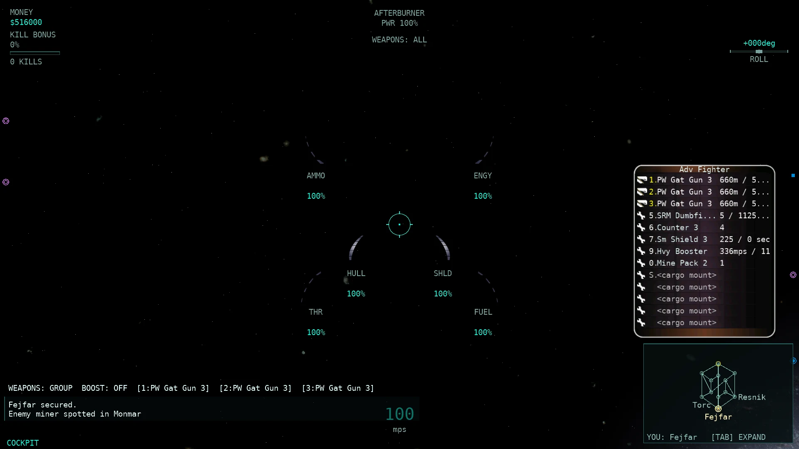
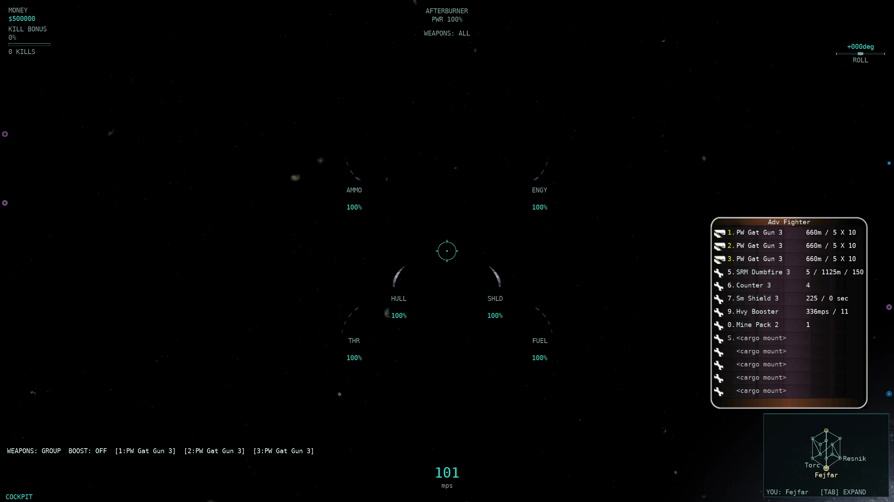
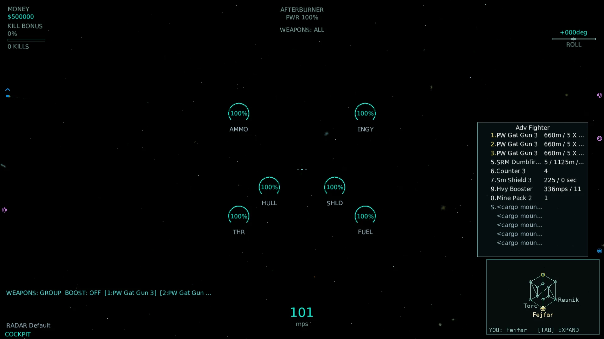
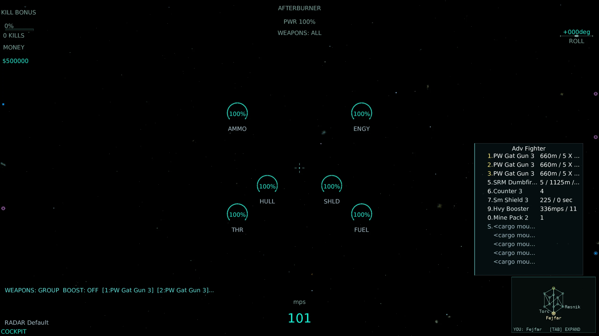

# HUD-7 — the flight equipment/inventory pane

Base: master at dispatch (HUD-1's `HudModel` + HUD-2's Classic/Modern skins). Branch: `pi/hud7`; fix round on `pi/hud7b` (merged master, which carried HUD-3's target pane and HUD-4's radar contacts). Changes are left in the working tree; no commits or pushes were made. See **Review fixes (HUD-7b)** at the bottom for this round's corrections.

This wave ports the native flight equipment/inventory pane (`WinTrek/inventoryimage.cpp`, `WinTrek/consoledata.cpp`) — the bottom-right F4 pane that lists fixed/turret weapons, equipment (magazine/chaff/shield/cloak/afterburner/dispenser), cargo slots, the own-ship name header, and eligible empty-slot affordances. The 18 `hud` rows in scope are all resolved as real model data and rendered by **both** skins at the native `SideBottomRight (-36, 40)` anchor.

The scorecard `hud` area is **unchanged at 0/324 (0/108)**: no row reaches *full* native parity, so none earns weighted credit. Every row is updated in `docs/parity/parity-matrix.csv` with a precise remaining difference (the parity scorecard awards no partial credit, so the before→after numbers are identical — the progress lives in the narrowed `port_cite_or_reason` column and the 10 new value-pinning tests).

## Native rules retained

Source citations resolve under `/home/domingo/Development/Allegiance/src/`; artwork citations under `/home/domingo/Development/Artwork/`.

| Rule | Native evidence | Port treatment |
| --- | --- | --- |
| Pane anchor and mask | `Artwork/dialog.mdl:5385-5393` (`SideBottomRight (-36, 40)`, mask `ofInventory = 8192` = F4) | Both skins draw at `InventoryPaneLayout` (same anchor), gated by the existing `_consolePanes.Inventory` F4 toggle. The only divergence is a clamp that raises the pane clear of the port's bottom-right minimap (the HUD-2 overlap rule, same as HUD-3's target-pane clamp). |
| Row order + hotkeys | `WinTrek/inventoryimage.cpp:238-268` — fixed weapons `1.`-`4.`, turrets `Y.`-`O.`, then `5.`-`0.` equipment, then selected cargo `S.` + wrap | `HudInventoryPaneBuilder.Build` reproduces the exact order and key vocabulary. |
| Slot existence + empty affordances | `inventoryimage.cpp:84-114` — a slot shows only when mounted or when `ShipHasPartForMount` finds a compatible held part; empty rows use the `invempty*.mdl` vocabulary | Builder emits `EmptyWeapon`/`EmptyEquipment`/`EmptyCargo` rows with the native strings (`<small weapon mount>`, `<shield mount>`, `<cargo mount>`, …) and dim grey key/name. |
| Own-ship name header | `Artwork/dialog.mdl:1803-1807` (`GetModelTypeDesc(Me)` → hull type name, `JustifyCenter`, 214 px) | Builder resolves the own hull's `DataHullTypeIGC.Name`; both skins centre it across the 214 px line. |
| Part identity + key | `consoledata.cpp:684`; `inventoryimage.cpp:65`; `invdefault.mdl:53` | Part type name + hotkey rendered per row with the native weapon/equipment icon. |
| Selected / active state | `consoledata.cpp:1080-1119`, `:1122`; `invsweapon.mdl:80` — active key yellow, inactive white, selected name white vs `.75` grey | Fixed weapons: `Selected == Active == (groupFire || mount == selectedMount)`, with those exact colours. |
| Quantity + empty warning | `consoledata.cpp:768-800`, `:1132-1155`; `invsweapon.mdl:90` — red `A` when empty, cargo same-type aggregation, packs `÷maxAmmo`/`÷maxFuel` | Builder implements all three; red `A` for empty weapon ammo / afterburner fuel / launcher amount. |
| Mounting progress | `consoledata.cpp:1157-1177`; `invdefault.mdl:6` — `ReadyState 1` selects the continuous mounted fraction | Builder maps `FractionMounted/240`; Classic draws the native `mountingbarbmp.mdl` fill left-to-right, Modern a thin geometric bar. |
| Launcher arming | `consoledata.cpp:1189-1200`; `invsmissile.mdl:69` — `ReadyState 2` armed fraction | **Not reachable**: the port's wire carries no live armed fraction, so a mounted launcher resolves straight to ready. Recorded as the precise gap. |
| Weapon range | `consoledata.cpp:690-719` — gun `speed·lifespan·GA(SpeedAmmo|LifespanEnergy)`, missile `lifespan·(initialSpeed+½·lifespan·accel)` | Exact formulas in the builder, rendered as `Nm`. |
| Shot damage | `consoledata.cpp:722-737` — `(power+blast)·GA(DamageGuns|DamageMissiles)` | Exact, rendered. |
| Burst rate | `consoledata.cpp:748-762` — `1/dtimeBurst` | Exact, rendered. |
| Shield strength / recharge | `consoledata.cpp:911-961` — `fraction·MaxStrength`, `(MaxStrength−strength)/regeneration` | Exact, rendered as `N / N sec`. |
| Afterburner top speed / endurance | `consoledata.cpp:848-889` — `GetMaxSpeed()·(1+MaxThrustWithGA/GetThrust())`, `fuel/(consumption·MaxThrust)` with `Inf.`; `GetMaxSpeed()`/`GetThrust()` are the GA-scaled source-ship values (`shipIGC.cpp:4529,4544-4546`; `consoledata.cpp:855`) | Exact, rendered as `Nmps / T`. |
| Cloak endurance | `consoledata.cpp:967-985` — `energy/(consumption−GetSourceShip()->GetRechargeRate())` with `Inf.` (`consoledata.cpp:976`) | Exact, rendered as `T sec`. The leading live cloak percentage (native `GetCloaking(Me)`) stays absent — no continuous cloaking factor on the wire (tracked by the separate *Cloak strength and drained state* row, out of this wave). |
| Cargo slots | `inventoryimage.cpp:169-195`, `:341` — selected-first, duplicate pack/magazine/dispenser collapse, no cargo in lifepods | Builder implements all four (lifepod via `HabmLifepod`). |
| Number formatting | `engine/modeler.cpp:1996-2009` (`NumberString` = `(int)(v+0.5)`) | Builder's `Round` matches; `Inf.` for the two `-1` endurance cases. |

## Implementation

### Model (`src/Allegiance.ClientCore.Game/Rendering/HudInventoryPane.cs`)

`HudInventoryRow` / `HudInventoryPane` are graphics-independent resolved rows. `HudInventoryPaneBuilder.Build` (line 76) is the pure, MonoGame-free derivation: it takes the granted loadout + cargo, the shop catalogue, the own hull, the side's `GlobalAttributeSet`, the live fuel/energy/shield/ammo fractions, the fire-mode/selected-mount/cargo-selection, and the own-ship name, and produces the ordered rows with native `ReadyState`, stats text, selected/active flags, out-of-ammo flag, mounted fraction and quantity. `HudContext.InventoryPane` carries it; `HudModel` copies it into a read-only snapshot.

### Snapshot (`src/Allegiance.ClientCore.Game/Game1.FlightParts.cs:44`)

`BuildInventoryPane` resolves the pane from `ShipEntity` + `ServerShipUpdate` (same world gate as the existing loadout/cargo reads), only while flying (native clears the pane in the hangar). `Game1.Rendering.cs` passes it through `HudModelAdapter` and adds `--auto-inventory` (`AutoProofPlan`/`Game1.AutoProof.cs`) so a real windowed client can open F4 for unattended captures.

### Renderers

- **Classic** (`HudRenderer.DrawInventoryPane`, `HudRenderer.cs:1319`): the real classic top/line/bottom backgrounds (`CortUI/classic/inventory*.png`, `InventoryPaneTextures`), the native weapon/equipment/turret icons (`invweaponiconbmp.mdl` etc.), and the native mounting/arming bar fills (`mountingbarbmp.mdl`), with the port HUD font for text. Procedural fallback when artwork is absent.
- **Modern** (`ModernHudRenderer.DrawInventoryPane`, `ModernHudRenderer.cs:169`): a HUD-2 geometric panel at the same anchor — translucent backing + accent spine, measured SDF text, thin progress bars, honouring HUD size and the colour-blind-safe palette.
- `InventoryPaneLayout.cs` owns the native anchor/extents and the minimap clamp; both skins reserve the pane in `PrepareLayout` so other measured text never overlaps it.

`HudElements.Build` now exposes the 18 rows from the pane (availability = data present; visibility = pane shown + row content present), so the renderer smoke test's Modern coverage check exercises every row that actually has content.

## Validation

- **Whole-solution Release build**: **0 warnings / 0 errors**.
- **`HudInventoryPaneTests`** (17 cases pinning the native formulas/order/state/affordances, the GA-scaled/source-ship afterburner & cloak stats, the build gate, and the HudModel exposure): **3/3** isolated runs, 17 cases each.
- **`HudFormatTests`** (4 new `FitToWidth` cases pinning the measured-text clip): **3/3** isolated runs.
- **`HudModelTests`** (affected model/elements, now 30 cases after the HUD-3/HUD-4 merge): **3/3** isolated runs, 30 cases each.
- **`P674ParityScorecardTests`** (CSV rows updated): **3/3** isolated runs.
- **Renderer smoke test** (`ModernHudTests.Both_skins_render_Hud1_scenarios…`, now populates the inventory pane in every scenario): **3/3** isolated runs; the hud2-proof harness passes all 270 combinations (15 scenarios × 3 resolutions × 3 sizes × 2 skins) with real font-measured bounds, no overlap, full Modern coverage of every visible element, the SYSTEMS-list-hidden assertion, and the measured inventory name/stats column-fit assertion (the deterministic stand-in for eyeballing the PNGs). [render-checks.json](HUD7_assets/render-checks.json).
- **Fast tier** (`tools/run-tests.sh --tier fast`): **9035 tests, PASS** — see Review fixes (HUD-7b) for the sweep history.
- `git diff --check` passes; `parity-matrix.csv` validates (665 rows).

No `src/Allegiance.Core` or `src/Allegiance.Server` production source changed, so the conditional server AOT publish is not triggered. Rig/221/200v200 runs were not launched.

## Real-client screenshots

Four real windowed clients against a local server on `m2scatter.igc` / `PCore001.igc`, one per skin per resolution, each auto-launching an **Adv Fighter** (8 parts) and opening the F4 inventory pane (`--auto-inventory`). Re-shot for HUD-7b. [Provenance and SHA-256](HUD7_assets/screenshots.json); raw PNGs/logs remain under `~/allegiance-evidence/HUD7b/` (outside the repository).

| Scenario | 1920×1080 | 2560×1440 |
| --- | --- | --- |
| Flight inventory (F4) — Classic |  |  |
| Flight inventory (F4) — Modern |  |  |

Assets total **347,618 bytes** (under the 2 MB cap).

## Rows covered (18)

All 18 `hud` rows of the native equipment/inventory pane. Every row is `partial`; the scorecard awards no partial credit, so the before→after scorecard is unchanged — the remaining-difference column in `docs/parity/parity-matrix.csv` records the narrowed gaps.

| Row | Native rule | Final status and remaining difference |
| --- | --- | --- |
| Flight equipment inventory pane | `inventoryimage.cpp:299`; `dialog.mdl:5388` | partial — model-driven at `SideBottomRight(-36,40)` in both skins with classic top/line/bottom art + weapon/equipment/turret icons; native tab image, selected-row background and native fonts still differ |
| Equipment part identity and key | `consoledata.cpp:684`; `inventoryimage.cpp:65`; `invdefault.mdl:53` | partial — name + hotkey + native icon rendered per row; port HUD font; gunner assigned-weapon semantics absent |
| Equipment selected and active state | `consoledata.cpp:1080,1122`; `invsweapon.mdl:80` | partial — native yellow/white/grey treatment rendered for fixed weapons; turret-gunner active semantics absent |
| Equipment quantity and empty warning | `consoledata.cpp:768,1132`; `invsweapon.mdl:90` | partial — red `A` + count + cargo aggregation/pack normalization implemented; port HUD font |
| Equipment mounting progress | `consoledata.cpp:1157,1177`; `invdefault.mdl:6` | partial — native mounting bar from `FractionMounted` rendered; track is a procedural dark rect instead of `mountingbarbkgndbmp` |
| Launcher arming progress | `consoledata.cpp:1157,1189`; `invsmissile.mdl:69` | partial — `GetArmedFraction` not on the client wire; `ReadyState 2` unreachable, native arming bar stays absent |
| Equipment weapon range | `consoledata.cpp:690`; `invsweapon.mdl:9`; `invsmissile.mdl:12` | partial — exact `speed·lifespan·GA` formula rendered; port HUD font |
| Equipment shot damage | `consoledata.cpp:722` | partial — exact `(power+blast)·GA` formula rendered; port HUD font |
| Equipment burst rate | `consoledata.cpp:748`; `invsweapon.mdl:17` | partial — exact `1/dtimeBurst` rendered; port HUD font |
| Equipment shield strength | `consoledata.cpp:911`; `invshield.mdl:9` | partial — exact `fraction·MaxStrength` rendered; port HUD font |
| Equipment shield recharge seconds | `consoledata.cpp:945`; `invshield.mdl:12` | partial — exact `(MaxStrength−strength)/regeneration` rendered; port HUD font |
| Equipment afterburner top speed | `consoledata.cpp:848`; `invafterburn.mdl:14` | partial — exact `MaxSpeed·(1+MaxThrustWithGA/Thrust)` rendered; port HUD font |
| Equipment afterburner endurance | `consoledata.cpp:869`; `invafterburn.mdl:4` | partial — exact `fuel/(consumption·MaxThrust)` with `Inf.` rendered; port HUD font |
| Equipment cloak endurance | `consoledata.cpp:967`; `invcloak.mdl:4` | partial — exact `energy/(consumption−recharge)` with `Inf.` rendered; leading live cloak percentage remains absent |
| Inventory turret gunner identity | `inventoryimage.cpp:65`; `invturret.mdl:3` | partial — per-turret occupant rows absent (no own-ship turret occupant names on the client wire); carrier camera label is separate |
| Inventory cargo slots | `inventoryimage.cpp:169,341` | partial — selected-first ordering, `S.` key, duplicate collapse and lifepod exclusion implemented; port HUD font and no cargo icon bitmap |
| Inventory own ship name | `consoledata.cpp:65`; `dialog.mdl:1803` | partial — native hull-name header rendered centred; port HUD font substitutes `smallBoldFont` |
| Equipment empty slot affordances | `inventoryimage.cpp:94`; `invemptyweapon.mdl:3` | partial — native `ShipHasPartForMount` eligible empty rows rendered with the empty-slot vocabulary and dim grey key/name; port HUD font |

## Review fixes (HUD-7b)

Claude's review items, addressed end to end on branch `pi/hud7b` (after `git merge master`; the merge commit is `4bc89df1` and resolves the HUD-3/HUD-4 additive conflicts in `HudModel.cs`, `HudModelAdapter.cs`, `HudElements.cs`, `HudRenderer.cs`, `Game1.Lifecycle.cs`, `Game1.Rendering.cs`, `hud2-proof/Program.cs`, tests and the parity CSV by keeping both sides).

1. **Two inventories** — `Game1.ConsoleModes.cs` `DrawConsolePanes` no longer draws the centre team-pane `INVENTORY` list for F4; F4 now shows only the native bottom-right pane (native mask `ofInventory`, `dialog.mdl:5237`). The old list duplicated the pane and covered the gauges.
2. **Text overflow** — `HudFormat.FitToWidth` (pure, unit-tested) clips a column string to a measured width with an ellipsis; `HudRenderer.FitText` delegates to it, and both skins fit the part **name** to the gap before the stats column and the **stats** to the pane's right border (`StatsX`→`LineWidth` minus a 3 px margin, `InventoryPaneLayout`). The full value stays in the model; only the glyphs clip. Re-shot both skins at 1080p and 2560p (see the screenshots above) and pinned the fit objectively via the hud2-proof `RequireInventoryColumnsFit` assertion (real `HUD` font metrics at both resolutions).
3. **Afterburner top speed** — `HudInventoryPane.cs` now computes `GetMaxSpeed()` = `hull.Speed·GA(c_gaMaxSpeed)` and `GetThrust()` = `hull.Thrust·GA(c_gaThrust)` (`shipIGC.cpp:4529,4544-4546`) instead of the raw hull values; pinned by `Afterburner_top_speed_uses_GA_scaled_max_speed_and_thrust` (attributes 2×/3× ≠ 1).
4. **Build only while visible** — `Game1.Rendering.cs` builds `BuildInventoryPane` only through `HudInventoryPaneBuilder.ShouldBuild(visible, docked, dead)` (F4 open + flying + alive), matching native's event-driven rebuild (`inventoryimage.cpp:356-393`) instead of running every frame while hidden; pinned by `Build_gate_requires_visible_flying_and_alive`.
5. **Old SYSTEMS list** — `HudRenderer.Draw` hides the P362 `SYSTEMS` panel while the native inventory pane is up (`InventoryVisible && InventoryPane.Rows.Count > 0`), so it no longer duplicates the pane or covers the ROLL readout in the 2560 Modern shot; pinned by the hud2-proof `SYSTEMS`-hidden assertion (with a positive `systems` scenario that still draws it when the pane is closed).
6. **Source-ship hull** — `BuildInventoryPane` resolves the carrier's hull when the local pilot is a turret gunner (`entity.ParentId >= 0`, `WinTrek.cpp:10215`) and passes it as `sourceHull`; the afterburner top speed and cloak recharge use `GetSourceShip()->GetHullType()` (`consoledata.cpp:855,976`) while afterburner endurance and cloak energy keep the LOCAL ship's fuel/energy. Pinned by `Afterburner_and_cloak_stats_use_the_source_ship_hull`.

### Validation (HUD-7b)

- **Whole-solution Release build**: **0 warnings / 0 errors**.
- **`HudInventoryPaneTests`** (17 cases) and **`HudFormatTests`** (4 new `FitToWidth` cases): **3/3** isolated runs each.
- **`HudModelTests`** (30 cases) + **`P674ParityScorecardTests`** (both matrices validate): **3/3** isolated runs.
- **Renderer smoke test** (`ModernHudTests.Both_skins_render…`, Live, now exercises the new `inventory`/`systems` scenarios and the measured column-fit + SYSTEMS-hidden assertions): **3/3** alone.
- **Fast tier** (`tools/run-tests.sh --tier fast`): **9035 tests, PASS** (272.3 s). An earlier sweep caught a real CSV-comma bug in my `parity-matrix.csv` row 484 edit (P674: `expected 6 columns, got 7`); fixed to `shipIGC.cpp:4529;4544` and P674 re-passed **3/3** alone. A second sweep's only `FAIL` marker was a **SLOW FAST** (`P750NativeAsteroidTypesTests.Research_showcase_rocks_carry_native_models_and_no_rock_names`, 12.7 s vs the 10 s calibrated limit) under concurrent load; that test passed **3/3** alone in ~2 s each (load flake, not a correctness failure). The final sweep passed clean. No `src/Allegiance.Core` / `src/Allegiance.Server` production source changed, so the conditional server AOT publish is not triggered.

## Remaining gaps (unfinished)

- **Native fonts** keep every text-bearing row `partial` (the port ships its own HUD SDF/sprite fonts, not `medVerdana`/`smVerdana`/`smallBoldFont`) — the same convention as HUD-3/HUD-6.
- **Launcher arming fraction** (`GetArmedFraction`) and **per-turret gunner occupants** have no client wire field, so the arming bar and gunner-identity rows cannot be produced without new telemetry.
- **Continuous cloak percentage** (`GetCloaking(Me)`) is not on the wire, so the native cloak row's leading `N%` is omitted (tracked by the separate *Cloak strength and drained state* row, out of scope).
- The classic pane uses a procedural dark rect for the bar track instead of `mountingbarbkgndbmp.mdl`, and does not draw the native inventory tab or selected-row background.
- Cargo rows have no cargo icon bitmap in either skin.
