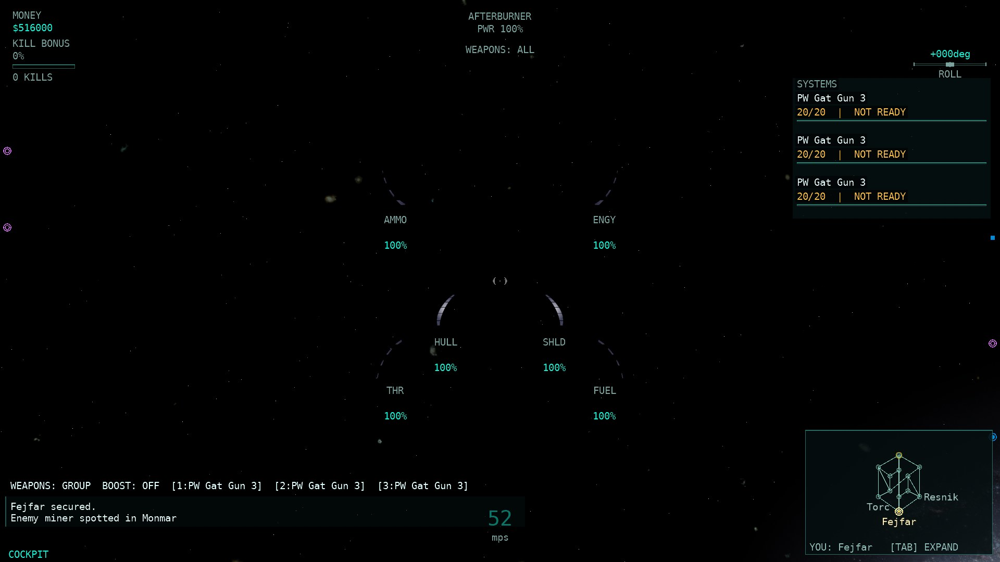
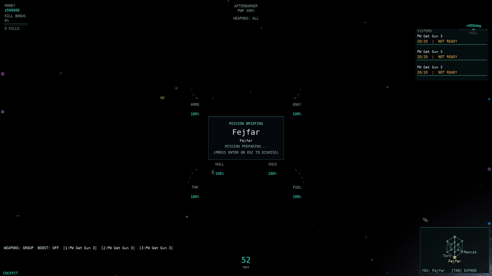
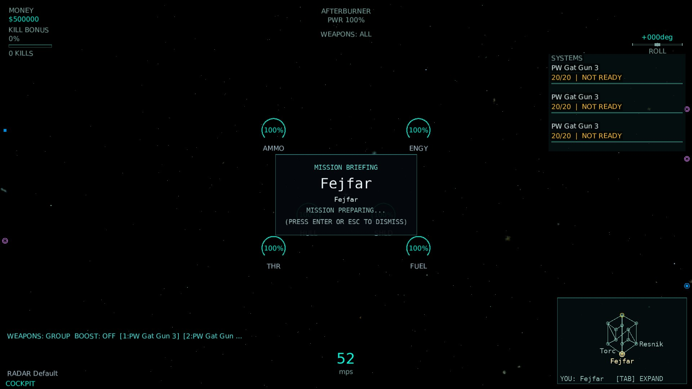
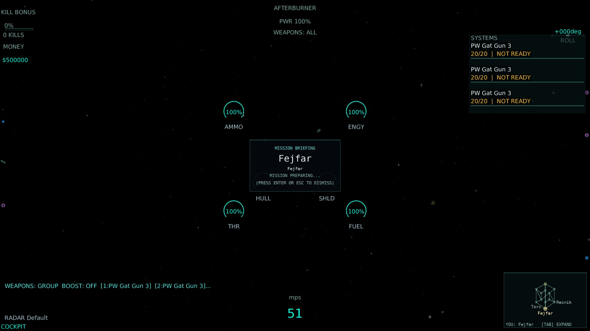
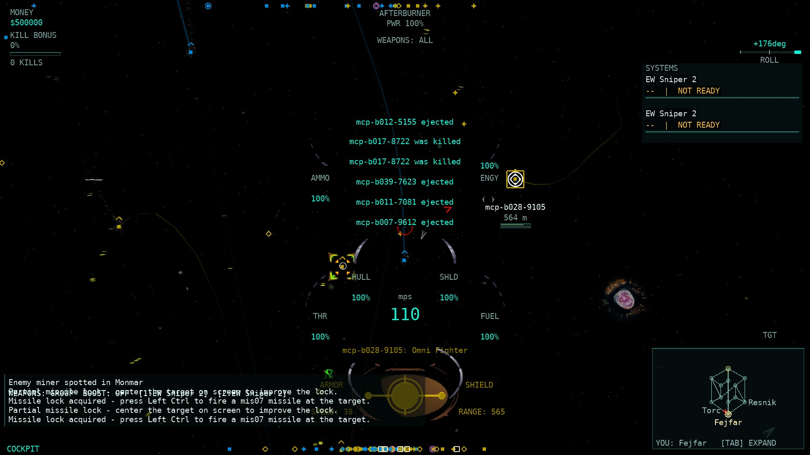
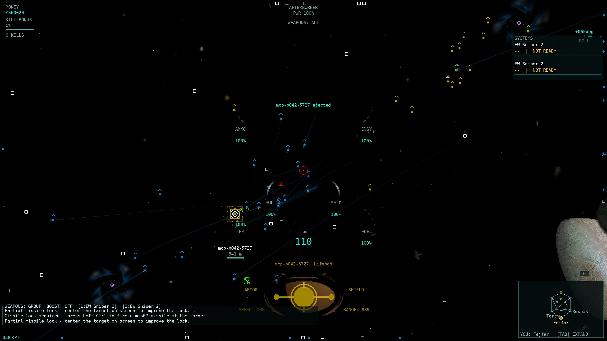
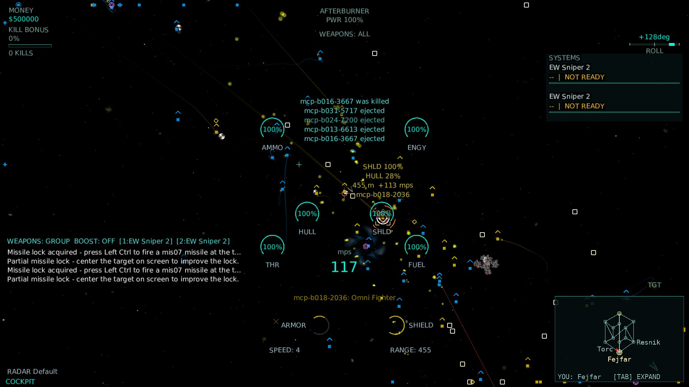
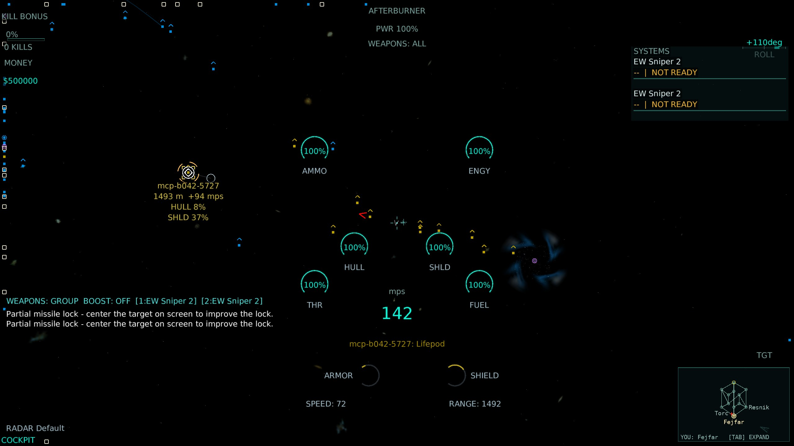

# HUD-8 — flight indicators: reticle, velocity/joystick/lead/order markers

Base: `pi/hud8` (`a8be2177`), merged with `master` (`69503841`). Branch: `pi/hud8b`.
The merge commit is recorded; the HUD-8b review fixes below are left in the working tree (no commit/push).

## Rows covered (9)

All from the `hud` area of `docs/parity/parity-matrix.csv`. No other unmerged `pi/*` branch touches these rows (track coordination was checked with `git branch --list "pi/*" --no-merged master` and each branch's `docs/parity/` diff). The rows stay `partial`; no HUD-8 row is promoted to `complete` because each still has a precise remaining difference (recorded below).

| Row | Native rule | Status and remaining difference |
| --- | --- | --- |
| Cockpit centre reticle | `indicator.cpp:149-150` — `directioninbmp` at the view centre, additive grey `(0.4,0.4,0.4,0.4)`, cockpit only | partial — Classic now draws the real `directioninbmp` at centre with the native grey; additive blending is approximated with alpha blend in the single-batch HUD; the FIRING tag and the turret reticle remain retained port extensions |
| Velocity direction marker | `indicator.cpp:130-148` — project source velocity direction, cockpit only, only when rounded speed ≠ 0, inside the view rect | partial — Classic draws the real `directionbmp` at the projected direction with the cockpit + non-zero-speed + inside-view gates; Modern draws a geometric marker; the velocity is the own/sim ship rather than native `GetSourceShip` for a boarded gunner |
| Joystick turning indicator | `indicator.cpp:154-177` — `atan2(pitch/yaw)+π/2` with yaw-sign correction, translate centre − 100·(yaw,pitch), scale `.5+.5·\|control\|`, alpha = `\|control\|` | partial — the live sent control vector feeds the native angle/position/scale/alpha in both skins; flat chevrons approximate the native 3-D `joystickindicator` geometry and the `ShowJoystickIndicator` toggle is unported (default-on matches native) |
| Ballistic lead marker | `indicator.cpp:179-330` — `leadinbmp`/`leadoutbmp` surface swap at the projected lead point, cockpit branch only | partial — Classic draws the native lead surfaces at the projected lead point; the server-solved lead stands in for the client `solveForLead`; the target-now ring is a port extension; chase/missile use the projected aim predictor instead of a lead surface |
| Aim hit-probability predictor | `indicator.cpp:245-362` — centre `centeroutbmp` crosshair tinted `(1-g,g,0)` when the intercept is in range | partial — Classic draws the native `centeroutbmp` at the cockpit centre with the `(1-g,g,0)` ramp when in range; chase/missile reuse the server lead point rather than native's forward-projected aim point; the native distinction from the lead surface is restored |
| Chase weapon aim without target | `indicator.cpp:367-405` — grey `centeroutbmp` projected from weapon forward × speed × lifespan in chase/missile with no target | partial — grey marker projected in chase/missile with no target; active weapon range resolved from the live loadout + core projectile table; no marker when the loadout/weapon is unresolved |
| Accepted and current order turn arrows | `indicator.cpp:411-457,783-791` — accepted green + current red (single yellow when the same target) at centre + 108·normalized screen offset; non-self/source, same cluster, offset² > 108² | partial — both arrows drawn at the 108px ring with the native colours and gates; the current (red) arrow reads the native `c_cmdCurrent` TARGET COMMAND (`ClientWorld.MyCurrentCommand`, set by `SetTarget` WinTrek.cpp:8823-8852) and not the autopilot slot; flat chevrons approximate the native continuously-rotating 3-D `pointer`; `CanSee` is approximated by object presence |
| Incoming missile warning | `trekigc.cpp:5061-5065` — tracked boolean, pitch `.75+bestLock/2` | partial (unchanged) — audio loop exists (`Game1.Audio.UpdateMissileWarning`); source-ship routing for a boarded gunner/observer remains the recorded gap; audio stays independent of drawing |
| Damage flash timer | `WinTrek.cpp:35-37,8922-8955` — 2s window, 0.25s on/0.25s off, phase-preserving re-arm | partial (unchanged) — the native timer is already ported in `DamageFlashTracker` and drives both skins' hull/shield red art; arming still infers sampled hull/shield decreases rather than a native per-positive-hit callback |

## Implementation

### Model (`src/Allegiance.ClientCore.Game/Rendering/HudModel.cs`, `HudFrame.cs`, `HudElements.cs`)

`HudContext` gains `VelocityMarker`, `ChaseAim`, `OrderArrows` and `ShowJoystickIndicator`; `HudFrame` gains `TurnYaw`/`TurnPitch`. New pure visibility gates live on `HudModel`: `VelocityMarkerVisible` (cockpit + non-zero speed + projected point), `JoystickIndicatorVisible` (indicator cameras + frame + default-on preference), `LeadMarkerVisible` (cockpit lead), `AimPredictorVisible` (cockpit in-range, or chase/missile aim), `ChaseAimVisible` (chase/missile without lead), `OrderArrowsVisible`. `HudElements` now exposes all of them with values/positions, so the renderer smoke test's Modern coverage covers them.

### Snapshot (`src/Allegiance.ClientCore.Game/Game1.Camera.cs`, `Game1.Rendering.cs`, `Game1.FlightInput.cs`)

- `_lastSentControls` stages the exact control vector the frame sent (after autopilot/spectator/training overrides); the HUD reads its `Yaw`/`Pitch` as the native `jsValues[c_axisYaw]/[c_axisPitch]` equivalent.
- `ComputeVelocityMarker` projects the own velocity as a **direction** (w=0) — native `TransformDirectionToImage` — and applies the inside-view gate.
- `ComputeChaseAim` resolves the active weapon's projectile `Speed × Lifespan` from the loadout + core projectile table and projects the forward range point from the camera.
- `ComputeOrderArrows` resolves `world.MyCurrentCommand` (the native `c_cmdCurrent` TARGET COMMAND, populated by `SetTarget` / command execution) and `world.MyAcceptedCommand`, applies the non-self/same-cluster/offset>108 gates, and reports the same-target yellow collapse. The autopilot target (`_autoTarget`) is deliberately NOT read here.
- `SendCurrentCommandToServer` sends the real `ORDER_CHANGE` `command=c_cmdCurrent` (WinTrek.cpp:8838-8844) on every target selection, so the server writes `Ship.CommandTarget` — the slot that drives the owner-only `LEAD_INDICATOR_UPDATE(210)` — and the client's local `MyCurrentCommand` mirror stays in sync.

### Renderers

- **Classic** (`HudRenderer`) loads the five native bitmaps (`directioninbmp`, `directionbmp`, `centeroutbmp`, `leadinbmp`, `leadoutbmp` — `IndicatorTextures.cs`) and draws them at their native 1:1 size, with the existing procedural shapes as graceful fallbacks.
- **Modern** (`ModernHudRenderer`) draws the same model values as geometric HUD-2 shapes at the same positions, honouring HUD size and the colour-blind palette.

## Validation

- **Whole-solution Release build**: **0 warnings / 0 errors**.
- **`HudModelTests`** (indicator + HUD-3 target-pane gate cases after the merge): **3/3** isolated runs, 47 cases each.
- **`ClientWorldCurrentCommandTests`** (new — the `c_cmdCurrent` slot): **3/3** isolated runs, 3 cases each.
- **`Hud8bCurrentCommandTests`** (new — target → `c_cmdCurrent` mapping): **3/3** isolated runs, 3 cases each.
- **Renderer smoke test** (`ModernHudTests.Both_skins_render_Hud1_scenarios…`, 14 scenarios including `chase`): **3/3** isolated runs. The proof harness passed **252 combinations** (14 scenarios × 3 resolutions × 3 sizes × 2 skins) with real font-measured bounds, no overlap, and full Modern coverage.
- **`P674ParityScorecardTests`** (both matrices validate after the CSV row updates): **3/3** isolated runs, 8 cases each.
- **Fast tier** (`tools/run-tests.sh --tier fast`): **9037 tests, PASS** (272.0 s).
- No `src/Allegiance.Core` or `src/Allegiance.Server` production source changed in this fix round, so the conditional server AOT publish is not triggered. Rig/221/200v200 runs were not launched.

Scorecard after the `master` merge and the HUD-8b fixes (`python3 scripts/parity-scorecard.py`):

```
area | weighted (credit/weight) | unweighted (complete/eligible)
hud  | 1.85% (6/324)             | 1.85% (2/108)
TOTAL| 76.93% (1397.737/1817.000) | 73.22% (462/631)
```

The `hud` gain over the HUD-8 branch is entirely the two `done` HUD-3/HUD-4 rows that came in with `master`; none of the nine HUD-8 rows reaches full native parity (their remaining differences above are real), so HUD-8 itself adds no `complete` credit.

## Real-client screenshots

Re-shot for HUD-8b (the previous 1080p Classic "flight" capture was the game-over scoreboard, and the previous combat captures had no locked target). All frames are real windowed clients against a local server on `m2scatter.igc` / `PCore001.igc` using the real-backbuffer autoshot path.

- **Flight** frames are cockpit frames captured during the P624 flight-keys proof (`ALLEGIANCE_FLIGHTKEYS_PROOF=1`): the camera is in the cockpit but head-looked right while the ship coasts forward, so the velocity-direction marker sits off the view-centre reticle (the marker projects the ship's forward velocity into the looked view). `--auto-launch Adv Fighter`, no target.
- **Combat** frames are cockpit frames with a real locked enemy fighter (`--auto-target-class enemy:fighter`, `--auto-launch "Adv Stl Fighter"` — the lead-indicator-capable hull). The class-filter handler selects the enemy fighter and `SendCurrentCommandToServer` writes `c_cmdCurrent`, so the server streams `LEAD_INDICATOR_UPDATE(210)`; server log confirms `[lead] peer … target … inRange 1` and `c_cmdCurrent -> target ship … — CommandTarget set`. The frames show the ballistic lead marker and the centre aim predictor. The red current-order arrow draws only when the locked target is more than 108&nbsp;px off the view centre (native `indicator.cpp:425`); in these autopilot-framed shots the target is held near the reticle, so the arrow's real-client data path is verified by the server `c_cmdCurrent` log and its drawing by the deterministic harness (fixture `combat`, off-axis `OrderArrows`).

[Provenance and original-PNG SHA-256 hashes](HUD8_assets/screenshots.json); raw logs/original PNGs remain under `~/allegiance-evidence/HUD8b/raw`.

| Scenario | 1920×1080 | 2560×1440 |
| --- | --- | --- |
| Flight — Classic |  |  |
| Flight — Modern |  |  |
| Combat (locked enemy fighter) — Classic |  |  |
| Combat (locked enemy fighter) — Modern |  |  |

Assets total **1,412,135 bytes** (under the 2 MB cap).

## Review fixes

1. **Screenshot claim** — the 1080p Classic "flight" shot was the game-over scoreboard. Re-shot real-client cockpit flight frames (above) and verified via the client log that they are the P624 look-right frames, not the scoreboard.
2. **Locked-target evidence** — re-ran with `--auto-target-class enemy:fighter` and a lead-capable player hull (`Adv Stl Fighter`). Server log shows `c_cmdCurrent -> target ship … — CommandTarget set` and `[lead] peer … inRange 1`, so the combat frames capture the lead marker and the aim predictor in the real client. The order arrow's real-client data path is the same `c_cmdCurrent` write (server log) + the `MyCurrentCommand` slot (unit tests); its drawing is off-axis-gated and covered by the deterministic harness.
3. **Current-order arrow** — native `c_cmdCurrent` is the current TARGET COMMAND (`SetTarget`, WinTrek.cpp:8823-8852; read by `indicator.cpp:411-457,783-791`), not the autopilot target. Added `ClientWorld.MyCurrentCommand` (the `c_cmdCurrent` mirror, populated by `ORDER_CHANGE` `CmdCurrent` / `SetCurrentCommand`), made `ComputeOrderArrows` read it instead of `_autoTarget`, and sent the real `c_cmdCurrent` wire on target selection. Pinned by `ClientWorldCurrentCommandTests` and `Hud8bCurrentCommandTests` (3/3 each).

## Remaining gaps (unfinished)

- **Reticle**: additive blend is approximated with alpha blend; the FIRING tag/turret reticle are port extensions.
- **Velocity marker**: own/sim velocity rather than native `GetSourceShip` for a boarded gunner.
- **Joystick pointer**: flat chevron instead of the native 3-D `joystickindicator` geometry; the `ShowJoystickIndicator` toggle is not exposed.
- **Lead/predictor**: server-solved lead stands in for client `solveForLead`; chase/missile reuse the server lead point rather than native's forward-projected aim point; the target-now ring is a port extension.
- **Chase aim**: needs the live loadout; no marker when the active weapon is unresolved.
- **Order arrows**: flat chevrons instead of the rotating 3-D `pointer`; `CanSee` is approximated by object presence.
- **Incoming missile warning** and **damage flash timer** remain unchanged partial rows (audio routing and per-positive-hit arming are the respective gaps).
