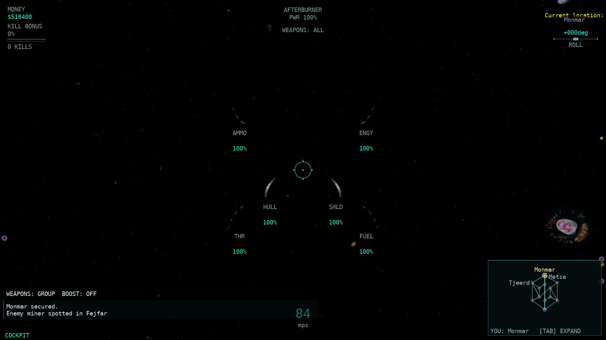
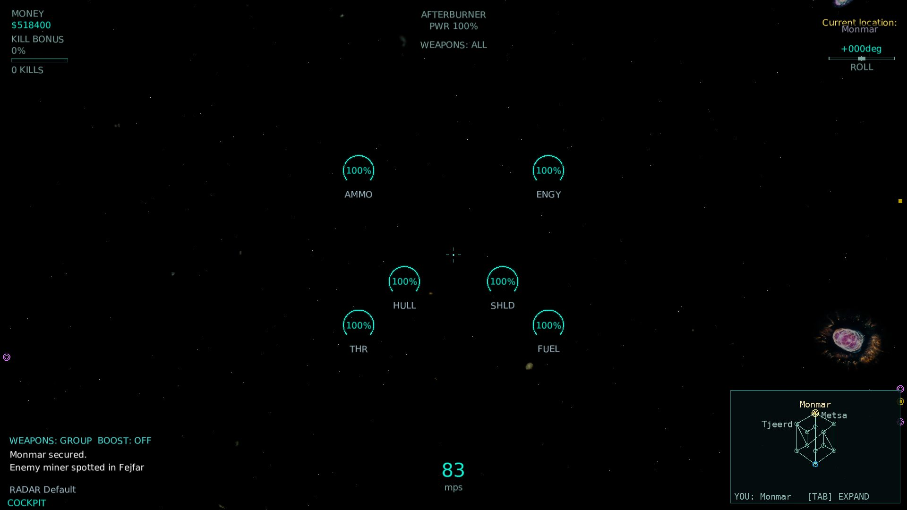
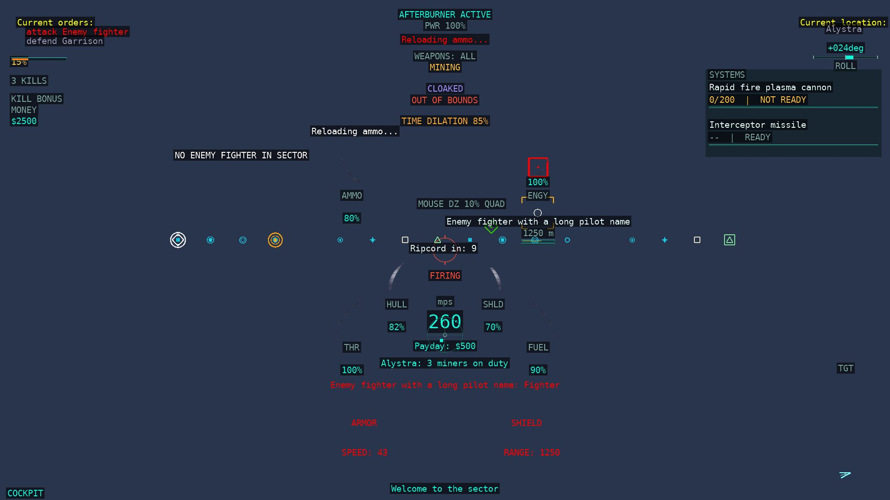
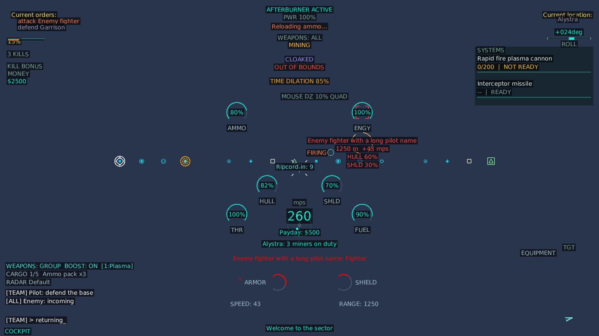

# HUD-9 — console text, chat and banners

Base: `pi/hud9` (HUD-1 `HudModel` + HUD-2 Classic/Modern skins), merged with
`master` (HUD-3 target pane + HUD-4 radar contacts) on branch `pi/hud9b`.
Changes are left in the working tree; no commits or pushes were made.

This wave adds the native console-text and banner rows to the shared `HudModel`
and renders them in **both** skins at the native `dialog.mdl` anchors: sector
location, turret carrier identity, observer/turret board state, accepted and
queued order text, tip and critical-tip lines, vote banner, ripcord countdown,
and the mission lives/kills model slots. Chat history/composition, money, pod,
death and boundary/crowd warnings were already model-driven; this wave records
their precise remaining difference where it changed.

## Review fixes (HUD-9b)

Base: branch `pi/hud9b` merged with `master` (HUD-3 target pane + HUD-4 radar
contacts); the client-side conflicts were additive and both sides are kept. This
round fixes the review findings:

- **Top vs bottom**: `dialog.mdl` uses a lower-left origin with y up
  (`dialog.mdl:5259-5268`), so the sector/turret/order on-points (`-37`/`-75`,
  `dialog.mdl:5419,5425,5451`) are 37/75 px below the **top** edge. Both renderers
  now draw them at the top: "Current location:" label at 37 with the sector name
  14 px below it (`dialog.mdl:1473-1485`); "Turret of:" label at 75 with the
  carrier name 14 below; "Current orders:" label at 37 with queued/accepted 20/40
  px below (`dialog.mdl:1605-1648`). These are fixed anchors — `Layout.Place` no
  longer reorders them. Positions are pinned by `HudConsoleTextTests` and the
  hud2-proof harness (`RequireBox` at 1920×1080).
- **Sector name colour**: native `CurrentShipSectorNameImage` uses `cortText`
  (`Color(0.586, 0.578, 0.680)`, `dialog.mdl:24,1438-1445`), not the side colour.
  The accepted-order line also uses `cortText` (`dialog.mdl:1623-1640`); both are
  now cortText. Queued stays red (`dialog.mdl:1605-1620`).
- **Banner heights**: critical tips draw at `50 + 12·NumChatLines` and the vote
  banner at `85 + 12·NumChatLines` (`dialog.mdl:5172-5176`), using the real chat
  line count from the HUD snapshot; critical slots stack 14 px upward with the
  newest at the bottom (`dialog.mdl:2039-2078`).
- **Ripcord**: `SideCenter(-75,15)` means the text's left edge sits at centre-x − 75
  and its top 15 px above centre (`dialog.mdl:5139-5154,5429-5430`); it is no
  longer centred. When `RipcordActiveSinceLocalMs` is null the client shows no
  countdown instead of a fabricated "Ripcord in: 1"
  (`HudConsoleFormat.RipcordLabel`).
- **Order text**: production now calls the tested `HudConsoleFormat.OrderText`;
  the duplicate private `Game1.OrderText` is removed.
- **Board-state proxy**: the port uses `own.State == ShipStatusMessage.StateTurret`
  as a proxy for native `GetTurretID() != NA` (`console.cpp:800-805`) to compute
  `BoardState` 2 vs 1.

## Rows covered (23)

The `hud` rows named by the brief, from `docs/parity/parity-matrix.csv`:

| Row | Native rule | Final status and remaining difference |
| --- | --- | --- |
| Sector location | `WinTrek/console.cpp:870`; `Artwork/dialog.mdl:1430-1456,5419` — flight `SectorName` = current cluster, base = station sector; top-right `(-180,-37)` | partial — "Current location:" + cluster name drawn top-right in both skins; port HUD font substitutes promptFont/medVerdana; red current-view variant not drawn |
| Turret carrier identity | `WinTrek/console.cpp:797`; `Artwork/dialog.mdl:1508-1543,5425` — parent pilot name when `BoardState==2` | partial — "Turret of:" + carrier name drawn top-right in both skins; port HUD font substitutes promptFont/medVerdana |
| Observer and turret board state | `WinTrek/console.cpp:797-804`; `WinTrek/consoledata.cpp:493`; `Artwork/dialog.mdl:2086` | partial — `BoardState` 0/1/2 now computed from `ParentId` + ship state and exposed with native "Observer of"/"Turret of" wording; `BoardTextImage` is loadout-only so it is not drawn in flight; native observer count is not on the wire |
| Accepted order text | `WinTrek/console.cpp:875-890`; `Artwork/dialog.mdl:1623-1640` | partial — verb + target name drawn top-left in native cortText (`dialog.mdl:1636`); port HUD font substitutes medVerdana; native comacceptbmp icon not drawn |
| Queued order text | `WinTrek/console.cpp:893-908`; `Artwork/dialog.mdl:1605-1620` | partial — verb + target name drawn top-left in red; port HUD font substitutes medVerdana; native comqueuedbmp icon not drawn |
| Chat history | `WinTrek/console.cpp:3508`; `Artwork/dialog.mdl:173` | partial (unchanged) — history/scroll in the shared snapshot; native line-count/font/colour/pane positioning differ |
| Chat composition and recipient | `WinTrek/console.cpp:705`; `Artwork/dialog.mdl:89` | partial (unchanged) — composition/recipient in the shared snapshot; five native presentation variants remain partial |
| Command recipient verb and wing controls | `WinTrek/console.cpp:746`; `Artwork/dialog.mdl:38` | partial (unchanged) — command actions exist; native recipient/verb bar and wing controls absent from the flight model |
| Tip text lines | `WinTrek/console.cpp:723,913`; `Artwork/dialog.mdl:2006,5347-5349` | partial — three native ordinary slots (newest-first, retained) now drawn bottom-centre in side colour; port HUD font substitutes medBoldVerdana/medVerdana/smVerdana |
| Critical tip text lines | `WinTrek/console.cpp:726,913`; `Artwork/dialog.mdl:2006,5346` | partial — four native critical slots expire after 7.5 s with no fade and draw red at 50 + 12·NumChatLines with the newest at the bottom and older slots 14 px above; port HUD font substitutes medBoldVerdana; 30 s training lifetime not surfaced |
| Vote banner | `WinTrek/console.cpp:935-937`; `Artwork/dialog.mdl:2114-2120,5453` | partial — active ballot text drawn white at 85 + 12·NumChatLines in both skins; port HUD font substitutes medBoldVerdana |
| Money credits | `WinTrek/console.cpp:792`; `Artwork/dialog.mdl:1885` | partial (unchanged) — wallet data correct; port always-visible `$n` differs from the native creditbox "cr"/investment-pane rule |
| Lives remaining | `WinTrek/console.cpp:812-818`; `Artwork/dialog.mdl:5056` | partial — `HudConsoleText.Lives` stays null (mission lives/deaths not on the client wire); native hudlives badge not drawn |
| Mission kills | `WinTrek/console.cpp:813-820`; `Artwork/dialog.mdl:5107` | partial — `HudConsoleText.MissionKills` stays null (no mission-kill counter streamed); native hudkills badge not drawn |
| Mission countdown | `WinTrek/WinTrek.cpp:8134`; `Artwork/dialog.mdl:5091` | partial (unchanged) — game-state clock exists; the standalone `CountdownOn=0` MDL badge is unused natively |
| Ripcord countdown | `WinTrek/consoledata.cpp:521-532`; `Artwork/dialog.mdl:5139-5163` | partial — native "Ripcord in: n" wording with the double-0.5 rounding, left edge at centre-x − 75 and top 15 px above centre; null start time shows nothing; port HUD font substitutes lgBoldVerdana |
| Eject pod identity panel | `WinTrek/consoledata.cpp:578`; `Artwork/dialog.mdl:1984` | partial (unchanged) — real native art and own adrift/rescued/dead gates available; native viewport position/scale and panel endurance fill remain partial |
| Lifepod oxygen endurance | `WinTrek/consoledata.cpp:536`; `Artwork/dialog.mdl:1926` | partial (unchanged) — fuel-slot oxygen mm:ss/fraction exist; native panel horizontal endurance bar absent |
| Death banner | `WinTrek/WinTrek.cpp:3653`; `Artwork/dialog.mdl:1998` | partial (unchanged) — native bitmap and dead/docked gate present; scaled top-of-view banner differs |
| Boundary and crowd warnings | `WinTrek/WinTrek.cpp:8654` | partial (unchanged) — warning text independent of gauge art; textual badges are a port extension (native is audio-only) |
| HUD style and software layouts | `WinTrek/WinTrek.cpp:5104`; `Artwork/cortui_huds.mdl:1`; `Artwork/dialog.mdl:5398` | partial (unchanged) — Classic/Modern are the port skins; native style selector/software layouts unported |
| Console pane visibility and slide animation | `WinTrek/console.cpp:3084,3385`; `Artwork/dialog.mdl:5255` | partial (unchanged) — lifecycle/command visibility centralized; full native pane animation and console overlays remain separate |
| Command view ship summary | `WinTrek/console.cpp:783`; `Artwork/dialog.mdl:4998` | partial (unchanged) — command lines share the snapshot; native compact resource summary still absent |

No row moved to `complete`: every covered row carries at least one text-bearing
native rule, and the port substitutes its HUD fonts for the native
medVerdana/medBoldVerdana/promptFont/smVerdana/lgBoldVerdana set. Marking a
text row `complete` would over-claim. Scorecard credit is unchanged
(0/108 complete before and after); the work is recorded as more precise
`partial` differences plus model/render coverage pinned by tests.

## Implementation

### Model (`src/Allegiance.ClientCore.Game/Rendering/HudConsoleText.cs`)

New `HudConsoleText` record carries one frame of console text: `SectorName`,
`CarrierName`, `BoardState` (0/1/2), `AcceptedOrder`, `QueuedOrder`, `VoteText`,
`OrdinaryTips` (three retained slots), `CriticalTips` (up to four, 7.5 s expiry,
opacity 1 — native has no fade), `Lives`/`MissionKills` (null — not on the wire)
and the own `SideColor` (native `mySideColor`). `HudConsoleFormat` owns the
native command-verb table (`c_cdAllCommands[cid].szVerb`, `Igc/common.cpp:41-52`),
order/board wording and the slot/duration constants. `HudContext.Console` carries
it; the model snapshots the two tip lists so later mutations cannot alter a
built frame.

### Gather (`src/Allegiance.ClientCore.Game/Game1.Rendering.cs`, `Game1.Feedback.cs`)

`BuildConsoleText` resolves, under the session gate: the own ship/station cluster
name (`console.cpp:870`; `dialog.mdl:1430-1456`), the carrier pilot name and
board state from `ParentId` + `ShipStatusMessage.StateTurret`
(`console.cpp:797-804`), the accepted/queued order strings via
`world.TryCommandTarget` (`console.cpp:875-908`), the active ballot text
(`console.cpp:935-937`), and the own side colour via `world.TryGetSideColor`.

The P578 tip ring is restructured to native's separate slots: `_ordinaryTips`
(three, newest-first, retained — `dialog.mdl:5347-5349`) and `_criticalTips`
(up to four, 7.5 s expiry — `console.cpp:726-730,913-931`). The old six-entry
shared ring and the .8 s fade are removed. `RipcordStatusLabel` now delegates to
the tested `HudConsoleFormat.RipcordLabel` (native `"Ripcord in: n"` wording with
the double-0.5 rounding, `consoledata.cpp:521-532`; `modeler.cpp:2008`) and
returns null when `RipcordActiveSinceLocalMs` is unknown.

### Renderers

- **Classic** (`HudRenderer.DrawConsoleText`, `HudRenderer.cs`) draws at the
  native `dialog.mdl` anchors expressed in top-edge screen space: sector label
  at 37 px below the top with the cortText sector name 14 px below it, turret
  label at 75 with the red carrier name 14 below, orders label at 37 with
  queued/accepted 20/40 below (red/cortText), vote white at 85 + 12·NumChatLines,
  critical tips red at 50 + 12·NumChatLines (newest bottom, 14 px stack), ordinary
  tips bottom-centre in side colour, and ripcord left edge at centre-x − 75, top
  15 px above centre. The console anchors are fixed (never reordered by
  `Layout.Place`) and reserved before the crosshair/warning pass. The eject-pod
  and death-bitmap art stays in `Game1.DrawEjectDeathOverlays`; its legacy tip
  loop is removed (tips now flow through `DrawConsoleText`).
- **Modern** (`ModernHudRenderer.DrawConsoleText`, `ModernHudRenderer.cs`)
  draws the same anchors with SDF text, HUD-size scaling and the colour-blind
  side palette; left-anchored console lines use the unscaled left edge.
- `HudElements.Build` exposes the new rows (`Sector location`, `Turret carrier
  identity`, `Observer and turret board state`, `Accepted order text`, `Queued
  order text`, `Vote banner`, `Tip text lines`, `Critical tip text lines`,
  `Lives remaining`, `Mission kills`) so the HUD-2 completeness check covers them.
- `HudConsoleFormat` owns the fixed anchor constants and the chat-line-dependent
  `CriticalTipTop`/`VoteTop`/`RipcordLabel` formulas so the unit tests pin the
  production positions.

## Validation

- **Whole-solution Release build: 0 warnings / 0 errors.**
- `HudConsoleTextTests` + extended `HudModelTests`: **56 cases, 3/3 isolated runs**
  (command verbs, order/board wording, native slot/duration constants, the new
  top-edge anchor constants, chat-line-dependent banner formulas, ripcord null/
  rounding, console snapshot isolation, element visibility, null lives/kills).
- **Renderer smoke test** (`ModernHudTests.Both_skins_render…`, the hud2-proof
  harness now exercises the console text): **3/3 isolated runs**; the harness
  passed **234 combinations** (13 scenarios × 3 resolutions × 3 sizes × 2 skins)
  with real font-measured bounds, no overlap, full Modern coverage of every
  visible element, and fixed-anchor position assertions at 1920×1080
  (`Current location:` 37, sector name 51, order lines 37/57/77, critical tip 74,
  ripcord top 525 / left 885).
- `P674ParityScorecardTests`: **3/3** (both matrices validate after the row edits).
- **Server AOT publish** (`dotnet publish src/Allegiance.Server/Allegiance.Server.csproj
  -c Release -r linux-x64 --self-contained -p:PublishAot=true`): **passed, no
  IL2026/IL3050** (the master merge brought `Allegiance.Core`/`Allegiance.Server`
  changes into the tree).
- **Fast tier** (`tools/run-tests.sh --tier fast`): **8,989 tests; one failure**
  (`Allegiance.Core.Tests.Transport.P661EgressAccountingTests.Hot_path_allocates_zero_bytes_for_all_events`),
  which passed **3/3 alone** without changes and is recorded in
  `docs/TEST_FLAKES.md` as a load flake (allocation counting, unrelated to
  HUD-9).
- Rig/221/200v200 runs were not launched (Claude runs those).

## Scorecard (before → after)

```
$ python3 scripts/parity-scorecard.py docs/parity/parity-matrix.csv
```

HUD-9b keeps every HUD-9 console-text row `partial` (a text row that substitutes
the port HUD font cannot be `complete`). The hud-area increase versus the
original HUD-9 report is from the `master` merge (HUD-3 target pane and HUD-4
radar `complete` rows), not from this fix round:

| area | weighted (credit/weight) | unweighted (complete/eligible) |
| --- | --- | --- |
| hud | 1.85% (6/324) | 1.85% (2/108) |
| TOTAL | 76.56% (1391.137/1817.000) | 72.11% (455/631) |

## Real-client screenshots

Two real windowed clients (Classic + Modern) against a local server on
`m2scatter.igc` / `PCore001.igc`, flight with an auto-launched ship, using the
real backbuffer autoshot path. [Provenance and original-PNG SHA-256
hashes](HUD9_assets/screenshots.json); the raw PNGs and logs remain under
`.scratch/hud9b-capture/` and `.scratch/render-cap/` (gitignored).

| Scenario | 1920×1080 |
| --- | --- |
| Flight — Classic |  |
| Flight — Modern |  |

The flight captures show the sector "Current location" header in cortText at the
top (37/51 px) live. Orders, carrier, vote, critical tips and the ripcord
countdown are absent in an uncommanded solo flight (the ripcord key has no
scripted automation), so deterministic production-skin fixtures (the HUD-2
pattern) exercise the full console-text set — the `combat` fixture shows the
sector line, both order lines, a critical tip and the ripcord countdown at their
fixed top anchors:

| Fixture (deterministic model, production skins) | 1920×1080 |
| --- | --- |
| Console text — Classic |  |
| Console text — Modern |  |

Assets total **~370 KB** (under the 2 MB cap).

## Remaining gaps (unfinished)

- Port HUD fonts substitute the native medVerdana/medBoldVerdana/promptFont/
  smVerdana/lgBoldVerdana set, so every text-bearing row stays `partial`.
- Native order icons (`comacceptbmp`/`comqueuedbmp`), the red current-view sector
  variant, the loadout-only `BoardTextImage`, the native chat pane geometry/font,
  the command recipient/verb/wing bar, and the native pane slide animation are
  not ported.
- Mission lives / mission kills counters are not on the client wire, so those
  two badges (and the mission countdown standalone badge) stay absent.
- The 30 s training critical-tip lifetime is not surfaced (no training flag on
  this HUD path); training callouts are out of scope.
- The real-client ripcord countdown was not captured: the ripcord key has no
  scripted automation in the live-proof harness, so the countdown is proven by
  the deterministic production-skin fixture and `RipcordLabel` unit test instead.
- The native 14 px label/value spacing is kept exactly, so the taller port HUD
  font makes those two fixed boxes overlap by a few px; this is intentional and
  the fixed anchors are never reordered (native fonts are shorter).
- Money, eject pod, death banner and boundary/crowd rows are unchanged from
  HUD-1 (already precise `partial` differences).
