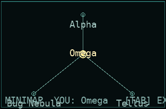
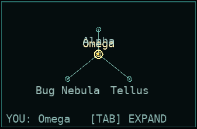

# P715 — minimap footer spacing and fit

Branch `codex/p715`; base `477513e201a46ac3c7d01da6c83f1d2cf85c075f`. SDK 10.0.400. Build and screenshot metadata: [validation ledger](P715_assets/validation.json).

The compact minimap now reserves a measured caption band before fitting the sector graph. Current-sector names stay above their dots and neighbour names below, within the map region. The caption drops `MINIMAP` when necessary, then uses two lines if the current sector name needs more room; overlong names are measured and shortened with ASCII `...`. The full `[TAB] EXPAND` hint fits at all three requested resolutions. Minimap click handling uses the same measured layout as rendering.

## Native review and port boundary

All native references below are under `~/Development/Allegiance/src/` and were checked directly.

| Native evidence | Application to this change |
| --- | --- |
| `WinTrek/sectormap.cpp:156-161` loads separate closed/open backgrounds and an expand image. `:166-169` derives the pane bounds from the background. | Keep the port's existing compact corner panel; no native bitmap dimensions are transplanted into the responsive HUD. |
| `WinTrek/sectormap.cpp:404-407` places the expand image separately at the background's size minus the button size and `(16, 4)`. `:411-422` places the selected sector caption separately at `(xBorder + 20, yTop - 13)` and appends ` Sector`. | Native's caption and expand control have independent placements. Its sector-info render method (`:392-537`) has no equivalent to the port's combined `MINIMAP YOU ... [TAB] EXPAND` footer. Measured footer reservation, sparse dot labels and text shortening are explicitly **port UI fixes**, not a claim of pixel-for-pixel native placement. |
| `WinTrek/sectormap.cpp:753-754,777-783,810-825` uses authored coordinates, a 10% border fudge and aspect preservation; `:1310-1317` maps them into the map rectangle. | Reuse the existing `StarmapLayout.Fit` coordinate mapping inside the reduced map region, with measured name headroom above and below the dot field. |
| `WinTrek/sectormap.cpp:1324,1333-1343` tests the same drawn cluster points with a nearest-cluster radius of 15 pixels. | Keep the existing `StarmapHitTest` rule and supply the new compact layout to click handling, so moving the graph does not leave its click targets behind. |

## Changes

- `src/Allegiance.ClientCore.Game/Rendering/MinimapLayout.cs`: shared, headless-testable measured geometry for the panel, map, footer and text rectangles. Measures with the caller's font; reserves the footer before graph placement; bounds and shortens names; selects a full, shortened or two-line caption.
- `src/Allegiance.ClientCore.Game/Rendering/StarmapRenderer.cs`: draws the shared layout's points and measured text placements.
- `src/Allegiance.ClientCore.Game/Game1.StarmapClick.cs`: uses that same layout and HUD font for compact-map clicks.
- `tests/Allegiance.ClientCore.MonoGame.Tests/MinimapLayoutTests.cs`: fourteen cases across four methods. Real MonoGame `SpriteFont.MeasureString` runs headlessly with generous glyph metrics. Covers all requested viewports, bottom-row Bug Nebula/Tellus neighbours, current sector at the centre or bottom of the graph, long names, caption fallbacks, missing current-sector information, click positions and a non-clickable footer.
- `tools/minimap-proof/Program.cs`: adds `--footer-regression --window WxH --tag after`. Uses the compiled game HUD font and real `DrawMini` on a window backbuffer; emits PNGs, lossless pane close-ups and measured JSON, and fails if text exceeds its reserved region. Waits five frames for SDL's initial resize before readback. Existing live-graph proof mode remains available.

## Screenshots and actual HUD-font measurements

The deterministic fixture places Omega above bottom-row Bug Nebula and Tellus. Before images use the original `HEAD` renderer; after images use the fixed renderer. Both use the same graph and compiled `HUD.xnb`. These are window-backbuffer captures of the production renderer, with lossless crops for comparison, rather than illustrative mock-ups.

| Viewport | Before | After | Available caption width | Measured caption width | Lowest sector-label bottom to footer band |
| --- | --- | --- | ---: | ---: | ---: |
| 1280×720 | [pane](P715_assets/before_1280x720_pane.png), [full frame](P715_assets/before_1280x720.png) | [pane](P715_assets/after_1280x720_pane.png), [full frame](P715_assets/after_1280x720.png), [measurements](P715_assets/after_1280x720.json) | 316.8 px | 275 px | 18.6 px |
| 1920×1080 | [pane](P715_assets/before_1920x1080_pane.png), [full frame](P715_assets/before_1920x1080.png) | [pane](P715_assets/after_1920x1080_pane.png), [full frame](P715_assets/after_1920x1080.png), [measurements](P715_assets/after_1920x1080.json) | 344 px | 275 px | 21 px |
| 2560×1440 | [pane](P715_assets/before_2560x1440_pane.png), [full frame](P715_assets/before_2560x1440.png) | [pane](P715_assets/after_2560x1440_pane.png), [full frame](P715_assets/after_2560x1440.png), [measurements](P715_assets/after_2560x1440.json) | 344 px | 275 px | 21 px |

Before, 1280×720:



After, 1280×720:



A separate [real flight-client screenshot](P715_assets/live/proof_t003.0_sCeto_ccockpit.png) at 1920×1080 shows the change in the complete HUD after an actual TCP connection, seat/ready countdown and `BUY_LOADOUT` launch on the **local `XXV_simple.igc` map**. It uses the existing `--auto-side 0 --auto-ready --auto-launch 13 --autoshots 3 --exit-after 6 --window 1920x1080` automation. No rig/221/200v200 proof was run.

To reproduce the deterministic after captures after building the client content:

```bash
dotnet build tools/minimap-proof/minimap-proof.csproj
for size in 1280x720 1920x1080 2560x1440; do
  dotnet run --no-build --project tools/minimap-proof -- \
    --footer-regression --window "$size" --tag after \
    --content "$PWD/src/Allegiance.ClientCore.MonoGame/bin/Debug/net10.0/Content" \
    --out "$PWD/docs/reports/P715_assets"
done
```

## Verification

- Whole solution: `dotnet build AllegianceCore.slnx -m:8 -v:minimal` — **0 warnings / 0 errors**.
- Every `tools/*/*.csproj`: built through an MSBuild project list — **0 warnings / 0 errors**.
- The initial restore could not write NuGet's shared HTTP cache under the sandbox. Re-running with `NUGET_HTTP_CACHE_PATH="$PWD/.verify_p715/nuget-cache"` completed normally; no audit or warning checks were disabled.
- Failing-first check with the final test fixtures against the [isolated original-layout adapter](P715_assets/LegacyMinimapLayout.cs.txt): **13 failed / 1 passed** ([recorded errors](P715_assets/regression-before.json)). The original-renderer before captures also show the footer crossing bottom labels and exceeding the panel.
- Final layout regressions: each of the four methods **3× individually**, **42/42 case executions passed** after the click-layout correction and build. [Final focused ledger](P715_assets/final-focused.json).
- Input compatibility checks: six existing hit-test methods and the action-map source guard each passed **3× individually**, **21/21 executions passed**. [Input ledger](P715_assets/input-focused.json).
- Verification process handling: the first tool shell returned exit 143 while its child verifier continued; the later terminal interrupt also left verifier descendants running. One completed sequential sweep was collected from each verifier, and both second loops were stopped at their next scratch-log open **before another test process can launch**. This keeps the total at exactly two runs per assembly. The overlapping runs and all observed failures are recorded in the [session observations](P715_assets/preliminary-verification.json); no assertion, deadline or test binary was changed for process control.
- Full suites: **exactly two complete unfiltered runs per assembly**, collected as one sequential sweep from each verifier. Both local P542 projectile proof and P660 15v15 showcase opt-ins are enabled. [Invocation ledger](P715_assets/verification.json).

| Sweep | Assembly | Passed | Failed | Skipped |
| --- | --- | ---: | ---: | ---: |
| 1 | Allegiance.Core.Tests | 4,724 | 1 | 0 |
| 1 | Allegiance.ClientCore.Tests | 1,117 | 0 | 0 |
| 1 | Allegiance.ClientCore.MonoGame.Tests | 2,256 | 0 | 3 |
| 1 | Allegiance.Lobby.Tests | 19 | 0 | 0 |
| 2 | Allegiance.Core.Tests | 4,723 | 2 | 0 |
| 2 | Allegiance.ClientCore.Tests | 1,117 | 0 | 0 |
| 2 | Allegiance.ClientCore.MonoGame.Tests | 2,256 | 0 | 3 |
| 2 | Allegiance.Lobby.Tests | 19 | 0 | 0 |

All **three Core failures passed 3/3 fresh exact-method isolated runs after both sweeps finished**; [nine-run retry ledger](P715_assets/diagnostic-isolation.json). These satisfy the brief's load-flake rule and match existing entries in [TEST_FLAKES.md](../TEST_FLAKES.md):

| Sweep | Method | Full-run symptom | Isolated result |
| --- | --- | --- | --- |
| 1 | `Transport.TcpTransportGreetTimeoutPoolTests.Silent_connection_does_not_block_a_second_client_join` | `ThreadStateException: Thread has not been started` during shutdown. | 3/3 pass |
| 2 | `Transport.TcpTransportSendWorkerPoolTests.Pool_worker_and_reader_counts_stay_fixed_across_join_leave_churn` | Raw peer never delivered `OnPeerJoined` within the existing deadline. | 3/3 pass |
| 2 | `LiveRipcordTests.Re_target_activates_to_requester_only` | Empty requester receipt collection at `Assert.Single`. | 3/3 pass |

No assertions, deadlines, quarantine traits, skip conditions or transport/ripcord implementation were relaxed. The two sweeps contain **16,231 passes / 3 load-flake failures / 6 existing optional Meshy-pack skips**. Both ClientCore runs passed all **1,117** cases; both MonoGame runs passed **2,256** cases plus the same three unavailable-pack skips. The 14 minimap cases passed in both full MonoGame runs.

[Portable-path raw TRX archive](P715_assets/verification-trx.tar.gz), [archive manifest](P715_assets/trx-manifest.json), [first sweep](P715_assets/accepted-sweep-1.json), [second sweep](P715_assets/accepted-sweep-2.json). Seven of the eight accepted suite TRXs were preserved. The first ClientCore TRX was overwritten by the other verifier's shared output name; its counters and errors had already been parsed and remain in the first-sweep ledger. Initial development results are retained separately in [initial before-test errors](P715_assets/regression-before-initial.json). The final before-test record uses the corrected final fixtures and reproduces all 13 expected baseline failures.

The Core binaries date from before the first sweep and stayed unchanged through the UI build. The final Game and MonoGame test binaries were built before either complete MonoGame run; final source hashes and the preserved startup fingerprints are included in the verification ledgers. `git diff --check` passed.

Changes are left in the working tree. No commit or push was made.

---

# P715b — minimap labels no longer collide

Branch `p715b`; base `master` (`8246dd9d` Merge P715). This closes the gap P715 left open: P715's fixture placed a neighbour directly **above** the current sector (the `docs/reports/P715_assets/after_2560x1440_pane.png` bottom-right panel), and with the P715 rule "current name above its dot, neighbour name below its dot" the neighbour's below-dot label overlapped the current sector's above-dot label whenever the neighbour sat directly above. P715b replaces that fixed rule with deterministic collision avoidance.

## The fix (`MinimapLayout.Build`)

Each labelled sector (current + direct warp neighbours) is placed in a fixed priority order — **current sector first, then neighbours by ascending id** — so the result is stable frame to frame (no jitter). For each label four slots are tried in a fixed order: above / below / left / right of its dot (current prefers **above**, neighbours prefer **below**, preserving the P715 look whenever nothing blocks it). A slot is accepted only if it fits inside the map area (never the footer band), overlaps no already-placed higher-priority label, and does not cover any other sector's dot/ring. If **no** slot is free, the label's own dot wins: the current sector always falls back to a clamped above-dot placement, and the lowest-priority **neighbour is dropped rather than overlapped**.

This exactly implements the brief: "choose above / below (or left / right) … so it intersects no other label, no dot/ring and not the footer band. The current sector's label has priority. If nothing fits, drop the lowest-priority neighbour label rather than overlap. Deterministic placement."

## Native review and port boundary

| Behaviour | Native cite | Class | What the port does |
| --- | --- | --- | --- |
| Selected-sector caption above the pane | `WinTrek/sectormap.cpp:411-422` (caption at `(xBorder+20, yTop-13)`, appends ` Sector`) | design | Kept: the current sector's name stays **above** its dot. |
| Per-dot neighbour names on the closed mini-map | none — native draws **no** per-dot sector names; it only renders the selected-sector caption (`:416-422`) and hover warning text (`:517-534`). The full-map view draws cluster icons without names. | port UI feature (P360/P715 convention) | Above/below/left/right choice is a port UI convention; there is no native rule to transplant, so the port defines a sensible, tested one. |
| Dot/icon layout | `sectormap.cpp:753-833` (authored coords, 10% fudge, aspect fit), `:1310-1317` (map point) | design | Unchanged — `StarmapLayout.Fit` still owns dot geometry; labels adapt around fixed dots. |

The P715 report's existing rows already establish that measured footer reservation, sparse dot labels and text shortening are **port UI fixes**, not pixel-for-pixel native placement; P715b continues that.

**Spot-check of the P715 reading:** P715 asserted neighbour labels sit below their dots. That is correct only in the *uncrowded* case. In a dense cluster the dots land so close together that two below-labels necessarily overlap, so the port now treats "below" as a **preference** (first candidate) rather than an absolute rule, and the test suite's rigid "neighbour below dot" assertions were relaxed to the true invariants (containment, current-above, no overlap, no dot cover). Native gives no counter-evidence (it draws no per-dot names).

## Modern alternative considered

Native has no label-collision handling at all (it simply never draws per-dot names). The modern approach — a deterministic greedy pass in descending priority with above/below/left/right anchoring, falling back to dropping low-priority labels — is the standard compact-chart labelling technique (used by tile/chart libraries). A full "leader-line / simulated annealing / flood-fill" label placers would be overkill for a 7-label minimap and would risk frame instability. Chosen: the greedy deterministic placer above.

## Tests (failing-first)

Extended `tests/Allegiance.ClientCore.MonoGame.Tests/MinimapLayoutTests.cs` with three new theory methods across 720p/1080p/1440p:

- `Neighbour_directly_above_current_sector_never_overlaps` — the reported collision.
- `Neighbour_directly_below_current_sector_never_overlaps` — the below sibling.
- `Dense_hexagon_cluster_never_overlaps_labels` — the m2xspiderw/Alderan-style 6-sector hexagon around the current sector (all six are direct neighbours, so seven labels compete).

Each asserts: current label always present, **no pair of label rectangles intersects**, and every label stays in the map area off the footer. The P715 test `Sector_labels_stay_in_map_area_clear_of_footer` was extended to assert no label-label overlap and no dot cover (its old rigid "neighbour always below dot" positional asserts are superseded by the adaptive placement; the current-above, containment and footer guarantees are kept).

Against the **original (unfixed) code** all nine new cases failed with exact overlapping rectangles (e.g. at 1280×720 `Omega overlaps Alpha: y[549.5,572.5] / y[545.6,568.6]`). After the fix: **23/23 pass** (14 existing + 9 new).

## Visual proof — real window backbuffer, 2560×1440 class

`tools/minimap-proof` gained `--label-regression` (a dense hexagon + a neighbour directly above the current sector), capturing the same `DrawMini` + compiled `HUD.xnb` on a real window backbuffer, writing a `p715b_`-prefixed PNG, lossless pane close-up and measured JSON per resolution. The after mode also **asserts** (from the same HUD font it drew with) that no label rectangle intersects, failing the run otherwise.

| Viewport | Before | After | Measured |
| --- | --- | --- | --- |
| 1280×720 | [pane](P715_assets/p715b_before_1280x720_pane.png), [frame](P715_assets/p715b_before_1280x720.png) | [pane](P715_assets/p715b_after_1280x720_pane.png), [frame](P715_assets/p715b_after_1280x720.png), [json](P715_assets/p715b_after_1280x720.json) | 7 labels, 0 overlaps |
| 1920×1080 | [pane](P715_assets/p715b_before_1920x1080_pane.png), [frame](P715_assets/p715b_before_1920x1080.png) | [pane](P715_assets/p715b_after_1920x1080_pane.png), [frame](P715_assets/p715b_after_1920x1080.png), [json](P715_assets/p715b_after_1920x1080.json) | 7 labels, 0 overlaps |
| 2560×1440 | [pane](P715_assets/p715b_before_2560x1440_pane.png), [frame](P715_assets/p715b_before_2560x1440.png) | [pane](P715_assets/p715b_after_2560x1440_pane.png), [frame](P715_assets/p715b_after_2560x1440.png), [json](P715_assets/p715b_after_2560x1440.json) | 7 labels, 0 overlaps |

Before, the neighbour directly above the current sector overlaps it (measured overlap at 720p ≈ 19 px vertically). After, all seven labels are separated (at 720p: Omega y[551,573], the sector above at y[506.8,528.8] — a 22 px clear gap; side neighbours x-separated). All three after runs exited 0 (no overlap asserted).

Reproduce:

```bash
dotnet build tools/minimap-proof/minimap-proof.csproj
for size in 1280x720 1920x1080 2560x1440; do
  dotnet run --no-build --project tools/minimap-proof -- \
    --label-regression --window "$size" --tag after \
    --content "$PWD/src/Allegiance.ClientCore.MonoGame/Content/bin/DesktopGL/Content" \
    --out "$PWD/docs/reports/P715_assets"
done
```

## Verification

- Whole solution `dotnet build AllegianceCore.slnx -m:8` — **0 warnings / 0 errors**.
- `tools/minimap-proof` — **0 warnings / 0 errors**.
- Layout regressions: the full `MinimapLayoutTests` class **23/23 pass** (final code).
- Full suites: two complete runs via `scripts/run-tests.sh` (main lane + quarantine lane), exactly two runs per assembly:

| Run | Assembly (main lane) | Passed | Failed | Skipped |
| --- | --- | ---: | ---: | ---: |
| 1 | Allegiance.Lobby.Tests | 19 | 0 | 0 |
| 1 | Allegiance.ClientCore.MonoGame.Tests | 2,269 | 0 | 3 |
| 1 | Allegiance.ClientCore.Tests | 1,140 | 0 | 1 |
| 1 | Allegiance.Core.Tests | 4,710 | 1 | 0 |
| 2 | Allegiance.Lobby.Tests | 19 | 0 | 0 |
| 2 | Allegiance.ClientCore.MonoGame.Tests | 2,269 | 0 | 3 |
| 2 | Allegiance.ClientCore.Tests | 1,140 | 0 | 1 |
| 2 | Allegiance.Core.Tests | 4,711 | 0 | 0 |

Both required assemblies (ClientCore, MonoGame) were clean in both runs. Run 1's single Core failure
`MapGenLiveProofTests.GeneratedSingleRing_PeerFliesThroughWarp_ToRingNeighbour` (`never crossed: sectors=[0]`)
is a live-network map-gen warp-timing flake: it passed **3/3 isolated runs** (~200 ms each) and is not in
code this change touches. It is recorded in [TEST_FLAKES.md](../TEST_FLAKES.md) (same family as the existing
P716 `GeneratedHiLo...ToTracedNeighbour` entry). All quarantine passes were green in both runs; run 2 was
fully clean.
- `git diff --check` clean; committed on the `master`-based `p715b` branch, not pushed (below).
