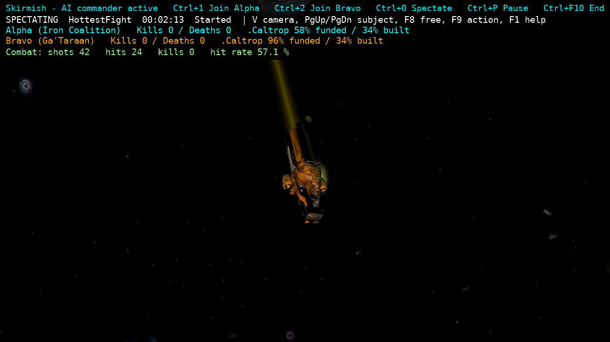

# SP-5 — offline spectating and drop-in

Working tree on `codex/sp5`, based on `a8a9eb24e04744ab788b84ffcdc83e2b96afcc1a`. No commits or pushes.

## Delivered

Skirmish setup now has **Start as spectator**. Large and Epic default to Yes; Small and Medium default to No. Every size can override the choice, and an explicit choice survives later size changes.

Spectating creates **no player connection, ship, side membership, or occupied pilot slot**. Both teams receive their full configured bot complements. The embedded host supplies detached observations to the existing client world at 10 Hz: all sectors and flying ships, station ownership/health, asteroids, warps, projectiles, missiles, probes and mines. The player identity stays null. This is an in-process capability of the owned single-player host; it adds no remote/dedicated-server spectator privilege.

The existing free-camera and inspector/orbit renderer paths provide the view. Hottest fight follows recent sampled hull/shield damage and ship-to-lifepod transitions, with a five-second minimum cut interval; ship and station selection use stable ID order and wrap in both directions. Camera selection resets stale subjects when a new mission replaces the old one. Corrected orbit integration so framing preserves the focus, the camera-relative scene is translated once, and the camera follows the same dead-reckoned pose that is drawn. Empty sectors render using a camera reference pose without creating a ship entity. Pilot HUD instruments are hidden while observing.

The overlay shows each team's kills/deaths, active research funding/build progress, the simulation match timer and stage, and available bot combat counters. This base has no SC-1-specific counter producer or schema; its existing shots/hits/kills/hit-rate telemetry is displayed. No SC-1 counters are invented.

**Join Alpha**, **Join Bravo**, and **Return to spectator** are available in the Escape menu and through the controls below. Joining first disconnects any old pilot, gracefully despawns one combat bot from the requested side, and reconnects through ordinary `POSITION_REQ`, hangar, loadout and launch. Returning restores the missing bot; switching directly between sides restores the old side before reserving the new side. The driver prefers a fighter slot and preserves the vacated hull for refill. New seat-command JSON uses generated metadata; the driver's new tool arguments use JSON nodes rather than reflected application objects. No simulation ship or loadout is transferred to the human. A seat change resumes a paused match; a choice made during intermission waits for a playable match. Pending changes are serialized and cancelled with host shutdown.

The owned host retains the selected side (or null for observer). Normal server migration retains seated peers across next-match rotation; observers continue consuming the replacement mission without being auto-seated.

## Controls

These appear in the live in-game help, including the new **LOCAL SKIRMISH** group. New seat/camera actions use the action map and can be rebound. Existing free-camera movement actions are reused.

| Default | Action |
| --- | --- |
| Ctrl+1 | Join Alpha |
| Ctrl+2 | Join Bravo |
| Ctrl+0 | Return to spectator |
| V | Hottest fight → ship → station → free camera |
| PageUp / PageDown | Next / previous ship or station in its selection mode |
| F8 / F9 | Free camera / hottest fight |
| W/A/S/D, Q/E | Free-camera movement |
| Mouse, Shift / Ctrl | Free-camera look, faster / slower movement |
| F1 / F6 | Help / rebind controls |
| Escape | Close a modal or open the menu |
| Ctrl+P / Ctrl+F10 | Pause/resume / end skirmish |

## Native evidence and deliberate local additions

Native paths were inspected under `/home/domingo/Development/Allegiance/src/`; references below are native source locations, not port line numbers.

| Rule / existing path | Native evidence | SP-5 use |
| --- | --- | --- |
| Native `c_ssObserver` is a child on a parent ship, with no turret assignment | `FedSrv/fsship.cpp:268–280`; `WinTrek/trekigc.cpp:1202–1206` | Does not masquerade as a native carrier observer; the new local view has no player ship. |
| Camera modes include orbit, station, target and command views | `WinTrek/Treki.h:112–126` | Reuses the port's existing orbit/free-camera rigs and scene renderer. |
| Native external orbit rotates around the subject and sizes its offset from the hull | `WinTrek/WinTrek.cpp:7187–7196` | Subject-centred orbit framing; local hottest-fight selection is an explicit new policy. |
| Native external station view tracks a visible target or falls back to chase | `WinTrek/WinTrek.cpp:7209–7233` | Existing station-target rendering informed the station view; unrestricted local station selection is new. |
| Native sector previews require a docked ship | `FedSrv/FedSrv.CPP:6419–6426` | Leaves remote `VIEW_CLUSTER` authorization unchanged; the embedded observer reads local snapshots. |
| Fresh seats enter the side's base/hangar | `FedSrv/fsmission.cpp:791–796` | Existing `AssignShip`/`DockInitialLoadout` and the normal client launch flow remain authoritative. |

Relevant port implementation: `SkirmishOptions.cs`, `SkirmishScreenModel.cs`, `SkirmishObservation.cs`, `SkirmishCamera.cs`, `ClientWorld.LocalObserver.cs`, `Game1.SkirmishObserver.cs`, and `tools/allegiance-mcp/SkirmishDriver.cs`.

## Offline evidence

Discovery is disabled in the skirmish config; the host and bot workers use numeric loopback addresses. The local config raises the per-IP cap to `max(64, 2 × team size + 20)`, allowing Epic's 120 bots plus worker/commander/control connections. The default public-server cap remains unchanged. A guarded Epic smoke initially exposed the old 64-connection cap; after the local fix, all three fresh Epic smokes passed with 119 bots plus a launched human pilot. Observing itself uses no socket. The intro directory scan stops when entering the local observer.

Both `unshare -rn true` and `unshare -Urn true` were rejected with **Operation not permitted** by this environment. Therefore the exact network-namespace gate cannot be claimed here. As an executable fallback, a temporary `LD_PRELOAD` guard rejects non-loopback IPv4/IPv6 connects, external DNS, and non-loopback `sendto`, while allowing local sockets and loopback (including IPv4-mapped IPv6). It is inherited by the real client, supervisor and workers. A traced real-client run reached combat and captured the screenshot below. Separate guarded live repetitions exercised shipless updates, both teams' hangar/launch flows, refill and next-match rotation successfully. The guarded Large smoke also seated a pilot, launched normally and finished with 59 bots plus the human. The guard and raw syscall trace are outside the repository.

The matching [frame metadata](SP5_assets/spectator-1280x720.json) confirms null player ship and side IDs. The [station view](SP5_assets/station-1280x720.png) and its [metadata](SP5_assets/station-1280x720.json) provide a second real-client camera capture.

## Validation

Gate results are recorded in [validation-summary.json](SP5_assets/validation-summary.json). Raw logs and TRX files are in `/tmp/allegiance-evidence/SP5/`.

| Unfiltered sweep (one invocation each) | Passed | Failed | Skipped | Disposition |
| --- | ---: | ---: | ---: | --- |
| Core | 4,878 | 1 | 0 | Existing ripcord receipt race; 3/3 isolated retries passed. |
| MonoGame | 2,432 | 2 | 3 | Two expected category-count assertions updated for the new help group; each passed 3/3. Optional asset-pack skips unchanged. |
| ClientCore | 1,383 | 1 | 1 | Existing supervisor stderr race; 3/3 retries passed. Opt-in local rotation then passed 3/3 with its flag enabled. |
| Lobby | 19 | 0 | 0 | Passed. |

The two help expectations were corrected after the unfiltered run. Final affected cases are verified separately; the full suites are not repeated. The unrelated supervisor stderr race also passed 3/3 exact-method retries. Both load failures are recorded in `docs/TEST_FLAKES.md`. All three default Meshy-pack skips were then run explicitly against the already installed pack: 3/3 per method, 9/9 total. The opt-in local 15v15 showcase rotation also passed 3/3 with `ALLEGIANCE_LIVE_P660_SHOWCASE=1`. No default skip was left unexercised.

The prescribed `~/allegiance-evidence/SP5/` destination is outside this session's writable roots. `/tmp/allegiance-evidence/SP5/` is the permitted external evidence destination; no raw logs, archives or TRX files were added to the repository.

- Whole-solution build: **0 warnings / 0 errors** (`NUGET_HTTP_CACHE_PATH=/tmp/sp5-nuget-cache dotnet build AllegianceCore.slnx --nologo`). The default NuGet HTTP cache is read-only here; moving the cache resolved the initial restore failure.
- AOT gate: not triggered; neither `src/Allegiance.Server` nor `src/Allegiance.Core` changed.
- New and affected tests: all passed exact-method isolated repetitions, three times each (39 initial invocations, 15 final new-test invocations, and 6 additional configuration/input-guard invocations). Live coverage includes null observer identity with fresh authoritative updates, both sides' stable populations, ordinary hangar/launch, pause-to-join, direct side exchange, bot refill, and retained observer/seated choices across rotation.
- Core, ClientCore and MonoGame: one unfiltered invocation each; no second full sweep. Final counts and isolated failure classifications are in the summary.
- Showcase never-parks: **5/5 passed**, in 101.98, 104.59, 99.39, 99.33 and 98.82 seconds. The dispatch base's P727 report records 5/5 passes (96.59–99.38 seconds); compare the new timings in the summary. Bot flight/simulation code is unchanged; the changed driver protocol is not used by this test.
- Real-client spectator and station screenshots: both 1280×720 PNGs, each with matching null-identity JSON. All SP-5 assets together remain below the task's 2 MB limit.
- Guarded size smokes: Large passed with 59 bots and one pilot; the final Epic verification passed 3/3 with 119 bots and one pilot. The smoke helper now reserves a pilot slot even for sizes that default to observing.
- No rig, 221, dedicated-server, commander-mode or benchmark runs were performed.
